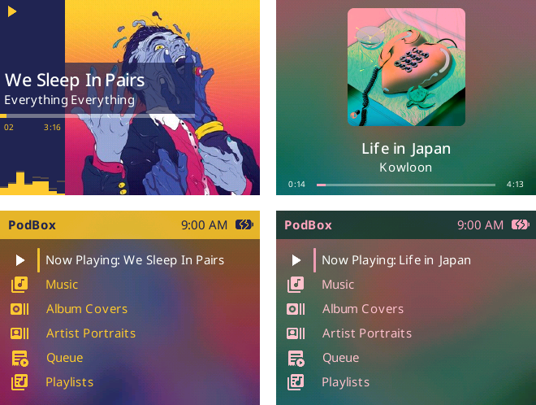
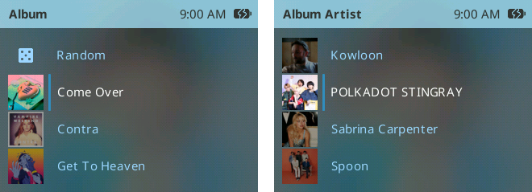
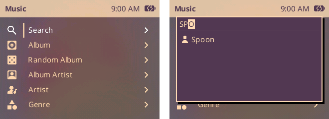
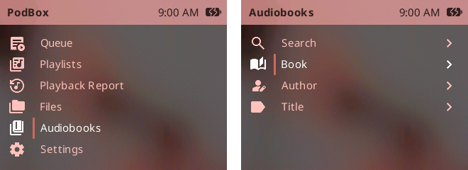
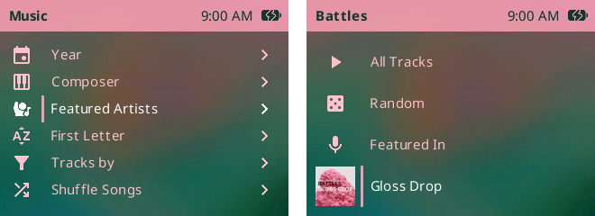
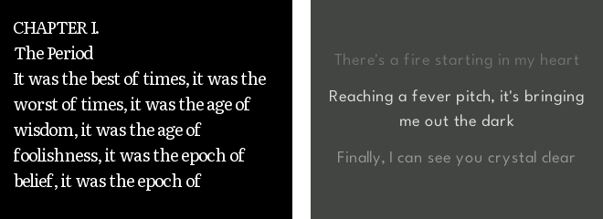
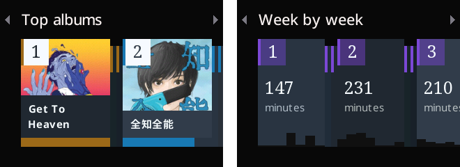
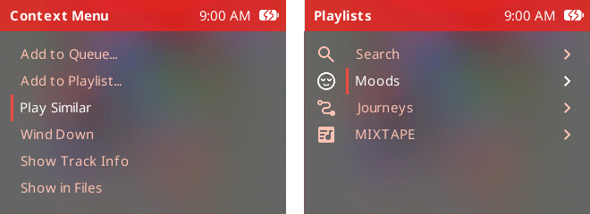
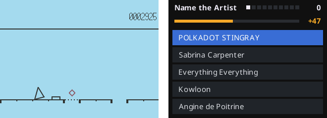
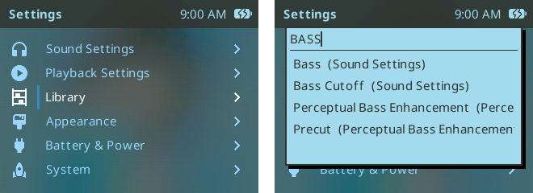

# PodBox

**PodBox is Rockbox, rebuilt for the iPod Classic and iPod Video.** Album covers and artist
photos sit beside every list, and the whole interface takes its colours from whatever is
playing. Search finds anything in your library as you type.

It goes further than the iPod ever did: build playlists from how your music actually sounds,
look back on a year of listening, read lyrics as they are sung, and keep your place in every
audiobook - all on the player, with no computer or app needed.

<a href='https://ko-fi.com/P3J3200FZY' target='_blank'></a>

# Features

## Appearance



The interface re-colours itself from the art of what is playing. PodBox ships with
[Scrim](themes/scrim/README.md), a new theme built around it, with art filters, translucent
panels and a spectrum visualiser. It comes in two variants with different Now Playing screens.

- Dynamic colours from the album or artist art, applied to every colour the theme uses
  - Theme dependent
  - `Settings > Appearance > Interface Colours > Dynamic Colors`
- Choose whether the album's lighter or darker colour becomes the background
  - `Settings > Appearance > Interface Colours > Dynamic Colors Background`
- Choose whether long text scrolls, or is cut short with "..."
  - `Settings > Appearance > Scrolling > Enabled`, on by default
- Your appearance changes are saved with the theme you made them in, so switch back to a theme
  and your changes come with it, and a theme never picks up changes made in another
  - Reset them with `Settings > Appearance > Forget My Changes`
- Choose what is on the main menu and in what order, including items promoted from the Music menu
  - `Settings > Appearance > Edit Main Menu`
- Show album art or artist art on the Now Playing screen
  - Theme dependent (the theme must show album art)
  - `Settings > Appearance > Now Playing Screen > Now Playing Artwork`
  - In Auto, the art follows how you got to the track: through `Music > Artist` shows the
    artist, through `Music > Album` shows the album
- Trim noise such as "(feat. ...)", "[Live]" or "- 2021 Remaster" from names on the Now Playing
  screen
  - Off by default. `Settings > Appearance > Now Playing Screen > Trim Titles`
  - Add your own patterns in `.rockbox/library/user/trim.txt`, which an update leaves alone
- Dialogs, splashes and prompts follow the theme, and no screen breaks out of it

## Music



Rockbox's Database menu is now **Music**, and every view in it can be switched off, reordered
or promoted onto the main menu.

- Album covers and artist photos beside their rows
  - Theme dependent
  - See [Album and artist art](#album-and-artist-art) for setting up your art
  - `Settings > Appearance > Interface Elements > Art Rows > Album Art Rows`/`Artist Art Rows`
- Show each album's release year before or after its name
  - Off by default. `Settings > Library > Music > Show Year in Album Lists`
- Sort albums by name, by year (oldest or newest first), or by artist and then name or year
  - `Settings > Library > Music > Sort > Albums By`
- Sort artists by name or by most played
  - `Settings > Library > Music > Sort > Artists By`
- Sort artists and albums ignoring a leading "The", "A" or "An"
  - Off by default. `Settings > Library > Music > Sort > Ignore The/A/An`
- Play a random album
  - `Music > Random Album`
- See your most played, most recently played and forgotten albums and artists
  - `Music > Playback History`
- See how much of an album or artist you have listened to
  - Hold `Select` on the album or artist and select `Listening Progress`
- Start a sleep timer from the Now Playing screen, with your usual length already chosen
  - Hold `Select` and select `Sleep Timer`
- Choose what is in the Music menu and in what order
  - `Settings > Library > Music > Edit Music Menu`

## Search



Results appear as you type, across tracks, albums and artists. The grid keyboard is gone,
replaced by a single-line editor driven by the click wheel.

- `Music > Search`
- Choose how results are ordered in `Settings > Library > Music > Search`

## Audiobooks



Audiobooks remember where you stopped, with no bookmarks to manage, and can live in a menu of
their own.

- Give audiobooks their own main menu entry, and keep them out of Music and the carousels
  - Off by default. `Settings > Library > Music > Segregate Audiobooks`
  - A book is a track with the genre "audiobook", "spoken word", "book", "podcast" or "podcasts"
- Book covers and author photos beside their rows
  - Theme dependent
  - Off by default. `Settings > Appearance > Interface Elements > Art Rows > Audiobook Art Rows`/`Author Art Rows`
- See which books you have finished, not started or are part-way through
  - Scroll up above the first book in `Audiobooks > Book` for `Finished`, `Not Started` and
    `In Progress`. A list with no books in it is not shown
  - Choosing a book plays it, from where you left off if you have started it
  - Hold `Select` on a book and select `Mark as...` to move it between the lists. The mark lasts
    until the book is next played
- See the chapters of a book held in a single file
  - Off by default. `Settings > Playback > Chapter Marks`
  - Reads the chapter marks in `.m4b` books and the chapter frames in `.mp3` ones
  - While a book plays, hold `Select` on the Now Playing screen and choose `Browse Chapters`

## Album Covers and Artist Portraits


Two carousels on the main menu, **Album Covers** and **Artist Portraits**, let you flick
through your library by its art. Open a cover to go into that album, or an artist to go into
their albums. Both run much faster than Rockbox's PictureFlow, particularly on the iPod Video.

- Choose whether opening an album lists its tracks or starts playing it
  - `Settings > Library > Carousel > On Album Select`
- Show the covers in 3D, or flat and face-on either side of the current one
  - `Settings > Appearance > Carousel > View Mode`
- Change the look of the covers with art filters
  - `Settings > Appearance > Carousel > Artwork Filter`
- Sort the carousels the same way as Music, or separately
  - Off by default. `Settings > Library > Carousel > Sort > Same as Music`
- Give the carousel a fixed background colour that dynamic colours leave alone
  - `Settings > Appearance > Carousel > Background > Custom`
- Spin to a random album or artist
  - Hold `Play`
  - `Settings > Library > Carousel > Random Spin Length` sets how far it spins

## Featured Artists



- See the artists featured on your tracks, and from any artist, the tracks they guest on
  - Off by default. `Settings > Library > Music > Featured Artists`
  - Then `Music > Featured Artists`
  - See [`featured-artists-guide.md`](docs/podbox/featured-artists-guide.md) for more

## Lyrics, documents and pictures



A lyrics viewer follows the song line by line. The text viewer reads txt, lrc, fb2, epub, docx,
pdf, md, html and rtf, and the image viewer is built in.

- See the lyrics of what is playing
  - Press `Select + Play` on the Now Playing screen
  - `Settings > Library > Viewers > Lyrics Viewer` for how they are shown
- Choose how documents look: font, margin, line spacing and colours
  - `Settings > Library > Viewers > Text Viewer`
- `Continue Reading` on the main menu reopens your last document where you left off
- See every document and image on the player in one list, and search them
  - Hidden by default. Add it with `Settings > Appearance > Edit Main Menu`

## Playback Report



Your year in listening, read from the player's playback log (the standard log or the Last.fm
one). Based on [Spun](https://github.com/majorsiebe/Stats_for_iPod).

- A row of cards: In Numbers, Week by Week, Top Artists, Top Songs, Top Albums, Skips and
  Achievements - plus Newly Unlocked, when you have earned something since you last looked
  - The wheel scrolls along a section, `Left`/`Right` change section
  - `Select` opens a card to show the detail behind it - the figures, who a song is by, the
    album it came from
  - `Play` on an artist, album or song card plays it
  - Hold `Menu` to pick a year, or all time, and for the settings

## Playlist engine



PodBox listens to your library and measures how each track actually sounds - its tempo,
loudness, tonal balance, key and how busy it is - then builds playlists of tracks that work
together.

- Turn it on with `Settings > Library > Playlist Engine > Enabled`, which starts the analysis.
  This takes a long time on the player; `soundscan.exe` does it much faster from a Windows PC
  (see [First run](#first-run))
- Play tracks like one you love
  - Hold `Select` on the track and select `Play Similar`
  - On an album or folder, the playlist is built around it as a whole
- Play a mood - Calm, Energetic, Dark, Warm, Punchy, Hypnotic and ten more
  - `Playlists > Moods`
- Travel from one mood to another
  - `Playlists > Journeys`
- Wind down from a track you choose, each track calmer than the last
  - Hold `Select` on the track and select `Wind Down`, then choose how long it runs: 15 minutes
    to two hours, or Default to end with your sleep timer (or at your Playlist Length)
- Order a playlist so each track leads into the next
  - Hold `Select` in the playlist viewer and select `Order by Sound`
- Keep the music going when anything runs out - an album, a saved playlist or a queue - with more
  of the same
  - `Settings > Library > Playlist Engine > Continue Playing`
- Choose whether Play Similar and Wind Down start with the track you chose
  - `Settings > Library > Playlist Engine > Play Selected First`
- See what a track sounds like, in words - its moods, energy, pace, tone, key and more
  - Hold `Select` on the track, select `Show Track Info` and open the `Sound` row
- See what an album or folder sounds like as a whole
  - Hold `Select` on it and select `Album Sound`
- See what the analysis found across your whole library: how many tracks each mood can draw on,
  and the spread of tempos, keys and loudness by decade
  - `Settings > Library > Playlist Engine > Library Sound`

## Games



**Spike** turns the song you are listening to into a game. It analyses each track's rhythm and
builds a level that moves with the beat, getting harder as you go.
[Watch it](docs/podbox/videos/spike_game.mp4).

The **Music Quiz** tests how well you know your library. A clip plays from partway through a
song, and you name the track, artist, album or year from five options before the points drain
away.

- Spike: on the Now Playing screen, hold `Select` and select `Play with Spike`
- Music Quiz: `Music > Quiz`
  - Choose which questions it asks in `Settings > Library > Music > Quiz Questions`
  - Remove it from the menu with `Settings > Library > Music > Edit Music Menu`

## Language

- Everything PodBox adds is translated into English (US), Deutsch, Français, Español, Italiano,
  Nederlands, Português (Brasil), Polski, Svenska, 日本語 and 简体中文
  - `Settings > System > Language & Text > Language`
  - Other languages show Rockbox's own translations, with PodBox's additions in English
  - Achievement names and descriptions in the Playback Report stay in English
- These translations were made with AI, with little human oversight, and no native speaker has
  checked them yet. Expect some wording that is wrong, awkward or too long for the screen
  - If you find one, please [open an issue](https://github.com/anthonyfletcher/podbox/issues)
    with the language, where the text appears and what it should say
- Replace any on-screen text with your own
  - See [`language-override-guide.md`](docs/podbox/language-override-guide.md)

## Settings



Settings are regrouped into Sound, Playback, Library, Appearance, Battery & Power and System,
and every one of them can explain itself. See [`settings-guide.md`](docs/podbox/settings-guide.md)
for the full list.

- Find a setting by name or by what it does
  - `Settings > Search` (scroll up from the top of Settings)
- Hide the settings most people never change
  - `Settings > Settings Mode`: `Standard` or `Everything`
- See every setting you have changed in one list
  - `Settings > Changed Settings`
- Read what a setting does
  - Hold `Select` on it and select `Explain`
- Shut down or restart from the menu
  - `Settings > System > Startup/Shutdown`

## Behind the scenes

- Faster, more capable decoding
  - PodBox decodes 24-bit FLAC and ALAC with ARM assembly, so hi-res files take less of the
    processor, and seeks correctly in `.m4b` audiobooks over 27 hours long
  - From Rockbox: faster FLAC, Opus and APE decoding plus DSD (`.dsf`/`.dff`) playback
- Art is cached at the sizes the screens use, so lists and carousels stay smooth
  - `Settings > Library > Art Cache` for settings
  - `Settings > Library > Maintenance > Update Art Cache`/`Rebuild Art Cache`
  - `System > Background Tasks` to see what it is doing
- Album and artist lists come straight from the database held in memory, so Album Covers, the
  charts and Random Album open quickly
- Your library data - database, play history and caches - lives in `.rockbox/library/`
- `Back` and `Menu` behave the same way in every menu
- Message, input, confirmation, search, colour, date and time and folder dialogs share one
  themed design
  - `Settings > Appearance > Dialogs`
- PodBox works with docks, receivers, USB DACs, computers, the earphone remote and some modern
  cars - see [Connectivity](#connectivity)
- New theme tags for richer graphics and easier theme building
  - See [`custom-skin-tags.md`](docs/podbox/custom-skin-tags.md)

---

# Installation

## Does it run on my iPod?

| iPod | Generation | Years |
|---|---|---|
| **iPod Classic** | 6th / 7th gen | 2007–2014 |
| **iPod Video** | 5th / 5.5th gen | 2005–2006 |

Nothing else — not the Nano, Mini, Shuffle or Touch. If you have one of those,
you want [Rockbox](https://www.rockbox.org) itself, which supports 80+ players.

## Installing PodBox

> **New to Rockbox?** A player that has never run Rockbox needs its bootloader installed once
> first. That is a separate step, not covered here: follow the
> [Rockbox installation guide](https://www.rockbox.org/manual.shtml) for your model. If you
> already run Rockbox or RockPod, skip this.

Download the zip for your player from the
[latest release](https://github.com/anthonyfletcher/podbox/releases/tag/latest) —
`rockbox-ipod6g.zip` for the Classic, `rockbox-ipodvideo-5g.zip` for the Video — and unzip it
into the root of the iPod's disk, so that the `.rockbox` folder sits alongside your music.

Updating is the same: unzip the new release over the old one. **If you use any of the
[extra themes](#installing-themes), update them at the same time** — they are rebuilt for each
release, and a theme made for new firmware can fail on old firmware.

The zips include three Windows tools (see [First run](#first-run)). If your browser or
antivirus blocks them, the `-no-tools` zips are the same without them.

> **Optional: the PodBox bootloader.** With it the player starts PodBox even
> when the hold switch is on, and holding Menu as it starts gives you Apple's
> firmware. Download `podbox-bootloader.zip` from the
> [Bootloader release](https://github.com/anthonyfletcher/podbox/releases/tag/Bootloader),
> unzip it on a Windows PC and follow its `README.txt`. It installs over the
> Rockbox bootloader.

To try PodBox before installing it, the
[Simulator release](https://github.com/anthonyfletcher/podbox/releases/tag/Simulator) runs it in
a window on a Windows PC.

## Coming from Rockbox or RockPod

- **There are no plugins.** The viewers you need are built in; the games and other plugins are
  gone
- **The Database menu is now Music**
- **PodBox builds its own library database** in `.rockbox/library/`, the first time it starts.
  Rockbox's desktop database tool does not write it - use `database_pb.exe` (see
  [First run](#first-run))
- **Any Rockbox theme works**, but without changes it will not show dynamic colours or art in
  lists
- **Settings have moved.** Use `Settings > Search` to find one

# Setting up your music library

For best results, your music library should be set up in the following structure:

```text
Artist One
├── Album One
│   ├── 01 Track.flac
│   ├── 01 Track.lrc
│   ├── 02 Track.flac
│   ├── ...
│   └── folder.jpg
├── Album Two
│   └── ...
└── folder.jpg
Artist Two
└── Album One
    └── ...
Artist Three
└── Album One
    └── ...
```
## Album and artist art

Album art goes with the album's tracks as `folder.jpg` or `cover.jpg`, e.g.
`Artist/Album/folder.jpg`, or embedded in the tracks themselves. The image file is used first,
and the embedded cover when there is none; `Settings > Library > Art Cache > Album Art Source`
changes that order, or limits the cache to one kind.

Artist art goes in the artist's folder as `folder.jpg` or `cover.jpg`, e.g.
`Artist/folder.jpg`. Artist art only ever comes from image files. An artist folder with no image
of its own borrows one from the folder above it, so if your albums are grouped one level deeper,
as in `Artist/Albums/Album One`, artist art can stay in `Artist/folder.jpg`; an image in the
grouping folder (`Artist/Albums/folder.jpg`) takes precedence for the albums under it.

All artwork should be:

- a JPEG (baseline or progressive).
- embedded as JPEG, if embedded at all. PNG art in tags is skipped. The cache reads the art from
  only one track per album, so put the cover in every track.
- a sensible size - the cache stores 300x300px copies, and anything much larger takes longer to
  process.

Artwork is processed quietly in the background while the database is idle, so browsing stays
fast, but it can take a while for art to appear. `System > Background Tasks` shows what the cache
is doing. After adding art to your tags, run `Settings > Library > Maintenance > Update Art Cache`
to pick it up.

To fill your library with album and artist art, try
[rockbox-library-manager](https://github.com/cyberdeliaAI/rockbox-library-manager), or the
command-line [art_fetch](tools/art_fetch/README.md).

## Lyrics

Lyrics are found when they are:

- embedded in your audio files, or stored beside the track with the same name and a different
  extension, e.g. `Artist/Album/01 Track.lrc`
- in a `.lrc`, `.lrc8` or `.snc` file

# First run

The first time PodBox starts, it builds your music database and art cache in the background,
which slows things down for a while (particularly on the iPod Video). `System > Background Tasks`
shows how far it has got.

All three jobs below run much faster from a Windows PC. Connect the iPod after PodBox has started
at least once, and run the tools from `.rockbox/tools/` in a command prompt:

1. **`database_pb.exe`** builds the database. It does what
   `Settings > Library > Maintenance > Update Database` does, keeping play counts, ratings and
   positions; `database_pb.exe --rebuild` does what `Rebuild Database` does. When you eject the
   iPod it restarts itself to load the new database.
2. **`artcache_pb.exe`** builds the art cache - run it after `database_pb.exe` if you have added
   music. It does what `Update Art Cache` does, and `artcache_pb.exe --rebuild` what
   `Rebuild Art Cache` does.
3. **`soundscan.exe`** analyses your music for the [playlist engine](#playlist-engine), in about
   an hour rather than many on the player. Then turn the engine on with
   `Settings > Library > Playlist Engine > Enabled`.

# Installing themes

Scrim, the theme PodBox ships with, gets the most out of it. Any Rockbox theme works, but without
changes it will not show dynamic colours or art in lists.

More [themes](themes/README.md) made for PodBox are a separate download, one zip each or all of
them in `all-themes.zip`, from the
[Themes release](https://github.com/anthonyfletcher/podbox/releases/tag/Themes):

- [themify 2](themes/themify_2/README.md)
- [obsede 2](themes/obsede_2/README.md)
- [bony](themes/bony/README.md)
- [iclassic square](themes/iclassic_square/README.md) - classic, dark and light
- [jive](themes/jive/README.md)

Unzip onto the root of the iPod, the same way you installed PodBox, then pick
it under `Settings > Appearance > Load Theme`. Each zip carries the fonts its theme needs, so
they can be installed in any order and on their own.

**Update your themes whenever you update PodBox.** Themes are rebuilt for each release, and a
theme made for new firmware can fail on old firmware.

---

# Connectivity

Everything below works on both the iPod Video and the iPod Classic, apart from the earphone
remote (see [Headphones](#headphones-improved)), but it has been tested with only a small number
of accessories. If you'd like to help with testing, please follow
[this guide](docs/podbox/connectivity-testing-guide.md).

The USB and accessory settings below are under `Settings > System`, and some are shown only with
`Settings > Settings Mode` set to `Everything`.

### Sound card (New)


Your iPod can act as a sound card - the computer plays through the iPod, out of its headphone
socket, using the iPod's DAC.
- Tested on Windows, macOS and Ubuntu
- `Settings > System > USB > USB Sound Card` - off by default; turning it on can need a restart

### USB Host (New)


Your iPod can output to a USB DAC - the iPod sends its audio digitally over USB to a
headphone amp or DAC, which does the conversion instead of the iPod.
- `Settings > System > USB > USB DAC Output > Start Automatically` - on by default - or `Turn On`
  for a DAC with its own power supply that doesn't power the iPod
- The iPod supplies no power over USB, so the DAC needs its own supply - or you can use a
  USB splitter with a charger connected
- Most USB audio DACs should work; ones that only offer rates other than 44.1 and 48
  kHz will not
- A DAC also works through a USB hub; the iPod uses the first device it finds on the hub

### Docks and receivers (Improved)


Your iPod can send digital audio to a dock that takes it over the USB pins of the dock
connector.
- On by default, through `Settings > System > Accessories > Accessory Protocol`
- Works with `Settings > System > USB > USB Mode` set to either `Mass Storage` or `Charge Only`
- Remote support improved to match click-wheel actions
- If an accessory takes control but plays nothing, try another model under
  `Settings > System > Accessories > Identify As` - some judge what a player can do by its model

A receiver or dock that browses an iPod shows what is playing and can browse
and play your library from its own screen and remote
- Artist, album and title of the playing track
- Playlists, Artists, Albums, Genres, Composers and Songs, as far as the
  accessory offers them, sorted the way the Music menu sorts them
- `Settings > System > Accessories > Accessory Browsing` sets how many songs a list can hold -
  10,000 by default.

Your iPod can mirror its screen on a TV - through a dock with a video output
- `Settings > System > Accessories > TV Out > Turn On` - always off after a restart
- `Size` - `1x` (sharp, in the middle of the TV) or `2x` (fills most of it)
- `Standard` - PAL or NTSC, iPod Video only
- On an iPod Video the iPod's own screen goes black while it's on

### Modern Cars (New/Experimental)


A car that takes an iPhone over USB, but no longer an iPod, can now connect to your iPod. The iPod
speaks iAP2, the protocol an iPhone uses, and the car plays it as a USB media source - not CarPlay.
- Plays through the car's speakers, with the car's own buttons and steering-wheel controls for
  play, pause, skip, shuffle and repeat.
- Title, artist, album, cover art and a moving progress bar on the car's screen
- Your whole library in the car's own browser - pick an artist, album, playlist or song there and the iPod
  plays it
- `Settings > System > Accessories > Support iPhone Accessories` - `Auto` by default. Auto recognises a car,
  and a computer still mounts the iPod as a disk, about a second later than it otherwise would.
  Shown only while `Accessory Protocol` is on
- `Settings > System > Accessories > Accessory Artwork` specifies where the cover comes from.
  `Prefer Cache` by default, which appears almost at once. `As Album Art`, `Prefer Embedded` and
  `Prefer Image File` send the original image - sharper, but slower to appear and more work for a 5G.
  Only JPEGs under 512 KB are sent as they are. A dock or older car gets the art cache's cover
  whichever is chosen; `Off` sends no cover to anything

A car stereo that plays music from USB drives, but does not see the iPod, may read it with
`Settings > System > USB > USB Mode` set to `Drive Only`. Docks and cars that play from the iPod
over USB do not work until it is set back.

### Headphones (Improved)


You can control your iPod using the earphone remote (supported on the iPod classic
120GB - Late 2008 and 160GB - Late 2009 thin versions only)
- Works on all types of headphones - not just the Apple earpods.
- Click for play/pause, two clicks for the next track, three for the previous
  one, and the volume buttons
- Always on. The multi-click skips are `Settings > System > Accessories > Remote Track Skip`, on
  by default; turning it off makes play/pause react quicker

---

# Reporting a problem

Please [open an issue](https://github.com/anthonyfletcher/podbox/issues). For anything you can
make happen again, a log helps a great deal: switch on the matching one in
`Settings > System > Debug Logs` (database, album art, USB and accessories, battery, playback
errors, theme or background tasks), make the problem happen, and attach the file from
`.rockbox/logs/`, along with any `.1` file beside it. The logs switch themselves off after a
while.

# Technical details

See [`technically-curious.md`](docs/podbox/technically-curious.md) for the history of PodBox and
how to build your own version.

Theme builders: see [`theme-guide.md`](docs/podbox/theme-guide.md) for guidance on creating
themes for PodBox.

# Credits and licence

## Licence

Rockbox, RockPod and additions by PodBox are licensed under the [GNU General Public License v2.0](https://www.gnu.org/licenses/old-licenses/gpl-2.0.html).

Imported code governed by a previous licence is listed in
[`docs/LICENSES`](docs/LICENSES); the fonts and themes this fork adds are
credited below, each with a link to its full licence text.

## Development credits

This project has been developed with extensive AI assistance. I am a software developer, 
although C is not my primary language. I have driven the project's architecture, feature 
design, specifications, implementation approach, testing, debugging, and iteration. AI 
has been used as a development tool to assist with the C implementation, generate and 
explore solutions, and accelerate development. The resulting code is reviewed, tested, 
and iterated by me rather than being accepted as unreviewed generated output.

This is a hobby project, built because I wanted a version of Rockbox that better suited 
how I use my iPod. I'm sharing it in the hope that others might find it useful too.

Built on the work of:
- the [Rockbox](https://www.rockbox.org/) project
- the [RockPod](https://github.com/nuxcodes/rockpod) project (Nux Li: aka [@nuxcodes](https://github.com/nuxcodes)),
  the starting point for the app layer, the iPod hardware work in `firmware/`, and much of
  the serial accessory protocol
- the [Spun](https://github.com/majorsiebe/Stats_for_iPod) project (Siebe Majoor: aka [@majorsiebe](https://github.com/majorsiebe))

## Other credits

### Themes

- Themify 2
  - Created by: Evan Kenny aka [Dook](https://d00k.net/)
  - License: CC BY-SA 3.0 (https://creativecommons.org/licenses/by-sa/3.0/deed.en)
- Obsede' 2
  - Created by: Serge Fahnenstell
  - License: CC BY-SA 3.0 (https://creativecommons.org/licenses/by-sa/3.0/deed.en)
- Bony
  - Based on BONES created by: Chuck Lardo
  - License: CC BY-SA 4.0 (https://creativecommons.org/licenses/by-sa/4.0/deed.en)
- iClassic Square (and its Dark and Light versions)
  - Created by: Humberto Santana
  - License: CC BY-SA 3.0 (https://creativecommons.org/licenses/by-sa/3.0/deed.en)
- Jive
  - Created by: James Stevenson
  - License: CC BY-SA 3.0 (https://creativecommons.org/licenses/by-sa/3.0/deed.en)

### Fonts

Each theme carries the full licence text of the fonts it ships, beside them in
its own `.rockbox/fonts/`. The links below point at one copy of each.

- Material Design Icons
  - Created by Google (https://fonts.google.com/icons)
  - Licensed under the Apache License Version 2.0 —
    [full text](themes/scrim/.rockbox/fonts/LICENSE-Material-Design-Icons.txt)
- Noto Sans/Serif Font
  - Copyright 2022 The Noto Project Authors (https://github.com/notofonts/latin-greek-cyrillic)
  - Noto Sans built from MicroNotoSans - a fork of Noto Sans by Evan Kenny aka [Dook](https://d00k.net/)
  - Copyright 2026 Micro Noto Sans Authors (https://github.com/D0-0K/MicroNotoSans)
  - Licensed under the SIL Open Font License, Version 1.1 —
    [full text](themes/scrim/.rockbox/fonts/LICENSE-Noto.txt)
- Seven Fifteen Font
  - Copyright Douglas Vautour (https://burpyfresh.itch.io/seven-fifteen-font)
  - Bundled together with UnifontEX, a fork of GNU Unifont maintained by stgiga
    (https://github.com/stgiga/UnifontEX), which draws the scripts Seven Fifteen
    does not cover
  - Seven Fifteen licensed under CC BY-SA 4.0; UnifontEX under the GNU General
    Public License version 2 or later with the GNU font embedding exception, or
    the SIL Open Font License version 1.1 —
    [full text](themes/scrim/.rockbox/fonts/LICENSE-Seven-Fifteen.txt)
- League Spartan Font
  - Copyright 2020 The League Spartan Project Authors (https://github.com/theleagueof/league-spartan)
  - Copyright 2022 The Noto Project Authors (https://github.com/notofonts/devanagari)
  - Copyright 2026 Micro Noto Sans Authors (https://github.com/D0-0K/MicroNotoSans)
  - Licensed under the SIL Open Font License, Version 1.1 —
    [full text](themes/themify_2/.rockbox/fonts/LICENSE-LeagueSpartan.txt)
- ProFont Font
  - Copyright 2014 Andrew Welch, Carl R. Osterwald, Stephen C. Gilardi
  - Licensed under the MIT License —
    [full text](themes/bony/.rockbox/fonts/LICENSE-ProFont.txt)

### Docks, receivers and remotes (iAP)

Thank you to the following, whose code or findings the dock and remote support is built on.
Which came from where is in [`iap-sources.md`](docs/podbox/iap-sources.md).

- RockPod by Nux Li aka [@nuxcodes](https://github.com/nuxcodes) (https://github.com/nuxcodes/rockpod)
  - The serial accessory protocol overhaul: identification, playback control, notifications,
    volume, chapters, authentication and album art
- Paul Sauro's Rockbox changes 7900, 7906, 7938 and 7940 (https://gerrit.rockbox.org)
  - Digital audio to docks: rate changes, charge-only mode and seeking from a remote
- libiap by mojyack (https://github.com/mojyack/libiap)
  - The USB accessory protocol core
- ipod-gadget and ipod by Andrew Onyshchuk aka [@oandrew](https://github.com/oandrew)
  (https://github.com/oandrew/ipod-gadget)
  - How cars behave, and the identities behind `Identify As`

### Modern cars (iAP2)

Thank you to the following sources, which supplied facts about the protocol - message numbers,
layouts and behaviour to support the iAP2 development. Which fact came from where is in
[`iap2-sources.md`](docs/podbox/iap2-sources.md).

- carplayd by lvalen91 (https://github.com/lvalen91/carplayd)
  - The message table and the order of authentication and identification
- Nocturne by the Nocturne team (https://github.com/usenocturne/nocturne)
  - Now playing, the car's buttons and file transfers
- carplay-wifi-extractor by HaToan (https://github.com/HaToan/carplay-wifi-extractor)
  - The phone's side of the conversation
- JJTech0130's iAP2 gists (`carkit_iap2.py`, the `iap2.lua` Wireshark dissector)
  - The message names, and how to talk iAP2 to a real iPhone
- Adam Bell, "McLarens and CarPlay" (https://blog.adambell.ca)
  - Showed that a device can stand in for an iPhone in a car
- usbmuxd from libimobiledevice (https://github.com/libimobiledevice/usbmuxd)
  - Apple's USB mode requests
- pymobiledevice3 by doronz88 (https://github.com/doronz88/pymobiledevice3)
  - Fetched the iPhone's logs of its conversation with the car

### Spike Video

- Song: Gabriawll - Recall
- Music provided by NoCopyrightSounds
- Free Download/Stream: http://ncs.io/Recall
- Watch: http://ncs.lnk.to/RecallAT/youtube

### Album Artwork

- Angine de Poitrine - Vol.II - [Website](https://anginedepoitrine.com/)
  - Artwork: Arielle Corbeau - [Website](https://www.instagram.com/ariellecorbeau)
- Battles - Glass Drop - [Website](https://battles.warp.net/)
  - Artwork: Lesley Unruh - [Website](http://www.unruhphoto.com)
- Everything Everything - Get To Heaven - [Website](https://everything-everything.co.uk/)
  - Artwork: Andrew Archer - [Website](https://www.andrewarcher.com)
- Kowloon - Come Over - [Website](https://www.kowloonkowloon.com/)
  - Artwork: Ram Han - [Website](https://www.instagram.com/ram__han/)
- POLKADOT STINGRAY - 全知全能 - [Website](https://polkadot-stingray.jp/)
  - Artwork: Shizuku (雫) - [Website](https://www.instagram.com/plkshizuku/)
- Sabrina Carpenter - Man's Best Friend - [Website](https://www.sabrinacarpenter.com/)
  - Artwork: Bryce Anderson - [Website](https://www.instagram.com/brvceanderson)
- Spoon - Hot Thoughts - [Website](http://spoontheband.com/)
  - Artwork: Christine Messersmith
- Vampire Weekend - Contra - [Website](http://vampireweekend.com/)
  - Artwork: Complicated  
