<h1>
  <picture>
    <source media="(prefers-color-scheme: dark)" srcset="docs/podbox/images/logo/podbox-horizontal-on-dark.svg">
    
  </picture>
</h1>

**PodBox is Rockbox, reworked for the iPod Classic and iPod Video.** Album covers and artist
photos sit beside every list, and the whole interface takes its colours from whatever is
playing.

It goes further than the iPod ever did: build playlists from how your music actually sounds,
look back on a year of listening, read lyrics as they are sung, keep your place in every
audiobook, and play games made for the click wheel - all on the player.

<a href='https://ko-fi.com/P3J3200FZY' target='_blank'></a>

# Features

## Appearance

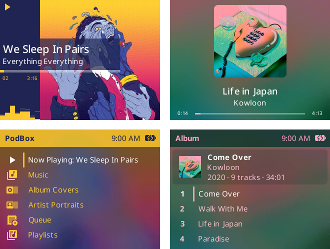

The interface re-colours itself from the art of what is playing. PodBox ships with
[Scrim](themes/scrim/README.md), a new theme built around it, with art filters, translucent
panels and a spectrum visualiser. It comes in two variants with different Now Playing screens.

> **Find more themes in [Discussions](https://github.com/anthonyfletcher/podbox/discussions/categories/themes)**,
> where people share the themes they make. The [extra themes](#installing-themes) made for PodBox
> are a separate download.

- Dynamic colours from the album or artist art, applied to every colour the theme uses
  - Theme dependent
  - `Settings > Appearance > Interface Colours > Dynamic Colors`
- Choose whether the album's lighter or darker colour becomes the background
  - `Settings > Appearance > Interface Colours > Dynamic Colors Background`
- Choose whether long text scrolls, or is cut short with "..."
  - `Settings > Appearance > Scrolling > Enabled`, on by default
- Your appearance changes are saved with the theme you made them in, so switch back to a theme
  and your changes come with it, and a theme never picks up changes made in another
  - Reset them with `Settings > Appearance > Forget My Changes`
- Choose what is on the main menu and in what order, including items promoted from the Music menu
  - `Settings > Appearance > Menus > Edit Main Menu`
- Choose what is in the Music menu and all the context menus
  - `Settings > Appearance > Menus`
- Change a theme's configuration on the player
  - `Settings > Appearance > Theme Options`, when the theme offers them.
  - Put an option on a Now Playing button: hold `Select` on it, select `Assign to Button`, then
    set a button to `Theme Toggle`. Each press moves it to its next choice
- Show album art or artist art on the Now Playing screen
  - Theme dependent (the theme must show album art)
  - `Settings > Appearance > Now Playing Screen > Now Playing Artwork`
  - In Auto, the art follows how you got to the track: through `Music > Artist` shows the
    artist, through `Music > Album` shows the album
- Trim noise such as "(feat. ...)", "[Live]" or "- 2021 Remaster" from names on the Now Playing
  screen
  - Off by default. `Settings > Appearance > Now Playing Screen > Trim Titles`
  - Add your own patterns in `.rockbox/library/user/trim.txt`, which an update leaves alone
- Choose what Select, Menu, a long press of Play, and Select and Play together do on the Now
  Playing screen: go back to where the music was started, open the queue, the lyrics, Music or
  Album Covers, go to the playing album, add the track to a playlist, stop, and more
  - `Settings > Playback > Now Playing Screen > Select Action`, `Menu Action`,
    `Long Press Play Action` and `Select + Play Action`
  - `Go to Album Via` chooses whether the album opens on its own or inside Music
- Message, input, confirmation, search, colour, date and time and folder dialogs share one
  themed design
  - `Settings > Appearance > Dialogs`
- Hold `Select` on a track, folder or file and select `Select...`
  - Click `Select` to tick or untick a row; hold `Select` and turn the wheel to tick a run of
    rows, and turn back to untick them
  - `Play/Pause` opens a menu for the ticked rows: play them, queue them or add them to a
    playlist; in the Queue, `Move Here` puts them after the selected track and `Remove` takes
    them out; in `Files`, `Cut`, `Copy` and `Delete`
  - `Menu` leaves without doing anything
- `Back` and `Menu` behave the same way in every menu

## Music

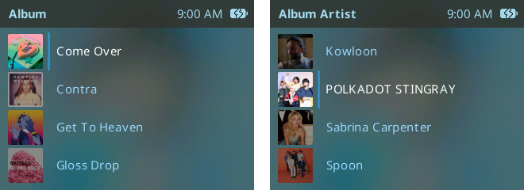

Rockbox's Database menu is now **Music**, and every view in it can be switched off, reordered
or promoted onto the main menu.

- Album covers and artist photos beside their rows
  - Theme dependent
  - See [Artwork](#artwork) for setting up your art
  - `Settings > Appearance > Interface Elements > Art Rows > Album Art Rows`/`Artist Art Rows`
- Show each album's release year before or after its name
  - Off by default. `Settings > Library > Music > Show Year in Album Lists`
- Sort albums by name, by year (oldest or newest first), or by artist and then name or year
  - `Settings > Library > Music > Sort > Albums By`
- Sort artists by name or by most played
  - `Settings > Library > Music > Sort > Artists By`
- Sort artists and albums ignoring a leading "The", "A" or "An"
  - Off by default. `Settings > Library > Music > Sort > Ignore The/A/An`
- Play a random album
  - `Music > Random Album`
- Shuffle albums rather than tracks: every album in a list, in a random order, each whole and in
  order
  - `[Shuffle Albums]` at the top of any list of two or more albums
- Hide the [All Tracks], [Random] and [Shuffle Albums] rows at the top of the Music lists
  - `Settings > Library > Music > Extra Rows`
  - Hiding [All Tracks] only hides the row: playing an artist or genre from its menu still
    plays every track
- See an album's cover, artist, year, track count and length above its tracks
  - Theme dependent. Scrim shows it, and `Album Header` in its Theme Options turns it off
- See your most played, most recently played and forgotten albums and artists
  - `Music > Playback History`
- See how much of an album or artist you have listened to
  - Hold `Select` on the album or artist and select `Listening Progress`
- Start a sleep timer from the Now Playing screen, with your usual length already chosen
  - Hold `Select` and select `Sleep Timer`
- Add your own views to the Music menu or an artist's groupings above their albums
  - See [`music-menu-guide.md`](docs/podbox/music-menu-guide.md)

## Search

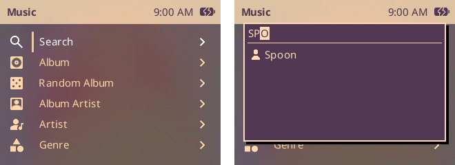

Results appear as you type, across tracks, albums and artists. The grid keyboard is gone,
replaced by a single-line editor driven by the click wheel.

- `Music > Search`
- Choose how results are ordered in `Settings > Library > Search`

## Audiobooks

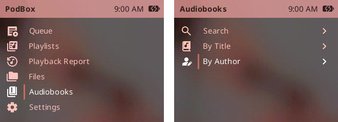

Audiobooks remember where you stopped, with nothing to save by hand, and can live in a menu of
their own.

- Give audiobooks their own main menu entry, and keep them out of Music and the carousels
  - `Auto` by default, whenever there are audiobooks. `Settings > Library > Music > Segregate Audiobooks`
  - A book is a track whose genre contains "audiobook", "audio book" or "spoken word", or is
    "book", "books", "spoken" or "speech"
- Book covers and author photos beside their rows
  - Theme dependent
  - `Settings > Appearance > Interface Elements > Art Rows > Audiobook Art Rows` (on by default)/`Audiobook Author Art Rows`
- See which books you have finished, not started or are part-way through
  - `Audiobooks` opens on `In Progress`, with `Search` and `Finished` above it and `Not Started`,
    `By Title`, `By Author`, `By Series` and `Listening Stats` below. A list with no books in it
    is not shown, and `By Series` only appears once a book has a series
  - Choosing a book plays it, from where you left off if you have started it
  - Hold `Select` on a book and select `Mark as...` to move it between the lists. The mark lasts
    until the book is next played. The same menu has `Listening Stats`, `Book Info` and
    `Show in Files`
- See how long you have listened to a book, how long is left at your speed, when you started and
  finished it, your longest sitting and your best streak of days
  - Hold `Select` on a book or a podcast show and select `Listening Stats`; every book's
    together is at the foot of `Audiobooks`, every show's at the foot of `Podcasts`, and a
    book's chapters not yet heard are listed below its figures
- Books in a series together, in the order they came out
  - `Audiobooks > By Series`. The series is the grouping tag; give each book of a series the
    same one, with no number in it
  - `Book Info` shows the grouping as `Series`, and the composer as `Narrator`
- Bookmark places in a book to come back to
  - While a book plays, hold `Select` and select `More... > Create Bookmark`
  - A book with bookmarks has a `Bookmarks` row in its menu, in Now Playing's `More...` and when
    you hold `Select` on the book. Choosing one plays the book from there; hold `Select` on one to
    delete it
- See the chapters of a book held in a single file
  - On by default for audiobooks and podcasts. `Settings > Playback > Chapter Marks`
  - Reads the chapter marks in `.m4b` books and the chapter frames in `.mp3` ones
  - While a book plays, hold `Select` on the Now Playing screen and choose `Browse Chapters`
- Play audiobooks and podcasts faster or slower without changing the voice, and leave music as it is
  - `Settings > Playback > Spoken Word Speed`, or hold `Select` on the Now Playing screen
- Skip a fixed time in a book rather than a whole track
  - `Settings > Playback > Spoken Word Skip Length`. Follows `Skip Length` until you set it
- Hear a few seconds again when you come back to a book, and leave music where it stopped
  - `Settings > Playback > Fast-Forward/Rewind > Spoken Word Rewind Before Resume` and
    `Spoken Word Rewind on Pause`. Each follows its music setting until you set it
- Fall asleep at the end of a chapter
  - While a book plays, hold `Select` on the Now Playing screen, choose `Sleep Timer` and then
    `End of Chapter`

## Podcasts

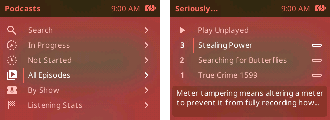

Each episode keeps its place, and a show opens on its newest episode.

- Give podcasts their own main menu entry, and keep them out of Music and the carousels
  - `Auto` by default, whenever there are podcasts. `Settings > Library > Music > Segregate Podcasts`
  - A podcast is a track with the genre "podcast" or "podcasts"
- Shows listed by name, or the show with the newest episode first
  - `Settings > Library > Music > Sort > Shows By`
- `Podcasts` opens on `In Progress`, with `Search` and `Finished` above it and `Not Started`,
  `All Episodes`, `By Show` and `Listening Stats` below. A list with no episodes in it is not
  shown
- A show opens on its newest episode, with `[Play Unplayed]` above it
- An episode's notes under the list
  - Theme dependent. Scrim shows them, and `Episode Notes` in its Theme Options turns them off
- Hold `Select` on an episode for `Mark as...` (`Finished` or `Not started`) and
  `Mark Older as Finished`, and on a show for `Mark All as Finished`,
  `Delete Finished Episodes` and, when other shows have some too, `Delete All Finished Episodes`
- Show art beside the rows
  - Theme dependent
  - `Settings > Appearance > Interface Elements > Art Rows > Podcast Art Rows` (on by default)
- Choose whether Search lists matching episodes or shows first
  - `Settings > Library > Search > Podcast Order`

## Album Covers and Artist Portraits


Two carousels on the main menu, **Album Covers** and **Artist Portraits**, let you flick
through your library by its art. Open a cover to go into that album, or an artist to go into
their albums. Both run much faster than Rockbox's PictureFlow, particularly on the iPod Video.

- Choose whether opening an album lists its tracks or starts playing it
  - `Settings > Library > Carousel > On Album Select`
- Show the covers in 3D, or flat and face-on either side of the current one
  - `Settings > Appearance > Carousel > View Mode`
- Change the look of the covers with art filters
  - `Settings > Appearance > Carousel > Artwork Filter`
- Sort the carousels the same way as Music, or separately
  - Off by default. `Settings > Library > Carousel > Sort > Same as Music`
- Give the carousel a fixed background colour that dynamic colours leave alone
  - `Settings > Appearance > Carousel > Background > Custom`
- Spin to a random album or artist
  - Hold `Play`
  - `Settings > Library > Carousel > Random Spin Length` sets how far it spins
- Show an artist's latest album cover when you have no photo of them
  - Off by default. `Settings > Appearance > Interface Elements > Art Rows > Album Cover If No Photo`

## Featured Artists

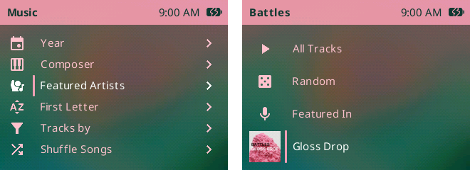

- See the artists featured on your tracks, and from any artist, the tracks they guest on
  - Off by default. `Settings > Library > Music > Featured Artists`
  - Then `Music > Featured Artists`
  - See [`featured-artists-guide.md`](docs/podbox/featured-artists-guide.md) for more

## Lyrics, documents and pictures


A lyrics viewer follows the song line by line. The text viewer reads txt, lrc, fb2, epub, mobi,
azw3, pdb, docx, pdf, md, html and rtf, and the image viewer shows JPEG (including CMYK), PNG,
GIF, WebP and BMP pictures.

- See the lyrics of what is playing
  - Press `Select + Play` on the Now Playing screen
  - `Settings > Library > Viewers > Lyrics Viewer` for how they are shown
- Choose how documents look: font, text size, margin, line spacing, justification, paragraph
  indent and colours
  - `Settings > Library > Viewers > Text Viewer`
  - `Larger Text` and `Smaller Text` step through the sizes the font comes in
  - The backlight can stay on while you read, with a brightness of its own:
    `Reading Backlight` and `Reading Brightness`
- `Continue Reading` on the main menu reopens your last document where you left off
- `Books` on the main menu shows every EPUB, FB2 and Kindle (MOBI, AZW3) book on the player,
  with its cover
  - A MOBI locked to a Kindle account will not open
  - Opens on `In Progress`, as `Audiobooks` does, with `Search` and `Finished` above it and
    `Not Started` below. `Search` finds books by title or author. `In Progress` and `Finished`
    list the book you read last first
  - Press `>>|` on a book's last page and it closes, shown in `Finished`
  - `By Title`, `By Author`, `By Subject` for the subjects the books name, each book under
    every one of its subjects, and `By Series` for the series they name, in their order
  - Hold `Select` on a book for `Mark as...`, which moves it between the lists, `Browse Chapters`,
    `Bookmarks`, `Book Info`, `Reading Stats` and `Show in Files`
  - Bookmark a page: hold `Menu` while reading and select `Create Bookmark`; `Bookmarks` in the
    same menu, or on the book's menu, goes back to one, and holding `Select` on one deletes it
  - `Reading Stats`, on a book's menu or at the foot of `Books`, shows your time reading, pages a day, reading speed in words a minute, the
    time left at that speed, when you started and finished, your longest sitting and your best
    streak of days, for one book or for all of them. A page flicked past, or read again in the
    same sitting, does not count
  - See pictures inside books
- Zoom into a picture and move around it
  - Hold `Menu` in the image viewer and select `Zoom` for a list of zoom levels
  - Hold `Select`, or select `Pan` in the same menu, to switch pan mode on: the wheel moves the
    picture up and down and `|<<` and `>>|` move it sideways. Click `Menu` to switch it off
- Footnotes are taken out of the text, and each reference reads as `[1]`. Hold `Select` on a
  page to read the notes it refers to
- A book's cover is its first page, and its pictures each have a page of their own
  - On by default. `Settings > Library > Viewers > Text Viewer > Pictures`
- Hold `|<<` for the start of the chapter and `>>|` for the next one
- Read holding the player sideways in one hand, turning pages with `Play` and `Menu`
  - `Settings > Library > Viewers > Text Viewer > Reading Orientation`, or double-click
    `Play` on an upright page
  - The button at the top works as `Menu` does upright: click it to leave, hold it for the
    settings. Double-click the button at the bottom to swap hands, and hold it to stand the
    page upright again. Hold the page-turning buttons to move by chapters
- Turn the wheel to move through the book a percent at a time; `Select` goes there, any other
  button stays put
  - Off by default. `Settings > Library > Viewers > Text Viewer > Wheel Scrubs`
- See every document and every image on the player in a list of each, search them, and list
  them by type
  - Hidden by default. Add it with `Settings > Appearance > Menus > Edit Main Menu`

## Playback Report

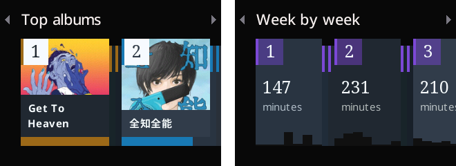

Your year in listening, like the summaries streaming services send at the end of the year, worked
out on the player from what it has logged. Based on [Spun](https://github.com/majorsiebe/Stats_for_iPod).

- `Playback Report` on the main menu
  - It reads the log that `Settings > Playback > Logging` writes, on by default: the standard
    playback log, or the Last.fm scrobbler log if you log that instead
  - It counts your whole history, from the first entry of the log.
- The report is a row of cards in sections. The wheel scrolls along a section, and `Left`/`Right`
  move between sections
  - **In Numbers** - minutes listened, plays, different tracks, plays skipped and your peak hour,
    then charts of what you play in the morning, afternoon, evening and at night, and how often
    you are still listening after midnight
  - **Week by Week** - how many weeks had music, your best day, your longest run of days in a
    row, then a card for every week with its minutes and a chart of its seven days
  - **Top Artists**, **Top Songs** and **Top Albums** - your top ten of each, with their
    artwork, ranked by plays or by minutes
  - **Skips** - the share of plays you skipped, the songs you skip most, and your most-played
    songs that you have never skipped. A play counts as skipped if you stopped it after
    5 seconds but before half the song (or 4 minutes) had played
  - **Achievements** - 340 badges for milestones in minutes, plays, skips, the number of
    different songs, artists and albums, night listening, streaks and record days. Each shows
    the date you earned it, and the next badge in each series shows how close you are.
    Badges count your whole history, whatever year is on screen
  - **Newly Unlocked** - first in the row, when you have earned badges since you last looked
- `Select` opens a card to show the detail behind it
  - An artist: their minutes, plays, songs and skips, and their top album and song
  - A song: who it is by, the album it is from and its figures
  - A week: its figures, top artist and top song
  - A badge: what it is for, and when you earned it
- `Play` on an artist, album or song plays it: all of an artist's tracks, an album in order, or
  the one song
- Hold `Menu` to choose a year or All Time, and for the settings

## Playlist engine

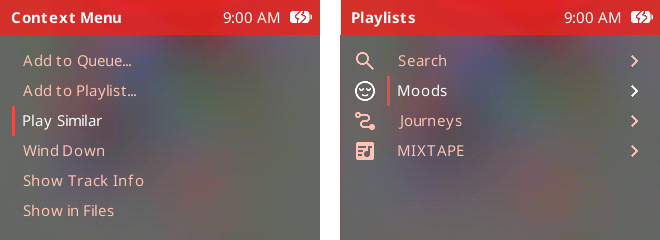

PodBox listens to your library and measures how each track actually sounds - its tempo,
loudness, tonal balance, key and how busy it is - then builds playlists of tracks that work
together.

- Turn it on with `Settings > Library > Playlist Engine > Enabled`, which starts the analysis.
  This takes a long time on the player; `soundscan.exe` does it much faster from a Windows PC
  (see [First run](#first-run))
- Play tracks like one you love
  - Hold `Select` on the track and select `Play Similar`
  - On an album or folder, the playlist is built around it as a whole
- Play a mood - Calm, Energetic, Dark, Warm, Punchy, Hypnotic and ten more
  - `Playlists > Moods`
- Travel from one mood to another
  - `Playlists > Journeys`
- Wind down from a track you choose, each track calmer than the last
  - Hold `Select` on the track and select `Wind Down`, then choose how long it runs: 15 minutes
    to two hours, or Default to end with your sleep timer (or at your Playlist Length)
- Order a playlist so each track leads into the next
  - Hold `Select` in the playlist viewer and select `More... > Order by Sound`
- Keep the music going when anything runs out - an album, a saved playlist or a queue - with more
  of the same
  - `Settings > Library > Playlist Engine > Continue Playing`
- Choose whether Play Similar and Wind Down start with the track you chose
  - `Settings > Library > Playlist Engine > Play Selected First`
- See what a track sounds like, in words - its moods, energy, pace, tone, key and more
  - Hold `Select` on the track, select `Show Track Info` and open the `Sound` row
- See what an album or folder sounds like as a whole
  - Hold `Select` on it and select `Album Sound`
- See what the analysis found across your whole library: how many tracks each mood can draw on,
  and the spread of tempos, keys and loudness by decade
  - `Settings > Library > Playlist Engine > Library Sound`

## Equalizer

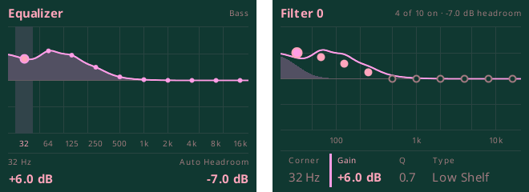

The equalizer is drawn as a curve, the sound it really makes, and you shape it while the music
plays. Simple mode gives ten bands to raise and lower; Enhanced mode sets each band's frequency,
Q and type as well.

- `Settings > Sound > Equalizer > Edit EQ`
  - The wheel sets a band's gain, `Left`/`Right` choose the band
  - In Enhanced mode, `Select` moves between gain, frequency, Q and type
  - Hold `Play` to hear the music without the EQ, and let go to hear it again
  - Hold `Menu` for presets, saving, resetting, Auto Headroom and Enhanced Mode
- Six built-in presets - Flat, Bass, Treble, Vocal, Loudness and Spoken - each played as you
  scroll past it, then any you have saved
  - `Settings > Sound > Equalizer > EQ Presets`
- Boosting does not clip: Auto Headroom (on by default) turns the equalizer down by its highest
  boost, and shows by how much
- Play 16-bit files bit for bit: with `Settings > Sound > Dithering` on `Auto` and
  `Settings > Playback > Replaygain > Replaygain Type` on `Off` (both the default on a new
  install), a 16-bit file reaches the DAC exactly as it is in the file

## Games

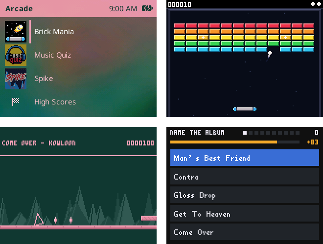

The main menu's **Arcade** holds the games, each with its logo, and every game's high scores.

> **Find more games in [Discussions](https://github.com/anthonyfletcher/podbox/discussions/categories/games)**,
> where players share the games they make. Download a game's `.pbg` file and copy it anywhere onto
> the iPod; it appears in the Arcade once the iPod is ejected.

**Spike** turns the song you are listening to into a game. It finds the beat of whatever is
playing and builds a level that moves with it: press `Select` on the beat to jump gaps and
creatures, onto platforms and springs.

The **Music Quiz** tests how well you know your library. A clip plays from partway through a
song, and you name the track, artist, album or year from five options before the points drain
away.

**Brick Mania** is a bat-and-ball game for the click wheel: ten levels of bricks, power-ups to
catch, and a combo for every brick broken without touching the paddle.

- Play: `Arcade`, then the game
  - Hold `Select` on a game for its high scores, its help, or to delete a saved game
- Press `Menu` to quit. A game you quit is marked `Paused` and starts again where you left it
- Hold `Menu` to pause: the game's own options, its high scores and help, and the music's
  controls
  - Turn `Game Sound` off there to hear only your music
- See every game's best scores and achievements in `Arcade > High Scores`
- Remove the Arcade from the main menu with `Settings > Appearance > Menus > Edit Main Menu`

### Making your own

Games are written in a small part of JavaScript, with their sprites, maps and sound effects
made alongside the code.

- [The Arcade IDE](https://anthonyfletcher.github.io/podbox/ide/) runs in a browser with nothing
  to install: write, draw, run and save a game, and share it as a web page
  - Chrome or Edge edit a game's folder in place; other browsers save a copy
- Keep a game on GitHub by making a repository from the
  [podbox-game](https://github.com/anthonyfletcher/podbox-game) template: every push builds it
  into a `.pbg`
- [The manual](arcade/manual/README.md) teaches it a chapter at a time, and describes every
  function
- The command-line compiler and runners are in [`arcade/sdk`](arcade/sdk/README.md)
- Share what you make in
  [Discussions](https://github.com/anthonyfletcher/podbox/discussions/categories/games)

## Settings

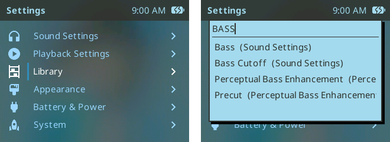

Settings are regrouped into Sound, Playback, Library, Appearance, Battery & Power and System,
and every one of them can explain itself. See [`settings-guide.md`](docs/podbox/settings-guide.md)
for the full list.

- Find a setting by name or by what it does
  - `Settings > Search` (scroll up from the top of Settings)
- Hide the settings most people never change
  - `Settings > Settings Mode`: `Standard` or `Everything`
- See every setting you have changed in one list
  - `Settings > Changed Settings`
- Read what a setting does
  - Hold `Select` on it and select `Explain`
- Shut down or restart from the menu
  - `Settings > System > Startup/Shutdown`

## Language and Voice

- Everything PodBox adds is translated into English (US), Deutsch, Français, Español, Italiano,
  Nederlands, Português (Brasil), Polski, Svenska, 日本語 and 简体中文
  - `Settings > System > Language & Text > Language`
  - Other languages show Rockbox's own translations, with PodBox's additions in English
  - Achievement names and descriptions in the Playback Report stay in English
- These translations were made with AI, with little human oversight, and no native speaker has
  checked them yet. Expect some wording that is wrong, awkward or too long for the screen
  - If you find one, please [open an issue](https://github.com/anthonyfletcher/podbox/issues)
    with the language, where the text appears and what it should say
- Replace any on-screen text with your own
  - See [`language-override-guide.md`](docs/podbox/language-override-guide.md)
- Have the player speak, with a synthesised voice built into the firmware: menus, settings and dialogs,
  and the names of your artists, albums, tracks and files - no voice file needed
  - Turn the voice on with `Settings > System > Language & Text > Voice > Speak Aloud`
  - Choose how fast it speaks with `Speech Rate`
- Hear what you are typing: each letter as you choose it, and the whole text when you hold
  `Select`
- Hear a list's title as you go into it
  - `Settings > System > Language & Text > Voice > Say List Titles`
- Hear each new track's title and artist, over the music or with the music paused
  - `Settings > System > Language & Text > Voice > Announce Track Change`
- Have documents read aloud, a page at a time or straight through, turning the pages as it goes
  - `Settings > Library > Viewers > Text Viewer > Read Aloud`
- Play the Music Quiz by ear: the question and the five answers are read before the clip plays
- The built-in voice reads English. Names in other Latin-alphabet languages are read as English
  would read them; Greek, Cyrillic and Japanese kana are read from their letters; other scripts,
  such as Chinese or Arabic, are named rather than read
- Rockbox voice files are also supported, with higher quality output but limited range to language
  strings
  - Choose one with `Settings > System > Language & Text > Voice > Voice`: `Voice File for Menus`
    speaks the menus in it and names in the built-in voice, `Voice File Only` uses it alone

## Performance improvements

- Faster decoding with more ARM assembly resulting in less CPU usage - particularly beneficial for the iPod Video
- Faster equalizer, Auditory Fatigue Reduction and Perceptual Bass Enhancement with more ARM
  assembly resulting in less CPU usage - again - particularly beneficial for the iPod Video
- Art is cached at the sizes the screens use, so lists and carousels stay smooth
  - `Settings > Library > Art Cache` for settings
  - `Settings > Library > Maintenance > Update Art Cache`/`Rebuild Art Cache`
  - `System > Background Tasks` to see what it is doing
- The iPod Video's screen is updated by a second DMA engine while music plays, leaving more of
  the CPU to the decoder
- Album and artist lists come straight from the database held in memory, so Album Covers, the
  charts and Random Album open quickly

---

# Installation

## Does it run on my iPod?

| iPod | Generation | Years |
|---|---|---|
| **iPod Classic** | 6th / 7th gen | 2007–2014 |
| **iPod Video** | 5th / 5.5th gen | 2005–2006 |

Nothing else — not the Nano, Mini, Shuffle or Touch. If you have one of those,
you want [Rockbox](https://www.rockbox.org) itself, which supports 80+ players.

## Installing PodBox

> **New to Rockbox?** A player that has never run Rockbox needs its bootloader installed once
> first. That is a separate step, not covered here: follow the
> [Rockbox installation guide](https://www.rockbox.org/manual.shtml) for your model. If you
> already run Rockbox or RockPod, skip this.

Download the zip for your player from the
[latest release](https://github.com/anthonyfletcher/podbox/releases/tag/latest) —
`rockbox-ipod6g.zip` for the Classic, `rockbox-ipodvideo-5g.zip` for the Video — and unzip it
into the root of the iPod's disk, so that the `.rockbox` folder sits alongside your music.

Updating is the same: unzip the new release over the old one. **If you use any of the
[extra themes](#installing-themes), update them at the same time** — they are rebuilt for each
release, and a theme made for new firmware can fail on old firmware.

The zips include three Windows tools (see [First run](#first-run)). If your browser or
antivirus blocks them, the `-no-tools` zips are the same without them.

> **Optional: the PodBox bootloader.** With it the player starts PodBox even
> when the hold switch is on, and holding Menu as it starts gives you Apple's
> firmware. Download `podbox-bootloader.zip` from the
> [Bootloader release](https://github.com/anthonyfletcher/podbox/releases/tag/Bootloader),
> unzip it on a Windows PC and follow its `README.txt`. It installs over the
> Rockbox bootloader.

To try PodBox before installing it, the
[Simulator release](https://github.com/anthonyfletcher/podbox/releases/tag/Simulator) runs it in
a window on a Windows PC.

## Coming from Rockbox or RockPod

- **There are no plugins.** The viewers you need are built in, and PodBox has its own games, in
  the [Arcade](#games); Rockbox's games and other plugins are gone
- **PodBox builds its own library database** in `.rockbox/library/`, the first time it starts.
  Rockbox's desktop database tool does not write it - use `database_pb.exe` (see
  [First run](#first-run))
- **Any Rockbox theme works**, but without changes it will not show dynamic colours or art in
  lists
- **Settings have moved.** Use `Settings > Search` to find one

# Setting up your music library

For best results, your music library should be set up in the following structure:

```text
Artist One
├── Album One
│   ├── 01 Track.flac
│   ├── 01 Track.lrc
│   ├── 02 Track.flac
│   ├── ...
│   └── folder.jpg
├── Album Two
│   └── ...
└── folder.jpg
Artist Two
└── Album One
    └── ...
Artist Three
└── Album One
    └── ...
```

Audiobooks and podcasts follow the same shape, with the author or host in place of the artist
and the book or show in place of the album. Give each book its own folder, whether it is one
file or many, with its cover in it.

```text
Audiobooks
├── Frank Herbert
│   ├── Dune
│   │   ├── 01 Chapter One.mp3
│   │   ├── 02 Chapter Two.mp3
│   │   ├── ...
│   │   └── folder.jpg
│   ├── Dune Messiah
│   │   └── Dune Messiah.m4b
│   └── folder.jpg
Podcasts
└── Show Name
    ├── Episode One.mp3
    ├── Episode Two.mp3
    ├── ...
    └── folder.jpg
```

What makes a book or a podcast is its tags, not its folder:

- the genre is "audiobook", "spoken word" or "book" for a book, and "podcast" or "podcasts" for
  a podcast
- the album is the book's title or the show's name, on every track
- the album artist is the author or the host
- an episode's place in its show comes from its title (`S01E04`, `Episode 12`, `#12` or a
  date), else its full release date or a date in its file name, else its track number if no
  other episode of the show has the same one, else when the file arrived
- a book in one file (`.m4b`, or `.mp3` with chapter frames) shows its chapters, with
  `Settings > Playback > Chapter Marks` on

EPUB, FB2 and MOBI books can be anywhere on the disk, and their title and author come from the book
itself. An image named after a book is its cover, in place of the one inside it:

```text
Books
├── Frank Herbert
│   ├── Dune.epub
│   ├── Dune.jpg            (optional: replaces the cover inside the book)
│   └── Dune Messiah.epub
└── Ursula K. Le Guin
    └── The Dispossessed.epub
```

## Artwork

Put the art beside your files, as the layouts above show:

- a cover as `folder.jpg` in its album's, book's or show's folder, or embedded in its files
- an artist's or author's picture as `folder.jpg` in their folder

All artwork should be:

- a JPEG (baseline or progressive), PNG, GIF, WebP or BMP file. JPEG is the quickest to process.
- embedded as JPEG or PNG, if embedded at all - the cache reads the art from only one track per
  album, so put the cover in every track.
- a sensible size - the cache stores 300x300px copies, and anything much larger takes longer to
  process.

Artwork is processed quietly in the background while the database is idle, so browsing stays
fast, but it can take a while for art to appear. `System > Background Tasks` shows what the cache
is doing. After adding art, run `Settings > Library > Maintenance > Update Art Cache` to pick it
up.

Art can also be kept in one folder of its own, away from your music, and a library laid out
differently still finds its art: see the [Artwork guide](docs/podbox/artwork-guide.md).

To fill your library with album and artist art, try
[rockbox-library-manager](https://github.com/cyberdeliaAI/rockbox-library-manager), or the
command-line [art_fetch](tools/art_fetch/README.md).

## Lyrics

Lyrics are found when they are:

- embedded in your audio files, or stored beside the track with the same name and a different
  extension, e.g. `Artist/Album/01 Track.lrc`
- in a `.lrc`, `.lrc8` or `.snc` file

# First run

The first time PodBox starts, it builds your music database and art cache in the background,
which slows things down for a while (particularly on the iPod Video). `System > Background Tasks`
shows how far it has got.

All three jobs below run much faster from a Windows PC. Connect the iPod after PodBox has started
at least once, and run the tools from `.rockbox/tools/` in a command prompt:

1. **`database_pb.exe`** builds the database. It does what
   `Settings > Library > Maintenance > Update Database` does, keeping play counts, ratings and
   positions; `database_pb.exe --rebuild` does what `Rebuild Database` does. When you eject the
   iPod it restarts itself to load the new database.
2. **`artcache_pb.exe`** builds the art cache - run it after `database_pb.exe` if you have added
   music. It does what `Update Art Cache` does, and `artcache_pb.exe --rebuild` what
   `Rebuild Art Cache` does.
3. **`soundscan.exe`** analyses your music for the [playlist engine](#playlist-engine), in about
   an hour rather than many on the player. Then turn the engine on with
   `Settings > Library > Playlist Engine > Enabled`.

# Installing themes

Scrim, the theme PodBox ships with, gets the most out of it. Any Rockbox theme works, but without
changes it will not show dynamic colours or art in lists.

More [themes](themes/README.md) made for PodBox are a separate download, one zip each or all of
them in `all-themes.zip`, from the
[Themes release](https://github.com/anthonyfletcher/podbox/releases/tag/Themes):

- [themify 2](themes/themify_2/README.md)
- [obsede 2](themes/obsede_2/README.md)
- [bony](themes/bony/README.md)
- [iclassic square](themes/iclassic_square/README.md) - classic, dark and light
- [jive](themes/jive/README.md)

Unzip onto the root of the iPod, the same way you installed PodBox, then pick
it under `Settings > Appearance > Load Theme`. Each zip carries the fonts its theme needs, so
they can be installed in any order and on their own.

**Update your themes whenever you update PodBox.** Themes are rebuilt for each release, and a
theme made for new firmware can fail on old firmware.

> **Find more themes in [Discussions](https://github.com/anthonyfletcher/podbox/discussions/categories/themes)**,
> where people share the themes they make.

---

# Connectivity

Everything below works on both the iPod Video and the iPod Classic, apart from the earphone
remote (see [Headphones](#headphones-improved)), but it has been tested with only a small number
of accessories. If you'd like to help with testing, please follow
[this guide](docs/podbox/connectivity-testing-guide.md).

The USB and accessory settings below are under `Settings > System`, and some are shown only with
`Settings > Settings Mode` set to `Everything`.

### Sound card (New)


Your iPod can act as a sound card - the computer plays through the iPod, out of its headphone
socket, using the iPod's DAC.
- Tested on Windows, macOS and Ubuntu
- `Settings > System > USB > USB Sound Card` - off by default; turning it on can need a restart
- The click wheel sets the iPod's volume while the computer plays through it

### USB Host (New)


Your iPod can output to a USB DAC - the iPod sends its audio digitally over USB to a
headphone amp or DAC, which does the conversion instead of the iPod.
- `Settings > System > USB > USB DAC Output > Start Automatically` - on by default - or `Turn On`
  for a DAC with its own power supply that doesn't power the iPod
- The iPod supplies no power over USB, so the DAC needs its own supply - or you can use a
  USB splitter with a charger connected
- Most USB audio DACs should work; ones that only offer rates other than 44.1 and 48
  kHz will not
- A DAC also works through a USB hub; the iPod uses the first device it finds on the hub

### Docks and receivers (Improved)


Your iPod can send digital audio to a dock that takes it over the USB pins of the dock
connector.
- On by default, through `Settings > System > Accessories > Accessory Protocol`
- Works with `Settings > System > USB > USB Mode` set to either `Mass Storage` or `Charge Only`
- Remote support improved to match click-wheel actions
- If an accessory takes control but plays nothing, try another model under
  `Settings > System > Accessories > Identify As` - some judge what a player can do by its model

A receiver or dock that browses an iPod shows what is playing and can browse
and play your library from its own screen and remote
- Artist, album and title of the playing track
- Playlists, Artists, Albums, Genres, Composers and Songs, as far as the
  accessory offers them, sorted the way the Music menu sorts them
- `Settings > System > Accessories > Accessory Browsing` sets how many songs a list can hold -
  10,000 by default.

Your iPod can mirror its screen on a TV - through a dock with a video output
- `Settings > System > Accessories > TV Out > Turn On` - always off after a restart
- `Size` - `1x` (sharp, in the middle of the TV) or `2x` (fills most of it)
- `Standard` - PAL or NTSC, iPod Video only
- On an iPod Video the iPod's own screen goes black while it's on

### Modern Cars (New/Experimental)


A car that takes an iPhone over USB, but no longer an iPod, can now connect to your iPod. The iPod
speaks iAP2, the protocol an iPhone uses, and the car plays it as a USB media source - not CarPlay.
- Plays through the car's speakers, with the car's own buttons and steering-wheel controls for
  play, pause, skip, shuffle and repeat.
- Title, artist, album, cover art and a moving progress bar on the car's screen
- Your whole library in the car's own browser - pick an artist, album, playlist or song there and the iPod
  plays it
- `Settings > System > Accessories > Support iPhone Accessories` - `Auto` by default. Auto recognises a car,
  and a computer still mounts the iPod as a disk, about a second later than it otherwise would.
  Shown only while `Accessory Protocol` is on
- `Settings > System > Accessories > Accessory Artwork` specifies where the cover comes from.
  `Prefer Cache` by default, which appears almost at once. `As Album Art`, `Prefer Embedded` and
  `Prefer Image File` send the original image - sharper, but slower to appear and more work for a iPod Video.
  Only JPEGs under 512 KB are sent as they are. A dock or older car gets the art cache's cover
  whichever is chosen; `Off` sends no cover to anything

A car stereo that plays music from USB drives, but does not see the iPod, may read it with
`Settings > System > USB > USB Mode` set to `Drive Only`. Docks and cars that play from the iPod
over USB do not work until it is set back.

### Headphones (Improved)


You can control your iPod using the earphone remote (supported on the iPod classic
120GB - Late 2008 and 160GB - Late 2009 thin versions only)
- Works on all types of headphones - not just the Apple earpods.
- Click for play/pause, two clicks for the next track, three for the previous
  one, and the volume buttons
- Always on. The multi-click skips are `Settings > System > Accessories > Remote Track Skip`, on
  by default; turning it off makes play/pause react quicker

---

# Reporting a problem

Please [open an issue](https://github.com/anthonyfletcher/podbox/issues). For anything you can
make happen again, a log helps a great deal: switch on the matching one in
`Settings > System > Debug Logs` (database, album art, USB and accessories, battery, playback
errors, theme or background tasks), make the problem happen, and attach the file from
`.rockbox/logs/`, along with any `.1` file beside it. The logs switch themselves off after a
while.

# Technical details

See [`technically-curious.md`](docs/podbox/technically-curious.md) for the history of PodBox and
how to build your own version.

Theme builders: see [`theme-guide.md`](docs/podbox/theme-guide.md) for guidance on creating
themes for PodBox.

# Credits and licence

## Licence

Rockbox, RockPod and additions by PodBox are licensed under the [GNU General Public License v2.0](https://www.gnu.org/licenses/old-licenses/gpl-2.0.html).

Imported code governed by a previous licence is listed in
[`docs/LICENSES`](docs/LICENSES); the fonts and themes this fork adds are
credited below, each with a link to its full licence text.

## Development credits

This project has been developed with extensive AI assistance. I am a software developer, 
although C is not my primary language. I have driven the project's architecture, feature 
design, specifications, implementation approach, testing, debugging, and iteration. AI 
has been used as a development tool to assist with the C implementation, generate and 
explore solutions, and accelerate development. The resulting code is reviewed, tested, 
and iterated by me rather than being accepted as unreviewed generated output.

This is a hobby project, built because I wanted a version of Rockbox that better suited 
how I use my iPod. I'm sharing it in the hope that others might find it useful too.

Built on the work of:
- the [Rockbox](https://www.rockbox.org/) project
- the [RockPod](https://github.com/nuxcodes/rockpod) project (Nux Li: aka [@nuxcodes](https://github.com/nuxcodes)),
  the starting point for the app layer, the iPod hardware work in `firmware/`, and much of
  the serial accessory protocol
- the [Spun](https://github.com/majorsiebe/Stats_for_iPod) project (Siebe Majoor: aka [@majorsiebe](https://github.com/majorsiebe))

## Other credits

### Themes

- Themify 2
  - Created by: Evan Kenny aka [Dook](https://d00k.net/)
  - License: CC BY-SA 3.0 (https://creativecommons.org/licenses/by-sa/3.0/deed.en)
- Obsede' 2
  - Created by: Serge Fahnenstell
  - License: CC BY-SA 3.0 (https://creativecommons.org/licenses/by-sa/3.0/deed.en)
- Bony
  - Based on BONES created by: Chuck Lardo
  - License: CC BY-SA 4.0 (https://creativecommons.org/licenses/by-sa/4.0/deed.en)
- iClassic Square (and its Dark and Light versions)
  - Created by: Humberto Santana
  - License: CC BY-SA 3.0 (https://creativecommons.org/licenses/by-sa/3.0/deed.en)
- Jive
  - Created by: James Stevenson
  - License: CC BY-SA 3.0 (https://creativecommons.org/licenses/by-sa/3.0/deed.en)

### Fonts

Each theme carries the full licence text of the fonts it ships, beside them in
its own `.rockbox/fonts/`. The links below point at one copy of each.

- Material Design Icons
  - Created by Google (https://fonts.google.com/icons)
  - Licensed under the Apache License Version 2.0 —
    [full text](themes/scrim/.rockbox/fonts/LICENSE-Material-Design-Icons.txt)
- Noto Sans/Serif Font
  - Copyright 2022 The Noto Project Authors (https://github.com/notofonts/latin-greek-cyrillic)
  - Noto Sans built from MicroNotoSans - a fork of Noto Sans by Evan Kenny aka [Dook](https://d00k.net/)
  - Copyright 2026 Micro Noto Sans Authors (https://github.com/D0-0K/MicroNotoSans)
  - Licensed under the SIL Open Font License, Version 1.1 —
    [full text](themes/scrim/.rockbox/fonts/LICENSE-Noto.txt)
- Seven Fifteen Font
  - Copyright Douglas Vautour (https://burpyfresh.itch.io/seven-fifteen-font)
  - Bundled together with UnifontEX, a fork of GNU Unifont maintained by stgiga
    (https://github.com/stgiga/UnifontEX), which draws the scripts Seven Fifteen
    does not cover
  - Seven Fifteen licensed under CC BY-SA 4.0; UnifontEX under the GNU General
    Public License version 2 or later with the GNU font embedding exception, or
    the SIL Open Font License version 1.1 —
    [full text](themes/scrim/.rockbox/fonts/LICENSE-Seven-Fifteen.txt)
- League Spartan Font
  - Copyright 2020 The League Spartan Project Authors (https://github.com/theleagueof/league-spartan)
  - Copyright 2022 The Noto Project Authors (https://github.com/notofonts/devanagari)
  - Copyright 2026 Micro Noto Sans Authors (https://github.com/D0-0K/MicroNotoSans)
  - Licensed under the SIL Open Font License, Version 1.1 —
    [full text](themes/themify_2/.rockbox/fonts/LICENSE-LeagueSpartan.txt)
- ProFont Font
  - Copyright 2014 Andrew Welch, Carl R. Osterwald, Stephen C. Gilardi
  - Licensed under the MIT License —
    [full text](themes/bony/.rockbox/fonts/LICENSE-ProFont.txt)
- Fusion Pixel Font, the games' text font
  - Copyright 2022 TakWolf (https://github.com/TakWolf/fusion-pixel-font)
  - Drawn with Galmuri (Lee Minseo), Miseki Bitmap (Mark Li), BoutiqueBitmap7x7
    (Luke Liu) and Misaki (Num Kadoma)
  - Licensed under the SIL Open Font License, Version 1.1, and Misaki under its
    own free licence — [full text](arcade/sdk/fonts/LICENSE-world.txt)

### The Arcade IDE

The Arcade's game editor, in `arcade/sdk/`, is built with these projects. The
licences of all the code it takes in are kept in full in the built file.

- [CodeMirror](https://codemirror.net) and [Lezer](https://lezer.codemirror.net),
  the code editor
  - Copyright Marijn Haverbeke and others; Lezer's JSON grammar Arun Srinivasan
  - Licensed under the MIT License
- [Acorn](https://github.com/acornjs/acorn), which reads a game's code
  - Copyright its contributors
  - Licensed under the MIT License
- [dockview](https://dockview.dev), the panels
  - Copyright mathuo
  - Licensed under the MIT License
- [fflate](https://github.com/101arrowz/fflate), compression
  - Copyright Arjun Barrett
  - Licensed under the MIT License
- [Lucide](https://lucide.dev), the icons
  - Copyright Lucide Contributors, and Cole Bemis for the Feather icons it began from
  - Licensed under the ISC License
- [sfxr](https://www.drpetter.se/project_sfxr.html), the sound generators
  - Copyright 2007 Tomas Pettersson
  - Licensed under the MIT License
- [wasi-libc](https://github.com/WebAssembly/wasi-libc), a few C library routines
  in the engine the editor and exported web pages run
  - Copyright the wasi-libc contributors, with parts from musl (Rich Felker, et al.)
    and cloudlibc (Nuxi)
  - Licensed under the MIT License, musl's parts under the MIT License and
    cloudlibc's under the BSD 2-Clause License —
    [full text](arcade/sdk/wasm/LICENSE-libc.txt)
- [esbuild](https://esbuild.github.io), which builds the editor
  - Copyright Evan Wallace
  - Licensed under the MIT License

### Docks, receivers and remotes (iAP)

Thank you to the following, whose code or findings the dock and remote support is built on.
Which came from where is in [`iap-sources.md`](docs/podbox/iap-sources.md).

- RockPod by Nux Li aka [@nuxcodes](https://github.com/nuxcodes) (https://github.com/nuxcodes/rockpod)
  - The serial accessory protocol overhaul: identification, playback control, notifications,
    volume, chapters, authentication and album art
- Paul Sauro's Rockbox changes 7900, 7906, 7938 and 7940 (https://gerrit.rockbox.org)
  - Digital audio to docks: rate changes, charge-only mode and seeking from a remote
- libiap by mojyack (https://github.com/mojyack/libiap)
  - The USB accessory protocol core
- ipod-gadget and ipod by Andrew Onyshchuk aka [@oandrew](https://github.com/oandrew)
  (https://github.com/oandrew/ipod-gadget)
  - How cars behave, and the identities behind `Identify As`

### Modern cars (iAP2)

Thank you to the following sources, which supplied facts about the protocol - message numbers,
layouts and behaviour to support the iAP2 development. Which fact came from where is in
[`iap2-sources.md`](docs/podbox/iap2-sources.md).

- carplayd by lvalen91 (https://github.com/lvalen91/carplayd)
  - The message table and the order of authentication and identification
- Nocturne by the Nocturne team (https://github.com/usenocturne/nocturne)
  - Now playing, the car's buttons and file transfers
- carplay-wifi-extractor by HaToan (https://github.com/HaToan/carplay-wifi-extractor)
  - The phone's side of the conversation
- JJTech0130's iAP2 gists (`carkit_iap2.py`, the `iap2.lua` Wireshark dissector)
  - The message names, and how to talk iAP2 to a real iPhone
- Adam Bell, "McLarens and CarPlay" (https://blog.adambell.ca)
  - Showed that a device can stand in for an iPhone in a car
- usbmuxd from libimobiledevice (https://github.com/libimobiledevice/usbmuxd)
  - Apple's USB mode requests
- pymobiledevice3 by doronz88 (https://github.com/doronz88/pymobiledevice3)
  - Fetched the iPhone's logs of its conversation with the car

### Speech

- NV Speech Player by NV Access (https://github.com/nvaccess/NVSpeechPlayer), GPL v2
  - The synthesiser and its rules for rhythm, ported to whole-number arithmetic for the iPod;
    based on Dennis Klatt's formant synthesiser
- The CMU Pronouncing Dictionary by Carnegie Mellon University
  (https://github.com/cmusphinx/cmudict), BSD licence, shipped as
  `.rockbox/speech/LICENSE-cmudict.txt`
  - How the words it holds are said
- "Automatic Translation of English Text to Phonetics by Means of Letter-to-Sound Rules", NRL
  Report 7948 (Elovitz, Johnson, McHugh and Shore, 1976), in John A. Wasser's public-domain
  transcription
  - How the words the dictionary lacks are said

### Other improvements

- ProkBox5g by prokopto-dev (https://github.com/prokbox/prokbox5g), GPL v2 or later
  - The PP5022's second DMA engine, which sends the 5G's screen to its video chip while
    the CPU decodes music
  - The design of automatic dither and its bit-perfect test
- RockWheel by Sergei Sarkisian aka [@ssarkisy](https://github.com/ssarkisy)
  (https://github.com/ssarkisy/RockWheel), GPL v2 or later
  - Faster seeks in long files, smooth volume fades, the directory cache's name space,
    an MP3 lead-in fix and lighter AAC decoding

### Album Artwork

- Angine de Poitrine - Vol.II - [Website](https://anginedepoitrine.com/)
  - Artwork: Arielle Corbeau - [Website](https://www.instagram.com/ariellecorbeau)
- Battles - Glass Drop - [Website](https://battles.warp.net/)
  - Artwork: Lesley Unruh - [Website](http://www.unruhphoto.com)
- Everything Everything - Get To Heaven - [Website](https://everything-everything.co.uk/)
  - Artwork: Andrew Archer - [Website](https://www.andrewarcher.com)
- Kowloon - Come Over - [Website](https://www.kowloonkowloon.com/)
  - Artwork: Ram Han - [Website](https://www.instagram.com/ram__han/)
- POLKADOT STINGRAY - 全知全能 - [Website](https://polkadot-stingray.jp/)
  - Artwork: Shizuku (雫) - [Website](https://www.instagram.com/plkshizuku/)
- Sabrina Carpenter - Man's Best Friend - [Website](https://www.sabrinacarpenter.com/)
  - Artwork: Bryce Anderson - [Website](https://www.instagram.com/brvceanderson)
- Spoon - Hot Thoughts - [Website](http://spoontheband.com/)
  - Artwork: Christine Messersmith
- Vampire Weekend - Contra - [Website](http://vampireweekend.com/)
  - Artwork: Complicated  
