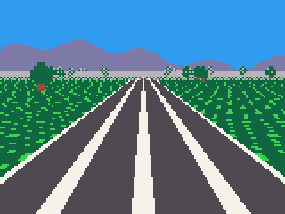
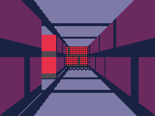
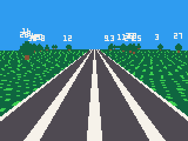
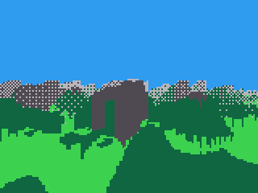
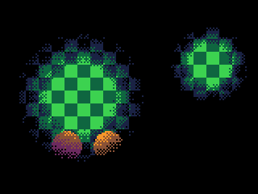

# 3D views: plane, land, walls and light

Pictures in perspective, in the style of the 16-bit consoles: a map laid
flat as a road or a field and seen from a camera, with sprites standing on
it; hills to fly over; the walls of a maze from inside; and light over a
dark scene.

- [How the plane works](#how-the-plane-works), [script or system](#script-or-system), and [the resolution rule](#the-resolution-rule)
- The camera: [plane.view](#planeviewx-y-z-angle-horizon-fov)
- Drawing: [plane.draw](#planedrawtop-bottom-outside-coarse-under), [plane.sky](#planeskyimage-lift),
  [plane.fog](#planefognear-far-colour-billboards), [plane.ceiling](#planeceilingheight-table-outside-coarse-top),
  [plane.billboards](#planebillboardsxs-ys-zs-sprites-sizes-flips-n-ws-hs)
- Points: [plane.project](#planeprojectx-y-z-out), [plane.pick](#planepicksx-sy-out)
- [land.draw and land.height](#landdrawheights-colours-far-scale-coarse-ramp)
- [walls.draw](#wallsdrawsolid-height-far-dark-doors)
- [light.draw](#lightdrawx-y-r-n-ramp)

## How the plane works

The **world** is the active map, laid flat: a map cell is 8 world pixels
across, and each cell's sprite is its patch of ground. A **camera** stands
somewhere on it, at a height, looking one way. `plane.draw` then draws the
ground as the camera sees it: near rows big at the bottom of the screen,
far rows small up towards the **horizon**.

Everything is in **world pixels**, the same as the actors': an actor
pool's `x, y` are points on the plane as they are. So a game keeps its
rules on the flat map -- a kart is an actor that `actors.move` stops at
walls and reports crossing the finish line -- and the plane is only how it
is drawn. The same game could be drawn from above for testing.

**Headings are in turns**, through the engine's own `sin` and `cos`: a
camera at angle `a` looks along `cos(a), sin(a)`, so a cart moving its
camera by `x += cos(a) * v; y += sin(a) * v` goes the way it looks. The
engine's `sin` is upside down -- y grows down the screen, and down the map
-- so **0 looks east, 0.25 north, 0.5 west, 0.75 south**.

## Script or system

The floor is the cost: some 80 rows of 160 pixels, each pixel a step
across the map, a sprite looked up, a colour copied. Done in script with
one `tline` a row, it is about 42,600 units a frame -- over three ticks' worth
on an iPod Video playing FLAC, before anything else is drawn. `plane.draw`
does the same floor for about 11,800, and `coarse` brings it to about
8,900.

| | Units |
|---|---|
| `plane.draw`, 80 rows | about 11,800 (coarse: 8,900) |
| `plane.billboards`, 40 trees | about 4,300 |
| `land.draw`, 128x128, 400 far | about 29,000 (coarse: 16,900) |
| `walls.draw`, a maze | about 11,300 |
| a maze with floor and ceiling too | about 27,800 (coarse: 23,800) |
| `light.draw`, two lights | about 11,000 |

A tick on an iPod Video playing FLAC has about 12,500 units at 33 ticks
a second, 17,500 at 25 and 22,800 at 20; with the music stopped, about
46,000 at 33. A road with trees, with a sky and fog, is about 25,300: it
keeps 33 with the music stopped, and needs `coarse` and a lower rate
under FLAC. A landscape or a full maze is the same. Step down when frames
go undrawn, and back up when the music stops:

```js
var late = 0, coarse = 1;

function update() {
    late += skipped();
    if (frame() % rate() == 0) {                  // once a second
        if (late > 4 && coarse == 1) coarse = 2;  // first, draw coarse
        else if (late > 4 && rate() > 25) setrate(25);   // then, slow down
        else if (!playback.playing()) { coarse = 1; setrate(33); }
        late = 0;
    }
}
```

Scale per-tick speeds by `33.0 / rate()` so the game plays at the same
speed at either rate.

## The resolution rule

How big things look depends on the **focal length**, `f`: screen pixels
across for one world pixel at depth 1. With the field of view `fov` in
turns,

```
f = 80 / tan(fov / 2)
```

-- about **97** at a field of view of 0.22, and exactly 80 at 0.25. A
thing at depth `d` world pixels is drawn `f / d` screen pixels for each of
its world pixels: **one to one at depth `f`**, twice as big at half that,
half as big at twice that.

So author everything at **one texel a world pixel**. A floor cell is 8
world pixels and its sprite 8 texels; make a billboard as many texels tall
as it is world pixels -- a 16-pixel kart a 2x2 sprite of 16 texels. Then
the floor and every billboard are sharp together at depth `f`, magnified
alike nearer, and skip texels alike further. A sprite drawn bigger has
detail that is never seen; smaller, it looks blurred beside the floor.

Things far away skip texels and shimmer, more than 2:1 past about depth
200. `plane.fog` hides it, or swap a far billboard for a smaller sprite
when its scale (from `plane.project`) falls under 0.5.

---

## plane.view(x, y, z, angle, horizon, fov)

Sets the camera. Every other function on this page draws from it.

| Argument | |
|---|---|
| `x`, `y` | where it stands on the map, in world pixels |
| `z` | its height above the ground, in world pixels |
| `angle` | which way it looks, in turns: 0 east, 0.25 north |
| `horizon` | the screen row of the horizon: 40 shows more ground, 60 more sky |
| `fov` | the field of view, in turns: 0.22 is natural, 0.3 wide; 1/64 to 7/16 |

**Returns** nothing.

- Call it each frame before drawing, as the camera moves. It lasts until
  the next call; drawing before the first stops the cart.
- Lower `z` feels faster and closer to the ground; a kart racer is about
  12 to 20, a flight 60 and up.
- Moving the horizon up and down as the camera climbs or dives -- 50 +
  climb x 12 -- tilts the view without any real pitch.

## plane.draw([top], [bottom], [outside], [coarse], [under])

Draws the map as the floor.

| Argument | |
|---|---|
| `top`, `bottom` | the screen rows to draw: from the horizon to the bottom when left out |
| `outside` | the sprite for ground off the map; none when left out, so what was there shows |
| `coarse` | 2 reads every other pixel and draws each twice: about three-quarters the cost |
| `under` | an array of sprites, one per map sprite number: draw that cell's floor with this instead |

**Returns** nothing.

A road between fields, with trees, mountains on the horizon and haze:

```js
const GRASS = 1, ROAD = 2, TREE = 3;
const N = 40;
var tx = [], ty = [];
var hills;

function init() {
    for (var y = 0; y < 8; y++)
        for (var x = 0; x < 8; x++) {
            sset(8 + x, y, (x * 3 + y * 5) % 7 ? 3 : 11);              // grass
            sset(16 + x, y, x == 0 || x == 7 ? 7 : 5);                 // road, white edges
            var d = (x - 3.5) * (x - 3.5) + (y - 3) * (y - 3);         // a tree
            sset(24 + x, y, d < 10 && y < 6 ? 3 : y >= 5 && (x == 3 || x == 4) ? 4 : 0);
        }
    for (var r = 0; r < 64; r++)
        for (var c = 0; c < 64; c++) mset(c, r, c >= 30 && c < 34 ? ROAD : GRASS);
    srand(12);
    for (var i = 0; i < N; i++) {
        var side = i % 2 ? 1 : -1;
        tx.push(256 + side * (40 + rnd(120)));
        ty.push(rnd(512));
    }
    // mountains round the horizon: a panorama, its width a whole turn
    hills = img(256, 24);
    target(hills);
    cls(0);
    for (var c = 0; c < 256; c++) line(c, 24 - flr(10 + 6 * sin(c / 64.0) + 3 * sin(c / 13.0)), c, 23, 13);
    target(SCREEN);
}

function draw() {
    cls(12);                                          // the sky
    plane.view(256, 480, 12, 0.25, 40, 0.22);         // 12 up, looking north (0.25), horizon on row 40
    plane.sky(hills);
    plane.fog(150, 400, 6);                           // far ground into the haze
    plane.draw();
    plane.billboards(tx, ty, 0, TREE, 16, false, N);  // trees 16 world pixels tall
}
```



- It ignores `camera()`. It draws through the draw palette, and colour 0
  of each sprite is clear unless `palt` says otherwise.
- `outside` set to a grass sprite makes the world look endless.
- `under` is for walls drawn with `walls.draw`: their cells' floor drawn
  as plain tile, not as the wall's sprite.

## plane.sky(image, [lift])

A panorama behind everything, that turns as the camera turns.

| Argument | |
|---|---|
| `image` | the picture: its width is one whole turn, its bottom row sits on the horizon |
| `lift` | how many rows above the horizon to raise it |

**Returns** nothing.

- Draw it after clearing to the sky's colour and before the floor, as in
  the road above. Its colour 0 is clear, so the sky colour shows through.
- 256 pixels wide is a whole turn in 256 steps: make the picture join up
  at its two ends, or a seam shows when the camera turns.

## plane.fog(near, far, colour, [billboards])

Fades the ground to a colour with distance, from `near` world pixels away
to fully at `far`, dithered -- haze, darkness, mist.

| Argument | |
|---|---|
| `near`, `far` | where it starts and where it is complete, in world pixels |
| `colour` | the colour it fades to; -1 turns it off |
| `billboards` | `false` to leave the billboards clear of it -- lamps in a dark dungeon, or a kart race's rivals always in view; true when left out |

**Returns** nothing.

- It lasts until changed, and `plane.draw`, `plane.ceiling`, `land.draw`,
  `walls.draw` and `plane.billboards` all use it.
- Fog to the sky's colour hides where the floor ends; fog to black makes
  a dark dungeon.

## plane.ceiling(height, [table], [outside], [coarse], [top])

A ceiling over the floor, `height` world pixels up, drawn from the map's
cells as the floor is.

| Argument | |
|---|---|
| `height` | how high it is |
| `table` | an array of sprites: each map cell's ceiling is its sprite's entry -- one sprite for all, or each its own |
| `outside`, `coarse` | as for `plane.draw` |
| `top` | the first screen row to draw; 0 when left out |

**Returns** nothing: nothing is drawn when the camera is above the
ceiling.

A maze: walls from the map, a floor, a ceiling of boards, and fog into
the dark:

```js
const BRICK = 1, TILE = 2, BEAM = 3, SOLID = 1;
var rows = ["11111111",
            "10000001",
            "10110101",
            "10100001",
            "10101101",
            "10000001",
            "11111111"];
var dark = [0, 0, 1, 1, 2, 1, 5, 6, 2, 4, 9, 3, 1, 1, 2, 5];   // each colour a shade darker

function init() {
    for (var y = 0; y < 8; y++)
        for (var x = 0; x < 8; x++) {
            var mortar = y % 4 == 3 || ((x + (y >> 2) * 4) % 8) == 0;
            sset(8 + x, y, mortar ? 5 : 8);                     // brick
            sset(16 + x, y, x == 0 || y == 0 ? 1 : 13);         // floor tiles
            sset(24 + x, y, x == 3 ? 2 : 1);                    // ceiling boards
        }
    fset(BRICK, SOLID);
    for (var r = 0; r < 7; r++)
        for (var c = 0; c < 8; c++) mset(c, r, rows[r].charCodeAt(c) == 49 ? BRICK : TILE);
}

function draw() {
    plane.view(12, 44, 4, 0.0, 60, 0.2);    // eye 4 up in an 8-high corridor, looking east
    plane.fog(30, 80, 0);
    plane.ceiling(8, [BEAM]);               // every cell's ceiling the boards
    plane.draw(60, 119, -1, 1, [TILE, TILE]);   // under the walls, tiles too
    walls.draw(SOLID, 8, 512, dark);
}
```



## plane.billboards(xs, ys, zs, sprites, sizes, flips, n, [ws], [hs])

Sprites standing on the ground -- trees, karts, enemies -- each scaled by
its distance and drawn far to near, so near ones cover far ones.

| Argument | |
|---|---|
| `xs`, `ys` | where each stands, in world pixels |
| `zs` | how far its feet are above the ground: 0 standing, more for a jump or a bird |
| `sprites` | each one's sprite |
| `sizes` | how tall each is, in world pixels |
| `flips` | each one's flip, as `spr` takes it |
| `n` | how many, up to 256 |
| `ws`, `hs` | each one's sprites across and down, as `spr` takes them; 1 when left out |

Every argument but `n` can be an array of any kind, or one number for
all: `plane.billboards(tx, ty, 0, TREE, 16, false, N)` above draws `N`
trees all standing, all sprite `TREE`, all 16 tall.

**Returns** how many it drew: those in front of the camera and on the
screen.

- A billboard's width follows its shape: 2 across and 3 down at 24 tall
  is 16 wide.
- Behind `walls.draw`'s walls and `land.draw`'s hills, a billboard is
  hidden where they are nearer: a ghost round a corner, a tree behind a
  hill.
- About 120 units a billboard drawn, 260 in fog.

## plane.project(x, y, z, out)

Where a world point appears on the screen: for drawing things yourself on
top of the 3D view -- a name over a kart, a shadow, a target marker.

| Argument | |
|---|---|
| `x`, `y`, `z` | the point, in world pixels, `z` above the ground |
| `out` | an array of four, `[0, 0, 0, 0]`, or an `Int32Array` |

**Returns** 1 when the point is in front of the camera, 0 when behind it.

`out` gets the screen x and y, the **scale** (screen pixels for one world
pixel there) and the **depth** (world pixels in front of the camera).

```js
const GRASS = 1, ROAD = 2, TREE = 3;
const N = 40;
var tx = [], ty = [];
var hills;

function init() {
    for (var y = 0; y < 8; y++)
        for (var x = 0; x < 8; x++) {
            sset(8 + x, y, (x * 3 + y * 5) % 7 ? 3 : 11);              // grass
            sset(16 + x, y, x == 0 || x == 7 ? 7 : 5);                 // road, white edges
            var d = (x - 3.5) * (x - 3.5) + (y - 3) * (y - 3);         // a tree
            sset(24 + x, y, d < 10 && y < 6 ? 3 : y >= 5 && (x == 3 || x == 4) ? 4 : 0);
        }
    for (var r = 0; r < 64; r++)
        for (var c = 0; c < 64; c++) mset(c, r, c >= 30 && c < 34 ? ROAD : GRASS);
    srand(12);
    for (var i = 0; i < N; i++) {
        var side = i % 2 ? 1 : -1;
        tx.push(256 + side * (40 + rnd(120)));
        ty.push(rnd(512));
    }
    // mountains round the horizon: a panorama, its width a whole turn
    hills = img(256, 24);
    target(hills);
    cls(0);
    for (var c = 0; c < 256; c++) line(c, 24 - flr(10 + 6 * sin(c / 64.0) + 3 * sin(c / 13.0)), c, 23, 13);
    target(SCREEN);
}

var at = [0, 0, 0, 0];

function draw() {
    cls(12);
    plane.view(256, 480, 12, 0.25, 40, 0.22);
    plane.draw();
    plane.billboards(tx, ty, 0, TREE, 16, false, N);
    // a label over each of the near trees, where projecting puts it
    for (var i = 0; i < N; i++)
        if (plane.project(tx[i], ty[i], 20, at) && at[3] < 320)
            print("" + i, at[0] - 4, at[1] - 6, 7);
}
```



- The numbers are fractions. An `Int32Array` takes them rounded down,
  which is fine for the screen x and y but makes the scale 0 when it is
  under 1: use an array when the scale matters, as for sizing a label.
- The scale is the resolution rule's `f / d`: 1.0 at depth 97 with a
  field of view of 0.22, 0.5 at 194.

## plane.pick(sx, sy, out)

The other way: the point on the ground under a screen pixel.

| Argument | |
|---|---|
| `sx`, `sy` | the screen pixel |
| `out` | an array of two, `[0, 0]`, for the ground's `x` and `y` (fractions), or an `Int32Array` for them rounded down |

**Returns** 1 for a pixel at or below the horizon, 0 above it (there is no
ground there).

- For a cursor on the ground: where the player taps, where a mouse-style
  pointer drawn by the wheel lands.

---

## land.draw(heights, colours, [far], [scale], [coarse], [ramp])

A landscape of hills and valleys from two images, seen from the plane's
camera: a flying game's ground.

| Argument | |
|---|---|
| `heights` | an image: each pixel's value is the ground's height there, in world pixels |
| `colours` | an image the same size: each pixel the ground's colour there |
| `far` | how far to draw, in world pixels; 512 when left out |
| `scale` | world pixels for each step of height; 1 when left out |
| `coarse` | 2 samples every other column: about half the cost |
| `ramp` | an array of colours by height: given it, heights are blended between pixels and coloured from the ramp, smoother and costlier |

**Returns** how many ground samples it took.

Both images are a **power of two** across and down -- 64, 128, 256 -- and
the world **wraps**: fly off one side and you are back on the other, so a
128x128 landscape goes on for ever. `noise.fill` (see **Boards and
paths**) makes both from the same noise: heights directly, and colours
through a ramp from water to snow.

```js
var heights, colours;

function init() {
    heights = img(128, 128);
    colours = img(128, 128);
    noise.fill(heights, 0, 0, 0, 40, 3, 7, 80);                 // heights 0 to 79
    // water, sand, grass, deeper grass, rock and snow, by the same noise
    noise.fill(colours, 0, 0, 0, 40, 3, 7, [12, 12, 12, 12, 15, 11, 11, 11, 3, 3, 3, 3, 5, 5, 6, 7]);
}

function draw() {
    plane.view(64, 64, 70, 0.1, 50, 0.22);   // 70 up, the horizon on row 50
    rectfill(0, 0, 159, 119, 12);
    plane.fog(120, 400, 6);
    land.draw(heights, colours, 400);
}
```



- It draws the ground only: clear to the sky first, and draw anything
  flying after.
- At about 29,000 units it is more than a tick with music playing: use
  `coarse` and a lower rate there: step down to `coarse` first, then to
  25, then 20, as frames are skipped.

## land.height(heights, x, y, [scale])

The ground's height at a world point, for keeping a craft above it or
standing a tree on it.

**Returns** the height in world pixels: the `heights` pixel at `x, y`
(wrapping), times `scale`.

```js
var ground = land.height(heights, x, y) + 12;   // 12 above the ground
if (z < ground) z = ground;                     // never fly into a hill
```

---

## walls.draw(solid, [height], [far], [dark], [doors])

First-person walls: the map's solid cells stood up as walls around the
plane's camera, each face showing its cell's sprite -- a maze in the old
style. See the maze example above, under `plane.ceiling`.

| Argument | |
|---|---|
| `solid` | flags: map cells whose sprite shares a bit with these are walls |
| `height` | how tall, in world pixels: 8, a cell, makes cubes; 8 when left out |
| `far` | how far to look, in world pixels; 512 |
| `dark` | an array: what each colour becomes on faces running along y, so corners show |
| `doors` | three numbers a door: its cell's column and row, and how open it is, 0 to 1 |

**Returns** how many screen columns met a wall.

- Draw the floor (`plane.draw`) and ceiling first, then the walls over
  them, then the billboards, which hide behind the walls.
- A door is a panel across the middle of its wall cell that slides aside
  as it opens. Have `actors.move` treat its cell as solid until it is
  nearly open.
- The player is best an actor, so `actors.move` stops them at the walls;
  the camera is then the actor's centre.

---

## light.draw(x, y, r, n, ramp)

Lights over a scene already drawn: everything beyond their reach goes
darker, in steps, and what is near them stays in full colour.

| Argument | |
|---|---|
| `x`, `y`, `r` | each light's centre and reach: numbers for one, arrays for several |
| `n` | how many lights; at most 4,096 |
| `ramp` | 1 to 8 colour tables, **darkest first**: each an array taking every colour to its darker one |

**Returns** nothing.

```js
// each colour of the 16 a shade darker, and darker again
var dark1 = [0, 0, 1, 1, 2, 1, 5, 6, 2, 4, 9, 3, 1, 1, 2, 5];
var dark2 = [0, 0, 0, 0, 1, 0, 1, 5, 1, 2, 4, 1, 0, 0, 1, 1];
var black = [0, 0, 0, 0, 0, 0, 0, 0, 0, 0, 0, 0, 0, 0, 0, 0];
var lx = [50, 130], ly = [60, 40], lr = [40, 24];

function init() {
}

function draw() {
    // the scene in full colour
    for (var y = 0; y < 120; y += 8)
        for (var x = 0; x < 160; x += 8)
            rectfill(x, y, x + 7, y + 7, ((x + y) / 8) % 2 ? 3 : 11);
    for (var i = 0; i < 6; i++) circfill(15 + i * 26, 90, 9, 8 + i % 4);
    // then two lights over it: dark beyond their reach, in three steps
    light.draw(lx, ly, lr, 2, [black, dark2, dark1]);
}
```



- Draw the whole scene first, then the lights over it. It works on any
  picture, 3D or flat: a torch in a dungeon crawl, a lighthouse, a cave.
- The ramp's tables are the steps between light and dark, dithered
  between: three gives a soft edge. A table of all 0s is black.
- Colours past a table's end stay as they are: give 16 entries for the 16
  colours a cart starts with.
- About 11,000 units for two lights, and 5,900 for one small one: 4,900
  of that darkens the whole clip, however small the lights. A light in
  a 40x40 `clip` is about 1,900.
