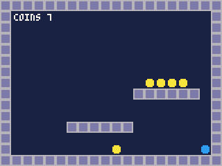
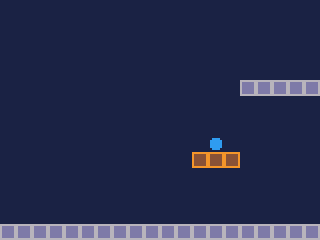
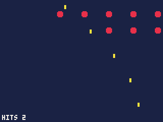
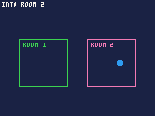
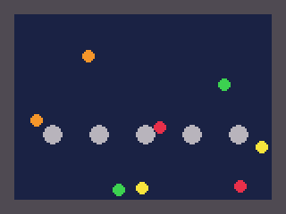
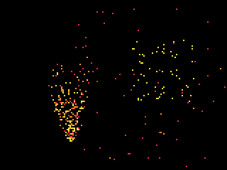
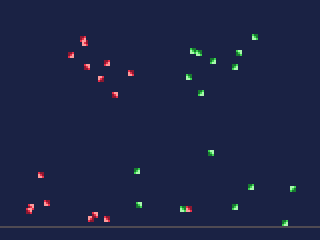
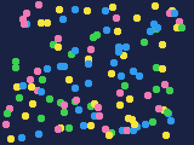

# Moving many things: actors and particles

The things in a game that move -- the player, enemies, shots, coins,
balls -- and the sparks, smoke and debris round them, moved, collided and
drawn many at a time.

- [How pools work](#how-pools-work), and [script or system](#script-or-system)
- Actors: [actors.pool](#actorspooln), [actors.spawn](#actorsspawnp),
  [actors.move](#actorsmovep-solid-trigger-out-oneway), [actors.overlaps](#actorsoverlapsa-b-out),
  [actors.draw](#actorsdrawp), [actors.zones](#actorszonesp-objs-n-out)
- Balls: [actors.bounce](#actorsbouncea-b-out-give), [actors.bounce_map](#actorsbounce_mapp-flags-out-give)
- Particles: [particles.pool](#particlespooln), [particles.emit](#particlesemitp-count-x-y-dx-dy-spread-life-c-sp),
  [particles.step](#particlesstepp), [particles.draw](#particlesdrawp),
  [particles.bounds](#particlesboundsp-out),
  [Sprite particles](#sprite-particles)
- [sprites.draw](#spritesdrawsp-xs-ys-n-flips)

## How pools work

A **pool** is a record of arrays, one entry an actor (or particle). Actor
3's position is `p.x[3], p.y[3]`, its speed `p.dx[3], p.dy[3]`. The
engine makes the pool; after that the arrays are yours, to read and write
as you like -- set a speed, move an actor by hand, change its sprite.

```js
var enemies;

function init() {
    enemies = actors.pool(20);       // room for 20
    var i = actors.spawn(enemies);   // the first free one: 0
    enemies.x[i] = 40;
    enemies.y[i] = 10;
    enemies.dx[i] = 1.5;             // pixels a tick
    enemies.sp[i] = 4;               // its sprite
}
```

Then a few calls a tick do the work for all of them at once: move them,
find what they hit, draw them. **What a hit means is up to you**: the
engine reports that actor 3 landed on a solid cell, or that a shot
overlaps an enemy, and your code decides to stop, bounce, score or
explode.

Positions are **pixels** (fractions allowed), and a map cell is 8 pixels,
so an actor at `x = 20` is in map column 2.

An actor's fields:

| Field | Starts | |
|---|---|---|
| `on` | 0 | 1 while the actor is in use; the calls skip actors that are off |
| `x`, `y` | 0 | its hitbox's top left, in pixels |
| `dx`, `dy` | 0 | its speed, pixels a tick |
| `w`, `h` | 8, 8 | its hitbox's size |
| `sp` | -1 | its sprite; -1 draws nothing |
| `flip` | 0 | drawn flipped, as `spr` flips: 1 mirrored, 2 upside down, 3 both |
| `frames`, `speed` | 1, 8 | an animation: `frames` sprites from `sp` in turn, `speed` ticks each |
| `cell` | -1 | the trigger cell it is in (see `move`) |
| `zone` | -1 | the map object it is in (see `zones`) |
| `mat` | -1 | its material in a cells field (see **Simulations**) |

and the pool's own, for all its actors:

| Field | Starts | |
|---|---|---|
| `gravity` | 0 | added to every `dy` each tick: 0.25 is a brisk fall |
| `drag` | 0 | the fraction of the speed lost each tick: 0.02 is air, 0.2 is mud |
| `platforms` | null | another pool whose actors are solid, and carry those standing on them |
| `oneway` | 0 | when this pool is someone's platforms: jumped up through, landed on |
| `slope_up`, `slope_down` | 0 | flags of map cells that are ramps at 45 degrees, rising to the right (`/`) and to the left (`\`) (see **Ramps and ladders**) |
| `ladders` | 0 | flags of map cells that are ladders: while an actor's middle is on one, gravity lets go |
| `field`, `rules`, `field_x`, `field_y`, `density`, `splash` | | a cells field the actors move in (see **Simulations**) |

### Ramps and ladders

A ramp is a map cell climbing a pixel a pixel across, at 45 degrees: the
pool's `slope_up` flags mark those rising to the right, `slope_down`
those rising to the left. A ramp is not solid -- leave its flag out of
`move`'s `solid` -- and an actor walking or falling into one is set on
its surface at the middle of its feet, reported as `HIT.DOWN`, as
landing on a floor is. It stays on a ramp walking down it, within 4
pixels, and leaves it by jumping.

A ladder is a cell flagged in the pool's `ladders`: while an actor's
middle is on one, gravity is not added, so it stays where it is until
the game moves it -- `dy` from Up and Down while climbing, as the game
decides. A ladder's top needs a floor the actor can stand on: a
`oneway` cell above it.

```js
p.slope_up = 2; p.slope_down = 4; p.ladders = 8;
actors.move(p, 1, 0, hits, 16);      // 1 walls, 16 one-way floors
```

## Script or system

A game of 100 moving things does the same few steps to each every tick.
Done in script, that loop is a large part of the budget; done in the
engine, a small one. Measured, for the same work:

| | Script | System |
|---|---|---|
| 100 actors, gravity and a floor | about 4,800 | `actors.move`: about 2,100 |
| 50 shots against 50 enemies | about 49,700 | `actors.overlaps`: about 1,500 |
| 300 particles, moved and drawn | about 12,900 | `particles.step` and `draw`: about 4,000 |
| 100 sprites drawn | about 7,400 (`spr` in a loop) | `sprites.draw` or `actors.draw`: about 3,400 |

A tick on an iPod Video playing FLAC has about 12,500 units. The script
`overlaps` alone would take four ticks. The system calls also do
more than the script versions here: `move` sweeps every actor in steps
against the map, so a fast one never passes through a thin wall.

Drawing is the one cost they cannot shrink much: every sprite's 64 pixels
must be copied, about 34 units a sprite however it is done.

---

## actors.pool(n)

Makes a pool of actors.

| Argument | |
|---|---|
| `n` | how many it holds, 1 to 4096 |

**Returns** the pool: a record of the fields above, every actor off.

- Make pools in `init()`, one for each kind of thing that behaves
  differently -- the player, enemies, shots -- so each kind can have its
  own gravity, and be tested against the others with `overlaps`.

## actors.spawn(p)

Turns on the first free actor in a pool, with its speed cleared.

| Argument | |
|---|---|
| `p` | the pool |

**Returns** the actor's index, or **-1 when every actor is in use**.

- It sets `on`, clears `dx`, `dy`, `cell` and `zone`, and leaves the rest
  as they were: set `x`, `y` and `sp` after spawning. Check for -1 before using
  the index.
- To remove an actor, set `on` to 0: it is free for the next `spawn`.

## actors.move(p, solid, trigger, out, [oneway])

Moves every actor in a pool by its speed, with the pool's gravity and
drag, **stopping against solid map cells**, and reports every contact.

| Argument | |
|---|---|
| `p` | the pool |
| `solid` | flags: actors stop at map cells whose sprite shares a bit with these; 0 for no walls |
| `trigger` | flags: cells reported as an actor's centre enters them, without stopping it; 0 for none |
| `out` | an `Int32Array` for the contacts, four numbers each |
| `oneway` | flags: cells solid only from above -- jumped up through, landed on |

**Returns** how many contacts it wrote into `out`.

Each tick, for each actor that is on: `dy` gains the gravity, both speeds
lose the drag, then the actor moves across and then down, in steps of at
most 4 pixels. Meeting a solid cell, it **stops flush against it** and a
contact is written. **Its speed is left as it was**: set `dy` to 0 on
landing, reverse it to bounce, or leave it to slide.

A contact is four numbers in `out`: **the actor, what happened, then a
column and a row**:

| What happened | Means | Then |
|---|---|---|
| `HIT.LEFT`, `HIT.RIGHT` | its left or right side met a solid cell | the cell's column and row |
| `HIT.UP` | its top met one: it hit its head | the cell |
| `HIT.DOWN` | its bottom met one: **it landed** | the cell |
| `HIT.ENTER` | its centre went into a trigger cell (once, until it leaves) | the cell |
| `HIT.CRUSH` | a platform pinned it against a wall | -1 and the platform |

With `platforms` or a cells field, contacts with them give -1 and the
platform's index, or -2 and the material, in place of the cell.

A platformer -- Prev and Next walk, Select jumps, coins taken as they are
touched:

```js
const SOLID = 1, COIN = 2;     // flags: solid ground, coins
var hero, hits = new Int32Array(64);
var coins = 0, ground = false;

// sprite n: a block, edged in a and filled in b
function block(n, a, b) {
    var sx = (n % 16) * 8, sy = flr(n / 16) * 8;
    for (var y = 0; y < 8; y++)
        for (var x = 0; x < 8; x++)
            sset(sx + x, sy + y, x == 0 || y == 0 || x == 7 || y == 7 ? a : b);
}

// sprite n: a ball of colour c
function ball(n, c) {
    var sx = (n % 16) * 8, sy = flr(n / 16) * 8;
    for (var y = 0; y < 8; y++)
        for (var x = 0; x < 8; x++) {
            var d = (x - 3.5) * (x - 3.5) + (y - 3.5) * (y - 3.5);
            sset(sx + x, sy + y, d < 12 ? c : 0);
        }
}

function init() {
    block(1, 6, 13); fset(1, SOLID);
    ball(2, 10);     fset(2, COIN);
    ball(3, 12);                        // the hero
    for (var c = 0; c < 20; c++) { mset(c, 14, 1); mset(c, 0, 1); }
    for (var r = 0; r < 15; r++) { mset(0, r, 1); mset(19, r, 1); }
    for (c = 6; c < 12; c++) mset(c, 11, 1);
    for (c = 12; c < 18; c++) mset(c, 8, 1);
    for (c = 2; c < 18; c += 2) mset(c, 13, 2);
    for (c = 13; c < 17; c++) mset(c, 7, 2);

    hero = actors.pool(1);
    hero.gravity = 0.25;
    var i = actors.spawn(hero);
    hero.x[i] = 12;
    hero.y[i] = 96;
    hero.sp[i] = 3;
}

function update() {
    // Prev and Next walk; Select jumps, from the ground
    hero.dx[0] = btn(0) ? -1.5 : btn(1) ? 1.5 : 0;
    if (ground && btn(4)) hero.dy[0] = -4.0;
    ground = false;

    var n = actors.move(hero, SOLID, COIN, hits);
    for (var k = 0; k < n; k++) {
        var side = hits[k * 4 + 1];
        if (side == HIT.DOWN) { ground = true; hero.dy[0] = 0; }
        else if (side == HIT.UP) hero.dy[0] = 0;
        else if (side == HIT.ENTER) {
            mset(hits[k * 4 + 2], hits[k * 4 + 3], 0);   // take the coin
            coins++;
        }
    }
}

function draw() {
    cls(1);
    map();
    actors.draw(hero);
    print("COINS " + coins, 10, 10, 7);
}
```



- **Flags make the map's meaning.** Here sprite 1's flag 1 means solid
  and sprite 2's flag 2 means coin; name them in the cart's settings and
  write `FLAG.solid` and `FLAG.coin` instead.
- **The ground test**: an actor is on the ground on the tick it reports
  `HIT.DOWN`. Clear `ground` before moving and set it from the contacts,
  as above, so a jump is only allowed from the ground.
- **`out` must be an `Int32Array`**, long enough for the contacts you
  expect -- four numbers each. Contacts past its end are dropped, not an
  error.
- Outside the map is empty: wall the level, or an actor that walks off
  the edge falls for ever.
- **One-way platforms**: give their sprite another flag and pass it as
  `oneway`. An actor jumps up through them and lands on top.
- **Moving platforms**: put them in a pool of their own, move it first,
  and set `p.platforms` to it. An actor standing on one is carried with
  it; one it pushes into a wall is crushed (`HIT.CRUSH`).

  ```js
const SOLID = 1;
var lifts, hero, hits = new Int32Array(32);

// sprite n: a block, edged in a and filled in b
function block(n, a, b) {
    var sx = (n % 16) * 8, sy = flr(n / 16) * 8;
    for (var y = 0; y < 8; y++)
        for (var x = 0; x < 8; x++)
            sset(sx + x, sy + y, x == 0 || y == 0 || x == 7 || y == 7 ? a : b);
}

// sprite n: a ball of colour c
function ball(n, c) {
    var sx = (n % 16) * 8, sy = flr(n / 16) * 8;
    for (var y = 0; y < 8; y++)
        for (var x = 0; x < 8; x++) {
            var d = (x - 3.5) * (x - 3.5) + (y - 3.5) * (y - 3.5);
            sset(sx + x, sy + y, d < 12 ? c : 0);
        }
}

function init() {
    block(1, 6, 13); fset(1, SOLID);
    block(2, 9, 4);                     // a lift's block
    ball(3, 12);
    for (var c = 0; c < 20; c++) mset(c, 14, 1);
    for (c = 15; c < 20; c++) mset(c, 5, 1);

    lifts = actors.pool(1);
    actors.spawn(lifts);
    lifts.x[0] = 96; lifts.y[0] = 104;
    lifts.w[0] = 24; lifts.h[0] = 4;

    hero = actors.pool(1);
    hero.gravity = 0.25;
    hero.platforms = lifts;             // the hero stands on, and rides, the lift
    actors.spawn(hero);
    hero.x[0] = 104; hero.y[0] = 90; hero.sp[0] = 3;
}

function update() {
    // the lift goes up and down between the floor and the high ledge
    lifts.dy[0] = lifts.y[0] <= 40 ? 1 : lifts.y[0] >= 104 ? -1 : lifts.dy[0];
    actors.move(lifts, 0, 0, hits);
    var n = actors.move(hero, SOLID, 0, hits);
    for (var k = 0; k < n; k++) if (hits[k * 4 + 1] == HIT.DOWN) hero.dy[0] = 0;
}

function draw() {
    cls(1);
    map();
    for (var x = 0; x < 3; x++) spr(2, lifts.x[0] + x * 8, lifts.y[0]);
    actors.draw(hero);
}
```

  

- About 21 units an actor a tick, walls and all.

## actors.overlaps(a, b, out)

Every pair of actors, one from each pool, whose hitboxes overlap: shots
and enemies, the player and pickups.

| Argument | |
|---|---|
| `a`, `b` | two pools, or the same pool twice |
| `out` | an `Int32Array` for the pairs, two numbers each: an actor of `a`, an actor of `b` |

**Returns** how many pairs it wrote.

With `b` the same as `a`, each pair is found once -- actors bumping into
each other.

A shooter -- a gun sweeping the bottom fires up at two rows of ships:

```js
var ships, shots, sparks;
var pairs = new Int32Array(64);
var downed = 0;

// sprite n: a block, edged in a and filled in b
function block(n, a, b) {
    var sx = (n % 16) * 8, sy = flr(n / 16) * 8;
    for (var y = 0; y < 8; y++)
        for (var x = 0; x < 8; x++)
            sset(sx + x, sy + y, x == 0 || y == 0 || x == 7 || y == 7 ? a : b);
}

// sprite n: a ball of colour c
function ball(n, c) {
    var sx = (n % 16) * 8, sy = flr(n / 16) * 8;
    for (var y = 0; y < 8; y++)
        for (var x = 0; x < 8; x++) {
            var d = (x - 3.5) * (x - 3.5) + (y - 3.5) * (y - 3.5);
            sset(sx + x, sy + y, d < 12 ? c : 0);
        }
}

function init() {
    ball(1, 8);                         // a ship
    for (var y = 0; y < 4; y++) { sset(16, y, 10); sset(17, y, 10); }   // a shot, 2 by 4
    ships = actors.pool(12);
    for (var i = 0; i < 12; i++) {
        actors.spawn(ships);
        ships.x[i] = 10 + (i % 6) * 24;
        ships.y[i] = 10 + flr(i / 6) * 16;
        ships.dx[i] = 0.5;
        ships.sp[i] = 1;
    }
    shots = actors.pool(16);
    sparks = particles.pool(200);
    sparks.gravity = 0.05;
}

function update() {
    // a shot every 8 ticks from a gun that sweeps the bottom
    if (frame() % 8 == 0) {
        var s = actors.spawn(shots);
        if (s >= 0) {
            shots.x[s] = 76 + 60 * sin(frame() / 120.0);
            shots.y[s] = 110;
            shots.w[s] = 2;
            shots.h[s] = 4;
            shots.dy[s] = -3;
            shots.sp[s] = 2;
        }
    }
    actors.move(ships, 0, 0, pairs);    // no walls: just moved
    actors.move(shots, 0, 0, pairs);
    for (var i = 0; i < 16; i++) if (shots.y[i] < -8) shots.on[i] = 0;

    var n = actors.overlaps(shots, ships, pairs);
    for (var k = 0; k < n; k++) {
        var s = pairs[k * 2], t = pairs[k * 2 + 1];
        if (!shots.on[s] || !ships.on[t]) continue;   // already gone this tick
        shots.on[s] = 0;
        ships.on[t] = 0;
        particles.emit(sparks, 20, ships.x[t] + 4, ships.y[t] + 4, 0, 0, 1.5, 20, 9 + rnd(2));
        downed++;
    }
    particles.step(sparks);
}

function draw() {
    cls(1);
    actors.draw(ships);
    actors.draw(shots);
    particles.draw(sparks);
    print("HITS " + downed, 2, 113, 7);
}
```



- An actor can be in more than one pair -- a shot touching two ships at
  once. Check `on` before acting on a pair, as above, so one shot does not
  destroy two.
- Only actors that are on are tested. About 1,500 units for 50 against 50.

## actors.draw(p)

Draws every actor that is on and has a sprite.

| Argument | |
|---|---|
| `p` | the pool |

**Returns** nothing.

Each actor is drawn as `spr(sp, x, y, 1, 1, flip)` would draw it -- one
8x8 sprite at its `x, y` -- from the sheet `sheet()` has chosen.

- **Animation**: set `frames` above 1 and the actor shows `frames`
  sprites from `sp` in turn, each for `speed` ticks: sprites 16, 17, 18
  and 19 for a four-frame walk, with `sp` 16 and `frames` 4. Different
  actors can be on different animations.
- A hitbox smaller than its sprite -- `w` 6 for a figure with a little
  room round it -- does not change how it is drawn. For a bigger sprite,
  draw it yourself with `spr(sp, x, y, 2, 2)`.
- About 30 units an actor.

## actors.zones(p, objs, n, out)

Which of the map's objects -- the rooms, doors, checkpoints and pools of
water placed in the map editor -- each actor is in, reported as it goes in
and out.

| Argument | |
|---|---|
| `p` | the pool |
| `objs` | the objects, five numbers each as `mapobj()` gives them: kind, x, y, w, h |
| `n` | how many of them |
| `out` | an `Int32Array` for the reports, four numbers each |

**Returns** how many reports it wrote.

A report is the actor, `HIT.ENTER` or `HIT.LEAVE`, the object's index and
its kind (`OBJ.<kind>`). An actor is in an object when **its centre** is
inside the object's rectangle; `zone` keeps which one it is in now.

```js
var walker, zone = new Int32Array(64);
// two rooms marked as objects: kind, x, y, w, h -- as mapobj() gives them
var rooms = new Int32Array(10);
var said = "";

// sprite n: a block, edged in a and filled in b
function block(n, a, b) {
    var sx = (n % 16) * 8, sy = flr(n / 16) * 8;
    for (var y = 0; y < 8; y++)
        for (var x = 0; x < 8; x++)
            sset(sx + x, sy + y, x == 0 || y == 0 || x == 7 || y == 7 ? a : b);
}

// sprite n: a ball of colour c
function ball(n, c) {
    var sx = (n % 16) * 8, sy = flr(n / 16) * 8;
    for (var y = 0; y < 8; y++)
        for (var x = 0; x < 8; x++) {
            var d = (x - 3.5) * (x - 3.5) + (y - 3.5) * (y - 3.5);
            sset(sx + x, sy + y, d < 12 ? c : 0);
        }
}

function init() {
    rooms[0] = 1; rooms[1] = 20; rooms[2] = 40; rooms[3] = 50; rooms[4] = 50;
    rooms[5] = 2; rooms[6] = 90; rooms[7] = 40; rooms[8] = 50; rooms[9] = 50;
    ball(1, 12);
    walker = actors.pool(1);
    actors.spawn(walker);
    walker.x[0] = 0; walker.y[0] = 61; walker.dx[0] = 1; walker.sp[0] = 1;
}

function update() {
    actors.move(walker, 0, 0, zone);
    var n = actors.zones(walker, rooms, 2, zone);
    for (var k = 0; k < n; k++)
        said = (zone[k * 4 + 1] == HIT.ENTER ? "INTO ROOM " : "OUT OF ROOM ") + zone[k * 4 + 3];
}

function draw() {
    cls(1);
    rect(20, 40, 69, 89, 11);
    rect(90, 40, 139, 89, 14);
    print("ROOM 1", 24, 44, 11);
    print("ROOM 2", 94, 44, 14);
    actors.draw(walker);
    print(said, 2, 2, 7);
}
```



- Here the two rooms are written by hand; usually they come from the map:
  `var n = mapobj(objs, 64)`.
- Going straight from one object to a touching one reports the leaving
  first, then the entering.

## actors.bounce(a, b, out, [give])

Actors as **circles** that bounce off one another at the true angle:
balls, marbles, pinball bumpers.

| Argument | |
|---|---|
| `a` | the pool of moving balls |
| `b` | the same pool, for balls off each other; or another pool of things that stay put |
| `out` | an `Int32Array` for the pairs that touched, two numbers each |
| `give` | how much speed comes back out of a bounce: 1 (the default) all of it, 0 none |

**Returns** how many pairs touched.

Each actor is a circle **centred in its hitbox, as wide as it**.
Touching circles are pushed apart and their speeds bounced: with `b` the
same pool, both of a pair move, as balls of one weight do; with another
pool, `b`'s actors stand still -- pegs and bumpers -- and only `a`'s give
way.

```js
const WALL = 1;
var balls, pegs, pairs = new Int32Array(64), struck = new Int32Array(48);

// sprite n: a block, edged in a and filled in b
function block(n, a, b) {
    var sx = (n % 16) * 8, sy = flr(n / 16) * 8;
    for (var y = 0; y < 8; y++)
        for (var x = 0; x < 8; x++)
            sset(sx + x, sy + y, x == 0 || y == 0 || x == 7 || y == 7 ? a : b);
}

// sprite n: a ball of colour c
function ball(n, c) {
    var sx = (n % 16) * 8, sy = flr(n / 16) * 8;
    for (var y = 0; y < 8; y++)
        for (var x = 0; x < 8; x++) {
            var d = (x - 3.5) * (x - 3.5) + (y - 3.5) * (y - 3.5);
            sset(sx + x, sy + y, d < 12 ? c : 0);
        }
}

function init() {
    fset(WALL, 1);
    for (var c = 0; c < 20; c++) { mset(c, 0, WALL); mset(c, 14, WALL); }
    for (var r = 0; r < 15; r++) { mset(0, r, WALL); mset(19, r, WALL); }
    balls = actors.pool(8);
    balls.gravity = 0.06;
    for (var i = 0; i < 8; i++) {
        actors.spawn(balls);
        balls.x[i] = 20 + i * 15; balls.y[i] = 20 + (i % 3) * 9;
        balls.w[i] = 7; balls.h[i] = 7;            // a ball 7 across
        balls.dx[i] = (i % 2 ? 1 : -1) * (0.6 + i * 0.1);
    }
    pegs = actors.pool(5);
    for (var i = 0; i < 5; i++) {
        actors.spawn(pegs);
        pegs.x[i] = 24 + i * 26; pegs.y[i] = 70;
        pegs.w[i] = 10; pegs.h[i] = 10;
    }
}

function update() {
    actors.bounce_map(balls, WALL, struck, 0.9);   // move, and bounce off the walls
    actors.bounce(balls, pegs, pairs, 0.9);        // off the pegs, which stay put
    actors.bounce(balls, balls, pairs);            // off one another
}

function draw() {
    cls(1);
    for (var r = 0; r < 15; r++)
        for (var c = 0; c < 20; c++)
            if (mget(c, r) == WALL) rectfill(c * 8, r * 8, c * 8 + 7, r * 8 + 7, 5);
    for (var i = 0; i < 5; i++) circfill(pegs.x[i] + 5, pegs.y[i] + 5, 5, 6);
    for (var i = 0; i < 8; i++) circfill(balls.x[i] + 3.5, balls.y[i] + 3.5, 3.5, 8 + i % 4);
}
```



- It bounces; it does not move them. Use it with `bounce_map`, which
  moves them, as above.
- `give` 0.9 loses a tenth of the speed at each bounce, so things settle.

## actors.bounce_map(p, flags, out, [give])

Moves a pool's circles by their speed -- with its gravity and drag, as
`move` does -- **bouncing them off the map**: off a wall's face square on,
off a corner at an angle.

| Argument | |
|---|---|
| `p` | the pool |
| `flags` | the map cells to bounce off: those whose sprite shares a bit with these |
| `out` | an `Int32Array` for the cells struck, three numbers each: the actor, the cell's column and row |
| `give` | as for `bounce` |

**Returns** how many cells were struck.

- Use it instead of `move` for balls: `move` stops an actor flush and
  leaves its speed alone; `bounce_map` reflects the speed for you.
- The cells struck are for breakout: clear a brick with `mset` when a
  ball strikes it.
- `bounce` and `bounce_map` for 8 balls together: about 790 units.

---

## particles.pool(n)

Makes a pool of particles: points of colour, or small sprites, that fly,
fall and fade -- sparks, smoke, rain, debris.

| Argument | |
|---|---|
| `n` | how many it holds, 1 to 4096 |

**Returns** the pool: arrays `life` (ticks left; 0 is free), `x`, `y`,
`dx`, `dy`, `c` (colour), `sp` (a sprite, or 0 for a pixel) and `flip`;
and for the whole pool:

| Field | |
|---|---|
| `gravity`, `drag` | added to `dy` each tick; speed lost each tick, a fraction -- negative, speed gained: a rocket's exhaust, a spray that bursts outward |
| `cull` | true: a particle that `particles.draw` finds wholly off the screen, through the camera it draws by, is gone; not under a turned or zoomed camera |
| `w`, `h` | how much of a sprite particle's sprite to draw, from its top left: 1 to 16 pixels -- 16 is a 2x2 block of the sheet -- 8 if not set |
| `shade` | how many of the sprite's colours, from 1, take the particle's colour ramp (see [Sprite particles](#sprite-particles)); 0 draws the sprite as it is |
| `floor`, `bounce` | a particle falling through y `floor` turns back up at `bounce` of its speed -- unless that is under a quarter pixel a tick, when it falls on through; 0 is no floor |
| `spin` | a sprite particle turns a quarter every `spin` ticks; 0 not at all |

- One pool per behaviour: fire that rises (negative gravity) and sparks
  that fall cannot share a gravity.
- A particle pool can settle into a cells field as it lands (see
  **Simulations**).

## particles.emit(p, count, x, y, dx, dy, spread, life, c, [sp])

A burst: up to `count` free particles start at one point, flying out.

| Argument | |
|---|---|
| `p` | the pool |
| `count` | how many to start |
| `x`, `y` | where, in pixels |
| `dx`, `dy` | their speed, pixels a tick |
| `spread` | each gets up to this much more or less speed, across and down, at random |
| `life` | about how many ticks they last: each within a quarter of this |
| `c` | their colour; for sprite particles with `shade`, the first colour of their ramp |
| `sp` | a sprite for each, flipped at random; left out, they are pixels |

**Returns** how many it started: fewer than `count` when the pool is
nearly full.

```js
var smoke, fire;

function init() {
    fire = particles.pool(300);
    fire.gravity = -0.03;               // fire rises
    fire.drag = 0.02;
    smoke = particles.pool(200);
    smoke.gravity = 0.1;                // sparks fall
}

function update() {
    particles.emit(fire, 6, 50, 100, 0, -1.0, 0.6, 40, 8 + rnd(3));
    if (frame() % 20 == 0) particles.emit(smoke, 60, 115, 60, 0, -1.5, 2.0, 50, 7 + rnd(4));
    particles.step(fire);
    particles.step(smoke);
}

function draw() {
    cls(0);
    particles.draw(fire);
    particles.draw(smoke);
}
```



- `dx`, `dy` 0 with a `spread` makes a burst in all directions; `dy` -1
  with a small spread makes a fountain or a flame.
- Random amounts come from the cart's own `rnd`, so a replay matches.
- About 12 units a particle started.

## particles.step(p)

A tick of every live particle: a tick of life gone, gravity and drag,
moved; bounced off the pool's `floor`, and a sprite particle turned every
`spin` ticks.

| Argument | |
|---|---|
| `p` | the pool |

**Returns** nothing.

## particles.bounds(p, out)

The box the live particles cover on the screen, for a game that keeps the
screen between frames and puts back only what was drawn over.

| Argument | |
|---|---|
| `p` | the pool |
| `out` | an `Int32Array` of 4 |

**Returns** how many particles are live; `out` holds the box, `x0, y0,
x1, y1`, inclusive, as drawn -- the camera's offset taken off, a sprite
particle its `w` by `h`. With none live, `out` is left as it was.

## particles.draw(p)

Draws every live particle as one pixel of its colour, or a sprite
particle as its sprite.

| Argument | |
|---|---|
| `p` | the pool |

**Returns** nothing.

- Through the camera and the clip, like any drawing.
- `particles.step` and `draw` for 300: about 4,000 units.
- To fade a particle as it dies, change its colour by its `life` in a
  loop of your own -- or emit from several pools of different colours.
- A sprite particle costs about what its pixels do as a sprite, plus a
  little: 48 pieces of 3x3 debris, moved and drawn, are about 1,400 units.

### Sprite particles

A particle with a sprite (`sp`) is drawn as that sprite -- or the top
left `w` by `h` of it -- flipped by its `flip` (1 across, 2 up and
down), so a pool of them is debris, shards, leaves, coins or confetti
without a loop of your own.

**One sprite, many colours.** With `shade` set, the sprite's colours 1
to `shade` are drawn from the particle's colour onward: with `shade` 3
and a particle colour of 16, colour 1 is drawn as 16, colour 2 as 17 and
colour 3 as 18. Draw the sprite once in colours 1, 2 and 3 -- light,
mid, dark -- and give each particle the first colour of its own ramp,
three in a row in the palette. Other colours, and colour 0, are drawn as
they are.

```js
var debris;

function init() {
    // sprite 1: a chunk in colours 1 (light), 2 and 3 (dark)
    var rows = ["112", "123", "233"];
    for (var y = 0; y < 3; y++)
        for (var x = 0; x < 3; x++)
            sset(8 + x, y, parseInt(rows[y][x]));
    // two ramps, light to dark: reds at 16, greens at 19
    setpal(16, 0xff9a9a); setpal(17, 0xe8304a); setpal(18, 0x8c1830);
    setpal(19, 0xa8f8ac); setpal(20, 0x3cd250); setpal(21, 0x177a30);
    debris = particles.pool(64);
    debris.gravity = 0.1;
    debris.w = 3;                       // the sprite's top left 3 x 3
    debris.h = 3;
    debris.shade = 3;                   // colours 1-3 from each one's ramp
    debris.floor = 110;                 // bounce off the ground...
    debris.bounce = 0.4;                // ...at 0.4 of the speed
    debris.spin = 4;                    // a quarter turn every 4 ticks
}

function update() {
    if (frame() % 30 == 0) {
        particles.emit(debris, 8, 50, 40, 0, -1.2, 1.0, 60, 16, 1);
        particles.emit(debris, 8, 110, 40, 0, -1.2, 1.0, 60, 19, 1);
    }
    particles.step(debris);
}

function draw() {
    cls(1);
    line(0, 113, 159, 113, 5);
    particles.draw(debris);
}
```



- Each piece is flipped at random as it starts, and `spin` turns it
  through all four flips -- for a small piece, as good as rotating it.
- Several shapes: emit each piece on its own with a different sprite,
  `particles.emit(debris, 1, x, y, ..., ramp, 80 + rnd(6))`.
- `w` and `h` are for the whole pool: put each shape at the top left of
  its sprite, inside the largest.

---

## sprites.draw(sp, xs, ys, n, [flips])

Draws `n` sprites at once, from arrays: a starfield, a crowd, a swarm --
anything drawn as many sprites that is not an actor pool.

| Argument | |
|---|---|
| `sp` | the sprites: an array, or one number for all |
| `xs`, `ys` | their positions |
| `n` | how many to draw |
| `flips` | each one's flip, as `spr` takes it: an array, or left out for none |

Each array can be a plain array, an `Int32Array` or a `Uint8Array`.

**Returns** nothing.

```js
const N = 120;
var xs = new Int32Array(N), ys = new Int32Array(N), sp = new Uint8Array(N);

// sprite n: a block, edged in a and filled in b
function block(n, a, b) {
    var sx = (n % 16) * 8, sy = flr(n / 16) * 8;
    for (var y = 0; y < 8; y++)
        for (var x = 0; x < 8; x++)
            sset(sx + x, sy + y, x == 0 || y == 0 || x == 7 || y == 7 ? a : b);
}

// sprite n: a ball of colour c
function ball(n, c) {
    var sx = (n % 16) * 8, sy = flr(n / 16) * 8;
    for (var y = 0; y < 8; y++)
        for (var x = 0; x < 8; x++) {
            var d = (x - 3.5) * (x - 3.5) + (y - 3.5) * (y - 3.5);
            sset(sx + x, sy + y, d < 12 ? c : 0);
        }
}

function init() {
    ball(1, 10); ball(2, 12); ball(3, 14); ball(4, 11);
    srand(6);
    for (var i = 0; i < N; i++) {
        xs[i] = rnd(152);
        ys[i] = rnd(112);
        sp[i] = 1 + rnd(4);
    }
}

function draw() {
    cls(1);
    sprites.draw(sp, xs, ys, N);        // 120 sprites, one call
}
```



- Each sprite is drawn as `spr(sp, x, y)` draws it, one 8x8 sprite, from
  the sheet `sheet()` has chosen.
- About 34 units a sprite, against about 74 for `spr` in a loop.
