# Boards and paths

Puzzle boards -- falling blocks, match three, 2048 -- and finding the way
across a maze, plus smooth random noise for making levels.

- [How boards work](#how-boards-work)
- Areas: [grid.fill](#gridfillb-w-x-y-v), [grid.region](#gridregionb-w-x-y-out)
- Lines and rows: [grid.runs](#gridrunsb-w-n-out), [grid.full and grid.collapse](#gridfullb-w-out),
  [grid.fall](#gridfallb-w), [grid.slide](#gridslideb-w-dir-merged)
- Shapes: [grid.fits, grid.place and grid.rotate](#gridfitsb-w-s-sw-x-y)
- Paths: [path.field and path.next](#pathfieldb-w-solid-x-y-out), [path.find](#pathfindb-w-solid-x0-y0-x1-y1-out),
  [path.sight](#pathsightb-w-solid-x0-y0-x1-y1), [path.view](#pathviewb-w-solid-x-y-r-out-mark),
  [path.ray](#pathrayx-y-dx-dy-solid-out-len)
- Noise: [noise.at](#noiseatx-y-seed-octaves), [noise.fill](#noisefilldst-w-ox-oy-scale-octaves-seed-ramp)

## How boards work

**A board is a `Uint8Array`**, one byte a cell, row after row: a board `w`
cells wide holds cell `x, y` at index `y * w + x`. **0 is an empty
cell**; any other number is something in it -- a colour of block, a
tile's value, a wall. The cart decides what the numbers mean, and draws
the board however it likes.

```js
const W = 10, H = 20;
var board = new Uint8Array(W * H);   // all empty

function init() {
    board[5 * W + 3] = 2;            // something in column 3, row 5
}
```

**The map is a board too.** `mem(MEM.MAP)` gives the active map's own
bytes as a `Uint8Array`, `mapw()` wide, so every function here works on
the map as it is.

**Script or system.** A board's work is loops over every cell, every
neighbour, every row, each tick something changes. In script those loops
are slow; here they run inside the engine. Measured on a 20x15 board:

| | Units |
|---|---|
| a flood fill of the whole board, in script (a queue in an `Int32Array`) | about 19,000 |
| `grid.fill`, the same | about 2,100 |
| Life on 80x60 in script, for comparison (see **Simulations**) | about 310,000 |

A tick on an iPod Video playing FLAC has about 12,500 units. A flood fill
in script takes more than all of it; `grid.fill` takes about a sixth.

**Cells and directions.** Positions here are cells, not pixels. The four
directions are constants, the same numbers as the actors' contact sides:

| `DIR.LEFT` | `DIR.RIGHT` | `DIR.UP` | `DIR.DOWN` |
|---|---|---|---|
| 0 | 1 | 2 | 3 |

**Results go into arrays you make.** A function that finds many cells
writes their indices into an `Int32Array` you pass, as far as it reaches,
and returns how many it found. Make it as long as the most it could hold
-- the board's length is always enough.

In the examples, boards are drawn as squares with this helper:

```js
// a board's cells as squares of size s from x, y, a colour from cols each
function drawBoard(b, w, x, y, s, cols) {
    for (var i = 0; i < b.length; i++) {
        var cx = x + (i % w) * s, cy = y + flr(i / w) * s;
        rectfill(cx, cy, cx + s - 2, cy + s - 2, cols[b[i]]);
    }
}
```

---

## grid.fill(b, w, x, y, v)

Flood fill: the area of equal cells joined to cell `x, y` -- across and
down, not diagonally -- all set to `v`. A paint bucket, the "fill" in a
colour-flood puzzle, or clearing a cave's open space.

| Argument | |
|---|---|
| `b` | the board, a `Uint8Array` |
| `w` | its width in cells |
| `x`, `y` | the cell to start from |
| `v` | the value to set |

**Returns** how many cells changed: 0 when the area already was `v`.

```js
const W = 20, H = 15;
var board = new Uint8Array(W * H);
var changed = 0;

// a board's cells as squares of size s from x, y, a colour from cols each
function drawBoard(b, w, x, y, s, cols) {
    for (var i = 0; i < b.length; i++) {
        var cx = x + (i % w) * s, cy = y + flr(i / w) * s;
        rectfill(cx, cy, cx + s - 2, cy + s - 2, cols[b[i]]);
    }
}

function init() {
    srand(3);
    for (var i = 0; i < W * H; i++) board[i] = rnd(10) < 3 ? 1 : 0;
    changed = grid.fill(board, W, 10, 7, 2);    // the open area round 10, 7
}

function draw() {
    cls(0);
    drawBoard(board, W, 0, 0, 8, [1, 5, 10]);
    print("FILLED " + changed, 2, 113, 7);
}
```

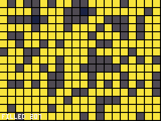

- It fills whatever `x, y` holds: start on an empty cell and it fills the
  empty area, on a wall and it fills the wall.
- About 2,100 units for 300 cells -- around 7 units a cell filled.

## grid.region(b, w, x, y, out)

The same area `grid.fill` would fill, without changing it: the indices of
its cells.

| Argument | |
|---|---|
| `b`, `w`, `x`, `y` | as for `grid.fill` |
| `out` | an `Int32Array` for the cells' indices |

**Returns** the area's size, in cells -- even if `out` is too short to
hold them all.

```js
var group = new Int32Array(W * H);
var n = grid.region(board, W, x, y, group);
if (n >= 3)                            // a group of three or more: pop it
    for (var k = 0; k < n; k++) board[group[k]] = 0;
```

- The groups in a "same game" or bubble puzzle: find the group under the
  cursor, and remove it if it is big enough.

## grid.runs(b, w, n, out)

Every cell that is part of a line of at least `n` equal, non-empty cells,
across or down. Match three.

| Argument | |
|---|---|
| `b`, `w` | the board and its width |
| `n` | the shortest line that counts: 3 for match three |
| `out` | an `Int32Array` for the cells' indices |

**Returns** how many cells are in lines. Each is listed once, in board
order, even where an across and a down line cross.

```js
const W = 8;
var board = new Uint8Array(W * W);
var hits = new Int32Array(64);
var n = 0;

// a board's cells as squares of size s from x, y, a colour from cols each
function drawBoard(b, w, x, y, s, cols) {
    for (var i = 0; i < b.length; i++) {
        var cx = x + (i % w) * s, cy = y + flr(i / w) * s;
        rectfill(cx, cy, cx + s - 2, cy + s - 2, cols[b[i]]);
    }
}

function init() {
    srand(11);
    for (var i = 0; i < W * W; i++) board[i] = 1 + rnd(5);
    n = grid.runs(board, W, 3, hits);           // every cell in a line of 3 or more
}

function draw() {
    cls(0);
    drawBoard(board, W, 32, 4, 14, [0, 8, 9, 11, 12, 14]);
    for (var k = 0; k < n; k++) {
        var x = 32 + (hits[k] % W) * 14, y = 4 + flr(hits[k] / W) * 14;
        rect(x - 1, y - 1, x + 13, y + 13, 7);
    }
    print(n + " IN LINES", 2, 2, 7);
}
```

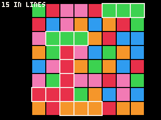

- Empty cells (0) never make a line.
- To clear the matches, set the listed cells to 0, then
  [`grid.fall`](#gridfallb-w) to drop the rest, then look again: a cascade.
- About 160 units for an 8x8 board.

## grid.full(b, w, out)
## grid.collapse(b, w, rows, n)

`grid.full` finds the rows with no empty cell; `grid.collapse` takes rows
out, those above dropping into their place. Falling blocks.

| Argument | |
|---|---|
| `b`, `w` | the board and its width |
| `out` | (`full`) an `Int32Array` for the rows' numbers |
| `rows` | (`collapse`) an array of row numbers to take out |
| `n` | (`collapse`) how many of `rows` to use |

**Returns** `full`: how many rows are full, listed top down in `out`.
`collapse`: how many rows it took out.

```js
const W = 8, H = 10;
var before = new Uint8Array(W * H), after = new Uint8Array(W * H);
var rows = new Int32Array(H);
var full = 0;

// a board's cells as squares of size s from x, y, a colour from cols each
function drawBoard(b, w, x, y, s, cols) {
    for (var i = 0; i < b.length; i++) {
        var cx = x + (i % w) * s, cy = y + flr(i / w) * s;
        rectfill(cx, cy, cx + s - 2, cy + s - 2, cols[b[i]]);
    }
}

function init() {
    srand(5);
    for (var y = 4; y < H; y++)
        for (var x = 0; x < W; x++) before[y * W + x] = rnd(10) < 7 ? 1 + rnd(4) : 0;
    for (x = 0; x < W; x++) { before[6 * W + x] = 2; before[8 * W + x] = 3; }
    copy(after, 0, before, 0, W * H);
    full = grid.full(after, W, rows);           // which rows are complete
    grid.collapse(after, W, rows, full);        // and take them out
}

function draw() {
    cls(0);
    drawBoard(before, W, 4, 18, 9, [1, 8, 9, 11, 12]);
    drawBoard(after, W, 84, 18, 9, [1, 8, 9, 11, 12]);
    print("BEFORE", 4, 6, 7);
    print("AFTER: " + full + " ROWS GONE", 84, 6, 7);
}
```

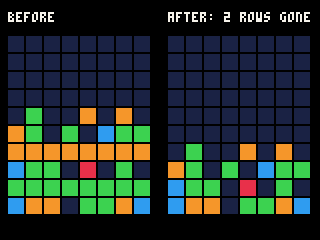

- `full`'s answer is just what `collapse` takes, so the two are used
  together. Count the rows for the score before collapsing.
- Empty rows come in at the top, as many as were taken out.

## grid.fall(b, w)

Every block drops straight down through the empty cells below it -- the
gravity in a match-three cascade or a puzzle where cleared cells leave
holes.

| Argument | |
|---|---|
| `b`, `w` | the board and its width |

**Returns** how many cells moved: 0 when everything was already down.

```js
const W = 8, H = 10;
var before = new Uint8Array(W * H), after = new Uint8Array(W * H);
var moved = 0;

// a board's cells as squares of size s from x, y, a colour from cols each
function drawBoard(b, w, x, y, s, cols) {
    for (var i = 0; i < b.length; i++) {
        var cx = x + (i % w) * s, cy = y + flr(i / w) * s;
        rectfill(cx, cy, cx + s - 2, cy + s - 2, cols[b[i]]);
    }
}

function init() {
    srand(8);
    for (var i = 0; i < W * H; i++) before[i] = rnd(10) < 4 ? 1 + rnd(5) : 0;
    copy(after, 0, before, 0, W * H);
    moved = grid.fall(after, W);
}

function draw() {
    cls(0);
    drawBoard(before, W, 4, 18, 9, [1, 8, 9, 11, 12, 14]);
    drawBoard(after, W, 84, 18, 9, [1, 8, 9, 11, 12, 14]);
    print("BEFORE", 4, 6, 7);
    print("AFTER: " + moved + " FELL", 84, 6, 7);
}
```

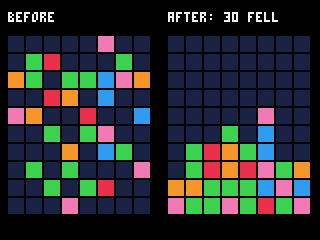

- Each column keeps its order: blocks land on one another, they do not
  pass.
- Call it until it returns 0 for blocks to fall a row a tick instead of
  all at once -- or once, and animate the drop yourself.

## grid.slide(b, w, dir, [merged])

Every block slides as far as it goes toward one side, and two equal blocks
that meet become one -- 2048's move.

| Argument | |
|---|---|
| `b`, `w` | the board and its width |
| `dir` | `DIR.LEFT`, `DIR.RIGHT`, `DIR.UP` or `DIR.DOWN` |
| `merged` | an `Int32Array`: the indices of the cells that merged, then -1 if there is room |

**Returns** how many cells changed, counting moves and merges: **0 when
nothing could move**, which in 2048 means the move does not count.

**A merge makes the next value up**, not the sum: two 1s make a 2, two 2s
a 3. Store a tile as its power of two -- 1 for 2, 2 for 4, 3 for 8 -- and
show it as `Math.pow(2, v)`.

```js
var board = new Uint8Array(16), merged = new Int32Array(16);
var changed = 0;
var start = [1, 1, 2, 0,
             0, 2, 2, 2,
             3, 0, 3, 1,
             1, 1, 1, 1];

function init() {
    for (var i = 0; i < 16; i++) board[i] = start[i];
    changed = grid.slide(board, 4, DIR.LEFT, merged);
}

// a tile's number: 2 to the power of its value
function tile(v) { return v ? "" + Math.pow(2, v) : ""; }

function show(b, x0) {
    for (var i = 0; i < 16; i++) {
        var x = x0 + (i % 4) * 18, y = 24 + flr(i / 4) * 18;
        rectfill(x, y, x + 16, y + 16, b[i] ? 8 + b[i] : 5);
        print(tile(b[i]), x + 9 - textw(tile(b[i])) / 2, y + 6, 0);
    }
}

function draw() {
    cls(1);
    var was = new Uint8Array(16);
    for (var i = 0; i < 16; i++) was[i] = start[i];
    show(was, 4);
    show(board, 84);
    for (var k = 0; merged[k] != -1 && k < 16; k++) {
        var x = 84 + (merged[k] % 4) * 18, y = 24 + flr(merged[k] / 4) * 18;
        rect(x - 1, y - 1, x + 17, y + 17, 7);
    }
    print("BEFORE", 4, 10, 7);
    print("SLID LEFT", 84, 10, 7);
}
```

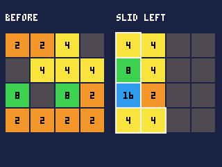

- A cell merges once a move: 2, 2, 2, 2 slides to 4, 4, not 8.
- `merged` is for the effect -- a pop, a sound -- on the cells that
  joined.
- About 30 units for a 4x4 board.

## grid.fits(b, w, s, sw, x, y)
## grid.place(b, w, s, sw, x, y)
## grid.rotate(s, sw, out, turns)

A falling piece. A **shape** is a small board of its own: a `Uint8Array`
`sw` wide, non-zero where the piece is. `fits` says whether it can go at
a place, `place` writes it onto the board, and `rotate` turns it.

| Argument | |
|---|---|
| `b`, `w` | the board and its width |
| `s`, `sw` | the shape and its width |
| `x`, `y` | the board cell for the shape's top left |
| `out` | (`rotate`) a `Uint8Array` as long as `s`, for the turned shape |
| `turns` | (`rotate`) quarter turns clockwise; negative goes the other way |

**Returns** `fits`: true or false. `place`: how many cells it wrote.
`rotate`: the turned shape's width -- a 3x2 piece turned once is 2 wide.

```js
var shape = new Uint8Array(6), turned = new Uint8Array(6);
var board = new Uint8Array(8 * 6);
var tee = [1, 1, 1,
         0, 1, 0];

// a board's cells as squares of size s from x, y, a colour from cols each
function drawBoard(b, w, x, y, s, cols) {
    for (var i = 0; i < b.length; i++) {
        var cx = x + (i % w) * s, cy = y + flr(i / w) * s;
        rectfill(cx, cy, cx + s - 2, cy + s - 2, cols[b[i]]);
    }
}

function init() {
    for (var i = 0; i < 6; i++) shape[i] = tee[i];
    for (var x = 0; x < 8; x++) board[5 * 8 + x] = x == 3 ? 0 : 2;
}

function draw() {
    cls(1);
    for (var k = 0; k < 4; k++) {
        var w = grid.rotate(shape, 3, turned, k);
        drawBoard(turned, w, 6 + k * 38, 14, 8, [1, 12]);
        print(k + (k == 1 ? " TURN" : " TURNS"), 6 + k * 38, 4, 6);
    }
    // the T, turned down, dropped into the gap
    var w2 = grid.rotate(shape, 3, turned, 2);
    var y = 0;
    while (grid.fits(board, 8, turned, w2, 2, y + 1)) y++;
    grid.place(board, 8, turned, w2, 2, y);
    drawBoard(board, 8, 44, 60, 9, [0, 12, 5]);
    print("DROPPED TO ROW " + y, 44, 50, 7);
}
```

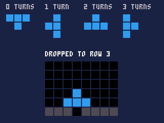

- `fits` is true when every cell of the piece lands on an empty cell.
  **Above the board's top counts as empty**, so a new piece can start
  partly above it; past the sides or the bottom does not.
- The usual drop: move the piece down while it fits one row lower, and
  place it when it no longer does.
- `out` may be `s` itself, turning the piece in place. To try a turn
  before keeping it, write it into a second array, test that with `fits`,
  and swap the two when it fits.

---

## path.field(b, w, solid, x, y, out)
## path.next(field, w, x, y)

A **distance field**: every open cell's distance in steps from one cell.
Any number of chasers then each find their way there with `path.next`,
one step downhill. One field serves every enemy heading for the player.

| Argument | |
|---|---|
| `b`, `w` | the board and its width |
| `solid` | which cells are walls: those whose sprite flags share a bit with `solid`; or with 0, any non-zero cell |
| `x`, `y` | the cell to measure from -- the place the chasers want to reach |
| `out` | an `Int32Array` as long as the board, for the distances |
| `field` | (`next`) a field `path.field` made |

**Returns** `field`: how many cells it reached. `next`: the direction
(`DIR.*`) one step nearer, or -1 at the start itself or where the start
cannot be reached.

`out` gets each cell's distance in steps, across and down only; walls and
cells that cannot be reached get -1.

```js
const W = 20, H = 15;
var board = new Uint8Array(W * H), dist = new Int32Array(W * H);
var reached = 0;

function init() {
    srand(7);
    for (var i = 0; i < W * H; i++) board[i] = rnd(10) < 3 ? 1 : 0;
    board[7 * W + 10] = 0;
    reached = path.field(board, W, 0, 10, 7, dist);   // steps from 10, 7 to everywhere
}

function draw() {
    cls(0);
    var ramp = [10, 9, 8, 14, 2, 1];
    for (var i = 0; i < W * H; i++) {
        var x = (i % W) * 8, y = flr(i / W) * 8;
        if (board[i]) rectfill(x, y, x + 6, y + 6, 5);
        else if (dist[i] >= 0) rectfill(x, y, x + 6, y + 6, ramp[min(5, dist[i] / 3)]);
    }
    // a chaser at 0, 0 follows the field downhill
    var cx = 0, cy = 0;
    if (board[0] == 0 && dist[0] >= 0)
        for (var s = 0; s < 40; s++) {
            var d = path.next(dist, W, cx, cy);
            if (d == -1) break;
            if (d == DIR.LEFT) cx--; else if (d == DIR.RIGHT) cx++; else if (d == DIR.UP) cy--; else cy++;
            circfill(cx * 8 + 3, cy * 8 + 3, 1, 7);
        }
}
```

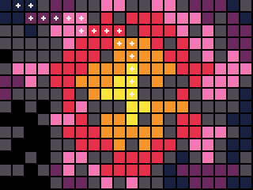

- **Walls on the map**: with the map's bytes (`mem(MEM.MAP)`, `mapw()`
  wide), `solid` is a flag -- `FLAG.solid` -- and walls are the cells
  whose sprite has it. With a board of your own, pass 0: any non-zero cell
  is a wall.
- Off the board is a wall.
- Make the field again only when its start moves to another cell, not
  every tick: about 2,300 units for 20x15, 31,000 for 64x64.

## path.find(b, w, solid, x0, y0, x1, y1, out)

One shortest way from one cell to another.

| Argument | |
|---|---|
| `b`, `w`, `solid` | as for `path.field` |
| `x0`, `y0` | where to start |
| `x1`, `y1` | where to get to |
| `out` | an `Int32Array` for the way's cells |

**Returns** the way's length in steps, or -1 when there is none.

`out` gets the cells' indices in order, **after** the start, ending on the
goal: a way of 7 steps lists 7 cells.

```js
const W = 20, H = 15;
var board = new Uint8Array(W * H), way = new Int32Array(W * H);
var steps = 0;

function init() {
    srand(21);
    for (var i = 0; i < W * H; i++) board[i] = rnd(10) < 3 ? 1 : 0;
    board[0] = 0;
    board[W * H - 1] = 0;
    steps = path.find(board, W, 0, 0, 0, W - 1, H - 1, way);
}

function draw() {
    cls(1);
    for (var i = 0; i < W * H; i++)
        if (board[i]) rectfill((i % W) * 8, flr(i / W) * 8, (i % W) * 8 + 6, flr(i / W) * 8 + 6, 5);
    circfill(3, 3, 3, 11);
    for (var k = 0; k < steps; k++) circfill((way[k] % W) * 8 + 3, flr(way[k] / W) * 8 + 3, k == steps - 1 ? 3 : 1, k == steps - 1 ? 8 : 10);
    print(steps < 0 ? "NO WAY" : steps + " STEPS", 2, 113, 7);
}
```

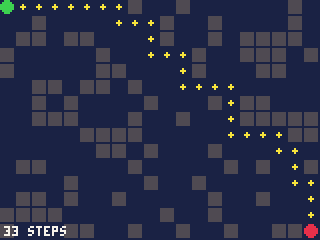

- For one traveller with one goal on an open board, `find` is cheaper
  than a field: about 1,300 units corner to corner on 20x15, against
  2,300. Among walls it searches further and can cost more: on the board
  above, about 1,650 against 1,600 for a field.
- It needs 10 bytes of scratch a cell, and boards up to 65,535 cells.

## path.sight(b, w, solid, x0, y0, x1, y1)

Whether one cell can see another: whether a straight line between their
centres crosses only open cells.

| Argument | |
|---|---|
| `b`, `w`, `solid` | as for `path.field` |
| `x0`, `y0`, `x1`, `y1` | the two cells |

**Returns** true or false.

```js
const W = 20, H = 15;
var board = new Uint8Array(W * H);
var gx = 9, gy = 7;   // the guard

function init() {
    srand(2);
    for (var i = 0; i < W * H; i++) board[i] = rnd(10) < 2 ? 1 : 0;
    board[gy * W + gx] = 0;
}

function draw() {
    cls(0);
    for (var y = 0; y < H; y++)
        for (var x = 0; x < W; x++) {
            var c = board[y * W + x] ? 5 : path.sight(board, W, 0, gx, gy, x, y) ? 10 : 1;
            rectfill(x * 8, y * 8, x * 8 + 6, y * 8 + 6, c);
        }
    circfill(gx * 8 + 3, gy * 8 + 3, 3, 8);
}
```

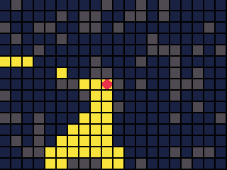

- The two cells themselves are not tested -- a guard standing in a
  doorway still sees out.
- No seeing through a diagonal gap: where the line passes exactly through
  a corner, both cells beside it must be open.
- About 25 units across a 20-cell board.

## path.view(b, w, solid, x, y, r, out, [mark])

What a player standing on a cell can see: a roguelike's field of view,
every cell at once.

| Argument | |
|---|---|
| `b`, `w`, `solid` | the board, as for `path.sight` |
| `x`, `y` | the cell seen from |
| `r` | how far, in cells |
| `out` | a `Uint8Array` the board's size |
| `mark` | left out: `out` is cleared and each seen cell set to 1. Given: only the seen cells are set to it, the rest kept |

**Returns** how many cells are seen.

Each cell within `r` is seen exactly when `path.sight` would see it, so
the two never disagree. A wall facing the player is seen -- a room shows
its walls -- and what is behind one is not.

```js
var seen = new Uint8Array(W * H), known = new Uint8Array(W * H);

function look() {
    path.view(board, W, 0, px, py, 6, seen);      // in sight now
    path.view(board, W, 0, px, py, 6, known, 1);  // and kept: the map so far
}
```

- From a cell off the board nothing is seen, and 0 is returned.
- About 20 units, and a quarter of a unit for each cell along each line
  looked down: a radius of 6 costs a few hundred.

## path.ray(x, y, dx, dy, solid, out, [len])

A ray across the active map, in **pixels**: from a point along a
direction, the first map cell it meets that is solid, and exactly where.
Shots, lasers, bounces, and line of sight between things that are not on
cell centres.

| Argument | |
|---|---|
| `x`, `y` | where it starts, in world pixels (fractions allowed) |
| `dx`, `dy` | its direction: any length |
| `solid` | flags: the ray stops at cells whose sprite shares a bit with them |
| `out` | an array of at least five, `[0, 0, 0, 0, 0]`, or an `Int32Array` |
| `len` | how far to look, in pixels: 1024 when left out, up to 65,536 |

**Returns** 1 when it hits, 0 when it goes clear.

`out` gets the point hit (x and y, on the face exactly), the cell's column
and row, and **the face it met**: `DIR.LEFT` for the cell's left face, and
so on; -1 if the ray started inside a solid cell.

```js
var hit = [0, 0, 0, 0, 0];

function init() {
    fset(1, 1);
    for (var c = 0; c < 20; c++) { mset(c, 0, 1); mset(c, 14, 1); }
    for (var r = 0; r < 15; r++) { mset(0, r, 1); mset(19, r, 1); }
    for (r = 4; r < 11; r++) mset(12, r, 1);
}

function draw() {
    cls(1);
    for (var r = 0; r < 15; r++)
        for (var c = 0; c < 20; c++)
            if (mget(c, r)) rectfill(c * 8, r * 8, c * 8 + 7, r * 8 + 7, 5);
    // a laser from 20, 30, bounced off each face it meets, five times
    var x = 20.0, y = 30.0, dx = 1.0, dy = 0.6;
    for (var b = 0; b < 5; b++) {
        if (!path.ray(x, y, dx, dy, 1, hit)) break;
        line(x, y, hit[0], hit[1], 8);
        circfill(hit[0], hit[1], 1, 10);
        if (hit[4] == DIR.LEFT || hit[4] == DIR.RIGHT) dx = -dx; else dy = -dy;
        x = hit[0] + dx; y = hit[1] + dy;   // a step off the face
    }
}
```

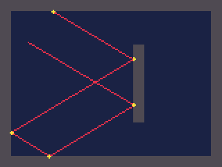

- The point hit is a fraction. An `Int32Array` takes it rounded down --
  enough to mark the cell, not to bounce exactly; use an array to bounce.
  One shorter than five stops the cart: "path.ray() writes to an array or
  Int32Array of at least five".
- To bounce, reverse `dx` on a left or right face and `dy` on an up or
  down face, and start the next ray a step off the face -- from exactly on
  it, it would hit the same face again.
- Off the map is open. About 230 units for a ray 150 pixels long.

---

## noise.at(x, y, seed, [octaves])

Smooth random noise: a value that changes gradually from place to place,
the same every time for the same place and seed. Hills, clouds, caves,
wind that gusts.

| Argument | |
|---|---|
| `x`, `y` | where, in lattice units: the noise changes about once a unit |
| `seed` | which noise: each seed is a different world |
| `octaves` | how many layers of finer detail, 1 to 8; 1 when left out |

**Returns** a fraction from 0 to just under 1.

```js
var gust = noise.at(t() * 0.5, 0, 7);        // a wind that rises and falls
var h = flr(noise.at(x / 40.0, 0, 3, 3) * 60);   // a hill's height along x
```

- Each octave adds detail at twice the fineness and half the weight: 1 is
  smooth and rolling, 4 rough and natural.
- Divide positions down: `x / 40.0` changes about once every 40 pixels.
- About 18 units a call, and 11 more for each octave after the first:
  fine for a few a tick, not for every pixel -- that is `noise.fill`.

## noise.fill(dst, w, ox, oy, scale, octaves, seed, ramp)

Fills a whole board or image with noise, each value one of a list: a
terrain map, a cave, a cloudy sky, in one call.

| Argument | |
|---|---|
| `dst` | a `Uint8Array` board, or an image (which brings its own width) |
| `w` | the board's width; ignored for an image -- pass 0 |
| `ox`, `oy` | where in the noise the top left is: move them to scroll |
| `scale` | how many cells to one lattice unit: bigger is smoother |
| `octaves` | 1 to 8, as for `noise.at` |
| `seed` | which noise |
| `ramp` | the values to use, low noise to high: an array of numbers, or a count `n` for 0 to `n - 1` |

**Returns** how many cells it filled.

```js
var terrain;

function init() {
    terrain = img(160, 120);
    // eight bands, deep sea to snow, from four octaves of noise
    noise.fill(terrain, 0, 0, 0, 40, 4, 99, [1, 1, 12, 15, 11, 3, 4, 7]);
}

function draw() {
    blit(terrain, 0, 0);
}
```

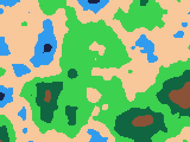

- With an image and a ramp of colours, the result is a picture ready to
  `blit`; with a board and a ramp of tile numbers, a level ready to play.
  Copy a board into the map with `copy(mem(MEM.MAP), ...)`.
- The ramp splits the noise into equal bands, so repeat a value to make
  its band wider -- the example's sea is four of eight bands.
- **It is costly**: 12 units a cell an octave -- about 230,000 units for a
  160x120 image with one octave, 922,000 with four. That is many ticks'
  worth: do it in `init()`, or a strip at a time, never every frame.
  Eight octaves of a whole screen is over 1,800,000 -- near the
  2,000,000 a tick may use, but well inside the 8,000,000 `init()` may.
