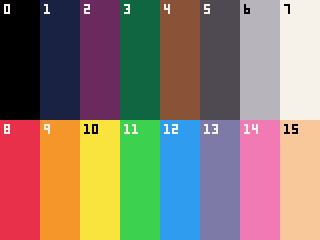
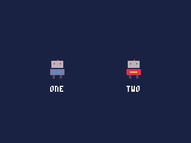
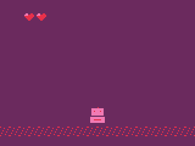
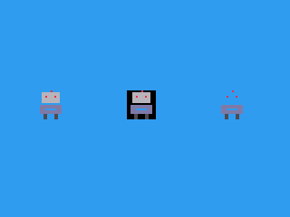
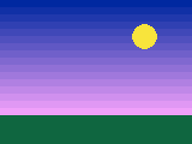
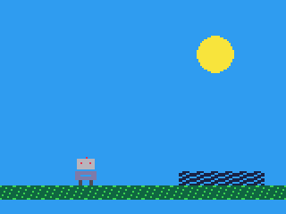
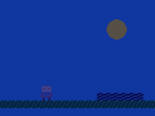
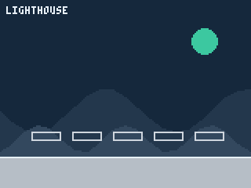
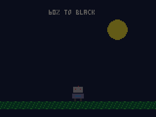
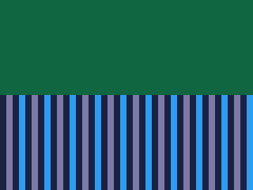

# Colour and palettes

What the colour numbers look like, and how to change it: recolouring a
sprite, see-through colours, fades, flashes, colour cycling, and a cart's
own palettes.

- [How colour works](#how-colour-works)
- Drawing in other colours: [pal](#palc0-c1-p), [palt](#paltc-t)
- What the colours look like: [setpal](#setpali-rgb), [getpal](#getpali),
  [loadpal](#loadpalpalname)
- Colours made at run time: [the iPod's colours, and shades of any colour](#the-ipods-colours-and-shades-of-any-colour)
- [Fades, flashes and cycling](#fades-flashes-and-cycling)

## How colour works

Every pixel holds a **colour number**, 0 to 255. What each number looks
like is set by the **palette**: 256 entries, each a colour given as red,
green and blue. Drawing never deals in red, green and blue -- only in
numbers -- so changing an entry of the palette changes, at once, every
pixel of that number on the screen, without anything being drawn again.

A new cart's palette starts with sixteen colours in entries 0 to 15:



| # | Colour | `0xRRGGBB` | # | Colour | `0xRRGGBB` |
|---|---|---|---|---|---|
| 0 | black | `0x000000` | 8 | red | `0xe8304a` |
| 1 | dark blue | `0x1a2244` | 9 | orange | `0xf5962a` |
| 2 | dark purple | `0x6b2a5e` | 10 | yellow | `0xf8e43c` |
| 3 | dark green | `0x0f6640` | 11 | green | `0x3cd250` |
| 4 | brown | `0x8a5236` | 12 | blue | `0x2f9cf0` |
| 5 | dark grey | `0x4f4a52` | 13 | lavender | `0x7e7aa8` |
| 6 | light grey | `0xb8b4bc` | 14 | pink | `0xf27ab4` |
| 7 | white | `0xf6f2ea` | 15 | peach | `0xf9c89a` |

Each plays the part the same number plays in PICO-8 -- 0 black, 7 white,
8 red, 12 blue -- so code and art from there keep their colours. Entries
16 to 255 start black, ready for colours of your own.

**A cart's own palettes.** A cart can carry palettes as files in its
`palettes/` folder, in GIMP's `.gpl` format, each with up to 256 colours.
In the IDE, add one with **File > New file > A palette**, and open it to
edit its colours as swatches; images and the sheet can also bring colours
into it when they are pasted in. The first palette by name is loaded when
the cart starts, and each is `PAL.<name>` in code, for
[loadpal](#loadpalpalname).

**Colour 0 is see-through** in sprites, the map and images: drawn, it
leaves what was under it. Shapes and text are not affected -- colour 0 is
black for them. [palt](#paltc-t) changes which colours are see-through.

**The iPod's screen** shows 65,536 colours, five or six bits each of red,
green and blue, so two palette colours very close together can look the
same on it. The palette keeps the full colour you give it.

**Three tables, one call each.** Between a colour number in your code and
the light on the screen there are three tables, each changed by its own
call:

| Table | Changed by | Affects |
|---|---|---|
| The **draw palette**: which number is written when you draw a number | `pal(c0, c1)` | drawing from now on |
| **Transparency**: which numbers are left out of sprites, the map and images | `palt(c, t)` | drawing from now on |
| The **screen palette** and the **palette** itself: what each number looks like | `pal(c0, c1, 1)`, `setpal`, `loadpal` | the whole screen, at once |

**What it costs.** The calls themselves are almost free -- about 3 units
for `pal` or `setpal`, 26 for `loadpal`. But on the iPod, **any change to
what the colours look like makes the iPod send the whole screen** that
frame, not just the rows that changed: up to 6.6 ms on an iPod Video
playing FLAC. That is `setpal`, the screen form of `pal`, `loadpal`, and
`pal()` with nothing in the brackets, which resets the screen palette too.
A fade or a flash is worth it; resetting with `pal()` every frame out of
habit is not. Reset the draw palette one colour at a time instead, with
`pal(c)`. The IDE counts it too: a frame that changes the palette is
charged the whole screen in its frame rate and the profiler.

---

## pal([c0, c1], [p])

Swaps one colour for another: in what is drawn from now on, or in how the
whole screen is shown.

| Argument | |
|---|---|
| `c0` | the colour number to swap |
| `c1` | the colour to use instead; `c0` itself when left out, undoing a swap |
| `p` | 0 (or left out) for the draw palette; 1 for the screen palette |

`pal()`, with nothing, undoes every swap of both kinds, and puts
transparency back as well (only colour 0 see-through).

**Returns** nothing.

**Drawing in other colours** -- `pal(c0, c1)`. Everything drawn after it
writes `c1` wherever it would have written `c0`: sprites, the map,
images, shapes and text. Pixels already on the screen are not changed.
The classic use is a second player, or an enemy that flashes when hit,
from the same sprite:

```js
cls(1);
spr(16, 40, 50, 2, 2);          // player one, as drawn
pal(13, 8);                     // body: lavender becomes red
pal(12, 10);                    // chest light: blue becomes yellow
spr(16, 104, 50, 2, 2);         // player two
pal(13);                        // undo the two swaps
pal(12);
print("ONE", 42, 72, 7);
print("TWO", 106, 72, 7);
```



**Showing the screen in other colours** -- `pal(c0, c1, 1)`. Nothing is
drawn differently; instead every pixel of colour `c0` already on the
screen, and every one drawn after, *shows* as `c1` does. It lasts until
undone, across frames. A whole screen tinted for a moment -- the player
hurt -- is a loop over the colours:

```js
// what each colour shows as while hurt: dark ones purple, the rest red or pink
var HURT = [0, 2, 2, 2, 8, 2, 14, 14, 8, 8, 14, 8, 8, 14, 14, 14];
var hurt = 4;                   // set to 4 when hit: four frames of red

function draw() {
    cls(1);
    for (var i = 0; i < 20; i++) spr(4, i * 8, 104);
    spr(16, 72, 88, 2, 2);
    spr(3, 20, 10);
    spr(3, 30, 10);
    if (hurt > 0) {
        for (var c = 0; c < 16; c++) pal(c, HURT[c], 1);
        hurt--;
    } else pal();
}
```



- The swaps last until undone, across frames: undo them when done, or
  every later draw -- text included -- comes out swapped.
- `pget` reads the colour *drawn*, so after `pal(8, 12, 1)` a red pixel
  still reads as 8.
- The screen form sends the whole screen (see [What it costs](#how-colour-works));
  as above, it is meant for moments, not every frame.

## palt([c], [t])

Says whether a colour is see-through in sprites, the map and images.

| Argument | |
|---|---|
| `c` | the colour number |
| `t` | true to make it see-through; false, or left out, to make it drawn |

`palt()`, with nothing, puts it back as it starts: colour 0 see-through,
every other colour drawn.

**Returns** nothing.

```js
cls(12);
spr(16, 20, 50, 2, 2);          // colour 0 is see-through
palt(0, false);
spr(16, 70, 50, 2, 2);          // colour 0 drawn, as black
palt();
palt(6, true);
spr(16, 120, 50, 2, 2);         // colour 6, the head, see-through
palt();
```



- It applies to `spr`, `sspr`, `rspr`, `map`, `blit` and the other
  copying calls -- not to shapes, text or `pset`, which always draw their
  colour.
- Several colours can be see-through at once: call it once for each.
- It lasts, across frames, until changed. `pal()` resets it too.
- A sprite that needs black in it can use another black: draw it in a
  colour number of your own set to black with `setpal`, and keep 0 as the
  see-through one.

## setpal(i, rgb)

Sets what one entry of the palette looks like.

| Argument | |
|---|---|
| `i` | the entry, 0 to 255 |
| `rgb` | the colour, as `0xRRGGBB`: red, green and blue, two hexadecimal digits each |

**Returns** nothing.

Every pixel of colour `i` on the screen changes at once. Entries 16 to
255 start black, so `setpal` is also how a cart gets more than sixteen
colours -- a smooth sky, say:

```js
for (var i = 0; i < 16; i++) setpal(16 + i, (16 * i) << 16 | (40 + 8 * i) << 8 | 160 + 6 * i);
for (var i = 0; i < 16; i++) rectfill(0, i * 6, 159, i * 6 + 5, 16 + i);
rectfill(0, 96, 159, 119, 3);
circfill(120, 30, 10, 10);
```



- `r << 16 | g << 8 | b` makes the `0xRRGGBB` number from red, green and
  blue, each 0 to 255.
- The entry is taken `& 255`: 256 is entry 0 again.
- It sends the whole screen on the iPod that frame (see
  [What it costs](#how-colour-works)). Setting colours once in `init()`
  costs nothing afterwards.

## getpal(i)

What one entry of the palette looks like.

| Argument | |
|---|---|
| `i` | the entry, 0 to 255 |

**Returns** its colour as `0xRRGGBB`: `getpal(12)` is `0x2f9cf0`,
3,120,368.

Read the colours before changing them, to put them back after a fade:

```js
var base = [];

function init() {
    for (var i = 0; i < 16; i++) base.push(getpal(i));
}
```

- `(c >> 16) & 255`, `(c >> 8) & 255` and `c & 255` take the red, green
  and blue back out.

## loadpal(PAL.name)

Loads one of the cart's palettes.

| Argument | |
|---|---|
| `PAL.name` | the palette, named after its file: `palettes/night.gpl` is `PAL.night` |

**Returns** nothing.

The palette's colours replace the entries they cover, from 0 up: a
16-colour palette replaces 0 to 15 and leaves the rest as they were. The
same art in another palette is a cheap change of scene -- day and night,
summer and winter, a level's own look:

```js
function init() {
    loadpal(PAL.b_night);
}
```

| `a_day`, loaded at the start | after `loadpal(PAL.b_night)` |
|---|---|
|  |  |

- The first palette, by file name, is loaded when the cart starts: name
  files so the one you want first sorts first (`a_day`, `b_night`).
- A cart with no palette files starts with the sixteen above.
- It sends the whole screen on the iPod that frame.

## The iPod's colours, and shades of any colour

`playback.colors` gives the colours the iPod is showing, and the
`colour` calls make more from them -- so a cart can dress itself in the
playing album's colours, as the iPod's own screens do under **Dynamic
Colours**, or in the theme's.

| Call | Returns |
|---|---|
| `playback.colors(out)` | the background, the text and the most vivid colour into `out`, an `Int32Array` of 3; 1 when they are the playing album's, 0 when they are the theme's |
| `color.tone(c)` | how light `c` reads, 0 black to 100 white |
| `color.toned(c, tone)` | `c` at that tone, its hue kept |
| `color.turn(c, t)` | `c`'s hue turned by `t` turns, its tone kept: 0.5 is the opposite hue |
| `color.mix(a, b, t)` | `a` moved toward `b`, `t` from 0 to 1.0 |
| `color.contrast(a, b)` | how well two colours stand apart, 1.0 to 21.0 |

Every colour is `0xRRGGBB`, as `setpal` takes. Tone is the measure to
build shades with: two colours read apart by the gap between their tones,
whatever their hues, so shades a few tones apart look evenly spaced in
any colour. Here three shades of the album's background make the sky and
the hills, three of its text colour the ground, and the vivid colour the
sun; when the track changes, so does the scene:

```js
var c = new Int32Array(3);
var far = [], near = [], hx = [];

// The album's colours made into a palette: three shades of its
// background, three of its text, and its vivid colour
function shades() {
    playback.colors(c);
    var paper = c[0], ink = c[1], t = color.tone(paper), k = color.tone(ink);
    var away = t < k ? 8 : -8;            // toward the text, so shades show
    for (var i = 0; i < 3; i++) {
        setpal(16 + i, color.toned(paper, t + away * i));
        setpal(19 + i, color.toned(ink, k - away * i));
    }
    setpal(22, c[2]);
}

function init() {
    shades();
    for (var x = 0; x <= 160; x += 8) {
        hx.push(x);
        far.push(70 - flr(14 * sin(x / 90.0)));
        near.push(88 - flr(9 * sin(x / 55.0 + 0.3)));
    }
    hx.push(160, 0);
    far.push(119, 119);
    near.push(119, 119);
}

function update() {
    if (playback.changed()) shades();
}

function draw() {
    cls(16);
    polyfill(hx, far, hx.length, 17);
    polyfill(hx, near, hx.length, 18);
    rectfill(0, 100, 159, 119, 21);
    line(0, 100, 159, 100, 19);
    for (var i = 0; i < 5; i++) rect(20 + 26 * i, 84, 38 + 26 * i, 89, 20);
    circfill(130, 26, 8, 22);
    print(playback.title(), 4, 4, 19);
}
```



- The colours change with the album, so ask again on
  `playback.changed()`; the palette change sends the whole screen that
  frame, and nothing else costs anything afterwards.
- With **Dynamic Colours** off, or no music, they are the theme's
  background and text, and the vivid colour is the text's.
- `color.toned` costs about 950 units and `color.turn` about 1,450,
  so build the palette when it changes, not every frame: the example's
  six shades are some 5,700 units, once a track. The other calls cost
  next to nothing.
- A colour whose hue cannot be shown at the tone asked loses some of its
  strength rather than its hue; a grey has no hue to turn.
- `color.contrast` says whether text will read: 4.5 or more against its
  background. Where it is short, `color.toned` the text further from the
  background's tone.
- In the IDE and `pbgvm`, each made-up album has colours of its own while
  its music plays. An exported web page gets black and white.

---

## Fades, flashes and cycling

Three effects that change the palette rather than the pixels, so nothing
is drawn again for them.

**A fade** sets every colour part of the way to black (or white, or any
colour), from the colours read at the start:

```js
var base = [];

// every colour t of the way to black: 0 as it was, 1.0 black
function fade(t) {
    var k = 1.0 - t;
    for (var i = 0; i < 16; i++) {
        var c = base[i];
        var r = flr(((c >> 16) & 255) * k), g = flr(((c >> 8) & 255) * k), b = flr((c & 255) * k);
        setpal(i, r << 16 | g << 8 | b);
    }
}

function init() {
    for (var i = 0; i < 16; i++) base.push(getpal(i));
    fade(0.6);
}
```



Call `fade` with a `t` that grows a little each frame -- over half a
second, 0.06 a frame at 33 ticks a second -- and the screen fades out.

**A flash** sets every colour to one, for a frame or two -- white for a
hit, red for a blast -- with the screen form of `pal`, as in
[pal](#palc0-c1-p)'s example.

**Colour cycling** turns a few entries round, each taking the next one's
look, so stripes drawn in them seem to flow -- water, lava, a conveyor --
without being redrawn:

```js
var water = [12, 1, 13, 1];

function init() {
    // entries 16 to 19, as blue, dark blue, lavender, dark blue
    for (var i = 0; i < 4; i++) setpal(16 + i, getpal(water[i]));
}

function draw() {
    cls(3);
    // stripes of 16 to 19, which the cycle turns
    for (var x = 0; x < 160; x++) line(x, 60, x, 119, 16 + (x >> 2) % 4);
    // every 6 ticks, each colour takes the next one's look
    if (frame() % 6 == 0) {
        var first = getpal(16);
        for (var i = 16; i < 19; i++) setpal(i, getpal(i + 1));
        setpal(19, first);
    }
}
```



The library **`lib/palfx.js`** has all three ready-made --
`palfx.fade(t, rgb)`, `palfx.flash(rgb)` and `palfx.cycle(first, n,
ticks)`. The first fade or flash keeps the palette as it is, to go back
to; after a `loadpal` or `setpal`, call `palfx.keep()` so they go back to
the new colours. Copy it into the cart and call them as above.

Each of these sends the whole screen on the iPod in the frames it changes
a colour. A fade over half a second is fine; a cycle that changes every
frame for the whole game costs that every frame. Change it every few
frames, as the example does.
