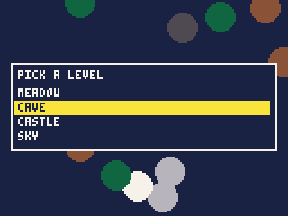
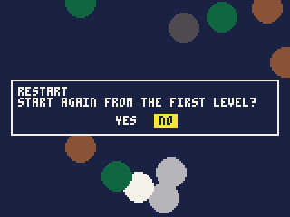
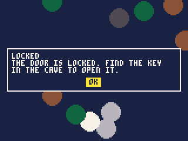
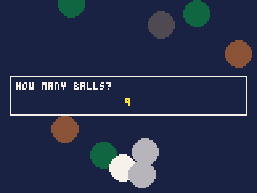
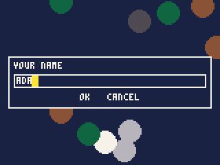
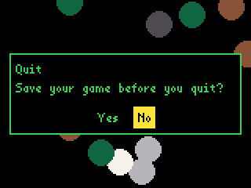

# Dialogs and speech

Asking the player something -- pick one of these, are you sure, how many,
what is your name -- in boxes that work like the iPod's own menus; and
having the iPod speak.

- [How dialogs work](#how-dialogs-work)
- [ui.choose](#uichooseprompt-items-at), [ui.confirm](#uiconfirmtext-title),
  [ui.message](#uimessagetext-title), [ui.number](#uinumberprompt-min-max-value-step),
  [ui.text](#uitextprompt-max-start), [ui.style](#uistylebox-text-highlight)
- Speech: [speak.say](#speaksayvalue-more), [speak.queue](#speakqueuevalue-more),
  [speak.busy](#speakbusy), [speak.stop](#speakstop), [speak.on](#speakon)
- The iPod's own: [sys.setting](#syssettingname), [sys.translate](#systranslatephrase)
- [Trying them out](#trying-them-out)

## How dialogs work

**A dialog waits for its answer.** `ui.confirm("Quit?")` does not return
until the player has chosen Yes or No; the function that called it simply
carries on with the answer, like any other function call:

```js
if (ui.confirm("START AGAIN?")) start();
```

While a dialog is open the game is frozen: no `update()`, no `draw()`, and
the game's clock (`t()`, `frame()`) does not move. The time it is open is
not charged to the cart, so a dialog never makes the game run late.

**It is drawn over the game**, in a box across the middle of the screen,
with whatever the game last drew still showing round it. When it closes,
the screen and the drawing state -- camera, clip, pen colour, palette --
are put back as they were.

**It looks like the game.** A dialog draws in the cart's current
[font](reference-text.md#fontf-size) and size, and in the colours
[ui.style](#uistylebox-text-highlight) sets, so it can match the game;
text the font cannot draw is shown in `FONT.WORLD` instead. Long text
wraps to the box, and scrolls with the wheel when it does not fit.

**It works like the iPod's menus:**

| | |
|---|---|
| the wheel | moves the highlight; in a number, changes it; in a text line, turns the letter |
| Prev, Next | the highlight one step left or up, right or down |
| Select | chooses |
| Menu | backs out: the dialog closes with its "nothing chosen" answer |

When the owner has the iPod's menus spoken, a dialog speaks its prompt
and each choice as it is highlighted, as the iPod's own menus do.

Dialogs can be opened from `init()`, `update()` or `draw()`, or from a
pause-menu item's function.

---

## ui.choose(prompt, items, [at])

A list to choose one from.

| Argument | |
|---|---|
| `prompt` | the question, over the list |
| `items` | a list of 1 to 32 texts, each cut to 48 bytes |
| `at` | the item highlighted to begin with, 0 first; 0 when left out |

**Returns** the index of the item chosen, 0 first, or -1 when the player
backed out with Menu.

```js
var levels = ["MEADOW", "CAVE", "CASTLE", "SKY"];
var i = ui.choose("PICK A LEVEL", levels, 0);
if (i >= 0) startLevel(i);
```



- A long list scrolls to keep the highlight in view.
- With `store.list()`, it makes a load-which-save menu.

## ui.confirm(text, [title])

A yes-or-no question.

| Argument | |
|---|---|
| `text` | the question |
| `title` | a heading over it |

**Returns** true for Yes; false for No, or when backed out of.

```js
if (ui.confirm("START AGAIN FROM THE FIRST LEVEL?", "RESTART")) start();
```



- **No is highlighted first**, so a player pressing Select by mistake
  does not lose a game. Ask the question so that No is the safe answer.

## ui.message(text, [title])

Something to read, and OK.

| Argument | |
|---|---|
| `text` | the message: up to 1024 bytes, wrapped to the box |
| `title` | a heading over it |

**Returns** nothing, once it has been read and closed.

```js
ui.message("THE DOOR IS LOCKED. FIND THE KEY IN THE CAVE TO OPEN IT.", "LOCKED");
```



- `"\n"` starts a new line. Text too long for the box scrolls with the
  wheel.

## ui.number(prompt, min, max, value, [step])

A number, chosen with the wheel.

| Argument | |
|---|---|
| `prompt` | the question |
| `min`, `max` | the least and the most it can be; `min` must be below `max` |
| `value` | the number it starts at |
| `step` | how much it moves each 6 clicks of the wheel, or each press of Prev or Next; 1 when left out |

**Returns** the number chosen, or `value` -- kept between `min` and `max`
-- when backed out of.

```js
balls = ui.number("HOW MANY BALLS?", 1, 9, 3);
```



- The wheel turns it a step for every 6 clicks; Prev and Next step it
  once, and repeat when held.

## ui.text(prompt, max, [start])

A line of text, typed with the wheel.

| Argument | |
|---|---|
| `prompt` | the question |
| `max` | the most bytes it may hold, 1 to 64: A to Z, digits and punctuation take one each, other letters 2 or 3 (8 holds 8 capitals, but only 2 kana) |
| `start` | the text it starts with |

**Returns** the text, or `null` when backed out of.

```js
var name = ui.text("YOUR NAME", 8, "ADA");
if (name != null) score.submit(BOARD.points, points, name);
```



How it is typed, as on the iPod:

- **Turning the wheel** puts a letter in at the caret and turns it
  through the letters, a letter every 6 clicks.
- **Next** keeps the letter and moves on; **Prev** moves back. Held, they
  delete.
- **Select** takes the text as it is.
- **Play** moves down to OK and Cancel; **Menu** from there goes back to
  the text, and from the text backs out.

The letters offered are those the current font can draw: in `FONT.CAPS`,
capitals, digits and punctuation; in `FONT.WORLD`, the owner's language's
letters too.

## ui.style(box, text, highlight)

The colours dialogs are drawn in, from now on.

| Argument | |
|---|---|
| `box` | the box's background |
| `text` | its text and edge |
| `highlight` | the chosen item's bar |

All three are colour numbers, 0 to 255. Until it is called they are 1, 7
and 10: dark blue, white and yellow.

**Returns** nothing.

```js
ui.style(0, 11, 10);             // black box, green text, a yellow bar
font(FONT.WORLD);
ui.confirm("Save your game before you quit?", "Quit");
```



- `lib/gui.js` draws the same box, buttons and lists for a cart's own
  screens, in the same style.

---

## speak.say(value, ...more)

Says something, with the iPod's speech synthesiser.

| Argument | |
|---|---|
| `value`, `more` | any number of values -- text and numbers -- said as one phrase, a pause between each |

**Returns** nothing.

Anything already being said is cut off.

```js
speak.say("Level", level);       // "Level 3"
```

## speak.queue(value, ...more)

Says something after what is being said now, as for `speak.say`.

```js
speak.say("Game over");
speak.queue("You scored", points);
```

## speak.busy()

**Returns** whether anything is still being said or waiting to be.

## speak.stop()

Stops speaking, and forgets anything queued.

## speak.on()

**Returns** whether the owner has the iPod's menus spoken.

```js
if (speak.on()) speak.say("Press select to start");
```

- A cart that narrates its screens -- reading out the menu, the score, the
  level -- for players who cannot see them should do so when this is true,
  as the iPod's own menus do.
- A cart whose game *is* speech can speak whatever this says, but nothing
  is heard if the owner has the synthesiser switched off.
- Each call costs about 20 units; the speaking itself is the iPod's.
- A phrase is at most 512 bytes; more is cut off.

---

## sys.setting(name)

One of the owner's iPod settings, read-only.

| Argument | |
|---|---|
| `name` | the setting's name as the iPod's `config.cfg` file writes it: `volume`, for instance |

**Returns** a number when the setting is one, otherwise its text as
`config.cfg` writes it (`"on"`, a choice's name, a colour as `rrggbb`), or
`null` when there is no such setting.

```js
var v = sys.setting("volume");   // the owner's volume, in dB
```

- About 50 units. Settings rarely change while a game runs: read one in
  `init()`.

## sys.translate(phrase)

A phrase the iPod already knows, in the owner's language.

| Argument | |
|---|---|
| `phrase` | the phrase in English, exactly as the iPod's English menus show it |

**Returns** it in the owner's language, or the phrase as given when the
iPod does not know it.

```js
var resume = sys.translate("Resume Game");
```

- It searches every phrase the iPod has, about 500 units: translate
  once, in `init()`, and keep the answer.
- It knows only the iPod's own phrases -- menu words such as "Resume
  Game", "Yes", "Quit" -- not a cart's own text.

---

## Trying them out

In the IDE, dialogs open in the Player and work with the keys: Up and
Down for the wheel, Left and Right for Prev and Next, Enter for Select,
Space for Play, Esc for Menu.

`pbgvm` prints a line for each dialog saying what it showed, and works it
a tick at a time from `--buttons` and `--wheel`, backing out when the
ticks run out (so `--shot` then shows it open). With `--ui` it takes
answers instead, in order, at once:

```
$ pbgvm game.pbg --ui 2,1,7,BOB,~
choose P: A|B|C at 0 -> 2
confirm Q? -> 1
number N: 1 to 9 by 1 from 3 -> 7
text T: [] up to 8 -> BOB
text T: [] up to 8 -> ~
```

-- an index for `choose` (-1 backs out), 1 or 0 for `confirm`, a number
for `number`, text for `text` (`~` backs out); `message` takes none.
`--speech` makes `speak.on()` true, and each `speak.say` and
`speak.queue` prints what it would say. `--setting name=value` gives
`sys.setting` a value; `sys.translate` gives English.
