# Drawing

Shapes, pixels, and the settings that change where and how everything is
drawn. Text is in **Text and fonts**, colours and palettes in **Colour**,
sprites and the map in their own chapters; they all draw by the rules on
this page.

- [How drawing works](#how-drawing-works)
- Clearing and pixels: [cls](#clsc), [pset](#psetx-y-c), [pget](#pgetx-y)
- Lines and shapes: [line](#linex0-y0-x1-y1-c), [rect and rectfill](#rectx0-y0-x1-y1-c),
  [circ and circfill](#circx-y-r-c), [oval and ovalfill](#ovalx0-y0-x1-y1-c),
  [tri and trifill](#trix0-y0-x1-y1-x2-y2-c), [polyfill](#polyfillxs-ys-n-c-ends-bend-boxes),
  [polyboxes](#polyboxesxs-ys-n-ends), [polyline](#polylinexs-ys-n-c-ends-closed)
- The drawing state: [color](#colorc), [fillp](#fillpp), [camera](#camerax-y-turn-px-py-zoom),
  [clip](#clipx0-y0-x1-y1), [target](#targett)

## How drawing works

**The screen** is 160 pixels across and 120 down. x counts across from 0
at the left, y counts down from 0 at the top, so the bottom-right pixel is
159, 119. Each pixel holds a **colour number** -- 0 to 15 in a new cart,
up to 255 -- and what each number looks like is the palette's business
(see **Colour**).

**A frame is drawn from scratch.** The usual `draw()` starts by clearing
the screen with `cls()` and then draws everything in the frame, back to
front: what is drawn later covers what was drawn before. Nothing is
remembered as an object -- a circle, once drawn, is just coloured pixels.

**Anything off the screen is cut off.** A shape partly off the edge draws
the part that is on, and one wholly off draws nothing, at no cost to
speak of. Positions far outside the screen are fine.

**Positions and sizes are whole pixels.** A fraction given as a position
is rounded down, so a ball at x = 10.7 is drawn at pixel 10. Keep
positions as fractions for smooth movement; the drawing takes care of it.

**Colours are optional.** Every drawing function's colour can be left
out, and then it draws in the **pen colour**. Giving a colour also makes
it the pen colour from then on, so

```js
rectfill(0, 0, 9, 9, 12);
circ(30, 30, 10);           // blue, like the rectangle
```

draws both in colour 12. The pen starts as 6, light grey.

**The drawing state lasts.** The pen colour, the [fill pattern](#fillpp),
the [camera](#camerax-y-turn-px-py-zoom), the [clip](#clipx0-y0-x1-y1) and the
[target](#targett) stay as they were set, from one call to the next and
from one frame to the next, until changed. Set them, draw, and set them
back.

**What it costs.** Each tick has a budget of work, counted in units --
about 12,500 a tick on an iPod Video playing FLAC, the slowest case (see
**Making it fast**). The costs below are measured on the engine; a call
in a loop also pays about 4 units a turn for the loop itself.

| Call | Units |
|---|---|
| `cls()`, the whole screen | about 200 |
| `rectfill` of the whole screen | about 460 |
| `rectfill` 20x20 | about 60 |
| `circfill` of radius 10, radius 50 | about 115, 550 |
| `circ` of radius 50 | about 830 |
| `trifill` across half the screen | about 1,100 |
| `line` 100 pixels long | about 150 |
| `pset` | about 10 each |
| copying pixels -- `blit`, `map`, `spr` | about 0.3 a pixel: 6,000 for a whole screen |
| `blit` with nothing clear and no colour swapped | about 0.05 a pixel: 1,000 for a whole screen |

Clearing and filled rectangles are the cheapest pixels there are, about
0.02 units each; copying a picture is fifteen times that, but for a
picture with nothing clear -- `palt(0, false)` -- and no colour swapped,
which is copied whole, row by row, at about 0.05. Hundreds of `pset`
calls a tick add up quickly: for many moving points, see
`particles.draw`.

---

## cls([c])

Clears the screen -- or the current [target](#targett) -- to one colour.

| Argument | |
|---|---|
| `c` | the colour to fill with; 0 when left out |

**Returns** nothing.

```js
function draw() {
    cls(12);
}
```


- `cls` also puts the [clip](#clipx0-y0-x1-y1) and the text cursor back to
  the whole screen and its top left. It does **not** reset the
  [camera](#camerax-y-turn-px-py-zoom), and its colour does not become the pen colour.
- Call it first in `draw()`, unless every pixel is about to be covered
  anyway -- by a full-screen map or background image -- in which case it
  is about 200 units saved.

## pset(x, y, [c])

Sets one pixel.

| Argument | |
|---|---|
| `x`, `y` | the pixel |
| `c` | its colour; the pen colour when left out |

**Returns** nothing.

```js
var stars = new Int32Array(80);

function init() {
    srand(4);
    for (var i = 0; i < 80; i++) stars[i] = rnd(160 * 120);
}

function draw() {
    cls(0);
    for (var i = 0; i < 80; i++) pset(stars[i] % 160, flr(stars[i] / 160), 7);
}
```

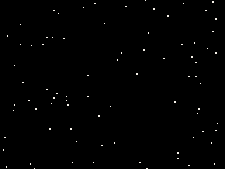

- A pixel off the screen is ignored.
- About 10 units each, and about 4 more for each turn of the loop around
  it: fine for a few dozen a frame, costly for thousands.

## pget(x, y)

The colour of one pixel of the screen, or of the current
[target](#targett).

| Argument | |
|---|---|
| `x`, `y` | the pixel |

**Returns** its colour number, or 0 for a pixel off the screen.

```js
cls(1);
rectfill(0, 0, 79, 119, 8);
print("LEFT IS " + pget(10, 60), 4, 4, 7);
print("RIGHT IS " + pget(120, 60), 84, 4, 7);
```

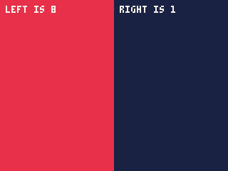

- It reads what has been drawn so far this frame, so it gives what is
  under a point -- useful for "is this pixel of the track grass?" when
  the track was drawn from a map. Reading the map itself (`mget`) is
  usually simpler and does not depend on drawing order.

## line(x0, y0, x1, y1, [c])

A straight line between two points, one pixel thick, both ends included.

| Argument | |
|---|---|
| `x0`, `y0` | one end |
| `x1`, `y1` | the other end |
| `c` | its colour; the pen colour when left out |

**Returns** nothing.

```js
cls(1);
for (var i = 0; i <= 16; i++) line(0, i * 7, i * 10, 119, 12);
```

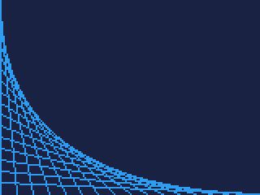

- Both ends the same draws a single pixel.
- About 1.5 units a pixel of length.

## rect(x0, y0, x1, y1, [c])
## rectfill(x0, y0, x1, y1, [c])

`rect` draws a rectangle's outline, one pixel wide; `rectfill` fills it.

| Argument | |
|---|---|
| `x0`, `y0` | one corner |
| `x1`, `y1` | the opposite corner |
| `c` | its colour; the pen colour when left out |

**Returns** nothing.

```js
cls(1);
rect(10, 10, 69, 49, 7);
rectfill(90, 10, 149, 49, 8);
rectfill(10, 70, 69, 109, 3);
rect(10, 70, 69, 109, 11);       // an edge round a filled box
```

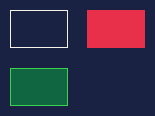

- **Both corners are included**: `rectfill(0, 0, 9, 9)` is 10 pixels
  square. For a box `w` wide at `x`, the far corner is `x + w - 1`.
- The corners can be given in either order.
- `rectfill` is the fastest way to colour many pixels: a whole screen is
  about 460 units.

## circ(x, y, r, [c])
## circfill(x, y, r, [c])

`circ` draws a circle's outline; `circfill` a filled circle.

| Argument | |
|---|---|
| `x`, `y` | the centre |
| `r` | the radius in pixels |
| `c` | its colour; the pen colour when left out |

**Returns** nothing.

```js
cls(1);
circ(40, 60, 30, 7);
circfill(110, 60, 30, 9);
circ(110, 60, 30, 10);           // a yellow edge on an orange disc
```

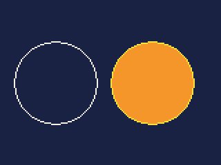

- The circle is `2 * r + 1` pixels across: radius 0 is a single pixel,
  radius 3 a ball 7 pixels wide. A negative radius draws nothing.
- A large outline costs more than the same circle filled: about 830 units
  for `circ` of radius 50, against 550 for `circfill`.

## oval(x0, y0, x1, y1, [c])
## ovalfill(x0, y0, x1, y1, [c])

The ellipse that fits inside a box: `oval` its outline, `ovalfill`
filled.

| Argument | |
|---|---|
| `x0`, `y0` | one corner of the box |
| `x1`, `y1` | the opposite corner |
| `c` | its colour; the pen colour when left out |

**Returns** nothing.

```js
cls(1);
oval(10, 30, 69, 89, 7);
ovalfill(90, 45, 149, 74, 14);
```

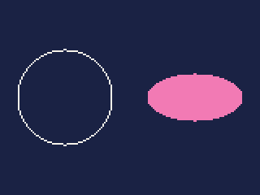

- The box's corners are included, as with `rect`: the oval touches all
  four sides. A square box gives a circle, which is useful when the circle
  must be an even number of pixels across -- `circ` is always odd.

## tri(x0, y0, x1, y1, x2, y2, [c])
## trifill(x0, y0, x1, y1, x2, y2, [c])

A triangle through three points: `tri` its outline, `trifill` filled.

| Argument | |
|---|---|
| `x0`, `y0`, `x1`, `y1`, `x2`, `y2` | the three corners, in any order |
| `c` | its colour; the pen colour when left out |

**Returns** nothing.

```js
cls(1);
trifill(20, 100, 60, 20, 100, 100, 11);
tri(80, 20, 150, 60, 90, 110, 7);
```

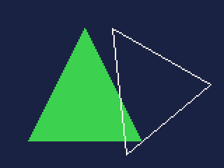

- Three points in a line draw that line.
- Triangles make any flat shape: a ship, an arrow, a polygon in pieces. A
  large one costs more than a rectangle of the same area -- about 1,100
  units for one across half the screen.

---

## polyfill(xs, ys, n, [c], [ends], [bend], [boxes])

Any flat shape from a list of points: a hill, a cave, a ship, a blob. The
points are joined in order and back to the first, and the inside filled.

| Argument | |
|---|---|
| `xs`, `ys` | arrays (or typed arrays) of the points' x and y; fractions are kept |
| `n` | how many points to use, from the first; at most 8,192 |
| `c` | its colour; the pen colour when left out |
| `ends` | to draw several outlines at once: an array of where each ends, the index after its last point |
| `bend` | an array, one number a point: where it is not 0, the point bends the line through it into a curve rather than lying on it |
| `boxes` | from [`polyboxes`](#polyboxesxs-ys-n-ends) for the same points and `ends`: for an outline far larger than the screen. Not with `bend` |

**Returns** nothing.

```js
cls(12);
// a hill with a cave through it: two outlines, the second a hole
var hx = [0, 40, 80, 120, 160, 160, 0,   60, 100, 100, 60];
var hy = [80, 50, 40, 55, 75, 120, 120,  75, 75, 100, 100];
polyfill(hx, hy, 11, 3, [7, 11]);
// a round bush: every point bends the outline
polyfill([20, 44, 44, 20], [30, 30, 54, 54], 4, 11, null, [1, 1, 1, 1]);
```

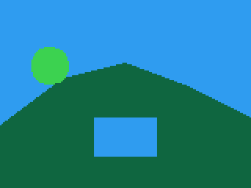

- **Inside** is decided row by row: a pixel is filled when a line from it
  to the left edge crosses the outlines an odd number of times. So an
  outline inside another is a hole, and a shape that crosses itself -- a
  five-pointed star drawn in one stroke -- has its middle left empty.
- A pixel is filled when its middle is inside, so a square from (0, 0) to
  (10, 10) fills 10 by 10 pixels -- one fewer each way than `rectfill`
  with the same corners.
- **Curves**: a point with `bend` set pulls the line toward it, as a
  font's outline does. Two bending points together curve through the
  point halfway between them, so four bending points at a square's
  corners make a rounded square, and a ring of them a smooth blob.
- `fillp` patterns it, and the camera and clip apply as to any shape.
- **What it costs.** The hill above is about 1,400 units, and the bush
  about 670; a full-screen shape about 1,300. The cost grows with the
  edges each row crosses and the pieces of row filled between them: a
  ragged ground line of 100 points along the bottom third of the screen
  is about 900. Points outside the clip cost about 8 units
  each, so a large outline mostly off screen stays cheap -- and with
  `boxes`, cheaper still. One `polyfill` is much cheaper than the same
  shape cut into `trifill` triangles, each of which pays for its rows.

## polyboxes(xs, ys, n, [ends])

Gets a large outline ready for `polyfill` to draw only the part in view:
a level's ground thousands of pixels long, scrolled past a screen at a
time. Make it once, when the outline is made, and pass it to every
`polyfill` of those points.

| Argument | |
|---|---|
| `xs`, `ys` | the outline's points, as `polyfill` takes them |
| `n` | how many points to use, from the first |
| `ends` | where each outline ends, as `polyfill` takes it |

**Returns** an `Int32Array`: the outlines cut into runs of 16 lines,
with the box round each run's points.

```js
var gx = [], gy = [], boxes, x = 0;

function init() {
    // ground 2,000 pixels long, a point every 4
    for (var i = 0; i <= 500; i++) {
        gx.push(i * 4);
        gy.push(80 + sin(i / 60.0) * 20 + rnd(6));
    }
    gx.push(2000); gy.push(120); gx.push(0); gy.push(120);
    boxes = polyboxes(gx, gy, gx.length);
}

function update() {
    x = (x + 2) % 1840;
}

function draw() {
    cls(12);
    camera(x, 0);
    polyfill(gx, gy, gx.length, 3, null, null, boxes);
    camera();
}
```

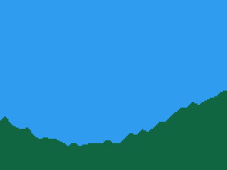

- `polyfill` draws exactly the same pixels with the boxes as without:
  a run wholly off the screen is passed over without reading its points.
- The boxes are for the points as they were when made. Moving the
  camera, turning or zooming it is fine; change the points, or their
  number, and make the boxes again -- `polyfill` stops the cart if the
  number of points or outlines no longer matches.
- Plain outlines only: `polyfill` refuses `boxes` together with `bend`.
- **What it costs.** Making the boxes above, 503 points, is about 2,100
  units, once. Each frame's `polyfill` then costs about 2,600 units
  against 6,000 without them. A run off the screen costs about 22 units
  against about 130 for walking its points. An outline that is mostly
  on screen gains little.

## polyline(xs, ys, n, [c], [ends], [closed])

Lines from point to point: a shape's edge, a track, a graph, a ship
drawn in outline -- the same points `polyfill` takes, in one call.

| Argument | |
|---|---|
| `xs`, `ys` | arrays (or typed arrays) of the points' x and y |
| `n` | how many points to use, from the first; at most 8,192 |
| `c` | its colour, or an array of one colour for each line: line `i` runs from point `i` to the next; the pen colour when left out |
| `ends` | to draw several runs at once: an array of where each ends, the index after its last point, as `polyfill`'s outlines |
| `closed` | `true` to join each run's last point back to its first |

**Returns** nothing.

```js
cls(12);
var hx = [0, 40, 80, 120, 160, 160, 0,   60, 100, 100, 60];
var hy = [80, 50, 40, 55, 75, 120, 120,  75, 75, 100, 100];
polyfill(hx, hy, 11, 3, [7, 11]);
// the hill's grassy top light green, the rest of its edges dark
var edge = [11, 11, 11, 11, 5, 5, 5,  5, 5, 5, 5];
polyline(hx, hy, 11, edge, [7, 11], true);
```

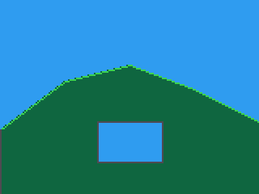

- The lines are those `line` draws between the same points, a whole
  pixel each end; the camera, its turn, the clip and `fillp` apply.
- **What it costs.** The edges above are about 600 units: about 18 a
  line besides its pixels, where the same lines drawn by `line` one at a
  time cost several times that.

---

## color([c])

Sets the pen colour: the colour every drawing function uses when its
own is left out.

| Argument | |
|---|---|
| `c` | the colour; 6 when left out |

**Returns** nothing.

```js
cls(1);
color(10);
circ(40, 60, 20);
line(80, 30, 120, 90);
rectfill(130, 40, 150, 80, 12);  // gives its own colour, which becomes the pen
circ(140, 60, 15);               // so this is blue, not yellow
```

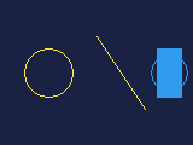

- Any drawing call given a colour sets the pen to it, as above. `color`
  is for setting it without drawing, so that a run of calls can leave
  their colours out.

## fillp([p])

A pattern for filled shapes: a 4x4 grid of on and off, so a fill can be
two colours in a checkerboard, stripes or a dither -- for shading,
shadows, and see-through effects.

| Argument | |
|---|---|
| `p` | 16 bits, one for each pixel of the 4x4 grid; left out, turns the pattern off |

**Returns** nothing.

The 16 bits run from the grid's top left, across each row and down, the
highest bit first. In hexadecimal each digit is one row: `0x5a5a` is the
rows `0101`, `1010`, `0101`, `1010`, a checkerboard.

**Where a bit is 0** the shape is drawn in its colour as usual. **Where a
bit is 1** it is drawn in a second colour, given with the first as
`c + 256 * c2` -- or **left as it was** when there is no second colour,
which makes the shape see-through.

```js
cls(1);
fillp(0x5a5a);
rectfill(10, 10, 69, 109, 8 + 2 * 256);   // red and purple, checkered
fillp(0x8421);
circfill(110, 60, 35, 12);                // blue diagonals, the background between
fillp();
```

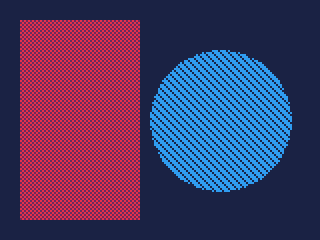

- The grid is fixed to the screen, not to the shape, so two patterned
  shapes side by side line up.
- It applies to everything on this page -- filled shapes, outlines, lines
  and `pset` -- until `fillp()` turns it off. Turn it off after use, or
  the next frame's shapes are patterned too.
- Common patterns: `0x5a5a` checkerboard, `0x0f0f` horizontal stripes,
  `0x8421` diagonals, `0x0505` a light dither, `0x7d7d` a heavy one.

## camera([x, y], [turn], [px], [py], [zoom])

Moves everything drawn afterwards by `-x`, `-y`: as if the screen were a
window onto a larger world, looking at `x, y`. With `turn`, the picture
is also turned, as if the window were tilted, and with `zoom` it grows or
shrinks, as if the window came closer.

| Argument | |
|---|---|
| `x`, `y` | where the screen's top left is in the world; both 0 when left out |
| `turn` | how far to turn the picture, in turns, clockwise: 0.25 is a quarter; 0 when left out |
| `px`, `py` | the point on the screen it turns and zooms about; the middle of the screen when left out -- or of the image being drawn into when `camera()` is called; a `target()` after it keeps the point |
| `zoom` | how much bigger the picture is drawn: 2 is twice the size, 0.5 half; from 1/16 to 16, and 1 when left out |

**Returns** nothing.

**Scrolling.** Draw the world at its own positions, and set the camera to
follow the player:

```js
var px = 300;   // the player, 300 pixels into a long level

function draw() {
    camera(px - 80, 0);         // keep the player in the middle
    cls(12);
    for (var i = 0; i < 40; i++) rectfill(i * 24, 100, i * 24 + 15, 119, 3);
    circfill(px, 92, 6, 10);
    camera();                   // back, for the score
    print("X " + px, 2, 2, 7);
}
```

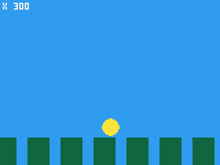

**Screen shake.** A camera a pixel or two off, at random, for a few
frames:

```js
camera(rnd(5) - 2, rnd(5) - 2);
cls(1);
rectfill(50, 40, 109, 79, 8);
print("BOOM", 72, 57, 7);
camera();
```

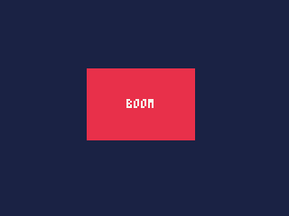

- The camera **lasts** until changed, across frames, and `cls` does not
  reset it: call `camera()` before drawing anything that should stay put,
  such as a score.
- It moves the map, sprites, text and shapes alike; not the
  [clip](#clipx0-y0-x1-y1), which stays on the screen.

**Turning.** A game whose world tilts -- a ball rolled by tipping the
board -- draws the world at its own positions and turns the camera:

```js
camera(0, 0, tilt);              // the world tilted a little clockwise
cls(12);
polyfill([-40, 60, 100, 200, 200, -40], [90, 80, 95, 70, 160, 160], 6, 3);
rectfill(72, 60, 81, 89, 4);     // a post, tilted with the ground
spr(1, 73, 52);                  // a ball on it, upright
camera();                        // the score stays level
print("TILT " + tilt, 2, 2, 7);
```

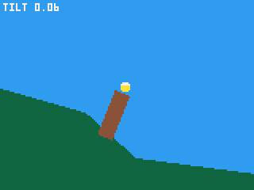

- **Shapes turn whole**: `pset`, `line`, `rect` and `rectfill`, `tri`
  and `trifill`, `polyfill`, and the middles of circles and ovals (an
  oval's axes stay upright). `pget` reads where `pset` would draw.
- **Pictures stay upright** and go where their middle turns to: `spr`,
  `sspr`, `blit`, `sprites.draw`, the actors and particles. Text goes
  where its top left turns to. `rspr` and `rblit` turn with the camera,
  on top of their own angle. `light.draw`'s lights go where their
  middles turn to.
- **Not turned**: `map` and `tline`, the 3D systems (they have their own
  camera), and the clip. For a turning world drawn from a map, draw its
  outlines with `polyfill`.
- Turning costs little: about 2 units a point for `polyfill`, and nothing
  that shows for the other calls.

**Zooming.** A camera that comes in close when the player rests and pulls
back while they move eases `zoom` a little each tick, about the player:

```js
camera(0, 0, 0, 77, 56, zoom);   // in close, about the ball
cls(12);
polyfill([-40, 60, 100, 200, 200, -40], [90, 80, 95, 70, 160, 160], 6, 3);
rectfill(72, 60, 81, 89, 4);     // the post grows
rspr(1, 77, 56, 0);              // the ball grows too: spr would keep its size
camera();
print("ZOOM " + zoom, 2, 2, 7);
```

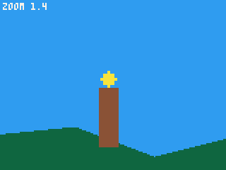

- **Shapes grow whole**, as they turn, and their lines stay a pixel wide.
  Circles and ovals grow about their middles.
- **`rspr` and `rblit` grow** with the zoom, on top of their own scale.
  The other pictures, text, particles and lights **keep their size** and
  go where their middle moves to: for a picture that should grow, draw it
  with `rspr` or `rblit`.
- `map`, `tline` and the 3D systems are not zoomed, as they are not
  turned.
- A zoom costs what a turn does; a picture zoomed in fills more pixels,
  and this one costs 2,821 units a tick against 2,427 at a zoom of 1.

## clip([x0, y0, x1, y1])

Limits drawing to a rectangle of the screen: anything outside it is left
alone.

| Argument | |
|---|---|
| `x0`, `y0` | one corner of the rectangle |
| `x1`, `y1` | the opposite corner; both corners are inside it, as for `rect` |

With no arguments, drawing is allowed over the whole screen again.

**Returns** nothing.

```js
cls(1);
rect(39, 29, 120, 90, 6);
clip(40, 30, 119, 89);
for (var i = 0; i < 12; i++) circfill(rnd(160), rnd(120), 12, 8 + i % 4);
clip();
```

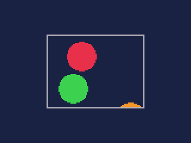

- `clip(x0, y0, x1, y1)` lets through exactly what
  `rectfill(x0, y0, x1, y1)` would cover.
- Use it for a window inside the screen -- a radar, a status panel, a
  playfield beside a score column -- so drawing in it cannot spill out.
- It is in screen pixels: the [camera](#camerax-y-turn-px-py-zoom) does not move it.
  `cls` resets it.

## target(t)

Where drawing goes: the screen, or an image.

| Argument | |
|---|---|
| `t` | `SCREEN`, or an image made by `img(w, h)` or one of the cart's `IMG.<name>` |

**Returns** nothing.

Everything on this page -- and text, sprites and the map -- draws into the
target. Drawing into an image draws nothing you can see until the image is
drawn on the screen, with `blit` (see **Images**).

**Draw once, show every frame.** A background that is costly to draw and
never changes can be drawn into an image once, in `init()`, and copied to
the screen with `blit` each frame:

```js
var bg;

function init() {
    bg = img(160, 120);
    target(bg);
    cls(1);
    for (var i = 0; i < 1200; i++) pset(rnd(160), rnd(120), 5 + rnd(2));
    circfill(120, 30, 14, 7);
    target(SCREEN);
}

function draw() {
    blit(bg, 0, 0);                         // the stars and the moon, at once
    circfill(40 + frame() % 80, 90, 5, 10); // only this is drawn each frame
}
```

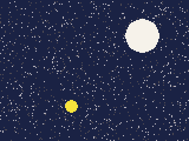

- Drawn every frame, these 1,200 stars cost about 24,000 units -- more
  than a whole tick on an iPod Video playing music. Copied from `bg`, the
  frame costs about 6,000.
- Copying is not free: about 0.3 units a pixel, 6,000 for the whole
  screen -- or 1,000 for a picture with nothing clear and no colour
  swapped, copied whole. An image saves time only when what is in it costs more than
  that to draw. A plain background is cheaper as `cls` and a few
  rectangles; a few lines of text in the built-in font, about 12 units a
  character, are cheaper printed.
- Drawing in an image uses the image's own pixels: `0, 0` is its top left,
  and it cuts off at its own edges. `cls` clears the image.
- Set the target back to `SCREEN` when done -- it lasts, like the rest of
  the drawing state.
- An image takes memory: 160x120 is 19 KB of the cart's 512 KB.
