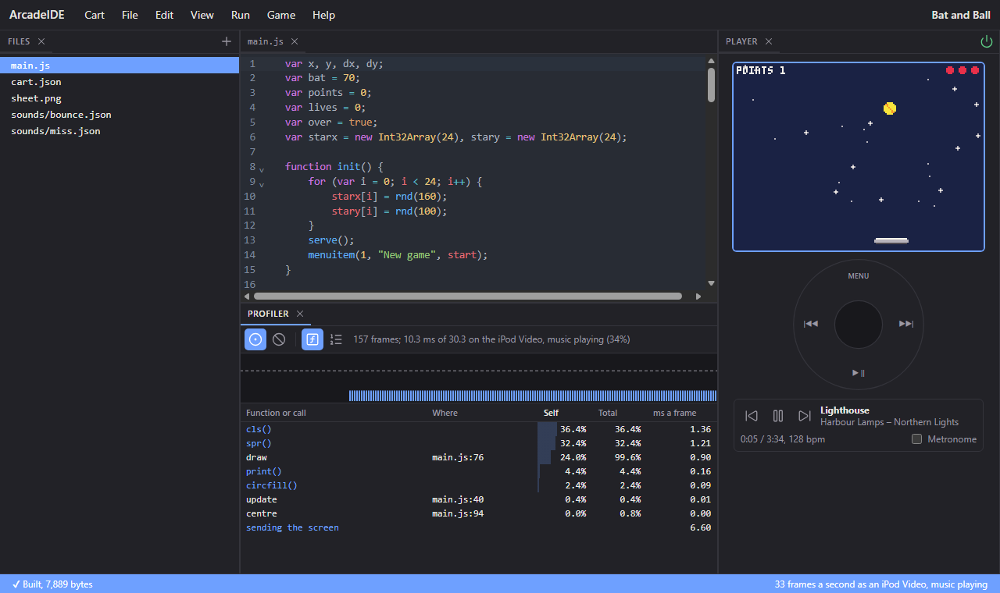
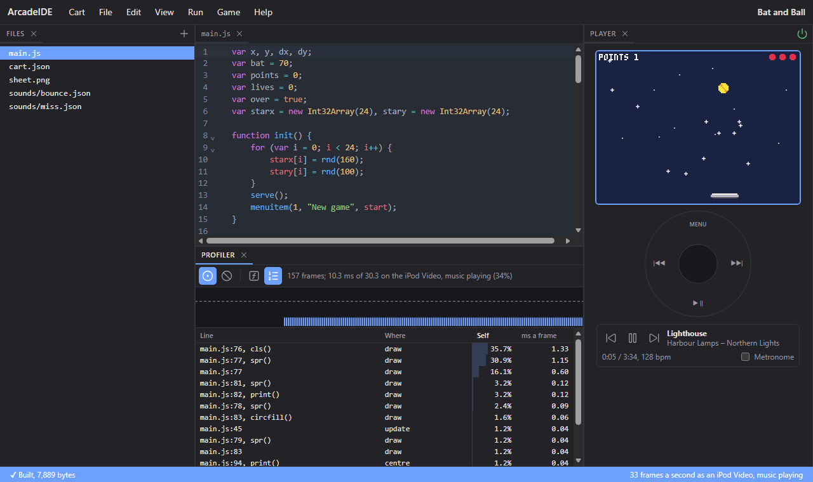
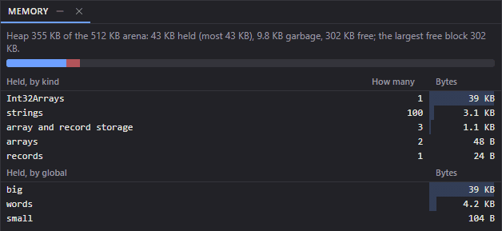
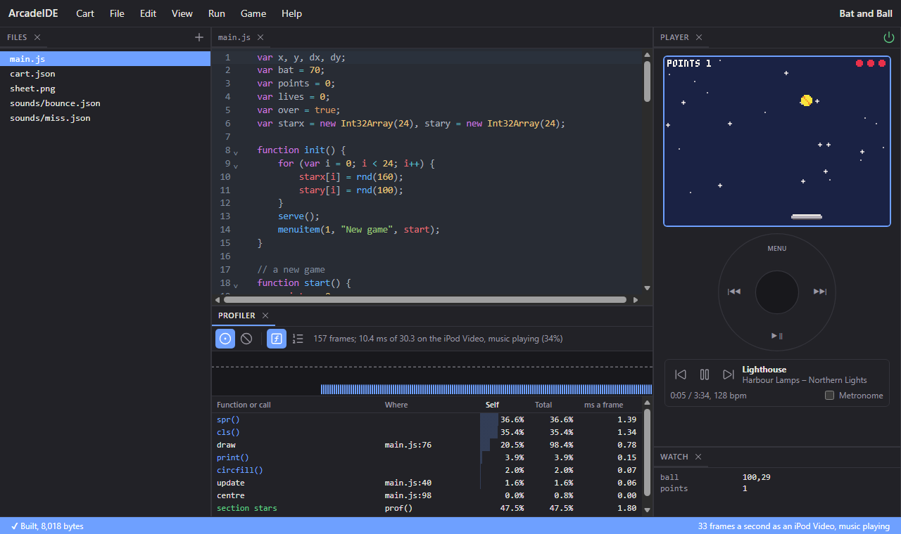

# Making it fast

Every cart must keep up on the slowest iPod it will meet: an iPod Video
playing music. This chapter is how the Arcade counts the work a cart
does, how much a tick may do, how to find what is costing the time, and
the changes that save the most.

- [How the work is counted](#how-the-work-is-counted): [units](#units),
  [the budget](#the-budget), [the screen](#the-screen)
- [What things cost](#what-things-cost)
- Finding it: [Run as](#run-as), [the profiler](#the-profiler),
  [the memory view](#the-memory-view), [replays](#replays),
  [pbgvm --units](#pbgvm---units)
- [Making it cheaper](#making-it-cheaper)
- Tools in code: [printh](#printhtext), [watch](#watchname-v), [prof](#profname)

## How the work is counted

### Units

The Arcade counts a cart's work in **units**. Roughly, a unit is one step
of script -- adding two numbers, reading a variable, testing a condition
-- and the API's functions charge units for the work they do: a pixel
filled, a sprite copied, a character drawn.

Units are the same on every iPod and in the IDE, so a cart's cost can be
known without an iPod. What a unit takes in real time depends on the
iPod:

| iPod | A unit | |
|---|---|---|
| iPod Classic | about 0.16 µs | music makes little difference |
| iPod Video, music stopped | about 0.55 µs | |
| iPod Video, playing FLAC | about 1.9 µs | the slowest, and the one to aim at |

The music takes the processor's time first; a cart has what is left. How
much that is depends on the music: high-resolution FLAC, the heaviest to
decode, leaves the Video about a third of its speed. Lighter music, such
as MP3, leaves more.

### The budget

A tick has its share of a second: 30.3 ms at 33 ticks a second, 40 ms at
25. Into that go the cart's units and the time to send the screen to the
display (below). On an iPod Video playing FLAC, redrawing the whole
screen every tick:

| Rate | Units a tick, at most |
|---|---|
| 50 | about 7,000 |
| 33 | about 12,500 |
| 25 | about 17,500 |
| 20 | about 22,800 |

In general:

```
units a tick ≤ (1000 / rate − 6.6 × rows sent / 120
                − 2.0 × rows drawn unchanged / 120) / 0.0019
```

Aim well under it: busy moments -- an explosion, a crowded screen -- cost
more than quiet ones, the music takes its time in bursts, and the frame
that runs over is the one the player sees stutter. A cart can also step
down when it falls behind -- draw less, or `setrate(25)` -- by watching
`skipped()`; see
[stepping the rate down](reference-time.md#stepping-the-rate-down). The
iPod Classic has room for about 175,000 a tick at 33, music or not: a
cart that keeps up on the Video playing FLAC has room to spare there.

Listening to the music's beat (`beat.listen(true)`) costs about 6,300
units a tick at 33 while music plays -- half the budget -- so stop
listening once the tempo is held.

One call that runs to 2,000,000 units stops the cart as "The game stopped
responding": a loop that never ends. `init()` may run to 8,000,000, for
work done once -- building a world, a big `noise.fill` -- which the player
waits for before the first frame. On the iPod a call is also stopped
after ten seconds, however few units it has used.

### The screen

After each drawn tick, the iPod sends the rows of the screen that
changed to the display. On an iPod Video playing FLAC the whole screen
takes about 6.6 ms -- a fifth of a tick at 33 -- and part of it takes its
share: 10 rows, about 0.55 ms. Four rows a frame are also sent
whatever they hold, which costs about 0.2 ms.

**What counts as changed**: the iPod compares each row the tick drew
with the same row last frame, and sends only those whose pixels differ.
Comparing costs too, though less: a whole screen drawn and found the
same is about 2 ms on the Video. Rows not drawn at all cost nothing.

| A tick that... | Rows compared | Rows sent |
|---|---|---|
| clears the screen with `cls` and redraws it, a ball moved | all 120 | the rows the ball left and those it entered |
| erases and redraws a ball at y 100 | 97 to 103 | those it left and entered |
| does that, and redraws a score at the top | 0 to 103 | the ball's, and the score's when it changed |
| draws nothing | none | none |

So a cart whose picture mostly stands still -- a puzzle, a board game, a
menu -- pays little for the screen even if it redraws it all each tick,
and less again if it draws only what moved. A changed palette is the
exception: every row is sent, without comparing (see
[how colour works](reference-colour.md#how-colour-works)).

## What things cost

Measured on the engine. Each script cost includes storing the result in a
local (`s = ...`) and nothing else; a loop adds 2 to 4 units a turn
around it, as the first row says.

| Script | Units |
|---|---|
| a turn of a `for` loop | 4; 2 up to a whole number from -128 to 127 |
| `a = a + 1`, or a comparison | 4 |
| reading a variable | 2 |
| a fraction multiplied | 4 |
| a record field: `o.x += 1` | 6 |
| an element of an array or typed array, read: `s = a[i]` | 4; 2 for a global array at a local index |
| calling a function of your own | about 3, plus its own steps |
| calling a simple API function: `abs`, `rnd`, `Math.abs` | about 3 |
| `sin(t)` | about 3 |
| `push` and `pop` | about 7 the pair |
| making a record `{ x: i, y: i }` | about 4 |
| `o[k]` with a string key | about 4, against 3 for `o.name` (2 when `o` is a global) |
| joining two strings | about 24 |
| `splice(0, 1)` of a 100-long array, then a `push` | about 60 |
| sorting 100 numbers | about 2,000 |

Three common patterns cost one step each rather than two or three: a
local variable compared with a whole number from -128 to 127 (`i < 8`,
`x >= 0`), a global array read at a local index (`grid[i]`), and a
global record's field read (`player.x`). Code written the ordinary way
gets this without trying. In a hot loop, a global compared with a small
whole number (`<`, `<=`, `>` or `>=`, not `==`) is worth copying into a
local first, and the arrays the loop reads are best kept global.

| Drawing (see **Drawing**) | Units |
|---|---|
| `cls()`, or a whole-screen `rectfill` | about 200, 460 |
| a 20x20 `rectfill` | about 60 |
| `circfill` radius 10 / 50 | about 115 / 550 |
| `pset` | about 10 |
| copying a picture: `blit`, `map`, `spr` | about 0.3 a pixel |
| a whole-screen `blit` | about 6,000; 1,000 with nothing clear and no colour swapped |
| the whole map on the screen, 20 by 15 cells | about 8,700 |
| a character of text, `FONT.CAPS` / `FONT.WORLD` | about 12 / 34 |
| `copy` or `fill` of 1,000 elements | about 250 |

## Run as

**Run > Run as** chooses which iPod the IDE runs the cart as. Each
tick takes as long as it would there -- its units, and the rows it sends
-- so the cart falls behind in the IDE where it would on the iPod. The
choices are the iPod Classic, the iPod Video, the iPod Video playing FLAC
(the default, and the one that matters), and no limit.

The status bar under the editor shows the frames drawn each second: "33
frames a second as an iPod Video, playing FLAC" when it keeps up, "29
of 33" when it does not. Click it to choose another iPod.

## The profiler

The profiler shows where a cart's time goes. Choose **Run > Run and
profile**, or open **View > Profiler** and press its record button,
then play the cart for a few seconds.



- **The graph** has a bar for each frame: its cost on the iPod you run
  as, against a dashed line for the time a frame has. A bar over the line
  is red: that frame ran late.
- **The line above it** sums up: frames recorded, their average cost
  against the time a frame has, and how many ran over.
- **The table**, by function and API call:
  - **Self**: the share of the time spent in its own code. For an API
    call, the time inside it.
  - **Total**: the share spent in it or in anything it called. `draw`'s
    total is everything `draw()` did.
  - **ms a frame**: its self, as milliseconds a frame on the chosen
    iPod.
  - **sending the screen**: the time to send the rows drawn, a row of its
    own.

  Click a column's heading to sort by it, and a row to go to its code.
- **By line**, the second view, ranks the lines themselves -- with the
  API call on the line, if it was in one:



**How it measures.** Every 2048 units, the engine notes where the cart
is: the function, the line, and the API call if it is in one. A
function that takes less than 2048 units a frame is caught only some
frames, so its share is right over many frames but missing from a few.
Record a few seconds, not a few frames. In the tutorial game above,
`update()` shows at 0.4%: it takes far less than 2048 units a frame, so
is caught only now and then.

## The memory view

A cart has the iPod's 512 KB for everything, and an allocation that
does not fit stops it with "out of memory". **View > Memory** shows what
that memory holds while the cart runs, twice a second:

```js
var big, words, small;
function init() {
    big = new Int32Array(10000);
    words = [];
    for (var i = 0; i < 100; i++) words.push("word" + i);
    small = { a: 1, b: [1, 2, 3] };
}
function update() { var junk = [1, 2, 3, 4]; }
function draw() {}
```



- **The line at the top** and its bar: the heap, the part of the arena
  the cart's arrays, records and strings live in. What is **held** is
  reached from a global; **garbage** was dropped -- `junk` above, a new
  array every tick -- and is freed when the engine next clears up;
  the rest is **free**. *Most* is the most held since the run began.
- **The largest free block** is the biggest thing that can be made
  without clearing up first. Past it, the engine clears up; if no
  block is then large enough, the cart stops with "out of memory".
- **By kind**: how many of each thing are held, and their bytes. An
  array's or record's values are its **storage**, a block of its own
  beside it.
- **By global**: the bytes each global reaches. What two globals both
  reach is counted to the one declared first.

The rest of the arena -- 157 KB for this cart -- is the engine and the
loaded cart: its code, sheet, map and images. Hover over the top line to
see it.

## Replays

Every run of a cart in the IDE is recorded: its random seed, the store as
it began, and every tick's buttons and wheel. **Run > Replay the last
run** plays it back exactly, frame for frame, then hands the cart back to
you.

That makes a change measurable: profile a run, change the code, replay
the same run with the profiler recording, and compare. If the change
alters what happens on the screen, the output says from which frame the
replay stopped matching. **Run > Save the last run as a replay** keeps
one as a file, and **Open a replay** plays it again later.

## pbgvm --units

The SDK's `pbgvm` runs a cart without a screen. `--units` prints each
tick's units:

```sh
host/pbgvm mygame.pbg --ticks 300 --units
```

```
start 325
tick 1 2839
tick 2 2839
...
```

That is the tutorial game: its start-up (`init()` and the globals set
before it) cost 325 units, and each tick about 2,800 -- well inside the
12,500 a tick has on an iPod Video playing FLAC, at 33.

`--dirty` prints the rows the last tick sent -- all of them after a
palette change, which sends the whole screen. `--buttons` and `--wheel`
play input into it, and `--skip t:n` runs tick `t` undrawn, as a late
frame is, so a cart's busiest moments can be measured from a script.
With `--units`, each `prof()` section's units go to the error output
as `prof name units`.

`--memory` prints what the memory view shows, after the last tick, each
global by its number in declaration order:

```
memory arena 524288 tables 161376 heap 362912 held 44376 garbage 2952 free 315584 largest 315584 constants 0 engine 0
memory kind string 100 3200
memory kind array 2 48
memory kind Int32Array 1 40016
memory kind record 1 24
memory kind storage 3 1088
memory global 0 40016
memory global 1 4256
memory global 2 104
```

That is the cart above after 30 ticks: `big`, global 0, holds the 40,016
bytes of the `Int32Array`.

## Making it cheaper

In order of what usually saves the most:

**1. Let the systems do the loops.** A script loop pays for every step of
every turn; the systems -- `particles`, `actors`, `sprites.draw`,
`grid`, `path`, `cells` -- do the same work inside the engine. Measured:

| | Script | System |
|---|---|---|
| 300 sparks falling under gravity, moved and drawn | about 16,500 units | `particles.step` and `particles.draw`: about 4,000 |
| 100 sprites drawn from arrays of positions | a loop of `spr`: about 7,400 | `sprites.draw`: about 3,400 |

The first is the difference between a cart that cannot keep up and one
with most of its tick to spare.

**2. Change fewer rows.** Only rows whose pixels changed are sent, so a
screen that mostly stands still costs a fraction of the 6.6 ms a whole
one does; drawing only what moved saves the comparing too. Keep what
moves together, rather than spread down the screen. See
[the screen](#the-screen).

**3. Don't build strings each tick.** A join is about 24 units; a
thousand of them, more than a whole tick. Build text when it changes. `print` with
a `+` inside costs nothing extra -- `print("SCORE " + points)` is as
cheap as printing the characters -- so this is about strings made into
variables, arrays and records each tick.

**4. Draw into an image only when drawing costs more than copying.**
Copying a picture is about 0.3 units a pixel -- a whole screen about
6,000, or 1,000 for one with nothing clear (`palt(0, false)`) and no
colour swapped, which is copied whole. A background of 1,200 stars drawn with `pset` costs about 24,000
a frame, so drawn once into an image and blitted it saves more than half.
But a page of text in `FONT.WORLD` costs about 5,300 to print and 7,600
to blit, and a plain background is cheapest of all as `cls` and
rectangles. Measure before reaching for an image.

**5. Box a large outline.** A `polyfill` of a level's whole ground walks
every point of it each frame, about 8 units a point, though most lie
off the screen. Made once, [`polyboxes`](reference-drawing.md#polyboxesxs-ys-n-ends)
lets it pass over the runs out of view: a ground line of 500 points
scrolled past costs about 2,600 a frame against 6,000.

**6. Do less often what can wait.** An enemy's path need not be found
every tick: every 8th, with the work spread across the ticks between
(`if ((frame() + i) % 8 == 0)` for enemy `i`).

**7. Prefer typed arrays and plain variables for what changes every
tick.** In units, an element of an `Int32Array` costs what an array's
does, and a record's field a little more. But each record, array or
string made in a tick is memory the engine must later clear up, between
ticks, in time the units do not show. A cart that makes none in its
`update()` and `draw()` -- reusing arrays, keeping numbers in typed
arrays -- avoids that work entirely.

**8. Step the rate down**, as a last resort: see **Time and speed**. At
25 ticks a second, each tick has a third more time.

## printh(text)

Writes a line to the IDE's Output panel -- for following what a cart is
doing while you write it.

| Argument | |
|---|---|
| `text` | text, a number, or pieces joined with `+` |

**Returns** nothing.

```js
printh("lives " + lives + " at " + x + "," + y);
```

- On the iPod it does nothing at all, so lines can be left in a finished
  cart -- though each still costs the units of its arguments.
- `pbgvm` prints them to its output, which is how scripts test a cart.
- A line is at most 255 bytes.

## watch(name, v)

Shows a value in the IDE as it changes, in the **Watch** panel (**View >
Watch**), which opens by itself the first time a cart calls it. A row a
name, the latest value beside it:

```js
watch("ball", flr(x) + "," + flr(y));
watch("points", points);
```



- On the iPod it does nothing, but still costs the units of its
  arguments.
- `pbgvm` prints `watch name value` each time a value changes.

| Argument | |
|---|---|
| `name` | a label |
| `v` | the value |

## prof([name])

Times a section of code for the profiler: from `prof("name")` until
`prof()` ends it. The section is a green row of its own, **section
name**, with its share and its milliseconds a frame -- the stars in the
picture above:

```js
prof("stars");
for (var i = 0; i < 24; i++)
    spr(32 + (flr(t() * 2) + i) % 2, starx[i] - 4, stary[i] - 4);
prof();
```

- It does nothing on the iPod.
- `pbgvm --units` prints `prof name units` for each section, each tick.
- The profiler finds functions and lines by itself; a section is for a
  few lines inside one function, or a stretch across several.

| Argument | |
|---|---|
| `name` | the section's name; left out, ends the section |
