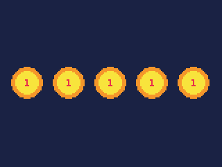
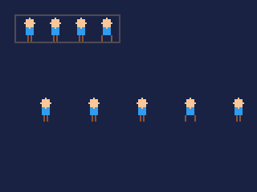
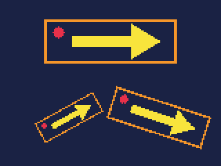
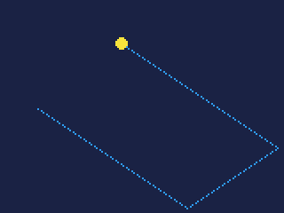

# Images

Pictures bigger than a sprite -- a title, a background, a strip of frames
-- and pictures made while the cart runs, to draw into and keep.

- [How images work](#how-images-work)
- Making one: [img](#imgw-h), and [a cart's own images](#a-carts-own-images)
- [Lazy images](#lazy-images): [img.load](#imgloadimgname), [img.drop](#imgdropimgname)
- Drawing one: [blit](#bliti-x-y-flip), [blitpart](#blitparti-sx-sy-w-h-x-y-flip),
  [rblit](#rbliti-x-y-angle-scale)
- Drawing into one: [target](reference-drawing.md#targett)
- [When an image is worth it](#when-an-image-is-worth-it)

## How images work

An **image** is a rectangle of colour numbers, like the screen but of any
size: from 1 pixel to 4,096 a side. It is a value, held in a variable, and
there are two ways to have one:

- **A cart's own**: a picture file in the cart's `images/` folder, ready
  when the cart starts, as `IMG.<name>`.
- **Made while running**: `img(w, h)` makes a new, empty one.

Either kind can be **drawn onto the screen** -- whole with `blit`, part
with `blitpart`, turned and scaled with `rblit` -- and **drawn into**:
`target(i)` sends every drawing call to the image instead of the screen,
until `target(SCREEN)`. What is drawn into an image stays there, frame
after frame, until drawn over.

Like a sprite, an image's **colour 0 is see-through** when it is drawn
([palt](reference-colour.md#paltc-t) changes which colours are), and
[pal](reference-colour.md#palc0-c1-p) swaps its colours as it is drawn.

**Images take memory.** Every pixel is a byte, and a cart has 512 KB for
everything -- its code, its data, the screen, the sheet, the map and its
images. A full-screen image, 160x120, is 19 KB.

- A cart's own images take their memory from the start, but for
  [lazy images](#lazy-images). In a cart with
  little else, about 336 KB of them fit -- one picture of 575x575, or
  several smaller. A cart with more does not build: "the images take ...
  KB, and the player has room for at most about 336 KB of images". A cart
  just under that whose code and data are large builds, but stops on the
  iPod and in the IDE with "not enough memory for this game".
- Images made with `img` come out of the memory the cart's variables use.
  An empty cart can make about eighteen full-screen ones before "out of
  memory". An image nothing refers to any more is freed and its memory
  reused.

**What it costs.**

| Call | Units |
|---|---|
| `blit` or `blitpart`, each pixel copied | about 0.3 -- 6,000 for the whole screen |
| the same with nothing clear (`palt(0, false)`) and no colour swapped | about 0.05 -- 1,000 for the whole screen |
| `blit` flipped | the same |
| `rblit`, each pixel of the image | about 1.8 at its own size, more scaled up |
| any of them wholly off the screen | about 85 |
| `img(160, 120)` | about 1,200; `img(16, 16)` about 40 |
| `target` | under 5 |

Copying costs about fifteen times what clearing or filling the same pixels
does (see [Drawing](reference-drawing.md#how-drawing-works)). Copy what is
needed, not the whole screen out of habit.

---

## A cart's own images

A picture in the cart's `images/` folder is an image ready to use, named
after its file: `images/title.png` is `IMG.title`.

- Save it as an **indexed PNG** -- a PNG with a palette, as pixel editors
  call it -- where each pixel's palette number is the colour number it
  draws in. In the IDE, **File > New file > An image** makes one, and the
  pixel editor draws it in the cart's colours; a picture pasted or dropped
  in from another program is matched to the cart's palette.
- Up to 1,024 pixels a side, within the memory above.
- In code it is the image itself: `blit(IMG.title, 0, 0)` draws it, and
  `target(IMG.title)` draws into it -- changing it until the cart ends,
  not in the cart's file.
- An image can also be a sprite sheet of its own, for more than 256
  sprites: see [sheet](reference-sprites.md#sheeti).

## Lazy images

An image the cart needs only at times -- one course's sky of four, a
title screen -- can stay in the cart file until it is wanted, taking no
memory. Name it in `cart.json`:

```json
"lazy_images": ["sky_desert", "sky_snow"]
```

Until [`img.load`](#imgloadimgname) reads it, `IMG.sky_desert` is a lazy
image: `imgw` and `imgh` give its size, and drawing it or drawing into it
stops the cart with "not a lazy image not yet loaded with img.load()". A
lazy image does not count towards the 336 KB of images a cart may hold.

## img.load(IMG.name)

Reads a lazy image from the cart file into memory; `IMG.name` is then
that image, for every call.

**Returns** the image. Loaded already, the same one again; an image that
is not lazy, as it is.

```js
var sky = null;

function startCourse(n) {
    if (sky != null) img.drop(sky);
    sky = img.load(n == 0 ? IMG.sky_desert : IMG.sky_snow);
}

function draw() {
    blit(sky, 0, 0);
}
```

- Keep what it returns, or use `IMG.name`: a copy of `IMG.name` taken
  before the load, in an array say, is still the lazy image.

- It takes the image's memory from the cart's variables, a byte a pixel,
  as `img` does.
- **Load between levels, not in play.** On the iPod Video the disk may be
  resting, and waking it takes a second or two.
- A 160x64 sky costs about 3,400 units: 0.3 a pixel, and one for each
  byte the image takes in the cart file.

## img.drop(IMG.name)

Lets a lazy image's copy go: `IMG.name` is lazy again, until the next
`img.load`.

**Returns** nothing.

- A copy kept in a variable of the cart's own stays, and is freed when
  nothing refers to it any more.
- It costs about 20 units.

## imgw(i), imgh(i)

**Returns** an image's width or height: one of the cart's own (`IMG.name`)
or one `img()` made.

## img(w, h)

Makes a new image, every pixel colour 0.

| Argument | |
|---|---|
| `w`, `h` | its width and height in pixels, 1 to 4,096 each |

**Returns** the image.

A shape drawn once into an image can then be drawn as often as wanted:

```js
var badge;

function init() {
    // a badge, drawn once into an image of its own
    badge = img(24, 24);
    target(badge);
    cls(0);
    circfill(11, 11, 11, 9);
    circfill(11, 11, 8, 10);
    print("1", 10, 9, 8);
    target(SCREEN);
}

function draw() {
    cls(1);
    for (var i = 0; i < 5; i++) blit(badge, 8 + i * 30, 48);
}
```



- Make images in `init()`, once, and keep them in global variables.
  Making one each frame works -- the old ones are freed -- but costs the
  making each time.
- A size outside 1 to 4,096 stops the cart with an error. One too big for
  the memory left stops it with "out of memory".
- Drawing into it uses its own pixels: 0, 0 is its top left, and it cuts
  off at its own edges. `cls` clears it.

## blit(i, x, y, [flip])

Draws a whole image.

| Argument | |
|---|---|
| `i` | the image: `IMG.<name>`, or one made with `img` |
| `x`, `y` | where its top left goes |
| `flip` | 1 to mirror it left to right, 2 to turn it upside down, 3 both; `true` is 1 |

**Returns** nothing.

```js
cls(1);
blit(IMG.title, 32, 10);                 // as it is
blit(IMG.title, 32, 46, 1);              // mirrored
blit(IMG.title, 32, 82, 2);              // upside down
```


- Colour 0 is see-through; the rest of the picture covers what is under
  it.
- Flipping costs nothing extra.
- An image partly off the screen copies only the part on it; wholly off,
  it costs about 85 units.

## blitpart(i, sx, sy, w, h, x, y, [flip])

Draws a rectangle of an image.

| Argument | |
|---|---|
| `i` | the image |
| `sx`, `sy` | the rectangle's top left in the image |
| `w`, `h` | its width and height |
| `x`, `y` | where its top left goes on the screen |
| `flip` | as for `blit` |

**Returns** nothing.

A strip of frames side by side in one image is an animation, each frame a
rectangle of it:

```js
cls(1);
// the strip: four 16x16 frames side by side
blit(IMG.hero, 10, 10);
rect(9, 9, 74, 26, 5);
// frame f is the 16x16 square at f * 16 across
for (var f = 0; f < 4; f++) blitpart(IMG.hero, f * 16, 0, 16, 16, 20 + f * 30, 60);
var f = flr(frame() / 4) % 4;
blitpart(IMG.hero, f * 16, 0, 16, 16, 140, 60);
```



- Unlike the sheet's sprites, the rectangle can be any size and anywhere:
  frames of 20x30 suit `blitpart` better than 8x8 sprites do.
- A rectangle running past the image's edge copies only the part inside
  it.

## rblit(i, x, y, angle, [scale])

Draws an image turned and scaled about its centre.

| Argument | |
|---|---|
| `i` | the image |
| `x`, `y` | where its **centre** goes on the screen |
| `angle` | how far to turn it, in turns: 0.25 a quarter, 1.0 all the way |
| `scale` | how big: 1.0 as it is (the default), 0.5 half, 2.0 double; from 1/64 to 64 |

**Returns** nothing.

```js
cls(1);
rblit(IMG.title, 80, 30, 0, 1.0);
rblit(IMG.title, 50, 85, 0.08, 0.5);
rblit(IMG.title, 115, 85, -0.05, 0.75);
```



- **The position is the centre**, so it turns on the spot.
- A positive angle turns it anticlockwise, as `rspr` and `sin` do.
- It costs about six times `blit` for the same image -- about 2.2 units
  a pixel of the image at its own size, more when scaled up: a 96x32
  picture is about 6,800 units turned, 15,400 doubled. A spinning logo on a
  title screen is fine; dozens of turning things a frame are not.

## When an image is worth it

Copying a pixel from an image costs about 0.3 units -- 0.05 when nothing
in it is clear and no colour is swapped; clearing or filling one about
0.02, and a character of text about 12. So **an image saves time
only when what is in it costs more to draw than to copy.**

**Worth it:**

- A background of hundreds of small shapes, or generated with noise, or
  built from many sprites -- drawn once into an image in `init()` and
  copied each frame (see [target](reference-drawing.md#targett)'s
  example: 1,200 stars cost 24,000 units drawn, 6,000 copied).
- **Pictures that remember**: paint, trails, scorch marks, a map revealed
  as it is explored. Draw each new mark into an image that is never
  cleared, and show the image:

  ```js
  var trail;
  var x = 20, y = 60, dx = 1.5, dy = 1.0;

  function init() {
      // an image the size of the screen, which keeps what is drawn into it
      trail = img(160, 120);
  }

  function update() {
      x += dx;
      y += dy;
      if (x < 3 || x > 156) dx = -dx;
      if (y < 3 || y > 116) dy = -dy;
  }

  function draw() {
      // add this frame's spot to the trail, then show the trail and the ball
      target(trail);
      pset(x, y, 12);
      target(SCREEN);
      cls(1);
      blit(trail, 0, 0);
      circfill(x, y, 3, 10);
  }
  ```

  

- Art bigger than the sheet holds: titles, portraits, a large boss.

**Not worth it:**

- A plain background: `cls` and a few `rectfill`s are fifteen times
  cheaper than copying the same area.
- A few lines of text in the built-in font, which cost less printed than
  copied.
- A full-screen copy every frame when only a corner changes: copy the
  corner with `blitpart`.

Images also feed the 3D views: `plane.sky` turns a panorama image round
the horizon, and `land.draw` makes a landscape from two images, its
heights and its colours. See **3D views**.
