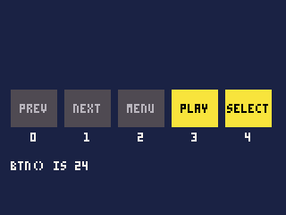
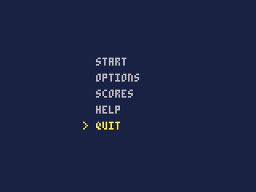
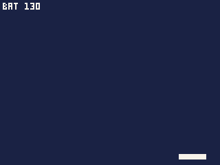
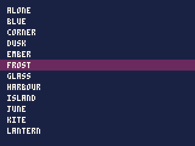
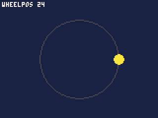
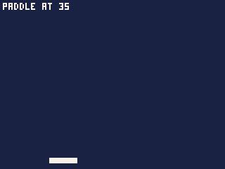
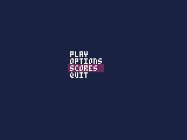

# Input and the wheel

What the player presses and turns: the click wheel's five buttons, the
wheel itself, and where a finger rests on it. Plus two script libraries
that turn the wheel into the controls games usually want.

- [How input works](#how-input-works), and [in the IDE](#in-the-ide)
- Buttons: [btn](#btni), [btnp](#btnpi), [btnr](#btnri), [the Menu button](#the-menu-button)
- The wheel: [wheel](#wheel), [wheelsteps](#wheelsteps), [wheelpos](#wheelpos), [click](#clickbeep)
- [The dial library](#the-dial-library): steps, angle, speed, paddle
- [The menu library](#the-menu-library)

## How input works

**The buttons** are numbered:

| Number | Button | Where |
|---|---|---|
| 0 | Prev | the wheel's left |
| 1 | Next | the wheel's right |
| 2 | Menu | the wheel's top -- only when the cart takes it (below) |
| 3 | Play | the wheel's bottom |
| 4 | Select | the centre button |

**The wheel** reports two things: how far it was turned since the last
tick, in clicks -- 96 to a whole turn, clockwise counting up -- and where a
finger is resting on it, 0 to 95 clockwise from the top.

**Input is read once a tick.** What the functions report is the state at
the start of the tick, the same however many times they are asked during
it. Read input in `update()`; `draw()` may be skipped when the iPod is
busy, and input read there would be missed.

**What each costs** is a few units a call. Input is never what makes a
cart slow.

### In the IDE

Click the Player's screen first, to give it the keys:

| Key | Is |
|---|---|
| Left, Right | Prev, Next |
| Up, Down | turns the wheel 4 clicks anticlockwise, clockwise: a list's row |
| Enter | Select |
| Space | Play |
| Esc | Menu |

Or use the drawn wheel under the screen: drag round its ring to turn it
(and the finger's place is where the pointer is); click the ring at the
top, left, right or bottom for Menu, Prev, Next or Play; hold the click
half a second to hold the button; click the middle for Select.

---

## btn([i])

Whether a button is held down now.

| Argument | |
|---|---|
| `i` | the button, 0 to 4; left out, all of them at once |

**Returns** true (1) while button `i` is held, false (0) when not. With no
`i`, a number with a bit for each button held: 1 Prev, 2 Next, 4 Menu, 8
Play, 16 Select.

```js
var NAMES = ["PREV", "NEXT", "MENU", "PLAY", "SELECT"];

function draw() {
    cls(1);
    for (var i = 0; i < 5; i++) {
        var x = 6 + i * 30, on = btn(i);
        rectfill(x, 50, x + 25, 70, on ? 10 : 5);
        print(NAMES[i], x + 13 - textw(NAMES[i]) / 2, 58, on ? 0 : 6);
        print("" + i, x + 11, 74, 7);
    }
    print("BTN() IS " + btn(), 6, 90, 7);
}
```



**Held buttons move things** smoothly, a little each tick:

```js
var x = 40.0;

function update() {
    if (btn(1)) x = min(x + 1.5, 152);
    if (btn(0)) x = max(x - 1.5, 8);
}
```


- A button number other than 0 to 4 stops the cart with an error.
- Several buttons can be held at once; test each.
- `btn(2)`, Menu, is false unless the cart takes the Menu button.

## btnr([i])

Whether a button was **let go** this tick: down last tick, up this one.
With no argument, whether any was. A charge-and-release -- hold Select to
wind up a throw, let go to throw -- is `btn` while held and `btnr` on the
release.

## btnp([i])

Whether a button was **pressed** this tick -- and, while it stays held,
again every so often, like a key repeating on a keyboard.

| Argument | |
|---|---|
| `i` | the button, 0 to 4; left out, all of them as bits, as for `btn` |

**Returns** true on the tick the button goes down; then, while it is
held, true again after 15 ticks, and every 4 ticks after that. False on
every other tick.

Use it wherever one press should do one thing: moving through a menu,
firing a single shot, starting a game.

```js
var choice = 0;
var ITEMS = ["START", "OPTIONS", "SCORES", "HELP", "QUIT"];

function update() {
    if (btnp(1)) choice = min(choice + 1, ITEMS.length - 1);
    if (btnp(0)) choice = max(choice - 1, 0);
}

function draw() {
    cls(1);
    for (var i = 0; i < ITEMS.length; i++)
        print(ITEMS[i], 60, 36 + i * 10, i == choice ? 10 : 6);
    print(">", 52, 36 + choice * 10, 10);
}
```



- Here Next was held for 28 ticks: the press moved the choice once, and
  the repeats at 15, 19 and 23 ticks moved it three more.
- When the repeat is unwanted -- a jump, which should happen once however
  long the button is held -- remember the button's state yourself:
  `var jump = btn(4) && !wasDown; wasDown = btn(4);`.

## The Menu button

**Holding Menu for a second pauses the game**: the iPod stops the cart
and shows its pause menu -- the cart's options, high scores, help, and
items of its own from `menuitem()`. The cart carries on where it was when
the menu closes, and [`resumed()`](reference-time.md#resumed) tells it the
game was paused. Menu pressed in the pause menu leaves the game, as its
Quit does, back to the list the game was started from.

**A short press of Menu** asks over the game, in its dialog style, whether
to quit. A cart that needs a fifth button can take the short press for
itself instead, with `"menu_button": "game"` in `cart.json` (in the IDE,
**Cart > Settings**, Running). Then:

- **A short press of Menu** reaches the cart as button 2, for one tick,
  **when the button is let go**.
- **Holding Menu for a second** still opens the pause menu, so the player
  is never trapped in a game.

So Menu suits a single action -- open a map, cycle a weapon -- not
something held down.

---

## wheel()

How far the wheel was turned since the last tick.

**Returns** the clicks turned: 96 make a whole turn; clockwise is
positive, anticlockwise negative; 0 when it was still.

Adding it to a position makes something follow the wheel, a pixel a click
-- the bat from the tutorial:

```js
var bat = 70;

function update() {
    bat = mid(0, bat + wheel(), 140);
}

function draw() {
    cls(1);
    rectfill(bat, 112, bat + 19, 115, 7);
    print("BAT " + bat, 2, 2, 7);
}
```



- A pixel a click is a useful speed for a bat: a quarter turn crosses
  most of the screen. Multiply for faster, or divide (by a fraction,
  `wheel() / 2.0`) for finer control.
- Turned fast, the wheel gives many clicks in one tick; nothing is lost
  between ticks.
- For menus, where a click is too small a step, see
  [`wheelsteps`](#wheelsteps).

## wheelsteps()

How many rows a list moves for this tick's turn of the wheel, the way
the iPod's own lists move.

**Returns** the rows, clockwise positive; usually 0, 1 or -1.

```js
var SONGS = ["ALONE", "BLUE", "CORNER", "DUSK", "EMBER", "FROST", "GLASS",
             "HARBOUR", "ISLAND", "JUNE", "KITE", "LANTERN"];
var at = 0;

function update() {
    at = mid(0, at + wheelsteps(), SONGS.length - 1);
}

function draw() {
    cls(1);
    for (var i = 0; i < SONGS.length; i++) {
        if (i == at) rectfill(0, 4 + i * 9, 159, 12 + i * 9, 2);
        print(SONGS[i], 6, 6 + i * 9, 7);
    }
}
```



- A row every 4 clicks, however slowly they come, the rest carried to
  the next tick.
- Spun fast -- past about three quarters of a turn a second -- it moves
  many rows a step, as the iPod's lists do, so a long list is crossed
  with a flick.
- Use it for any list or menu, so the cart's lists move as the
  iPod's own do. The dialogs (`ui.choose` and the rest), `gui.list`
  and the menu library use it.

## wheelpos()

Where a finger is resting on the wheel.

**Returns** the place, 0 to 95, clockwise from the top: 24 is the right,
48 the bottom, 72 the left. -1 when nothing is touching it.

```js
cls(1);
circ(80, 60, 40, 5);
var p = wheelpos();
if (p >= 0) {
    var a = p / 96.0;
    circfill(80 - 40 * sin(a), 60 - 40 * cos(a), 5, 10);   // sin is upside down
}
print("WHEELPOS " + p, 2, 2, 7);
```



- The finger does not have to move: a thumb resting on the wheel's left
  says 72 every tick. That makes the wheel a touch control -- point at
  where to go, as with [`dial.paddle`](#dialpaddlelo-hi-from-to).
- `p / 96.0` is the place as a fraction of a turn, ready for `sin` and
  `cos` -- remember the `.0`.

## click([beep])

Makes the iPod's click: the tick the wheel makes as it turns, or a short
beep -- from the iPod's little built-in speaker, not the headphones.

| Argument | |
|---|---|
| `beep` | true for the beep; the click when left out |

**Returns** nothing.

```js
if (btnp(4)) click(1);    // a beep to say Select did something
```

- It plays through the speaker that makes the wheel's own click, so it is
  heard even with headphones in, and whatever the owner's click setting.
  The beep lasts a fifth of a second; a click or beep asked for while one
  is still sounding is dropped.
- In the IDE it sounds through the computer's speakers.
- For real sound effects, through the headphones, see **Sound**.

---

## The dial library

`lib/dial.js` turns the wheel's raw clicks into what games usually want.
Copy it into the cart (in the IDE, **File > Add files from disk**) and its
functions are `dial.<name>`.

### dial.steps(n)

Whole steps of the wheel this tick, counting `n` steps to a turn -- with
the part of a step turned so far carried over to the next tick.

| Argument | |
|---|---|
| `n` | steps to a whole turn: 16 is a step every 6 clicks |

**Returns** the whole steps turned this tick, clockwise positive; usually
0, 1 or -1.

```js
choice = mid(0, choice + dial.steps(16), ITEMS.length - 1);
```

- Turned slowly, a click at a time, `wheel()` is 1 or 0 each tick and a
  menu would never move by a line a click; `steps` adds the clicks up and
  moves one line for every six, however slowly they come.
- It keeps one carry, so use one `n` for the whole cart.
- For a list, [`wheelsteps`](#wheelsteps) moves as the iPod's lists
  do; `steps` is for a dial of your own count, such as 16 settings
  round a knob.

### dial.angle()

How far the wheel has turned since the cart started, in turns: 1.0 is a
whole turn clockwise, -0.5 half a turn back.

**Returns** the turns, a fraction.

- For something that turns with the wheel: a knob, a ship's heading
  (`rspr(n, x, y, dial.angle())`), a safe's dial.

### dial.speed()

How fast the wheel is turning, in clicks a tick, smoothed so that one
jerky tick does not jump it.

**Returns** the smoothed clicks a tick, a fraction; positive clockwise.

- For things the wheel *drives* rather than places: spin it fast to
  pedal faster, to wind a spring, to charge a shot.

### dial.paddle(lo, hi, from, to)

The finger's place along an arc of the wheel, as a value from `lo` to
`hi`.

| Argument | |
|---|---|
| `lo`, `hi` | the values at the arc's two ends |
| `from`, `to` | the arc, as wheel places 0 to 95, going clockwise from `from` to `to` |

**Returns** the value for where the finger is, a fraction from `lo` to
`hi`; -1 when the finger is off the arc or not touching.

```js
// the bottom half of the wheel: clockwise from 24 (the right) to 72 (the left),
// so 140 at the right end and 0 at the left -- the bat under the finger
var x = dial.paddle(140, 0, 24, 72);
if (x >= 0) rectfill(x, 112, x + 19, 115, 7);
print(x < 0 ? "NOT TOUCHED" : "PADDLE AT " + flr(x), 2, 2, 7);
```



- The arc runs **clockwise**, so the bottom half of the wheel from left to
  right is *anticlockwise*: give it as clockwise from 24 to 72, with
  `lo` and `hi` the other way round, as above.
- A paddle put where the finger is can move as fast as a finger, which
  is different from a bat that moves with the clicks -- try both.

## The menu library

`lib/menu.js` is a whole in-game menu, worked by the wheel and the
buttons.

| Function | |
|---|---|
| `menu.open(items)` | starts a menu of `items`, an array of text, with the first chosen |
| `menu.update()` | call once a tick while it is open: the wheel moves the choice as the iPod's lists move ([`wheelsteps`](#wheelsteps)), Prev and Next a line a press, and both wrap round. **Returns** the number of the line chosen when Select is pressed, else -1 |
| `menu.draw(x, y, c, bar)` | draws the lines from `x, y`, a line of the current font apart, in colour `c`, the chosen one on a bar of colour `bar` |
| `menu.choice()` | the line chosen now, 0 first |

```js
function init() {
    menu.open(["PLAY", "OPTIONS", "SCORES", "QUIT"]);
}

function update() {
    var picked = menu.update();
    if (picked == 0) startGame();
    if (picked == 3) quit();
}

function draw() {
    cls(1);
    menu.draw(60, 44, 7, 2);
}
```



- The library is plain cart code: copy it and change it to suit.
