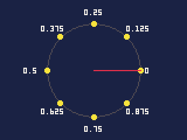
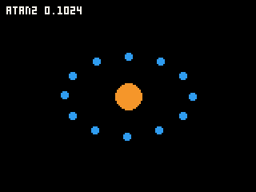

# The language

Carts are written in a small part of JavaScript. If you know some
JavaScript, most of what you write works as you expect; this chapter is
the whole of the language -- what it has, where it behaves differently,
and what it leaves out -- together with the maths functions every cart
uses.

Anything the compiler does not take, it refuses at the line, saying what
to write instead, so you cannot use a missing feature by accident. The
traps on this page are the differences it cannot catch: code that builds
and does something other than what JavaScript would.

- [A cart's files](#a-carts-files): [the functions the Arcade calls](#the-functions-the-arcade-calls),
  [namespaces](#namespaces), [the top level](#the-top-level), [names](#names)
- [Numbers](#numbers): [integers and fractions](#integers-and-fractions),
  [turning fractions into whole numbers](#turning-fractions-into-whole-numbers),
  [operators](#operators)
- Maths: [flr, ceil](#flrx-ceilx), [abs, sgn](#absx-sgnx), [min, max, mid](#mina-b-maxa-b),
  [sqrt](#sqrtx), [sin, cos](#sint-cost), [atan2](#atan2dx-dy), [rgb](#rgb0xrrggbb), [rnd](#rndx),
  [srand](#srandx), [rng](#rngseedg-seed-and-rngrndg-x), [Math.*](#math)
- [Text: strings](#strings)
- [true, false, null and typeof](#true-false-null-and-typeof), [== is ===](#-is-)
- [Statements](#statements)
- [Arrays](#arrays), [typed arrays](#typed-arrays): [copy](#copydst-di-src-si-n),
  [fill](#filla-v-i-n), [mem](#memmemname)
- [Records](#records)
- [Functions](#functions): [functions as values](#functions-as-values),
  [no closures](#no-closures), [sorting](#sorting)
- [What is not here, and what to write instead](#what-is-not-here-and-what-to-write-instead)
- [Memory](#memory)
- [When a cart stops](#when-a-cart-stops)

## A cart's files

### The functions the Arcade calls

`main.js` holds the functions the Arcade calls:

```js
function init()   { }   // once, when the cart starts
function update() { }   // every tick: the game's rules
function draw()   { }   // after each update that is shown: the drawing
```

A fourth is optional:

```js
function ending() { }   // once, as the cart closes
```

`ending()` runs when the game is closing -- the pause menu's Quit, the
quit question, the end of the run in the IDE or `pbgvm` -- after its last
tick and before its saves are written: the place to `dset` or
`store.write` what is in play, rather than saving it every tick. When Quit
keeps the game to carry on later, it carries on as `ending()` left it.
It may not draw: the screen is already the iPod's.

`init` and `update` are required. Without `draw`, `update` draws as well
-- fine for a cart whose drawing is cheap; but when the iPod falls
behind it runs `update()` without drawing, and only a separate `draw()`
can be left out then (see **Time and speed**).

### Namespaces

Every other `.js` file in the cart is a **namespace**, named after the
file. A function `twice` in `util.js` is `util.twice()` from any other
file, and its global `count` is `util.count`, which other files can read
and set:

```js
// util.js
var count = 2;
const N = 4;
function twice(x) { return x * 2; }

// main.js
function init() {
    printh(util.twice(4));   // 8
    printh(util.N);          // 4
    util.count = 5;
}
```

- Inside its own file, a namespace's names are used bare: `twice(3)`,
  `count`.
- A namespace's file can use `main.js`'s globals and functions directly,
  by their bare names.
- A namespaced call costs exactly what a call in the same file does.
- The script libraries in the SDK's `lib/` folder are namespaces of this
  kind: copy `dial.js` into a cart and it has `dial.steps()` and the rest.
  Functions a cart never calls are left out of the build.

### The top level

At the top of a file -- outside any function -- you can write `var`,
`function` and `const`, and nothing that runs:

```js
const N = 3, M = N * 2;          // constants, worked out when building
var board = new Int32Array(N * M);
var level = [1, 2, 3];
var hero = { x: 0, y: 0 };
var first = make();              // a call: runs before init()

function make() { return [5]; }
function init() { printh(board.length); }  // 18
```

- A `var` whose value needs code to make it -- an array, a record, a
  typed array, a call -- gets it **before `init()` runs**: the namespace
  files first, in alphabetical order of their names, then `main.js`; and
  within a file, from the top down. So `main.js` may use a namespace's
  globals in its own, and a later `var` may use an earlier one.
- A statement that does something -- `printh(1);`, `x = 5;`, a loop -- is
  refused at the top level: "only declarations can be at the top level of
  a file; put code that runs once in init()".
- **`const`** is for the top level only, and only for a value known when
  building: a number, text, or arithmetic on other constants. It costs
  nothing when the cart runs. Inside functions, use `var`.

### Names

A global cannot take the name of anything the Arcade already has -- an API
function, a constant group, a system or a namespace:

```js
var t = 1;        // refused: "t is a built-in function"
var grid;         // refused: "grid is the grid system"
var score = 0;    // refused: score is the high-score system
```

A local variable or a parameter may reuse any of them; inside that
function, the name is yours. The common clashes are `t`, `time`, `map`,
`print`, `score`, `grid`, `path`, `sheet`, `data`, `store`, `frame` and
`rate` -- name a global `points`, `level` or `board` instead.

## Numbers

### Integers and fractions

A number is an **integer** -- a whole number -- or a **fraction**, and the
way it is written says which:

- `2`, `-15`, `0xff` are integers: 32 bits, from about -2.1 billion to
  2.1 billion.
- `2.0`, `1.5`, `0.25` are fractions: steps of 1/65536, from -32768 to
  just under 32768. This is PICO-8's number, exact enough for positions,
  speeds and angles on a 160-pixel screen.

Anything with a fraction in it gives a fraction; two integers give an
integer:

| You write | You get |
|---|---|
| `7 / 2` | `3` -- **two integers divide to an integer**, toward zero |
| `7 / 2.0` | `3.5` |
| `-7 / 2` | `-3` |
| `-7 % 3`, `7 % -3` | `-1`, `1`: the sign of the left side, as JavaScript |
| `7 / 0.5` | `14` |
| `1 / 3.0` | prints `0.3333` |
| `0.1 + 0.2` | prints `0.3` |
| `2 == 2.0` | true: integers and fractions compare by value |
| `1000 * 1.5` | `1500` |
| `30000 * 1.5` | `-20536`: past 32767, a fraction wraps |
| `2147483647 + 1` | `-2147483648`: an integer wraps at 32 bits |

**The trap is integer division.** `speed / 4` with an integer speed is a
whole number; `points / 20` is 0 until there are 20 points. Write a point
when you want a fraction: `speed / 4.0`, `points / 20.0`.

**The other trap is size.** A fraction holds up to 32767, and an integer
above that mixed with a fraction wraps, silently. Keep big numbers -- a
score, a frame count, a time in milliseconds -- as integers, and do
fraction arithmetic on small values. A fraction literal too big to hold,
such as `40000.5`, is refused when building.

Fractions print with up to four decimal places, trailing zeros dropped:
`2.0` prints `2`, `1.25` prints `1.25`.

### Turning fractions into whole numbers

| You write | You get |
|---|---|
| `flr(2.7)`, `flr(-0.5)` | `2`, `-1`: down |
| `ceil(-1.5)` | `-1`: up |
| `Math.round(0.5)`, `Math.round(2.5)`, `Math.round(-2.5)` | `1`, `3`, `-2`: to the nearest, halves up |
| `Math.trunc(-2.5)` | `-2`: toward zero |
| `5.7 \| 0`, `-5.7 \| 0` | `5`, `-5`: bitwise operators truncate |

A fraction used as an array index, or given as a position, size or count
to the API, is rounded down.

### Operators

Every arithmetic, comparison and bitwise operator works, with `+=`, `-=`
and the rest, `++` and `--`:

| You write | You get |
|---|---|
| `6 & 3`, `6 \| 3`, `6 ^ 3`, `~0` | `2`, `7`, `5`, `-1` |
| `1 << 4`, `-16 >> 2`, `-16 >>> 28` | `16`, `-4`, `15` |
| `1 << 33` | `2`: shift counts are taken `& 31` |
| `-1 >>> 0` | `-1`: results stay 32-bit and signed |

There is no `NaN` and no `Infinity`: every number is finite, and
**dividing by zero stops the cart** with an error.

---

## flr(x), ceil(x)

Round a number down (`flr`) or up (`ceil`) to a whole number.

| Argument | |
|---|---|
| `x` | a number |

**Returns** an integer.

```js
printh(flr(2.7));     // 2
printh(flr(-0.5));    // -1
printh(ceil(-1.5));   // -1
printh(ceil(2));      // 2
```

- Use `flr` to turn a pixel position into a map cell: `flr(x / 8)` -- or
  `x >> 3` for an integer `x`.
- `Math.floor` and `Math.ceil` are the same.

## abs(x), sgn(x)

`abs` is a number without its sign; `sgn` is its sign.

| Argument | |
|---|---|
| `x` | a number |

**Returns** for `abs`, `x` made positive, an integer or a fraction as `x`
was; for `sgn`, `1` or `-1` -- **and `1` for 0**.

```js
printh(abs(-3));      // 3
printh(abs(-2.5));    // 2.5
printh(sgn(-0.5));    // -1
printh(sgn(0));       // 1
```

- `sgn(0)` is 1, as in PICO-8. `Math.sign(0)` is 0, as in JavaScript: use
  it when 0 must stay 0.

## min(a, b), max(a, b)
## mid(x, y, z)

`min` is the smaller of two numbers, `max` the larger; `mid` the middle
one of three.

| Argument | |
|---|---|
| `a`, `b` / `x`, `y`, `z` | numbers |

**Returns** one of its arguments.

```js
printh(min(3, 1.5));      // 1.5
printh(max(3, 1.5));      // 3
printh(mid(1, 3, 5));     // 3
printh(mid(5, 1, 3));     // 3: in any order
```

- `mid(low, value, high)` keeps a value between two limits -- the most
  common use: `bat = mid(0, bat + wheel(), 140)`.
- `Math.min` and `Math.max` take any number of arguments:
  `Math.min(4, 2, 9, 1)` is 1.

## sqrt(x)

The square root.

| Argument | |
|---|---|
| `x` | a number, 0 or more |

**Returns** the root -- **of an integer, an integer, rounded down**; of a
fraction, a fraction. 0 for a negative number.

```js
printh(sqrt(16));     // 4
printh(sqrt(17));     // 4
printh(sqrt(2.0));    // 1.4142
printh(sqrt(0.25));   // 0.5
```

- For a distance, give it fractions, or compare squares instead and skip
  the root: `dx * dx + dy * dy < r * r` is "within `r`".
- `Math.sqrt` behaves the same: `Math.sqrt(2)` is 1.

## sin(t), cos(t)

Sine and cosine of an angle, given in **turns**: 1.0 is a full circle,
0.5 a half, 0.25 a quarter.

| Argument | |
|---|---|
| `t` | the angle, in turns; any size, wrapping round |

**Returns** a fraction from -1 to 1.

Angles go **anticlockwise** on the screen from pointing right: 0 is right,
0.25 up, 0.5 left, 0.75 down. To make that so with y growing down the
screen, `sin` is upside down: `sin(0.25)` is -1.

```js
for (var i = 0; i < 8; i++) {
    var a = i / 8.0;
    circfill(80 + cos(a) * 40, 60 + sin(a) * 40, 2, 10);
}
```



- A point at distance `r` in direction `a` from `x, y` is
  `x + cos(a) * r, y + sin(a) * r`; a speed of `s` in direction `a` is
  `dx = cos(a) * s, dy = sin(a) * s`.
- `deg(90)` gives `0.25`, worked out when building, for those who think in
  degrees.

## rgb(0xRRGGBB)

The colour of the palette nearest to one given as red, green and blue,
worked out when building.

| Argument | |
|---|---|
| `0xRRGGBB` | the colour, as a number written in the code |

**Returns** the colour's number in that palette.

```js
var red = rgb(0xff0000);     // 8 in the standard palette
```

- It looks in the palette the cart starts in: its first palette file by
  name if it has one, the standard sixteen if not. A palette changed while the game
  runs is not seen.
- Only a number written in the code will do: `rgb(v)` does not build,
  "rgb() needs a colour written in the code".
- It costs nothing as the game runs: the number is in the cart.

## atan2(dx, dy)

The direction of a step `dx` across and `dy` down, as an angle in turns,
matching `sin` and `cos`.

| Argument | |
|---|---|
| `dx`, `dy` | the step: how far across, and how far down |

**Returns** a fraction from 0 to just under 1.

```js
printh(atan2(1, 0));    // 0: right
printh(atan2(0, -1));   // 0.25: up
printh(atan2(-1, 0));   // 0.5: left
printh(atan2(0, 1));    // 0.75: down
printh(atan2(1, 1));    // 0.875: down and right
```

- Aim at something: `var a = atan2(tx - x, ty - y);` then move along `a`
  with `cos` and `sin`.
- `atan2(0, 0)` is 0.



## rnd([x])

A random number. What it gives follows what it is given:

| You write | You get |
|---|---|
| `rnd()` | a fraction from 0 to just under 1 |
| `rnd(6)` | an integer from 0 to 5 |
| `rnd(6.0)` | a fraction from 0 to just under 6 |
| `rnd(array)` | one of the array's elements |

**Returns** as above; `rnd(0)` and a negative number give 0.

```js
var roll = rnd(6) + 1;                     // a die: 1 to 6
var speed = 0.5 + rnd(1.0);                // 0.5 to just under 1.5
var colour = rnd([8, 9, 10]);              // red, orange or yellow
if (rnd(100) < 25) printh("a 1 in 4 chance");
```

- The numbers are even: 600 rolls of `rnd(6)` came out 104, 100, 110, 85,
  95 and 106.
- `rnd(10)` with an integer never gives 10 itself.

## srand(x)

Seeds the random numbers: after the same seed, `rnd` gives the same
numbers in the same order.

| Argument | |
|---|---|
| `x` | the seed, a number |

**Returns** nothing.

```js
srand(7);
printh(rnd());    // 0.807
printh(rnd(6));   // 1
srand(7);
printh(rnd());    // 0.807 again
printh(rnd(6));   // 1 again
```

- A cart starts with a different seed each run, so games differ. Seed it
  yourself for a level that should be the same every time -- a daily
  puzzle seeded from the date, say.
- `srand(state)`, given the `Int32Array` that `rndstate(state)` filled,
  puts `rnd` back where it was: save the state with a game, and a game
  continued gets the same chances it would have had.

## rng.seed(g, seed) and rng.rnd(g, [x])

Generators of the cart's own, each a stream of its own, so a daily
puzzle's layout is not changed by the sparks and enemy moves that also
use chance.

| Argument | |
|---|---|
| `g` | the generator: an `Int32Array` of 2, which holds its state |
| `seed` | as `srand`'s |
| `x` | as `rnd`'s: a whole number, a fraction, or an array to pick from |

**Returns** `rng.rnd` gives what `rnd(x)` would; `rng.seed` nothing.

```js
var daily = new Int32Array(2);

function newPuzzle(day) {
    rng.seed(daily, day);                 // the same day, the same puzzle
    for (var i = 0; i < 20; i++)
        board[i] = rng.rnd(daily, 6);     // rnd() elsewhere leaves it alone
}
```

- The generator is just two numbers: save them with `dset` or
  `store.write` and the stream carries on where it was.

## Math.*

`Math.abs`, `Math.min` and `Math.max` (any number of arguments),
`Math.floor`, `Math.ceil`, `Math.round`, `Math.trunc`, `Math.sqrt`,
`Math.sign` and `Math.pow` work as above. `Math.pow` takes a whole
exponent: `Math.pow(2, 10)` is 1024, `Math.pow(2.0, 3)` is 8.

`Math.random` and `Math.PI` are not there: use `rnd()`, and angles in
turns.

---

## Strings

Text in quotes, single or double: `"hello"`, `'hello'`.

```js
var s = "n=" + 3 + ", f=" + 1.5;   // "n=3, f=1.5"
```

- `+` joins strings, and turns numbers into text: `"a" + 1 + 2` is
  `"a12"`, but `1 + 2 + "a"` is `"3a"` -- left to right.
- `\n` in a string is a new line.

| Method | Gives | Example |
|---|---|---|
| `s.length` | its length in bytes | `"abc".length` is 3 |
| `s.charCodeAt(i)` | the code of byte `i` | `"Hello".charCodeAt(0)` is 72 |
| `s[i]` | byte `i`, as a one-character string | `"abc"[1]` is `"b"` |
| `s.substring(a, [b])` | from `a` up to (not including) `b`, or to the end | `"Hello, World".substring(7)` is `"World"` |
| `s.slice(a, [b])` | the same, and negative counts from the end | `"abcd".slice(-2)` is `"cd"` |
| `s.indexOf(t, [from])` | where `t` first starts, looking from `from`, or -1 | `"Hello".indexOf("l")` is 2, `"Hello".indexOf("l", 3)` 3 |
| `s.lastIndexOf(t, [from])` | where `t` last starts, looking back from `from`, or -1 | `"Hello".lastIndexOf("l")` is 3 |
| `s.toUpperCase()`, `s.toLowerCase()` | the case changed | |
| `String.fromCharCode(n)` | the one-character string with code `n` | `String.fromCharCode(65)` is `"A"` |
| `parseInt(s)` | the whole number at its start, or `null` | `parseInt(" 42")` is 42, `parseInt("3.9")` 3, `parseInt("x")` `null` |

- `<` and `>` compare by character code: `"apple" < "banana"`, and
  `"Zebra" < "apple"` because capitals come first.
- `==` compares the text.
- **Strings are bytes** (UTF-8). For plain ASCII a byte is a character;
  an accented letter is two, so `"héllo".length` is 6.

**Building strings costs time**: about 24 units a join, each time it runs.
Text that does not change is cheaper made once. Inside `print`, though,
the pieces of a `+` are drawn one after another without being joined, so
`print("SCORE " + points, ...)` costs no extra (see **Text and fonts**).

## true, false, null and typeof

- `true` and `false` are the integers 1 and 0: `printh(2 > 1)` prints `1`.
- `undefined` is `null`: a variable never set, a missing field, an
  argument not given.
- False in a test: `0`, `0.0`, `null` and `""`. Everything else is true,
  empty arrays `[]` and records `{}` included.
- `a || b` and `a && b` give one of their values, as in JavaScript:
  `null || "d"` is `"d"`, `3 && 4` is `4` -- handy for a default:
  `name = given || "PLAYER"`.
- `typeof` gives:

| Value | `typeof` |
|---|---|
| integers, fractions, `true`, `false` | `"number"` |
| text | `"string"` |
| functions | `"function"` |
| `null`, arrays, typed arrays, records | `"object"` |

## == is ===

Nothing is converted to compare: `1 == "1"` is false, `null == 0` is
false. `!=` is `!==` likewise.

- Arrays and records are equal only when they are the same one:
  `[1] == [1]` is false, but after `var b = a`, `a == b` is true -- and
  changing `b.x` changes `a.x`, since they are one record.
- Integers and fractions compare by value: `2 == 2.0`.

## Statements

`var`, `if` / `else`, `for`, `while`, `do` ... `while`, `switch`,
`break`, `continue`, `return`, and `? :`:

```js
for (var i = 0, j = 10; i < j; i++, j--) { }   // commas in a for

switch (state) {                                // numbers or strings
case "title":
    drawTitle();
    break;
case "play":
    drawGame();
    break;
default:
    drawOver();
}

var size = n < 5 ? "low" : n < 10 ? "mid" : "high";
```

- A `case` without `break` carries on into the next, as in JavaScript.
- `do { } while (c)` runs its body once before testing.
- `var` inside a function makes a local; declare it anywhere in the
  function, as in JavaScript. There is no `let`, and no block scope.

## Arrays

An array is a list that can grow and shrink.

```js
var a = [3, 1, 2];
a.push(4);                 // a is [3, 1, 2, 4]
var last = a.pop();        // 4
var first = a.shift();     // 3; a is [1, 2]
a.unshift(8, 9);           // a is [8, 9, 1, 2]
a.shift();                 // a is [9, 1, 2]
printh(a.join(","));       // 9,1,2
printh(a.indexOf(2));      // 2
var part = a.slice(1);     // a new array [1, 2]
var out = a.splice(0, 2);  // takes [9, 1] out; a is [2]
a.reverse();
```

| Method | Does |
|---|---|
| `a.length` | how many elements (read only) |
| `a.push(v, ...)` | adds them at the end, and gives the new length |
| `a.pop()`, `a.shift()` | takes one from the end, or the start, and gives it |
| `a.unshift(v, ...)` | adds them at the start, in order, and gives the new length |
| `a.indexOf(v, [from])` | where `v` first is, looking from `from` (negative counts from the end), or -1 |
| `a.lastIndexOf(v, [from])` | where `v` last is, looking back from `from`, or -1 |
| `a.slice(a, [b])` | a new array of a part |
| `a.splice(i, [n], [v, ...])` | takes `n` out from `i` -- to the end without `n` -- puts any `v`s in their place, and gives those taken as an array |
| `a.join([sep])` | one string of them all, `sep` between (`,` without it) |
| `a.reverse()` | turns it round in place |
| `a.sort(comparator)` | sorts it in place; see [sorting](#sorting) |

- `push` and `unshift` take up to 16 values, and `splice` up to 16 to
  put in; more do not build. They behave as in JavaScript:
  `a.splice(1, 0, 2, 3)` puts 2 and 3 in at 1, taking nothing out.
- **Reading past the end gives `null`; writing past the end stops the
  cart.** Grow an array with `push`. Its length cannot be set.
- An array literal cannot have holes: `[1, , 3]` is refused.
- Arrays of arrays, and of records, work: `a[1][0]`, `list[i].x++`.
- Taking from the front -- `shift`, `splice(0, 1)` -- moves everything
  after it along, which costs time on a long array. For a queue that is
  taken from often, keep an index of where the front is instead.

### Typed arrays

`new Int32Array(n)`, `new Uint8Array(n)` and `new FixArray(n)` make
fixed-length arrays of numbers, all 0:

```js
var board = new Int32Array(20 * 15);   // a board 20 by 15
board[y * 20 + x] = 3;
```

- An `Int32Array` holds integers: storing `1.75` stores `1`.
- A `FixArray` holds fractions, as a variable does: `1.75` stays `1.75`,
  and every element reads back as a fraction. Use it for positions and
  speeds of many things outside an actor pool. Like any fraction, a value
  past 32767 wraps.
- A `Uint8Array` holds 0 to 255, wrapping: `300` is stored as `44`, `-1` as
  `255`. It takes a quarter of the memory.
- Reading past the end gives `null`; **writing past the end is silently
  ignored** -- unlike an array, which stops the cart.
- `indexOf` and `lastIndexOf` work on them as on an array; `copy` and
  `fill` take them, two of one kind.
- Use them for grids and boards, many numbers that change each tick, and
  wherever the API fills an array: `date`, `mapobj`, and the systems'
  `out` arrays all take an `Int32Array`. They take far less memory than an
  array of the same numbers, and making none each tick leaves the memory
  manager nothing to clear up.

## copy(dst, di, src, si, n)

Copies `n` elements from one array to another, or within one.

| Argument | |
|---|---|
| `dst`, `di` | where to copy to: the array, and the first index |
| `src`, `si` | where to copy from |
| `n` | how many |

**Returns** nothing.

```js
var a = new Int32Array(8);
fill(a, 5);              // 5,5,5,5,5,5,5,5
fill(a, 0, 2, 3);        // 5,5,0,0,0,5,5,5
copy(a, 1, a, 0, 6);     // 5,5,5,0,0,0,5,5: overlapping, done right
```

- Both arrays must be of one kind -- two `Int32Array`s, two
  `Uint8Array`s, or two arrays -- or the cart stops: "copy() needs two
  arrays of one kind".
- It costs far less than a loop: 1,000 elements in about 250 units,
  against about 10,000 for a `for` loop doing the same. `fill` is the
  same: 1,000 in about 250, and the whole screen through `mem` in about
  1,200.

## fill(a, v, [i], [n])

Sets elements of an array to one value.

| Argument | |
|---|---|
| `a` | the array |
| `v` | the value |
| `i` | the first index; 0 when left out |
| `n` | how many; to the end when left out |

**Returns** nothing.

Example above, under `copy`. It works on arrays too: `fill(list, 0)`.

## mem(MEM.name)

The engine's own memory, as a `Uint8Array` you can read and write
directly.

| Argument | |
|---|---|
| `MEM.SCREEN` | the screen: 19,200 bytes, a row of 160 after another, each a colour |
| `MEM.SHEET` | the sprite sheet: 16,384 bytes, 128 a row |
| `MEM.MAP` | the active map's cells, a byte each, a row after another |
| `MEM.FLAGS` | the 256 sprites' flags |

**Returns** the `Uint8Array`.

```js
cls(3);
var s = mem(MEM.SCREEN);
printh(s[0]);      // 3
s[0] = 8;
printh(pget(0, 0));  // 8: the screen itself was changed
```

- With `copy` and `fill`, this moves whole rows of the screen or the map
  at once: scroll the map a row, or copy a band of the screen.
- Writing the screen this way bypasses the camera, the clip and the
  draw palette. Its rows are sent to the display like any drawing.

## Records

A record is a set of named values -- JavaScript's objects, without
methods or classes:

```js
var hero = { x: 10, y: 20, name: "Ada", pos: { tx: 1, ty: 2 }, bag: [] };
hero.x += 2;
hero.lives = 3;             // a new field
hero.bag.push("key");
printh(hero.missing);       // null
var k = "name";
printh(hero[k]);            // Ada: a field by a string, slower than hero.name
```

- A missing field reads as `null`. To clear one, set it to `null`;
  there is no `delete`.
- `o[k]` with a string looks the name up each time -- fine now and then,
  slower in a loop than `o.name`.
- A call named like an array or string method -- `o.push()`, `o.sort()`
  -- is always that method, so a field of that name can be read but not
  called. `o.length` on a record stops the cart.
- Printing a record shows `[object Object]`.
- Records and arrays are shared, not copied: `var b = a` makes `b` the
  same record as `a`.

## Functions

Declare functions at the top level of a file. They may call themselves and
each other, in any order:

```js
function fib(n) { return n < 2 ? n : fib(n - 1) + fib(n - 2); }
```

- A call with fewer arguments than the function names gives the rest as
  `null`; extra ones are dropped. There are no default values -- check
  for `null` instead: `if (speed == null) speed = 1;`.
- A function cannot be declared inside another; and a declared function's
  name cannot be assigned.

### Functions as values

A function can be kept in a variable, an array or a record, and called
through it. Write it as a **function expression**:

```js
var add = function (a, b) { return a + b; };
printh(add(1, 2));    // 3

function twice(f, v) { return f(f(v)); }
printh(twice(function (n) { return n * 3; }, 2));   // 18
```

A declared function's name is a value too, which makes a **state table**
-- the tidy way to run a game with several screens:

```js
var updates = [titleUpdate, playUpdate, overUpdate];
var state = 0;

function update() {
    updates[state]();
}
```

### No closures

**A function expression cannot use the local variables of the function
around it.** It can use globals and its own parameters, and nothing else;
using a local is refused: "k is a local variable of the function around
this one, and functions cannot capture locals; pass it as an argument or
make it a global".

```js
var bonus = 10;    // a global: fine to use
function scoreOf(list) {
    var add = function (n) { return n + bonus; };   // fine
    return add(list.length);
}
```

### Sorting

`a.sort(comparator)` sorts in place. The comparator is required: it is
given two elements and returns a negative number if the first goes first,
positive if the second does, 0 if either will do.

```js
list.sort(function (a, b) { return a - b; });         // numbers, smallest first
list.sort(function (a, b) { return a.y - b.y; });     // records by y: draw far to near
```

- 100 numbers sort in about 2,000 units.
- A comparator cannot itself sort: calling `.sort()` inside one stops the
  cart.

## What is not here, and what to write instead

| Not taken | Write |
|---|---|
| `let`, `const` inside a function | `var` |
| `=>` arrow functions | `function (x) { ... }` |
| `` `template ${strings}` `` | `"a" + x` |
| `for...of` | `for (var i = 0; i < a.length; i++)` |
| `for...in`, `in` | `o[key] != null` |
| `instanceof` | `typeof` |
| `**` | `Math.pow(a, b)` |
| `...` spread, destructuring, default parameters | name each one; check for `null` |
| `{ a }`, `{ [k]: v }` | `{ a: a }`, then `o[k] = v` |
| `.map`, `.forEach`, `.filter`, `.concat`, `.includes` | a `for` loop; `indexOf(x) != -1` |
| `.split`, `.charAt`, `.trim`, `.replace` | `indexOf` and `substring`; `s[i]` |
| `.toString()`, `String(x)`, `Number(x)`, `parseFloat` | `"" + x`; `parseInt(s)` |
| `new Array`, `new Object`, classes, `this` | `[]`, `{}`, records and functions |
| `Math.random`, `Math.PI` | `rnd()`; angles in turns |
| a closure over a local | an argument, or a global |
| a function declared inside another | a top-level function, or a function expression |
| `try`, `throw`, labels, `delete`, `void`, getters and setters, regular expressions, `arguments`, `JSON`, `eval` | -- |
| `NaN`, `Infinity` | every number is finite |

## Memory

A cart has 512 KB, the same on both iPods and in the IDE. Its code, the
sprite sheet, its maps and its pictures come out of that first; what is
left -- about 340 KB for a small cart -- holds everything it makes:
strings, arrays, records, typed arrays, images made in code, pools. When
that is full the cart stops with `out of memory`.

| Made | Takes |
|---|---|
| a string | 12 bytes and its length: `"SCORE 1234"` is 24 |
| an array or record | 24 bytes, and 8 for each element or field it has room for |
| an `Int32Array`, `FixArray` | 12 bytes and 4 an element |
| a `Uint8Array` | 12 bytes and 1 an element |
| an image made in code | a byte a pixel |

Each is rounded up to a whole number of 8 bytes, and takes at least 16.

- Memory nothing refers to any more is cleared up between ticks and used
  again, so a cart runs out only with what it keeps -- a list that only
  ever grows, say.
- Clearing up takes time the units do not show. Making nothing new in
  `update()` and `draw()` keeps it away: see
  [Making it cheaper](reference-fast.md#making-it-cheaper).

## When a cart stops

A mistake the compiler cannot see stops the cart when it happens. The IDE
shows the message in Output with the file, line and function, and puts
the editor on the line; the iPod shows it on its screen.

| Message | Means |
|---|---|
| `division by zero` | `/` or `%` by 0 |
| `index past the end of an array` | writing beyond an array's length; use `push` |
| `can't read .x of null` | a variable or field that is `null` used as a record |
| `+ needs numbers or strings, not a null` | often a missing argument, or a field never set |
| `.length of a record` | `length` asked of a record, not an array or string |
| `copy() needs two arrays of one kind` | `copy` between an `Int32Array` and a `Uint8Array`, say |
| `too much recursion` | a function calling itself without end |
| `out of memory` | more kept than fits: see [Memory](#memory) |
| `The game stopped responding` | one call ran far too long -- a loop that never ends |
