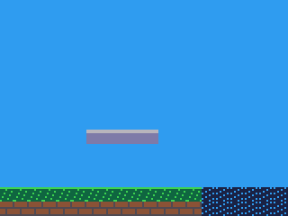
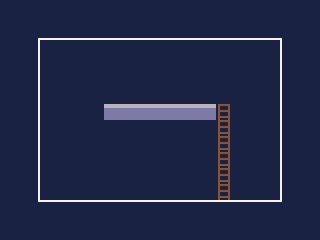
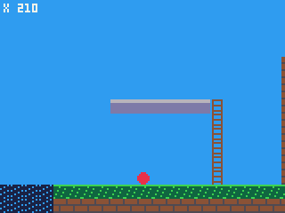
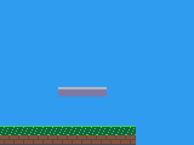
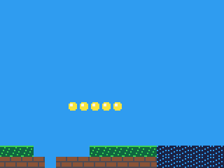
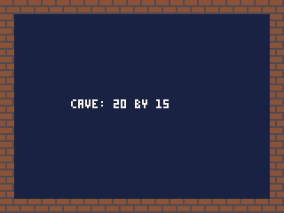
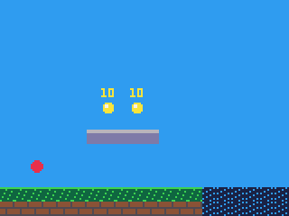
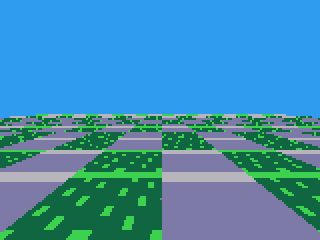
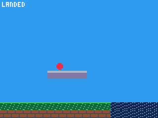

# Maps and objects

A map is a grid of sprites: the level a game is played on. Objects are
places marked on it -- where the player starts, where the coins and doors
are -- for the code to find.

- [How maps work](#how-maps-work)
- [Making maps in the IDE](#making-maps-in-the-ide), and [the file](#the-map-file)
- Drawing: [map](#mapcelx-cely-sx-sy-celw-celh-layers-cells-w), [tline](#tlinex0-y0-x1-y1-mx-my-mdx-mdy)
- Cells: [mget](#mgetx-y), [mset](#msetx-y-v)
- Maps: [loadmap](#loadmapmapname-cells), [layers](#layers-a-second-map-at-once), [mapw and maph](#mapw-and-maph)
- Objects: [mapobj](#mapobjout-max), [mapprop](#mappropi-name)
- [Walls, floors and ladders: flags](#walls-floors-and-ladders-flags)

## How maps work

**A map is a grid of cells**, each holding one sprite number from the
sheet (see **Sprites**). A cell is 8 pixels square, like a sprite, so a
map 20 cells across and 15 down exactly fills the screen. Maps can be up
to 256x256 cells -- 2048 pixels each way -- and bigger than the screen is
the usual case: the [camera](reference-drawing.md#camerax-y-turn-px-py-zoom) scrolls over
them.

**Cell 0 is empty.** A cell holding 0 draws nothing, whatever sprite 0
looks like, so leave sprite 0 blank and use it for sky, air and gaps.

**A cart can have several maps** -- one per level, say -- each a file in
`maps/` and each `MAP.<name>` in code. **One is active at a time**: the
one `map()`, `mget()`, `mset()` and the rest work on.

- At the start, the active map is **the first by name, alphabetically**:
  with `cave.json` and `level.json`, `cave` is active. Call
  `loadmap(MAP.level)` in `init()` to start where you mean to.
- A cart with no maps has an empty one, 128 by 64 cells, to `mset` into.

**Positions are in cells or pixels**, and the functions say which. Cells
count from 0 at the map's top left; a pixel position becomes a cell by
dividing by 8, which `>> 3` does for whole numbers: pixel 100 is in cell
`100 >> 3`, 12.

**Objects** are rectangles marked on a map in the IDE, each with a
**kind** -- `coin`, `door`, `start`, any name you choose -- a position and
size in pixels, and properties of your own: numbers or text. They are not
drawn; they are for the code to read when a level starts, and to put its
own things where they say. Each kind is `OBJ.<kind>` in code.

---

## Making maps in the IDE

Choose **File > New file**, then **A map**, give it a name and a size in
cells. It opens in the map editor:

- **The Tiles panel** is the sprite sheet. Click a sprite to paint with
  it, or drag across a block of sprites to paint with the whole block.
- **The tile bar** under the map holds the tiles in use, so the Tiles
  panel can be closed. Drag a sprite from the Tiles panel onto it, or
  press its **+** for the one chosen; right-click one to take it off.
- **The tools**, on the toolbar, each with its key:

  | Tool | Key | |
  |---|---|---|
  | Select | S | drag to choose cells; Delete clears them, and a fill inside them fills them all |
  | Paint | P | paints the chosen sprite; the right button erases |
  | Line | L | a line of the chosen sprite |
  | Rectangle | R | a filled rectangle of it |
  | Oval | C | an oval's edge; with Shift, filled |
  | Fill | F | the area of matching cells joined to the one clicked |
  | Pick | I | takes the sprite under the click to paint with; Alt+click does it with any tool |
  | Erase | E | clears cells |
  | Objects | O | drag to place an object, click to choose one, drag it to move or its corner to size it |

- **Mark a flag**, the layers button and its list, shades the cells whose
  sprite has a flag -- to check every wall is solid.
- **Objects**: their kind is on the toolbar while the Objects tool is
  chosen or an object is; set it before placing, and new objects take it.
  The **Objects** panel lists them, and shows the chosen one's position,
  size and properties to change. Objects snap to whole cells unless Shift
  is held. With an [`objects.json`](#kinds-of-object), the kinds come
  from a list and each kind's properties are there to fill in.
- **Map size** changes the map's size.
- **A trace image** -- a picture from your computer, shown faintly under
  the map -- lets you paint a level over a sketch. It stays in your
  browser and never goes in the cart.
- The button at the right of the tab bar shows the map as text, and back.

## The map file

A map is saved as `maps/<name>.json`:

```json
{
  "width": 40,
  "height": 15,
  "rows": ["0000000000...", "...", "0101010101..."],
  "objects": [
    { "kind": "start", "x": 16, "y": 88, "w": 8, "h": 8 },
    { "kind": "coin", "x": 56, "y": 56, "w": 8, "h": 8, "props": { "value": 10 } },
    { "kind": "door", "x": 304, "y": 80, "w": 8, "h": 24, "props": { "to": "cave" } }
  ]
}
```

- `width` and `height`: cells, 1 to 256.
- `rows`: one string a row, two hexadecimal digits a cell -- `"0102"` is
  sprite 1 then sprite 2. A short row is filled out with empty cells.
- `objects`: each with a `kind` (a name: letters, digits and `_`), `x`,
  `y`, `w` and `h` in whole pixels, and `props` of whole numbers or
  text. Up to 255 kinds across the cart's maps, 255 properties an object.

The IDE writes this for you; it is plain text, so other tools can too.

## Kinds of object

`objects.json`, beside `cart.json`, lists the kinds of object your maps
hold, and each kind's properties, with a default and a line of help:

```json
{
  "coin": { "help": "A coin to collect",
            "props": { "value": { "default": 10, "help": "Points it is worth" } } },
  "door": { "help": "Leads to another map",
            "props": { "to": { "default": "", "help": "The map it opens" },
                       "locked": { "default": 0, "help": "1 if it needs a key" } } }
}
```

- The map editor offers its kinds, and shows a chosen object's
  properties with the help beside them. A property left empty takes its
  default.
- A default's type is the property's: a whole number, or text.
- The build gives every object the defaults of the properties it does
  not set, so `mapprop` always finds them.
- A map with a kind or a property the file does not list, or a value of
  the wrong type, fails the build with the map and the object named.

Without the file, any kind and any property go. In the IDE, **File > New
file > The kinds of map object** makes one to start from.

---

## map([celx, cely, sx, sy, celw, celh], [layers], [cells, w])

Draws part of the active map: a rectangle of its cells, each as its
sprite.

| Argument | |
|---|---|
| `celx`, `cely` | the first cell to draw, the rectangle's top left, in cells |
| `sx`, `sy` | where on the screen to draw it, in pixels |
| `celw`, `celh` | how many cells across and down |
| `layers` | only the cells whose sprite has all these [flags](#walls-floors-and-ladders-flags); all cells when left out |

`map()` with nothing draws the whole map from its top left at pixel 0, 0.

**Returns** nothing.

```js
function init() {
    loadmap(MAP.level);
}

function draw() {
    cls(12);       // sky: empty cells draw nothing, so this shows through
    map();
}
```



A rectangle of it, somewhere else on the screen:

```js
cls(1);
rect(19, 19, 140, 100, 7);
map(20, 3, 20, 20, 15, 10);      // cells 20-34 across, 3-12 down, at 20, 20
```



**Scrolling** a map bigger than the screen is the camera's job: draw the
whole map, and move the camera to the part to show. Keep the camera
inside the map, so its edge never comes on screen:

```js
var px = 210;    // the player, in pixels across the level

function draw() {
    cls(12);
    camera(mid(0, px - 80, mapw() * 8 - 160), 0);
    map();
    circfill(px, 100, 3, 8);
    camera();
    print("X " + px, 2, 2, 7);
}
```



**Layers.** With `layers`, only cells whose sprite has those flags draw.
Give background and foreground tiles different flags, and one map draws
as two layers -- the background, then the players, then the foreground
over them:

```js
cls(12);
map(0, 0, 0, 0, 20, 15, FLAG.solid);    // only the solid tiles: no water
```



- Only cells on the screen are drawn, so `map()` over a map of any size
  costs only what shows.
- A cell's sprite draws with colour 0 see-through, like `spr` -- set
  `palt` to change that (see **Colour**).
- `map` draws from the cart's sprite sheet, even after `sheet()` has
  chosen an image for the sprite calls.
- **Cost**: about 29 units a cell drawn. A screen with every cell filled
  is about 8,700; empty cells cost almost nothing, so a level that is
  mostly sky is cheap. With `layers`, cells left out are cheaper still.

## mget(x, y)

The sprite in a cell of the active map.

| Argument | |
|---|---|
| `x`, `y` | the cell; fractions are rounded down |

**Returns** its sprite number, or 0 for a cell off the map.

```js
var tile = mget(px >> 3, py >> 3);   // the cell under pixel px, py
```

- The commonest use is asking what is at a place: is the cell under the
  player's feet solid? See [flags](#walls-floors-and-ladders-flags) below.
- Off the map is 0, empty: a player can walk off the edge and fall. If
  the edges should be walls, test for them, or put walls round the map.
- About 6 units a call.

## mset(x, y, v)

Changes a cell of the active map.

| Argument | |
|---|---|
| `x`, `y` | the cell |
| `v` | the sprite to put there; 0 empties it |

**Returns** nothing.

```js
function init() {
    loadmap(MAP.level);
    for (var x = 3; x < 8; x++) mset(x, 13, 0);    // dig a hole in the grass
    mset(4, 14, 0);                                  // and through the brick
    for (var x = 6; x < 11; x++) mset(x, 9, 4);     // the ledge becomes coins
}
```



- Collected coins, broken blocks, opened doors: whatever changes the
  level, `mset` it, and `map()`, `mget` and the systems see the change at
  once.
- A cell off the map is ignored.
- Changes last until `loadmap` loads the map again, which puts it back as
  it was built -- restarting a level is just `loadmap`.

## loadmap(MAP.name, [cells])

Makes one of the cart's maps the active one, as it was built -- or, with
`cells`, unpacks it into an array of the cart's own, leaving the active
map as it is.

| Argument | |
|---|---|
| `MAP.name` | the map, named after its file: `MAP.level` for `maps/level.json` |
| `cells` | a `Uint8Array` of at least the map's width times its height |

**Returns** the map's width.

```js
loadmap(MAP.cave);
cls(1);
map();
print("CAVE: " + mapw() + " BY " + maph(), 40, 56, 7);
```



- Any `mset` changes to the map that was active are lost, and the loaded
  one starts fresh -- also when it is loaded again.
- Only the active map takes memory: the others wait in the cart file, and
  `loadmap` reads the one asked for. So a cart can hold many large maps.
  On the iPod Video the disk may be resting, and waking it takes a second
  or two, so load a map between levels, not in play.
- `MAP.<name>` numbers the maps in name order from 0, so a list of levels
  can be `MAP.level1`, `MAP.level2` and so on, or simply 0, 1, 2 when
  every map is a level.


## Layers: a second map at once

The active map is one, but `map` draws any array of cells: give it
`cells` and their width `w`, after `layers`, and it draws those as it
draws the map. A backdrop scrolling at half speed under the level, a
foreground of leaves over it, or a level made in code:

```js
var back = new Uint8Array(64 * 16), backW = 0;

function init() {
    loadmap(MAP.level);                   // the active map, for mget and mset
    backW = loadmap(MAP.hills, back);     // a second, the level untouched
}

function draw() {
    cls(1);
    map(flr(scroll / 16), 0, -(scroll / 2 % 8), 0, 21, 16, 0, back, backW);
    map(flr(scroll / 8), 0, -(scroll % 8), 0, 21, 16);
}
```

- `mget`, `mset`, `mapobj` and the systems read the active map only; a
  layer of the cart's own is read and written as the array it is.
## mapw and maph

### mapw()
### maph()

The active map's width and height, in cells.

**Returns** the width or the height.

- Times 8 is the map's size in pixels: the furthest a camera can go is
  `mapw() * 8 - 160` across and `maph() * 8 - 120` down.

## mapobj(out, max)

The active map's objects, into an array.

| Argument | |
|---|---|
| `out` | an `Int32Array` (or array) to fill: five numbers an object |
| `max` | how many objects to give at most |

Each object is five numbers in a row: its kind (`OBJ.<kind>`), x, y, w
and h, in pixels. Object `i` starts at `out[i * 5]`.

**Returns** how many objects the map has -- which may be more than `max`.

```js
var objs = new Int32Array(64 * 5);
var count = 0;

function init() {
    loadmap(MAP.level);
    count = min(mapobj(objs, 64), 64);
}

function draw() {
    cls(12);
    map();
    for (var i = 0; i < count; i++) {
        var k = objs[i * 5], x = objs[i * 5 + 1], y = objs[i * 5 + 2];
        if (k == OBJ.coin) {
            spr(4, x, y);
            print("" + mapprop(i, "value"), x, y - 7, 10);
        } else if (k == OBJ.door) {
            rectfill(x, y, x + objs[i * 5 + 3] - 1, y + objs[i * 5 + 4] - 1, 9);
        } else if (k == OBJ.start) {
            circfill(x + 4, y + 4, 3, 8);
        }
    }
}
```



- `out` must have room for the objects given -- five numbers each, for
  `max` or the map's count if that is fewer -- or the cart stops with an
  error.
- The return is the map's whole count, so `min(mapobj(objs, 64), 64)` is
  how many were given. Make the array big enough for your largest level.
- Usually called once, when a level starts, to set up the level's coins,
  enemies and doors in the game's own arrays.
- `OBJ.<kind>` numbers the kinds in name order across all the cart's maps:
  compare with `OBJ.coin`, never with a number you counted.

## mapprop(i, name)

A property of one of the active map's objects.

| Argument | |
|---|---|
| `i` | the object, numbered as `mapobj` gives them, from 0 |
| `name` | the property's name, as text |

**Returns** the property's value -- a whole number or text -- or `null`
when that object has no property of that name.

```js
var value = mapprop(i, "value");     // 10, for a coin
var to = mapprop(4, "to");           // "cave", for the door
```

- `i` must be one of the map's objects, 0 to its count less one, or the
  cart stops with an error.
- Properties are how a level says what the code cannot guess: how much a
  coin is worth, where a door leads, how fast an enemy moves.

## tline(x0, y0, x1, y1, mx, my, [mdx, mdy])

A line of pixels textured from the map: starting at a point on the map and
stepping across it a little for each pixel drawn. Line after line, it
draws a map as a floor seen in perspective -- the "mode 7" look of old
racing games.

| Argument | |
|---|---|
| `x0`, `y0`, `x1`, `y1` | the line on the screen |
| `mx`, `my` | the point on the map for its first pixel, in cells; fractions allowed |
| `mdx`, `mdy` | how far across the map to step for each pixel, in cells; 1/8 and 0 when left out -- one texture pixel a screen pixel, across |

**Returns** nothing.

```js
function init() {
    loadmap(MAP.level);
    // a checkered floor over the whole map
    for (var y = 0; y < 15; y++)
        for (var x = 0; x < 40; x++) mset(x, y, ((x >> 1) + (y >> 1)) % 2 ? 1 : 6);
}

function draw() {
    cls(12);
    for (var y = 56; y < 120; y++) {
        var z = 64.0 / (y - 52);          // how far away this row is, in cells
        tline(0, y, 159, y, 20 - z * 2, 14.9 - z, z / 40, 0);
    }
}
```



Each row is a slice of floor further away the nearer it is to the
horizon: further rows take bigger steps across the map, so the floor
shrinks into the distance.

- Empty cells draw nothing, so the sky behind shows through.
- **It is expensive**: about 3 units a pixel, so 60 rows across the screen
  cost about 30,000 units -- more than a whole tick on an iPod Video
  playing music. For a floor, use `plane.draw` (see **3D views**), which
  draws one in a single call, far faster. `tline` is for a few lines: a
  road's stripe, a scanline effect.

---

## Walls, floors and ladders: flags

The map says what is where; **sprite flags** say what each sprite *is*.
Each sprite has 8 flags, on or off, set in the sprite editor's Flags list.
The cart gives them names in its settings (**Cart > Settings**, Sprite
flags), and each name becomes `FLAG.<name>` -- the flag as a number with
that one bit set, so `FLAG.solid` might be 1, `FLAG.water` 2 and
`FLAG.ladder` 4.

To ask whether the cell at a pixel is solid:

```js
// whether the map is solid at a pixel
function solid(px, py) {
    return fget(mget(px >> 3, py >> 3)) & FLAG.solid;
}
```

`mget` gives the sprite there, `fget` all its flags, and `& FLAG.solid`
keeps just the one asked about: 0 when it is not set.

A ball that falls until it lands, and settles on top of what it lands on:

```js
var x = 60.0, y = 0.0, dy = 0.0;

function update() {
    dy = min(dy + 0.2, 4.0);          // gravity
    if (solid(x, y + 4 + dy)) {
        while (!solid(x, y + 4)) y += 1;   // settle onto it
        y -= 1;
        dy = 0.0;
    }
    y += dy;
}

function draw() {
    cls(12);
    map();
    circfill(x, y, 3, 8);
    print(dy == 0 ? "LANDED" : "FALLING", 2, 2, 7);
}
```



- Test the cell the thing is *about to move into*, before moving it --
  here `y + 4 + dy`, the bottom of the ball after this tick's fall.
- For many moving things -- enemies, bullets, a crowd of players -- the
  `actors` system does this test for all of them at once, far faster:
  `actors.move(pool, FLAG.solid, ...)` (see **Moving many things**).
- Flags combine with `|`: `FLAG.solid | FLAG.water` is both, for `map`'s
  `layers` and the systems.
- A ladder is a flag like any other: test it as `solid` tests
  `FLAG.solid`, and while the player's middle is on one, let them climb
  and leave out the gravity. `actors.move` does this for a pool given its
  `ladders` flags, and ramps too (see
  [Ramps and ladders](reference-actors.md#ramps-and-ladders)).
