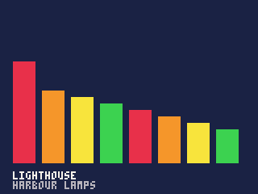
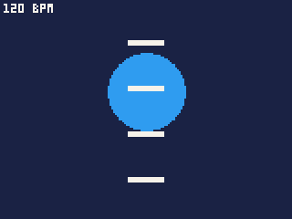

# The owner's music and the beat

The Arcade plays while the owner's music does, and a cart can use it: show
what is playing, react to its spectrum, follow its beat for a rhythm game,
choose tracks from the owner's library, or take over the music entirely.

- [How it works](#how-it-works) -- the three music levels
- What is playing: [playback.playing, title, artist, album, track, elapsed, length, changed](#what-is-playing)
- Controlling it: [toggle, next, prev, seek, duck, volume, adjust](#controlling-it)
- Owning it: [play, stop, started](#owning-it)
- The library and the queue: [tracks.*](#the-library-and-the-queue)
- The sound of it: [playback.bands](#playbackbandsout-n), [playback.sound and tracks.sound](#playbacksoundout)
- Its colours: [playback.colors](reference-colour.md#the-ipods-colours-and-shades-of-any-colour), in Colour and palettes
- The beat: [listening](#the-beat), [beat.listen](#beatlistenon), [beat.state](#beatstateout),
  [beat.next and beat.inbar](#beatnextfrom-n), [beat.downbeat](#beatdownbeat),
  [the clock](#beatclock), [beat.press](#beatpressi), [beat.offset](#beatoffsetms), [beat.jumped](#beatjumped),
  [beat.mood](#beatmoodout), [beat.ahead and beat.horizon](#beataheadout-from-to)
- [A rhythm game](#a-rhythm-game)
- [Trying it out](#trying-it-out)

## How it works

A cart says in `cart.json` how much of the music it needs, with `"music"`,
and gets nothing beyond it -- a call above its level is an error when the
cart is built.

| `"music"` | The cart may | For |
|---|---|---|
| `"listen"` (the default) | read what is playing, the library and the queue; follow the beat | a visualiser, a rhythm game, a quiz about what is playing |
| `"control"` | also pause, play, skip, seek, turn it down for a moment, and add to the queue | a game that uses Prev, Next and Play as its own buttons and gives the music controls back in its own way |
| `"own"` | also play tracks of its own choosing from the library, and stop | a music quiz, a game built round chosen songs |

A cart at `own` level sets the owner's queue aside the first time it plays
a track, and puts it back when the cart ends -- ready to carry on, not
playing.

**Times are in milliseconds of the track** throughout: `elapsed`,
`length`, `seek`, and all of `beat`.

**In the IDE**, the music is made up: a library of twenty tracks on five
albums and a spoken chapter, each with a steady tempo, the queue holding
the first ten. The music box under the Player plays, pauses and skips it.
So music games can be written and tried without an iPod -- but test them
on one too: real music is less tidy than a steady beat.

---

## What is playing

All at `listen` level.

| Call | Returns |
|---|---|
| `playback.playing()` | whether the music is playing (not paused or stopped) |
| `playback.title()`, `playback.artist()`, `playback.album()` | the current track's, as text |
| `playback.track()` | the current track's id, or -1 when there is none |
| `playback.elapsed()` | how far into the track, in ms |
| `playback.length()` | the track's length, in ms |
| `playback.changed()` | true for one tick after the track changes |

```js
var bands = new Int32Array(8);

function draw() {
    cls(1);
    playback.bands(bands, 8);
    for (var i = 0; i < 8; i++) {
        var h = bands[i] * 80 / 100;
        rectfill(8 + i * 18, 100 - h, 21 + i * 18, 100, 8 + i % 4);
    }
    print(playback.title(), 8, 106, 7);
    print(playback.artist(), 8, 112, 6);
}
```



- A track's id is the key to the library: `tracks.field(id, ...)` and the
  rest take it.
- The title, artist and album are made once a track, so reading them
  every frame is cheap.
- `playback.playing()` is the test for a game that needs music to play:
  "PLAY SOME MUSIC" until it is true.

## Controlling it

At `control` level.

| Call | Does |
|---|---|
| `playback.toggle()` | pauses the music, or plays it again |
| `playback.next()`, `playback.prev()` | the next track; back a track |
| `playback.seek(ms)` | moves to `ms` into the track |
| `playback.duck(level, [ticks])` | turns the music down to `level`/256 of the owner's volume, over `ticks` (at once when left out) -- for a moment of speech or a big effect; `duck(256)` brings it back. Never louder than the owner set it, and undone when the cart ends |
| `playback.adjust(n)` | turns the owner's volume up `n` of the iPod's own steps, or down for a negative `n`, as the wheel does on the iPod's screens. It stays where it is put when the cart ends. Returns the volume then, 0 to 100 |
| `tracks.enqueue(id, [next])` | adds a track to the queue: after the playing one with `next` true, else at the end. Returns whether it was added |

None of these return anything but `adjust` and `enqueue`. `playback.volume()`
reads the volume, 0 to 100, at any level.

- A game that uses the wheel for itself takes the volume from the owner:
  give it back on the wheel, `playback.adjust(wheel())`, while nothing else
  wants it, and show the level for a moment after it moves.

- The pause menu's **Now Playing** always offers play, pause and skip, so
  a game that takes Prev, Next and Play for itself does not need
  `control` just to give them back.

## Owning it

At `own` level.

| Call | Does |
|---|---|
| `playback.play(id, [ms])` | plays track `id` from `ms` in (the start when left out). Returns whether it started |
| `playback.stop()` | stops the music |
| `playback.started()` | whether the track asked for can be heard yet |

The music pauses with the game -- the pause menu, the hold switch -- and
plays on after; [`resumed()`](reference-time.md#resumed) tells the cart
it happened.

- On an iPod Video a track can take seconds to start, while its disk
  spins up. A round timed against the music -- "name this song" -- starts
  its clock when `playback.started()` turns true, not when `play` was
  called.

---

## The library and the queue

The owner's library, read through the iPod's database. All at `listen`
level but `enqueue`, above.

| Call | Returns |
|---|---|
| `tracks.count([filter])` | how many tracks match |
| `tracks.pick(n, filter, out)` | `n` tracks at random that match, their ids into `out` (an `Int32Array` or a list); how many it found |
| `tracks.field(id, f)` | one thing about a track: `TRACK.TITLE`, `ARTIST`, `ALBUM` or `GENRE` as text, `TRACK.YEAR` or `LENGTH` (ms) as a number; null for a track or field there is not |
| `tracks.near(id, n, out, [sound])` | up to `n` tracks (64 at most) most like `id` -- the same genre and decade first -- into `out`; how many. With `sound` true, those that sound most like it, nearest first, by the Sound Index; none when `id` has not been measured. `id` can be a list of up to 10 tracks: `out` then holds `n` for each in turn, -1 after the last of each |
| `tracks.sound(id, out)` | a track's Sound Index (below) |
| `tracks.queued()` | how many tracks the queue holds |
| `tracks.place()` | the playing track's place in the queue, 0 first, or -1 |
| `tracks.queue(i)` | the id of the track at place `i` of the queue, or -1 |

A **filter** is a record of any of:

| Field | Matches |
|---|---|
| `minlen`, `maxlen` | tracks at least, at most this long, in ms |
| `genre` | tracks of this genre, as text: `"Rock"` |
| `decade` | tracks from this decade: `1970` |
| `music` | `true` leaves out spoken word: audiobooks and podcasts |
| `artist` | tracks by this artist, as text |

```js
var ids = new Int32Array(4);

function newRound() {
    // three wrong answers like the right one
    var n = tracks.pick(1, { music: true, minlen: 90000 }, ids);
    if (n == 0) return;
    var answer = ids[0];
    var others = new Int32Array(3);
    tracks.near(answer, 3, others);
    printh(tracks.field(answer, TRACK.TITLE) + " by " + tracks.field(answer, TRACK.ARTIST));
}
```

- Library calls read the database as they are called, which on the
  iPod can take a while: make them while a round is set up, not every
  frame. `tracks.count`, `tracks.pick` and `tracks.near` look at every
  track in the library and cost 200 units and 4 a track -- about 40,000
  for a library of 10,000, over three ticks' worth on an iPod Video
  playing FLAC.
- `tracks.near` by sound reads the whole Sound Index instead, at the same
  cost. Given a list of tracks, it reads it once for them all: ask about
  every track a game needs in one call, not one call a track.
- In the IDE, `tracks.count()` is 20 and the queue holds 10, and
  `tracks.near` by sound takes the nearest tempo for the nearest sound.

---

## playback.bands(out, n)

The music's spectrum this tick: the bars a skin's spectrum display shows.

| Argument | |
|---|---|
| `out` | an `Int32Array` of at least `n` |
| `n` | how many bands, 1 to 8, low to high |

**Returns** nothing; `out` holds each band, 0 to 100. The example under
[What is playing](#what-is-playing) draws them.

## playback.sound(out)

The current track's **Sound Index**: what the iPod's library worked out
about the whole track when it was scanned.

| Argument | |
|---|---|
| `out` | an `Int32Array` of `SOUND.SIZE` |

**Returns** 1, filling `out`; or 0, `out` cleared, when the track has no
index. `tracks.sound(id, out)` gives any track's the same way.

Each field is read by its name:

| Field | |
|---|---|
| `SOUND.PERIOD` | the beat's length in ms, 0 for none; `SOUND.CONFIDENCE`, and `SOUND.SETTLED` whether the tempo held |
| `SOUND.LOUDNESS` | dBFS x10 |
| `SOUND.CREST` | how punchy, in dB |
| `SOUND.WIDTH` | stereo width |
| `SOUND.LOW`, `MID`, `HIGH` | the level in each band |
| `SOUND.ONSETS_LOW`, `ONSETS_MID`, `ONSETS_HIGH` | hits a second in each band, in tenths |
| `SOUND.STRENGTH`, `SOUND.PEAKINESS` | how strong and how peaky the beat is |
| `SOUND.PITCH` | the first of twelve pitch classes, C to B: `out[SOUND.PITCH + k]` |
| `SOUND.TONIC` | the key's note, 0 C to 11 B |
| `SOUND.MODE`, `SOUND.MODE_MARGIN` | major or minor, and how clearly |
| `SOUND.CLARITY`, `SOUND.CHANGE` | how tonal, and how much the harmony moves |

Use it to choose before the track starts: a dark, minor track makes a
night level; a dense one more enemies.

---

## The beat

The iPod can listen to the music as it plays, find its tempo and
predict its beats, so a game can land things exactly on them -- the same
beat tracker the iPod's own rhythm game uses.

**Listening is costly.** While a cart listens, the analyser takes about a
third of an iPod Video's time: in units, about 6,300 a tick at 33 ticks a
second, charged to the cart. So listen until the tempo is held, then stop,
and predict the beats from it -- which `beat.next` does whether or not the
cart is still listening. Everything else here -- the clock, the presses,
the mood -- is cheap and can be left on.

### beat.listen(on)

Starts (`true`) or stops (`false`) listening.

### beat.state(out)

What the tracker has found.

| Argument | |
|---|---|
| `out` | an `Int32Array` of 6 |

**Returns** whether the tempo is locked; `out` holds:

| | |
|---|---|
| `out[0]` | locked, 1 or 0 |
| `out[1]` | the tempo, in beats a minute |
| `out[2]` | the beat's length, in ms |
| `out[3]` | confidence, 0 to 100 |
| `out[4]` | how full its picture of the music is, 0 to 100 |
| `out[5]` | beats heard since it locked |

```js
var st = new Int32Array(6);

function init() {
    beat.listen(true);
}

function update() {
    // listen until the tempo is held, then stop and predict
    if (beat.state(st) && st[3] >= 80) beat.listen(false);
}
```

It takes a moment to lock: about a second in the IDE, longer on real
music.

### beat.next(from, n)

**Returns** the time of the `n`th beat at or after `from` -- `n` 0 is the
first -- or -1 with no tempo locked. `beat.inbar()`, called after it,
gives that beat's place in its bar, 0 to 3.

```js
var now = beat.clock();
var next = beat.next(now, 0);          // the coming beat
var after = beat.next(now, 1);         // the one after
var first = beat.inbar() == 0;         // after's place in the bar
```

The beats are predicted, so a game can put something on the screen to
arrive on a beat before it is heard.

```js
function draw() {
    cls(1);
    var now = beat.clock();
    var next = beat.next(now, 0);
    if (next < 0) {
        print("LISTENING...", 56, 56, 6);
        return;
    }
    var since = st[2] - (next - now);              // ms since the last beat
    var r = 30 - min(20, since / 25);              // big on the beat, shrinking
    circfill(80, 50, r, beat.inbar() == 0 ? 8 : 12);
    for (var k = 0; k < 4; k++) {                  // bars falling to land on the next four
        var y = 110 - (beat.next(now, k) - now) / 20;
        rectfill(70, y, 89, y + 2, 7);
    }
    print(st[1] + " BPM", 2, 2, 7);
}
```



### beat.downbeat()

**Returns** which of the four beats starts the bar, 0 to 3, or -1 when
that is not yet clear -- it needs 32 beats heard, and a clear winner.
`beat.margin()` is how clearly it won, in tenths.

### beat.clock()

**Returns** the track's time as of this tick, in ms. It holds still
through the tick, so everything drawn in a frame agrees: draw from this.
`beat.now()` is the time at the instant it is called, for the rare thing
that needs it between ticks. With no music, the clock stands at 0.

### beat.press(i)

**Returns** when button `i` went down this tick, in the track's ms, or
-1 when it did not.

A rhythm game judges a press by this, not by the tick it is seen in,
which can be up to a frame later:

```js
var p = beat.press(4);
if (p >= 0) {
    var nearest = beat.next(p - st[2] / 2, 0);    // the beat closest to the press
    var off = abs(p - nearest);
    if (off < 110) hit(); else miss();
}
```

### beat.offset([ms])

The cart's timing calibration: `ms` is taken off every press `beat.press`
reports, from -500 to 500.

**Returns** the offset in force.

Headphones, a dock and a player's own reflexes each put a press a little
after the beat they heard. A calibration screen -- "press Select on each
beat" -- measures how late the presses fall, on average, and sets it:

```js
beat.offset(dget(9));            // kept from the last calibration
...
beat.offset(averageLateness);    // after calibrating
dset(9, averageLateness);
```

- It moves only the presses, not the beats, so everything a game draws
  stays on the music.

### beat.jumped()

**Returns** true for the tick after the music moved under the game: a
seek, a skip, a new track. Anything placed on the old beats should be
cleared and placed again.

### beat.left()

**Returns** the ms of the track still to play.

### beat.mood(out)

The bar just heard, into an `Int32Array` of 3: its energy (0 to 100,
against the loudest the track has been), its flux (0 to 100, how much it
moves within the bar) and its trend (rising or falling against the bar
before). Neutral until two bars are in. For a game whose intensity follows
the music.

### beat.ahead(out, from, to)

The hits already heard in the music between `from` and `to`: the iPod
decodes music a little ahead of the speaker, and the analyser reads it
there, so these are hits that are about to be heard.

| Argument | |
|---|---|
| `out` | an `Int32Array`, three numbers a hit |
| `from`, `to` | the window, in the track's ms |

**Returns** how many hits; each is its time, its bands (1 low, 2 mid, 4
high, added together) and its strength (128 level with the hits round it,
192 an accent). Only while listening. `beat.horizon()` is the track time,
in ms, up to which `beat.ahead` can see -- about two seconds past
`beat.clock()` -- or -1 when not listening.

- This is the costly path: the cart must keep listening, about 6,300 units
  a tick, for as long as it reads hits ahead.

---

## A rhythm game

The pieces fit together like this in a game where the player rides
three lanes through walls that land on the beat of whatever is playing:

1. On the title, it waits for `playback.playing()` -- "PLAY SOME MUSIC".
2. Started, it calls `beat.listen(true)` and waits until `beat.state`
   locks and `beat.downbeat()` is known, then `beat.listen(false)`: from
   here the run costs no more than a game without music.
3. Each tick it reads `beat.clock()` and asks `beat.next(now, k)` for the
   coming beats, placing a wall for each one far enough ahead to travel
   down the screen and arrive on it -- a heavy wall on the bar's first
   beat (`beat.inbar() == 0`), fewer walls in a quiet bar (`beat.mood`).
4. Select pressed on the beat -- judged by `beat.press(4)` against the
   nearest `beat.next` -- builds a multiplier.
5. `beat.jumped()` clears the walls when the music skips.

A pause-menu item switches it to a course cut from the hits themselves
(`beat.ahead`), which keeps the analyser listening for the whole run.

---

## Trying it out

In the IDE, the music box under the Player plays, pauses and skips the
made-up library, and the beat locks about a second after a cart listens.

`pbgvm` plays the same library: `--playing` has the music playing, its
clock moving on with the ticks, and `--beat 120` plays a steady track at
that tempo, so the beat calls can be tried from the command line.

```
$ pbgvm game.pbg --playing --beat 120 --buttons 35:16,36:0 --ticks 40
pressed at 1090 beat 1000 off by 90 ms
```
