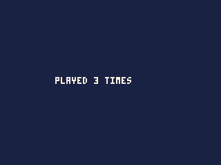

# Saving

Keeping things between plays -- a best score, the level reached, a whole
game in progress -- and reading files that come with the cart, such as
levels and dialogue.

- [How saving works](#how-saving-works)
- Saved numbers: [dget](#dgeti), [dset](#dseti-v)
- Stored values: [store.write](#storewritename-value), [store.read](#storereadname),
  [store.remove](#storeremovename), [store.list](#storelist)
- The cart's own files: [data.read](#datareaddataname)
- [Where it all lives](#where-it-all-lives)

## How saving works

A cart has three ways to keep or carry information, and most games use
one or two:

| | Holds | For |
|---|---|---|
| **Saved numbers**, `dget` and `dset` | 256 numbers | a best score, the level reached, a few settings of the game's own |
| **The store**, `store.*` | values by name -- records, lists, text, numbers | a game in progress, a level the player built, anything with structure |
| **Data files**, `data.read` | files that come inside the cart, read-only | levels, enemy waves, dialogue: the game's content |

Scores, options and achievements are kept by the iPod itself; see
**Scores, options and the pause menu**.

**Everything is kept under the cart's `id`**, the 16 hex digits in
`cart.json`. That is how the iPod knows a save belongs to this cart, so
**never change a cart's id**: a cart with a new id starts with nothing
saved, and its old saves are left behind. Copying a cart and changing its
name keeps the id, and the copy shares the original's saves -- give a
genuinely new game a new id (**Cart > New cart** makes one).

**Saving in the IDE.** The IDE keeps the store and the saved numbers in
the browser, for each cart, so they survive stopping the cart and
reloading the page, as they survive on the iPod. A replay runs on its
own copy of them as they were when the run began, so playing one back
changes nothing. `pbgvm` keeps neither unless told to (the end of this
chapter).

---

## dget(i)

A saved number.

| Argument | |
|---|---|
| `i` | which, 0 to 255 |

**Returns** the number last saved as `i` -- a whole number or a fraction,
as it was saved -- or 0 if nothing has been, or if `i` is outside 0 to
255.

## dset(i, v)

Saves a number.

| Argument | |
|---|---|
| `i` | which, 0 to 255 |
| `v` | the number: a whole number or a fraction |

**Returns** nothing.

```js
var best = 0;

function init() {
    best = dget(0);              // 0 the first time the cart is played
}

function gameOver(points) {
    if (points > best) {
        best = points;
        dset(0, best);
    }
}
```

- Each number keeps whether it was a fraction: `dset(1, 2.5)` comes back
  as `2.5`.
- Only numbers can be saved this way: `dset(2, "x")` stops the cart. For
  text, records or lists, use the store.
- Setting a number outside 0 to 255 does nothing.
- **When it is written.** `dset` costs almost nothing; the iPod writes
  the 256 numbers to its disk when the game is paused, when it ends, and
  before anything that might switch the iPod off -- so a save is never
  lost to the battery, and setting numbers every tick is fine.
- Give each number a fixed meaning and note it at the top of the file:
  `// 0 best score, 1 furthest level, 2 sound on`.

## store.write(name, value)

Keeps a value under a name, between plays.

| Argument | |
|---|---|
| `name` | 1 to 32 letters, digits, `-` and `_` |
| `value` | a number, text, a list, a record, a typed array, `null`, or any of those inside one another |

**Returns** true when it was kept; false when it was too big, the cart's
space is full, or the disk refused.

## store.read(name)

The value kept under a name.

| Argument | |
|---|---|
| `name` | as for `store.write` |

**Returns** the value, made afresh, or `null` when nothing is kept under
that name.

```js
var save;

function init() {
    save = store.read("save");
    if (save == null) save = { plays: 0, best: 0, name: "" };
    save.plays++;
    store.write("save", save);
}

function draw() {
    cls(1);
    print("PLAYED " + save.plays + (save.plays == 1 ? " TIME" : " TIMES"), 40, 56, 7);
}
```



- **A record is the usual thing to keep**: one name, `"save"`, holding
  everything about a game in progress. Read it once in `init()`, change
  the record as the game goes, and write it at the moments that matter --
  a level finished, the game paused through a menu item.
- **It is kept as JSON**, the text format, so what comes back is a copy
  of what was written, not the same value:
  - numbers, text, lists and records come back as they went;
  - `true` and `false` come back as 1 and 0, as they are in the
    language;
  - a typed array comes back as a plain list (its numbers the same, but
    no longer limited to whole numbers or 0 to 255);
  - a function or an image cannot be kept: writing one stops the cart.
- **Limits.** One name holds at most 64 KB as JSON -- about 10,000
  numbers in a list. A cart has 256 KB and 64 names in all. Past either,
  `store.write` returns false and keeps the old value, in the IDE as on
  the iPod.
- **Writing is safe.** The new value is written beside the old one and
  only then replaces it, so a full disk or a flat battery mid-write leaves
  the old value whole.
- **Names** are not case-sensitive on the iPod: `Save` and `save` are
  one. A name with a space or other characters stops the cart.
- **What it costs**: each call goes to the disk, so it costs 2,000 units
  before anything is read, and a write 8,000 more; on top of that about 2
  units a number written and 1 a number read, more for text. Writing one
  number is about 10,000 units, half a tick on an iPod Video playing
  music; a list of 1,000 numbers is about 12,300 to write and 3,000 to
  read. Read once when the game starts, and write when something changes,
  not every tick.

## store.remove(name)

Forgets a value.

| Argument | |
|---|---|
| `name` | as for `store.write` |

**Returns** true when there was one to remove.

## store.list()

The names the cart has kept.

**Returns** a list of names, in alphabetical order; empty when there are
none.

```js
var slots = store.list();       // ["level1", "level2", "save"]
for (var i = 0; i < slots.length; i++) print(slots[i], 10, 10 + i * 8, 7);
```

- With `ui.choose`, this makes a "load which?" menu for games with several
  save slots or levels the player has made.

---

## data.read(DATA.name)

One of the cart's own data files: content that ships inside the cart.

| Argument | |
|---|---|
| `DATA.name` | the file, by its name: `data/levels.json` is `DATA.levels` |

**Returns** the file's contents as values: a `.json` file as the lists,
records, text and numbers it holds; a `.txt` file as one piece of text.

Put the files in the cart's `data/` folder (**File > New file > Data** or
**Text** in the IDE). A level file:

```json
{
  "levels": [
    { "name": "Meadow", "enemies": 3, "speed": 1.5 },
    { "name": "Cave", "enemies": 6, "speed": 2 }
  ],
  "secret": true
}
```

read and used:

```js
var levels;

function init() {
    levels = data.read(DATA.levels).levels;
    printh(levels.length + " " + levels[1].name + " " + levels[0].speed);   // 2 Cave 1.5
}
```

- **Read it once**, in `init()`, and keep it: each call makes the whole
  value afresh, which takes time and memory.
- The files are checked when the cart is built: a mistake in the JSON is
  an error naming the file and the place, and so is a number the cart
  cannot hold (a whole number beyond 32 bits, or a fraction outside
  -32768 to 32767).
- Numbers with a point become fractions, without one whole numbers, as
  in code. `true` and `false` are 1 and 0.
- Data files are read-only: the cart cannot change them. To keep changes,
  copy what you need into the store.
- A `.txt` file keeps its line breaks, as `"\n"`; a story or a list of
  words can be cut up with `indexOf` and `substring`.

---

## Where it all lives

On the iPod, each cart's things are kept in the hidden `.rockbox`
folder, by its id:

| | File |
|---|---|
| saved numbers | `/.rockbox/games/saves/<id>.sav` |
| the store | `/.rockbox/games/data/<id>/<name>.json`, one file a name |
| high scores and achievements | `/.rockbox/games/scores/<id>.sco` |
| option values | `/.rockbox/games/options/<id>.opt` |

Copying these to another iPod moves a cart's saves with it. The store's
files are plain JSON, readable on a computer.

**Testing saves without an iPod.** `pbgvm` keeps nothing by default; give
it `--store folder` to keep the store there between runs, as `name.json`
files, within the iPod's limits, and `--saves file` to keep the saved
numbers in that file: read before the run starts, written after its last
tick.
