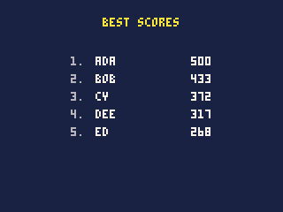
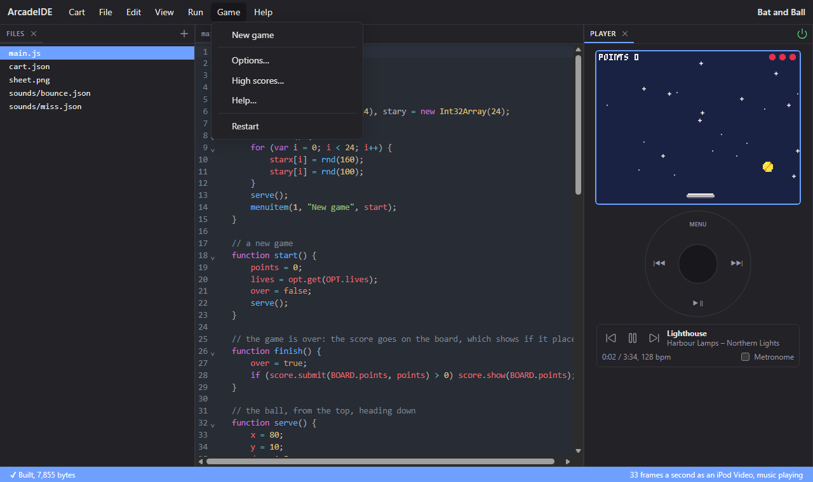
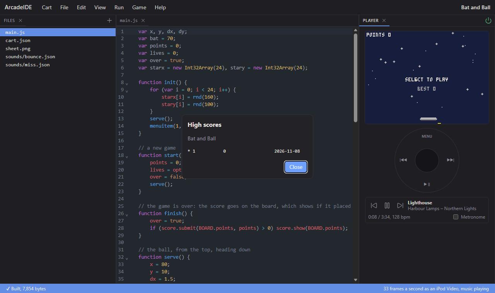

# Scores, options and the pause menu

The parts of a game the iPod looks after itself: high-score tables,
settings the owner can change, achievements, and the menu that opens when
the game is paused. A cart declares them in `cart.json` and reads and
updates them from code; the iPod keeps them, shows them in the same
style as its own menus, and saves them.

- [How it works](#how-it-works)
- High scores: [declaring boards](#declaring-boards), [score.submit](#scoresubmitboard-value-name),
  [score.best](#scorebestboard), [score.get, score.name, score.count](#scoregetboard-rank),
  [score.show](#scoreshowboard)
- Options: [declaring options](#declaring-options), [opt.get](#optgetoptname),
  [opt.set](#optsetoptname-value), [opt.changed](#optchanged)
- Achievements: [declaring achievements](#declaring-achievements),
  [ach.earn](#achearnachname), [ach.has](#achhasachname)
- The pause menu: [what it holds](#the-pause-menu), [menuitem](#menuitemi-label-fn),
  [quit](#quit)
- [Trying them out](#trying-them-out)

## How it works

A cart lists its boards, options and achievements in `cart.json`. Each
has a `name` that code uses: a board named `points` is `BOARD.points`, an
option named `level` is `OPT.level`, an achievement named `first` is
`ACH.first`. The IDE's **Cart > Settings** form edits all three, and
checks each name as you type it.

The iPod then:

- keeps each board's ten best scores, with the date and an optional name;
- shows the boards in the pause menu's **High Scores**, with the
  achievements earned;
- shows the options in the pause menu, lets the owner change them, and
  remembers the owner's choices;
- announces an achievement across the top of the screen the first time it
  is earned.

All of it is kept under the cart's id, like its saves (see **Saving**).

---

## Declaring boards

`"boards"` in `cart.json` is a list of up to 8 records:

| Field | | |
|---|---|---|
| `name` | required | what code calls it: `BOARD.<name>` |
| `title` | | shown in High Scores, up to 23 bytes; the name when left out |
| `wins` | `"high"` (the default) or `"low"` | whether the highest or the lowest score is best -- `low` for times |
| `format` | `"number"` (the default), `"time"` or `"ticks"` | how a score is shown: `time` is milliseconds, shown as `1:23.45`; `ticks` is ticks at the cart's rate, shown as a time |
| `version` | a whole number, 1 by default | raise it to start the board afresh, when a change to the game makes old scores unfair |

```json
"boards": [
  { "name": "points", "title": "Points" },
  { "name": "lap", "title": "Best Lap", "wins": "low", "format": "time" }
]
```

A board's scores are found again by its name, so boards can be reordered
or added to without losing anything.

## score.submit(board, value, [name])

Records a score.

| Argument | |
|---|---|
| `board` | `BOARD.<name>` |
| `value` | the score, a whole number (a fraction is rounded down) |
| `name` | text kept with it, up to 15 bytes; longer is cut short |

**Returns** its rank, 1 to 10 -- 1 is the best -- or 0 when it did not
make the ten.

```js
function gameOver() {
    var rank = score.submit(BOARD.points, points);
    if (rank > 0) score.show(BOARD.points);
}
```

- Ties go to the score that was there first: a new score equal to the
  tenth does not get in.
- Submit every finished game: the board decides whether it is good
  enough. Submitting is cheap, about 50 units.
- For a time, record milliseconds (`format: "time"`) -- `t()` is seconds,
  so `flr(t() * 1000)` -- or ticks (`format: "ticks"`), which needs no
  arithmetic: `frame()` at the finish less `frame()` at the start.
- The `name` is the cart's to choose: ask with `ui.text`, or leave it out.

## score.best(board)

**Returns** the board's best score, or `null` when it has none -- which
tells a first game from a game scored 0.

```js
var best = score.best(BOARD.points);
if (best != null) print("BEST " + best, 60, 2, 6);
```

## score.get(board, rank)
## score.name(board, rank)
## score.count(board)

`score.get` gives the score at a rank, 1 to 10; `score.name` the name kept
with it (`""` when none was given); `score.count` how many scores the
board holds, 0 to 10. A rank beyond the board gives `null` from `get` and
`name`.

These are for a cart drawing a table of its own, on its title screen
say:

```js
cls(1);
print("BEST SCORES", 58, 10, 10);
for (var r = 1; r <= score.count(BOARD.points); r++) {
    var y = 22 + r * 10;
    print(r + ".", 40, y, 6);
    print(score.name(BOARD.points, r), 54, y, 7);
    var v = "" + score.get(BOARD.points, r);
    print(v, 120 - textw(v), y, 7);
}
```



- A cart's own table shows the raw numbers; for a `time` board, turn
  milliseconds into minutes and seconds yourself: `text.lap(ms)` in the
  [text library](reference-libraries.md#text) shows them as the board
  does, `1:23.45`.

## score.show(board)

Shows the iPod's own table for a board, over the game, after this tick.

| Argument | |
|---|---|
| `board` | `BOARD.<name>` |

**Returns** nothing.

- The latest score is marked when it made the ten.
- The table is the Arcade's own, drawn in its CAPS font in the iPod's
  theme colours: the same screen as the pause menu's High Scores, a page
  a board, then the achievements and how much the game was played, turned
  with the wheel or Right. Left closes it.
- The game is paused while the table is open; it carries on with the next
  tick once the owner closes it.
- Several calls in one tick show the last.
- In the IDE the board opens in a dialog over the editor, the new score
  marked with `*`; the game carries on under it. `pbgvm` prints the
  table (below).

---

## Declaring options

`"options"` in `cart.json` is a list of up to 8 records. Each is a row in
the pause menu, which the owner can change while the game is paused:

| Field | | |
|---|---|---|
| `name` | required | what code calls it: `OPT.<name>` |
| `title` | | its row in the pause menu, up to 23 bytes; the name when left out |
| `type` | required | `"choice"`, `"onoff"` or `"number"` |
| `default` | | its value until the owner changes it (below) |
| `help` | | up to 300 bytes, shown in the pause menu's Help |

and by type:

| `type` | Also takes | `opt.get` gives | `default` |
|---|---|---|---|
| `choice` | `choices`: 2 to 8 texts, each up to 23 bytes | the index of the one chosen, 0 first | an index; 0 when left out |
| `onoff` | | 1 or 0 | `true` or `false`; false when left out |
| `number` | `min`, `max`, and `step` (1 when left out) | the number | `min` when left out |

```json
"options": [
  { "name": "level", "title": "Difficulty", "type": "choice",
    "choices": ["Easy", "Normal", "Hard"], "default": 1 },
  { "name": "trails", "title": "Trails", "type": "onoff", "default": true },
  { "name": "speed", "title": "Speed", "type": "number", "min": 1, "max": 10,
    "help": "How fast the ball starts" }
]
```

The owner's values are kept and found again by each option's name, so
options can be added and reordered between versions of a cart.

## opt.get(OPT.name)

**Returns** an option's current value: a choice's index, 1 or 0 for
on/off, or the number.

```js
function start() {
    var speeds = [1.0, 1.5, 2.25];
    ballSpeed = speeds[opt.get(OPT.level)];
    showTrails = opt.get(OPT.trails);
}
```

## opt.set(OPT.name, value)

Sets an option from the game: for a settings page of the game's own, on
its title screen, that shows the same options as the pause menu.

| Argument | |
|---|---|
| `OPT.name` | the option |
| `value` | its new value: a choice's index, 1 or 0 for on/off, or the number |

**Returns** nothing. The value is brought within the option's range and
onto its steps, and kept as the pause menu keeps the owner's -- written
when the game next pauses or ends, so the disk is not woken mid-game. It
is not a change `opt.changed()` reports: the game made it.

```js
function settingsPage() {
    var lives = opt.get(OPT.lives);
    lives = mid(1, lives + dial.steps(16), 9);
    opt.set(OPT.lives, lives);
    print("LIVES " + lives, 40, 60, 7);
}
```

## opt.changed()

**Returns** true for the one tick after the owner changes any option in
the pause menu, and on the first tick, so a game reads its options in one
place.

```js
function update() {
    if (opt.changed()) applyOptions();
    ...
}
```

- It is the time to rebuild anything that depends on the options: a
  background drawn once, a speed worked out at the start of a level.
  Reading `opt.get` every tick works too, and costs little.

---

## Declaring achievements

`"achievements"` in `cart.json` is a list of up to 32 records:

| Field | | |
|---|---|---|
| `name` | required | what code calls it: `ACH.<name>` |
| `title` | | shown when it is earned and in High Scores, up to 31 bytes; the name when left out |
| `text` | | how it is earned, up to 95 bytes |

```json
"achievements": [
  { "name": "first", "title": "First Point", "text": "Score a point" },
  { "name": "hundred", "title": "Century", "text": "Score 100 in one game" }
]
```

## ach.earn(ACH.name)

Earns an achievement.

**Returns** true the first time -- when the iPod announces it -- and
false every time after.

```js
if (points == 100) ach.earn(ACH.hundred);
```

- Call it whenever the condition holds; only the first call counts, so a
  cart need not remember what it has already given.
- The announcement is a banner over the top of the game's screen; the game
  carries on underneath.

## ach.has(ACH.name)

**Returns** whether an achievement has been earned, on any play.

- For rewards: a colour, a level, a mode unlocked by an achievement.

---

## The pause menu

Holding Menu for a second pauses the game and opens the pause menu (a
short press asks whether to quit, or with `"menu_button": "game"` in
`cart.json` reaches the cart). Its rows, top to bottom:

1. **Resume**
2. the cart's own items, from `menuitem`
3. the cart's options, each showing its value, then **Game Sound**, which
   mutes the game's own effects ([Sound](reference-sound.md#how-sound-works))
4. **High Scores**, when the cart has boards or achievements
5. **Help**, when the cart has `help` text or options with help
6. **Now Playing**: play, pause and skip the owner's music -- the way to
   reach them in a game that uses those buttons itself
7. **Restart**: the cart from the beginning
8. **Quit**: kept as it is, and offered to carry on the next time the cart
   starts -- unless the cart owns the music, or has `"suspend": false`
   in `cart.json`, for a game that cannot be picked up again later (see
   [Keeping a game to carry on](reference-cart.md#keeping-a-game-to-carry-on))

The saved numbers and scores are written to the disk as the menu opens.

**In the IDE**, Menu (Esc) only pauses. What the pause menu holds is in
the IDE's **Game** menu instead, while the cart runs: the cart's own items
from `menuitem()`, **Options...**, **High scores...** (the boards and
the achievements), **Help...** and **Restart**:



## menuitem(i, [label], [fn])

Adds an item of the cart's own to the pause menu, or takes one away.

| Argument | |
|---|---|
| `i` | its place, 1 to 5 |
| `label` | its text in the menu; left out, the item is taken away |
| `fn` | the function to call when it is chosen |

**Returns** nothing.

The function is called with the button that chose it (4, Select). If it
returns a true value, the menu stays open (and is drawn again, so a label
the function changed shows); otherwise the game resumes.

```js
var lives = 3;

function init() {
    menuitem(1, "Extra life", extraLife);
    menuitem(2, "Back to the title", toTitle);
}

function extraLife() {
    lives++;
    return true;            // stay in the menu
}

function toTitle() {
    over = true;            // resume, at the title
}
```

- An item whose label changes -- "Music: on" and "Music: off" -- sets
  itself again with the new label from its own function, and returns true
  to stay in the menu showing it.
- Items can be added and taken away as the game goes: "Skip level" only
  while a level is being played.

## quit()

Leaves the game, back to the iPod's menu, at the end of this tick.

**Returns** nothing.

- The saves and scores are written first, as on Quit from the pause menu,
  but the game is not kept to carry on: the next start is a fresh one.
- A game rarely needs it: Quit is always in the pause menu. It is for a
  "Quit" on the cart's own title screen.
- In the IDE the cart stops, and the output says "The cart quit."
  `pbgvm` ends the run after that tick, printing `quit`.

---

## Trying them out

**In the IDE**, a cart's scores, achievements and option values are kept
in the browser under its `id`, as the iPod keeps them, so each run
starts where the last left off. `score.show` opens the board:



An achievement earned is announced in the output ("Achievement: ...").
Options are set from **Game > Options...**, and stay set for later runs.
A replay starts from the scores and options its run began with, and
keeps nothing it changes.

To try the iPod's side without an iPod or a browser, `pbgvm` has
options for each:

| Option | Does |
|---|---|
| `--scores file` | keeps the cart's scores and achievements in `file` between runs; `score.show` prints the table, and an achievement prints `achieved <title>` |
| `--options file` | keeps the option values in `file` |
| `--opt 120:0:2` | sets option 0 to 2 before tick 120, as the owner would in the pause menu |
| `--menu 1` | after the run, chooses pause-menu item 1, printing the items and what its function returned |

```
$ pbgvm game.pbg --ticks 600 --scores game.sco
show Points
*1 120 ADA 20261103
2 80  20261103
```
