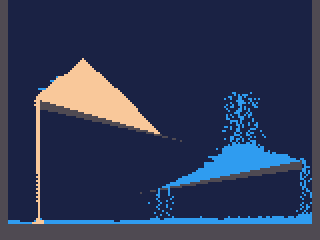
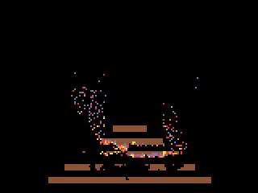
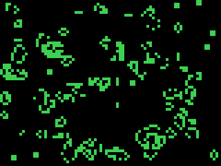
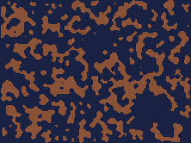
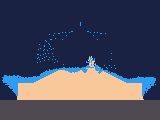
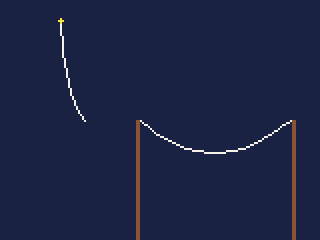
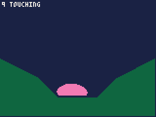
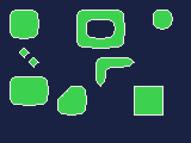
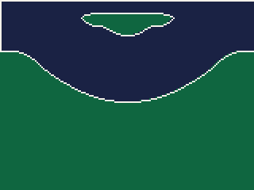
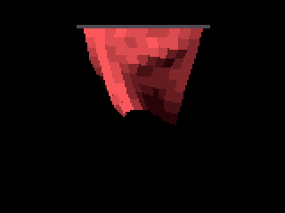

# Simulations: cells and links

Two kinds of physics a game can afford on the iPod: **cells**, a field of
materials -- sand, water, fire, smoke -- that move and react a pixel at a
time, and Life and its cousins; and **links**, points held together --
ropes, chains, bridges, cloth, and soft bodies that meet outlines.

- Cells: [how a field works](#how-a-field-works), [cells.rules](#cellsrules),
  [cells.step](#cellsstepfield-w-rules-actors-box), [cells.life](#cellslifefield-w-birth-survive-born),
  [cells.lift](#cellsliftfield-rules-x-y-r-pool-speed), [actors and particles in a field](#actors-and-particles-in-a-field)
- Links: [how links work](#how-links-work), [links.pool](#linkspoolpoints-links),
  [links.point](#linkspointp-x-y-pin), [links.link](#linkslinkp-i-j-len),
  [links.step](#linksstepp-solid-out-which), [links.ring](#linksringp-first-n-area-stiffness),
  [segs.make](#segsmakexs-ys-n-mats-ends), [segs.move](#segsmoves-dx-dy),
  [segs.draw](#segsdraws-colour), [segs.trace](#segstracesolid-sharp-smooth-cx-cy-cw-ch-shapes-outside),
  [links.draw](#linksdrawp-colour),
  [links.cloth](#linksclothp-x-y-cols-rows-gap-pin), [links.fill](#linksfillp-ramp)

## How a field works

A **field** is an image -- or a `Uint8Array` board -- whose every pixel is
a **material**. Number each material after its palette colour -- sand 15,
water 12, stone 5 -- and the field is also its own picture: `blit` draws it
as it is. 0 is air.

```js
const AIR = 0, STONE = 5, WATER = 12, SAND = 15;
```

A **rules** record says how each material behaves: whether it stays,
falls as a powder, flows as a liquid or rises as a gas; how heavy it is;
how likely it is to turn into something else each tick; and what happens
when two materials meet. Each tick, `cells.step` moves every cell by the
rules.

**You make materials by painting.** Draw into the field with the ordinary
drawing functions, `target(field)` first: a `circfill` in sand's colour
pours sand, a `rectfill` in stone's builds a wall.

**Script or system.** A 160x120 field is 19,200 cells, each looked at
every tick -- far beyond script. The engine also lets settled parts
**sleep**: the field is kept in 16x16 chunks, and a chunk where nothing
moved, and nothing beside it changed, is skipped, so a resting pile costs
no more than empty air. Drawing into a sleeping chunk wakes it.

| `cells.step` on 160x120 | Units |
|---|---|
| everything settled, or air | about 2,100 |
| two streams pouring | about 23,000 |

and for Life on an 80x60 board, about 8,400 units with `cells.life`
against 311,000 in script -- nearly forty times as fast, and well inside
a tick; the script version would take fifteen.

The `blit` that shows a full-screen field costs about 6,000 more, or
1,000 drawn over a background of its own with `palt(0, false)` (see
**Drawing**); a field smaller than the screen costs less to show.

Random choices come from the cart's own `rnd`, so a replay goes the same
way.

## cells.rules()

A new, empty rules record for a field.

**Returns** a record of `Uint8Array`s for you to fill. For each of the
256 materials, indexed by its number:

| Field | |
|---|---|
| `move` | `MOVE.STATIC` (stays, the default), `MOVE.POWDER` (falls and piles), `MOVE.LIQUID` (falls and flows level), `MOVE.GAS` (rises and spreads) |
| `density` | 0 to 255: a moving cell swaps into a lighter neighbour, so sand (200) sinks through water (100). Give walls 255 |
| `spread` | how many cells a tick a liquid or gas runs along when it cannot fall; 0 means 2. More levels faster |
| `decay`, `becomes` | a chance a tick, out of 256, of turning into `becomes`: a flame dying to smoke |
| `flags` | what an actor makes of it: `CELL.SOLID`, `CELL.LIQUID`, `CELL.HARM` |

and up to 64 **reactions**, each an index `k` into:

| Field | |
|---|---|
| `a`, `b` | a cell of material `a` beside one of `b`... |
| `c`, `d` | ...becomes `c`, and the `b` becomes `d`... |
| `chance` | ...with this chance out of 256 a tick |

```js
var R = cells.rules();
R.move[SAND] = MOVE.POWDER;   R.density[SAND] = 200;
R.move[WATER] = MOVE.LIQUID;  R.density[WATER] = 100;  R.spread[WATER] = 4;
R.move[STONE] = MOVE.STATIC;  R.density[STONE] = 255;
```

- Make it once, in `init()`, and keep it.
- A reaction is tried with **one random neighbour a tick**, so a chance of
  255 is near certain beside a large area of `b`, and slower at a single
  cell.
- A reaction can do anything two touching materials could: fire beside
  wood makes fire and fire (it spreads); water beside fire makes smoke and
  steam (it puts it out); a drain beside water makes drain and air (it
  swallows it).

## cells.step(field, w, rules, [actors], [box])

One tick of the field.

| Argument | |
|---|---|
| `field` | an image, or a `Uint8Array` board up to 256x256 |
| `w` | the board's width; ignored for an image -- pass 0 |
| `rules` | a record from `cells.rules()` |
| `actors` | a pool, or an array of pools, whose actors are obstacles while it steps; `null` to leave out and give `box` |
| `box` | an `Int32Array` of 4, written with x0, y0, x1, y1, both corners inside, round every cell that changed since the last step: moved by it, drawn on, or settled into by particles. Moves are in 16-cell chunks; shapes, sprites and blits add what they drew, other drawing whole rows; the whole field the first time; untouched when nothing changed |

**Returns** how many cells moved.

Sand and water poured onto two stone ramps:

```js
const AIR = 0, STONE = 5, WATER = 12, SAND = 15;   // each its palette colour
var R, field;

function init() {
    R = cells.rules();
    R.move[SAND] = MOVE.POWDER;   R.density[SAND] = 200;
    R.move[WATER] = MOVE.LIQUID;  R.density[WATER] = 100;  R.spread[WATER] = 4;
    R.move[STONE] = MOVE.STATIC;  R.density[STONE] = 255;

    field = img(160, 120);
    target(field);                      // the level, drawn in stone
    rectfill(0, 112, 159, 119, STONE);
    rectfill(0, 0, 3, 119, STONE);
    rectfill(156, 0, 159, 119, STONE);
    trifill(20, 50, 90, 70, 20, 54, STONE);
    trifill(150, 80, 70, 96, 150, 84, STONE);
    target(SCREEN);
}

function update() {
    target(field);                      // pour: paint sand and water in at the top
    if (frame() < 200) {
        circfill(40, 6, 2, SAND);
        circfill(120, 6, 2, WATER);
    }
    target(SCREEN);
    cells.step(field, 0, R);
}

function draw() {
    cls(1);                             // air is colour 0, clear: the sky shows through
    blit(field, 0, 0);
}
```



**Drawing only what changed.** A whole field blitted each frame costs by
its every pixel, though most of it stands still. With `box`, draw just
that part, over its own background, and leave the rest of the screen:

```js
var box = new Int32Array(4);

function update() {
    fill(box, -1);
    cells.step(field, 0, R, null, box);
}

function draw() {
    if (box[0] < 0) return;             // nothing changed: the screen stands
    rectfill(box[0], box[1], box[2], box[3], 1);    // the sky behind it
    blitpart(field, box[0], box[1], box[2] - box[0] + 1,
             box[3] - box[1] + 1, box[0], box[1]);
}
```

- Fill the box before the copy: air is clear, so a grain that has moved
  on would otherwise stay on the screen.
- It suits a screen that is the field alone. Anything drawn over the
  field each frame -- a character, a score -- needs its own part redrawn
  too.

A wooden frame set alight -- reactions spread the fire, and life spans
turn flames to smoke and smoke to air:

```js
const AIR = 0, WOOD = 4, RED = 8, ORANGE = 9, YELLOW = 10, SMOKE = 13;
var R, field;

function init() {
    R = cells.rules();
    R.move[WOOD] = MOVE.STATIC;   R.density[WOOD] = 255;
    for (var f = RED; f <= YELLOW; f++) { R.move[f] = MOVE.GAS; R.density[f] = 2; }
    R.move[SMOKE] = MOVE.GAS;     R.density[SMOKE] = 3;
    // flames cool and die: a chance a tick, out of 256, of becoming the next
    R.decay[YELLOW] = 30; R.becomes[YELLOW] = ORANGE;
    R.decay[ORANGE] = 25; R.becomes[ORANGE] = RED;
    R.decay[RED] = 20;    R.becomes[RED] = SMOKE;
    R.decay[SMOKE] = 10;  R.becomes[SMOKE] = AIR;
    // any flame beside wood: the flame stays, the wood catches, 90 times in 256
    for (var k = 0; k < 3; k++) {
        R.a[k] = RED + k; R.b[k] = WOOD; R.c[k] = RED + k; R.d[k] = YELLOW; R.chance[k] = 90;
    }

    field = img(160, 120);
    target(field);
    for (var y = 0; y < 5; y++) rectfill(30 + y * 10, 110 - y * 8, 130 - y * 10, 113 - y * 8, WOOD);
    line(70, 109, 90, 109, YELLOW);     // flames on the bottom plank
    target(SCREEN);
}

function update() {
    cells.step(field, 0, R);
}

function draw() {
    cls(0);
    blit(field, 0, 0);
}
```



- The scan alternates direction each tick and touches a cell once, so
  nothing drifts to one side and nothing moves twice.
- Air is colour 0, which `blit` leaves clear: clear the screen to the
  sky's colour first, as above.
- Liquids carry a direction as they run, so a stream spreads both ways
  from where it lands and a pool levels out.

## cells.life(field, w, birth, survive, [born])

One generation of a **Life-like** rule: each cell lives or dies by how
many of its eight neighbours are alive.

| Argument | |
|---|---|
| `field`, `w` | as for `cells.step` |
| `birth` | bit `n` set: an empty cell with `n` live neighbours is born |
| `survive` | bit `n` set: a live cell with `n` live neighbours stays alive |
| `born` | the value a new cell gets; 1 when left out |

**Returns** how many cells changed.

Any non-zero cell is alive, and off the field counts as dead. Conway's
Life is birth on 3 (bit 3: 8) and survival on 2 or 3 (bits 2 and 3: 12):

```js
var board;

function init() {
    board = img(80, 60);
    srand(9);
    target(board);
    for (var i = 0; i < 1400; i++) pset(rnd(80), rnd(60), 11);
    target(SCREEN);
}

function update() {
    cells.life(board, 0, 8, 12, 11);    // Life: born on 3, survives on 2 or 3; born cells colour 11
}

function draw() {
    cls(0);
    rblit(board, 80, 60, 0, 2.0);       // the 80x60 board, doubled
}
```



**Caves.** Other numbers make other rules. Birth on 5 to 8 and survival
on 4 to 8 smooths random noise into caves -- a few generations in
`init()` make a level:

```js
var cave;

function init() {
    cave = img(160, 120);
    srand(4);
    target(cave);
    cls(0);
    for (var y = 0; y < 120; y++)       // a wall in 47 cells of 100, at random
        for (var x = 0; x < 160; x++) if (rnd(100) < 47) pset(x, y, 4);
    target(SCREEN);
    // smooth the noise into caves: walls born on 5 or more, survive on 4 or more
    for (var k = 0; k < 5; k++) cells.life(cave, 0, 0x1e0, 0x1f0, 4);
}

function draw() {
    cls(1);
    blit(cave, 0, 0);
}
```



- Writing the bits: survival on 4 to 8 is `(1 << 4) | (1 << 5) | ... | (1
  << 8)`, which is `0x1f0`.
- With an image, `born` as a colour shows the result straight away.

## cells.lift(field, rules, x, y, r, pool, [speed])

A blast: the loose cells within a radius are thrown out as particles,
flying outward from its centre.

| Argument | |
|---|---|
| `field`, `rules` | the field and its rules |
| `x`, `y` | the centre, in field cells |
| `r` | the radius, up to 32 |
| `pool` | a particle pool for what is thrown |
| `speed` | the fastest a particle flies, in pixels a tick; 2 when left out |

**Returns** how many cells it lifted.

Only cells that move -- powder, liquid, gas -- are thrown; stone stays.
With the particle pool's `field` set to this field, the particles **fall
back in as cells** where they land, so sand thrown up lands as sand:

```js
const STONE = 5, WATER = 12, SAND = 15;
var R, field, debris;

function init() {
    R = cells.rules();
    R.move[SAND] = MOVE.POWDER;   R.density[SAND] = 200;
    R.move[WATER] = MOVE.LIQUID;  R.density[WATER] = 100;
    R.move[STONE] = MOVE.STATIC;  R.density[STONE] = 255;
    field = img(160, 120);
    target(field);
    rectfill(0, 100, 159, 119, STONE);
    rectfill(30, 70, 129, 99, SAND);
    rectfill(30, 60, 129, 69, WATER);
    target(SCREEN);

    debris = particles.pool(800);
    debris.gravity = 0.2;
    debris.field = field;               // particles that land become cells again
}

function update() {
    if (frame() == 10) cells.lift(field, R, 80, 70, 16, debris, 3);   // the blast
    particles.step(debris);
    cells.step(field, 0, R);
}

function draw() {
    cls(1);
    blit(field, 0, 0);
    particles.draw(debris);
}
```



- About 4.7 units a cell lifted: 800 cells for about 3,800.

## Actors and particles in a field

A field can be a world for the other systems too:

- **Actors** (see **Moving many things**): set a pool's `field` and
  `rules` (and `field_x`, `field_y` if the field is not at 0, 0). Then
  `actors.move` treats the materials by their `flags`: an actor stands on
  `CELL.SOLID`, is slowed and buoyed by `CELL.LIQUID` against the pool's
  `density`, and gets a `HIT.TOUCH` contact (-2 and the material) for
  `CELL.HARM`. An actor with a material of its own (`mat`) reacts with the
  cells it touches -- a lit torch sets wood alight -- reported as
  `HIT.REACT`. A pool with `splash` set pushes loose cells out of the way
  as its actors move.
- Passing a pool to `cells.step` makes its actors **obstacles**: sand and
  water go round a character, and pile on a moving platform.
- **Particles**: a pool with `field` set settles into the field as it
  lands, each particle becoming a cell of its colour.

---

## How links work

Points and links are **Verlet** physics: each point remembers where it
was a tick ago as well as where it is, so its speed is the difference.
Each step moves every point on by its speed, adds gravity, takes off drag,
and then pulls every link back towards its length, a few passes over --
so a chain of links hangs and swings like a rope.

A **pin** holds a point where you put it: a rope's end on a hook, or on an
actor (set its `x`, `y` each tick).

A pool's fields, plain arrays you read and write:

| Field | |
|---|---|
| `x`, `y` | each point's position, in pixels |
| `ox`, `oy` | where it was a tick ago: move these to push a point -- `ox -= 1` blows it right |
| `z` | depth, for a cloth to ripple in and out of the screen; 0 for ropes |
| `pin` | whether a point is held in place |
| `a`, `b`, `len` | each link's two points and its length; `a` is -1 for a broken link |
| `gravity`, `drag` | for every point: gravity in pixels a tick, drag a fraction of the speed |
| `gx` | gravity across, in pixels a tick: with `gravity`, a pull in any direction, as when a world tilts |
| `damp` | a share of each point's speed drawn toward the whole pool's: a soft body that does not wobble, and still moves as a whole |
| `slack` | when true, links pull but never push: a skin that can sag and fold but never stretch |
| `segs` | a segment set (`segs.make`) the points are kept out of, or an array of up to 16: the level, and its gates and lifts |
| `radius` | how far each point keeps from the set's lines, in pixels |
| `friction` | each material's friction against the lines, 0 (ice) to 1 (glue): an array indexed by material, or one number for all |
| `bounce` | how much of a point's speed into a line it keeps, bounced back: 0 none |
| `passes` | how many times a step pulls the links straight: 4; more is stiffer |
| `tear` | above 0, a link stretched more than this share past its length breaks |
| `field`, `rules`, `field_x`, `field_y` | a cells field, its rules and where its top left lies, as an actor pool takes them: points are kept out of its solid cells and slowed in its liquids |
| `points`, `links`, `broken` | how many points and links are used, and how many broke |

## links.pool(points, links)

Makes a pool for up to `points` points and `links` links (up to 1024 and
2048).

**Returns** the pool, empty.

## links.point(p, x, y, [pin])

Adds a point at rest at `x, y`, pinned in place if `pin` is true.

**Returns** its index, or -1 when the pool is full.

## links.link(p, i, j, [len])

Links points `i` and `j`, holding them `len` pixels apart -- as far apart
as they are now when left out.

**Returns** its index, or -1 when the pool is full.

A rope swinging from a hook, and a bridge with a little slack between two
posts:

```js
var world;

function init() {
    world = links.pool(100, 100);
    world.gravity = 0.15;
    world.drag = 0.01;
    // a rope of ten links from a hook, swung out to the side
    var prev = links.point(world, 30, 10, true);
    for (var i = 1; i <= 10; i++) {
        var p = links.point(world, 30 + i * 5, 10);
        links.link(world, prev, p);
        prev = p;
    }
    // a bridge between two posts, a little slack
    prev = links.point(world, 70, 60, true);
    for (i = 1; i <= 15; i++) {
        p = links.point(world, 70 + i * 5, 60, i == 15);
        links.link(world, prev, p, 5.3);
        prev = p;
    }
}

function update() {
    links.step(world, 0);
}

function draw() {
    cls(1);
    rectfill(68, 60, 69, 119, 4);
    rectfill(146, 60, 147, 119, 4);
    links.draw(world, 7);
    circfill(30, 10, 1, 10);
}
```



- A link longer than the gap -- the bridge's 5.3 for points 5 apart --
  gives slack.
- About 1,100 units a tick for `links.step` on the rope and the bridge.

## links.step(p, solid, [out], [which])

A tick of every point and link, then points kept out of the lines of the
pool's segment sets (`segs`), and pushed out of map cells whose sprite
shares a bit with `solid` (0 for none) -- a rope that lies over a ledge.

| Argument | |
|---|---|
| `out` | an array of three numbers a point, written with what each touched: the line's material plus one (0 for nothing), then the way out of it, `nx` and `ny` -- `ny` below 0 is ground underneath. In an `Int32Array` the way out is only whole numbers |
| `which` | an array of one number a point: the index in `segs` of the set it met -- 0 when `segs` is one set -- or -1 for none |

**Returns** how many points the pool uses.

- A point never passes through a line, however fast it goes: its path
  from where it was is stopped short of the first line it crosses.
- Where it touches, its speed along the line loses the material's share
  of friction, and its speed into the line is bounced by `bounce`.
- **Moving parts**: make each gate, lift or platform a set of its own and
  give the pool them all, `p.segs = [level, gate, lift]`. A set costs
  only where a point comes near it; `which` tells a sinking platform it
  is stood on. To break a floor, take its set out of the array.

## links.ring(p, first, n, area, stiffness)

Points `first` to `first + n - 1` as a closed ring, sped toward holding
`area` square pixels -- a bag of liquid, a balloon, a body that keeps its
size however it is squashed.

| Argument | |
|---|---|
| `area` | the area to hold, in square pixels |
| `stiffness` | how much of the way there by the next step: 1 all of it, 0.1 a soft body |

**Returns** the area the ring holds now.

- Call it each tick, before `links.step`: it gives each point speed,
  rather than moving it, so the step carries the points out and keeps
  them out of the lines as they go.
- An area a little under the ring's own -- 0.8 of a circle's -- makes a
  body that slumps under its own weight.
- A ring crushed under a tenth of its area -- thrown hard into a corner,
  its points heaped or wound round each other -- opens out again by
  itself, each point heading for its place round a circle, up to two
  pixels a tick, then fills as usual.
- About 24 units a point; 36 while it opens a crushed ring.

A soft body: a ring of slack links, under-filled, dropped into a bowl
with ice up its right side:

```js
var bag, ground, N = 20, touch = [], bx = [], by = [], full;
// the ground: a bowl, with ice (material 1) up its right side
var gx = [0, 40, 60, 100, 120, 159, 159, 0];
var gy = [60, 80, 100, 100, 80, 60, 119, 119];
var mat = [0, 0, 0, 0, 1, 0, 0, 0];

function init() {
    bag = links.pool(N, N);
    for (var i = 0; i < N; i++) {
        links.point(bag, 50 + cos(i * 0.05) * 12, 20 + sin(i * 0.05) * 12);
        touch.push(0, 0, 0);
    }
    for (var j = 0; j < N; j++) links.link(bag, j, (j + 1) % N);
    bag.gravity = 0.15;
    bag.damp = 0.3;          // no wobble
    bag.slack = 1;           // a skin: it sags, it never stretches
    bag.passes = 6;
    bag.radius = 1.5;
    bag.friction = [0.6, 0.02];
    ground = segs.make(gx, gy, 8, mat);
    bag.segs = ground;
    full = 3.14 * 12 * 12 * 0.8;     // under-filled, so it slumps
}

function update() {
    links.ring(bag, 0, N, full, 0.5);
    links.step(bag, 0, touch);
}

function draw() {
    cls(1);
    polyfill(gx, gy, 8, 3);
    for (var i = 0; i < N; i++) { bx[i] = bag.x[i]; by[i] = bag.y[i]; }
    polyfill(bx, by, N, 14);
    var down = 0;
    for (var k = 0; k < N; k++) if (touch[k * 3]) down++;
    print(down + " TOUCHING", 2, 2, 7);
}
```



- The same points draw the ground and stop the bag: `polyfill` and
  `segs.make` take outlines the same way.
- About 3,000 units a tick for the 20-point bag resting on the ground, and
  1,750 falling; most of a tick's budget on an iPod Video playing FLAC is
  left for the rest of the game.

## segs.make(xs, ys, n, [mats], [ends])

Outlines, as lines for points to meet: the ground, walls, platforms.

| Argument | |
|---|---|
| `xs`, `ys`, `n` | the points, as `polyfill` takes them: each outline closed, its last point joined to its first; an outline of two points is a single line |
| `mats` | a material for each point, 0 to 255: the line from that point takes it; 0 for all when left out |
| `ends` | where each outline ends, as for `polyfill` |

**Returns** the set. At most 4,096 points.

- **What is solid** is what `polyfill` would fill: inside an outline,
  but not inside one inside that. Draw a closed outline round the ground,
  not round the air -- a bowl is its curve closed underneath. Points are
  kept on the air side of each line, so one that slips into the solid is
  put back out, and a corner cannot catch it. A line of two points has no
  inside: a point stays on the side it came from.
- Make sets once, in `init()` or as a level starts: a ragged ground line
  of 100 points costs about 9,700 units. Moving a set does not make it
  again.

## segs.move(s, dx, dy)

Moves the set by `dx, dy`: a lift, a gate, a moving platform. Points
resting on it this tick move with it, as far as their friction holds --
in an array of sets as alone.

**Returns** nothing. Call it every tick a set moves.

- **Call it before `links.step`, in the same tick.** The step carries
  what rests on the set by this tick's move; called after the step,
  nothing is carried, and a lift rises through the bag on it.

## segs.trace(solid, [sharp], [smooth], [cx, cy, cw, ch], [shapes], [outside])

A level drawn on the map, as outlines: the edges of its solid cells
joined round each solid region and each hole in one, ready for
`polyfill` to draw and `segs.make` to stand on.

| Argument | |
|---|---|
| `solid` | the flags of solid cells: a cell whose sprite shares a bit with it is solid |
| `sharp` | the flags of cells whose corners stay square; the rest are cut by half a cell, at 45 degrees |
| `smooth` | 0 to 3 passes that round the outlines further, each doubling their points |
| `cx`, `cy`, `cw`, `ch` | the cells to trace; the whole map when left out (`null` to leave them out and give what follows) |
| `shapes` | an array by sprite: the shape of a solid cell drawn with it, from the table below; 0 or missing is a full cell |
| `outside` | `true` to count every cell beyond the area as solid; or the sides to make solid, added: 2 left, 4 right, 8 above, 16 below |

**Returns** a record: `x` and `y`, arrays of the points in world
pixels; `ends`, where each outline ends; and `n`, how many points.

```js
fset(1, 1); fset(2, 3);          // sprite 1 solid; sprite 2 solid and sharp
// ... the level drawn into the map with mset ...
var o = segs.trace(1, 2, 2);     // two passes of rounding
var ground = segs.make(o.x, o.y, o.n, null, o.ends);

function draw() {
    cls(1);
    polyfill(o.x, o.y, o.n, 11, o.ends);
    segs.draw(ground, 7);
}
```



- Two cells meeting only at a corner are kept as two outlines.
- Trace once, as a level starts: a 64 by 64 map of hills is about 44,000
  units, and 66,000 rounded twice -- well inside what `init()` may use.
  A large map can be traced a part at a time.
- What points meet need not be what is drawn: trace the ground rounded
  twice for `polyfill` and once for `segs.make`. The second has half the
  lines, so meeting it costs less, and the two are never more than
  about 0.8 pixels apart. Unrounded, the corners stand 4 pixels out,
  and that shows.

### Slopes

Square cells traced and rounded still show their steps. A cell can be a
slope instead: `shapes[sprite]` gives its shape, in an 8 by 8 cell.

| Shape | |
|---|---|
| 1 | full |
| 2, 3 | the lower half of the cell cut corner to corner: a floor rising to the right, and rising to the left |
| 4, 5 | the upper half: a ceiling falling to the right, and falling to the left |
| 6, 7 | a shallow floor rising to the right, half a cell across the cell: its low half, then its high half |
| 8, 9 | a shallow floor falling to the right: its high half, then its low half |
| 10 to 13 | 6 to 9 upside down, as ceilings |

```js
var SHAPE = [0, 1, 2, 3, 4, 5, 6, 7, 8, 9, 10, 11, 12, 13];   // sprite k is shape k
var LEVEL = [
    "....................",
    "......4######5......",
    "........abcd........",
    "....................",
    "##3..............2##",
    "###3............2###",
    "####89........67####",
    "######89....67######",
    "####################",
    "####################",
    "####################"];
var o, ground;

function init() {
    for (var k = 1; k < 14; k++) fset(k, 1);
    for (var r = 0; r < LEVEL.length; r++)
        for (var c = 0; c < 20; c++)
            mset(c, r, "#23456789abcd".indexOf(LEVEL[r][c]) + 1);
    o = segs.trace(1, 0, 2, 0, 0, 20, 11, SHAPE, true);  // all beyond is solid
    ground = segs.make(o.x, o.y, o.n, null, o.ends);
}

function update() {}

function draw() {
    cls(1);
    polyfill(o.x, o.y, o.n, 3, o.ends);
    segs.draw(ground, 7);
}
```



- A slope's line is kept straight, not cut, and joins the cells beside
  it: a 6 then a 7 is one slope of 1 in 2. Rounding then smooths each
  place where the slope changes, so a bowl laid in slopes comes out
  round. A `sharp` cell keeps its corners.
- A slope's half-height side meets a full cell beside it in one outline.
- With `outside`, the map's edge is a wall, and the outlines are the
  edges of the air. What lies beyond the area reaches 4,096 pixels out,
  so `polyfill(o.x, o.y, o.n, c, o.ends)` fills everything that is not
  air, wherever the camera looks. With all four sides the first outline
  is that far rectangle; with some, the solid beyond them joins the
  level's own -- 2 + 4 + 16 makes walls left and right and ground below,
  with the sky open above. `segs.make` takes the whole record: the far
  lines are out of reach.
- The bowl above is about 3,700 units.

## segs.draw(s, colour)

Draws every line of the set, where it is now: for seeing what the points
meet while building a level.

**Returns** nothing.

## links.draw(p, colour)

Draws every link as a line, through the camera.

**Returns** nothing.

## links.cloth(p, x, y, cols, rows, gap, [pin])

Lays out a sheet of cloth: a grid of `cols` by `rows` points `gap` pixels
apart, its top left at `x, y`, each linked to the one beside it, the one
below, and across both diagonals of every cell, so it does not shear.

| Argument | |
|---|---|
| `pin` | 1 (the default) pins the top row; 2 just its two top corners; 0 nothing |

**Returns** its first point, or -1 when the pool has no room. A pool holds
one cloth.

## links.fill(p, ramp)

Draws the pool's cloth as filled cells, each shaded by how squarely it
faces a light from the upper left, so folds show as it moves.

| Argument | |
|---|---|
| `ramp` | colours from edge-on to facing the light: darkest first |

**Returns** how many cells it drew. A cell with a broken link is left
open.

A curtain on a rail in a breeze, shaded through eight reds:

```js
var cloth, ramp = [];

function init() {
    for (var k = 0; k < 8; k++) {                 // eight shades of red, darkest first
        setpal(32 + k, (40 + k * 30) * 65536 + (4 + k * 12) * 256 + 8 + k * 12);
        ramp.push(32 + k);
    }
    cloth = links.pool(120, 480);
    cloth.gravity = 0.12;
    cloth.drag = 0.03;
    links.cloth(cloth, 47, 16, 12, 10, 6);        // its top row pinned
}

function update() {
    // a breeze: each point pushed into the screen and back, a wave across
    for (var i = 12; i < cloth.points; i++)
        cloth.z[i] += sin(frame() * 0.02 + (i % 12) * 0.07) * 0.3;
    links.step(cloth, 0);
}

function draw() {
    cls(0);
    rectfill(43, 14, 117, 15, 5);
    links.fill(cloth, ramp);
}
```



- **Cloth is costly.** A 12x10 cloth has 120 points and about 400 links:
  `links.step` about 10,100 units a tick and `links.fill` about 19,300 --
  together over two ticks' worth on an iPod Video playing FLAC. Use a
  smaller cloth, fewer `passes`, or `links.draw` (about 10,500) where the
  shading is not needed.
- With `tear` set, a hard pull rips it: tug a cloth's hem down hard and
  it tears.
