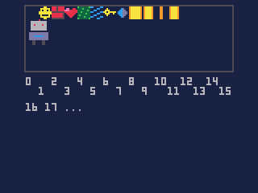
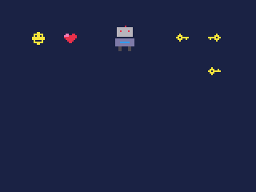
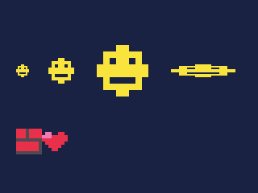
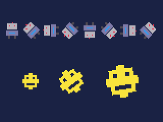
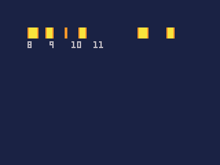
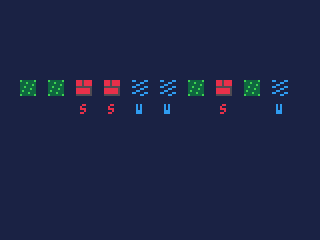
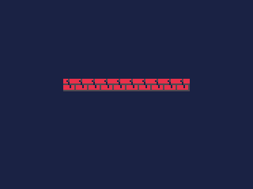
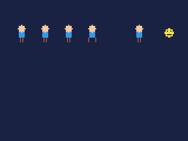
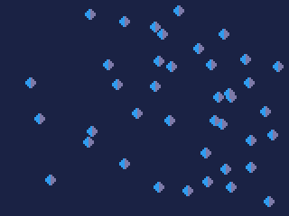

# Sprites

Small pictures drawn from the cart's sprite sheet: characters, tiles,
items, and the frames that animate them.

- [How sprites work](#how-sprites-work)
- Drawing: [spr](#sprn-x-y-w-h-flip), [sspr](#ssprsx-sy-sw-sh-dx-dy-dw-dh-flip),
  [rspr](#rsprn-x-y-angle-scale-w-h-flip)
- [Animation](#animation)
- Flags: [fget](#fgetn-f), [fset](#fsetn-v-f)
- The sheet's pixels: [sget](#sgetx-y), [sset](#ssetx-y-c)
- [More sprites: sheet](#sheeti)
- [Many sprites at once](#many-sprites-at-once)

## How sprites work

**The sprite sheet** is one picture, 128 pixels square, in the cart's
`sheet.png`. It is cut into a grid of 8x8 squares -- 16 across and 16
down, 256 sprites -- numbered from 0 at the top left, across each row and
down:



So sprite `n` is in column `n % 16` and row `flr(n / 16)`: its top left is
at `8 * (n % 16)`, `8 * flr(n / 16)` on the sheet. Sprite 16 starts the
second row, sprite 32 the third.

In the IDE, open `sheet.png` to draw on it: the sheet is a picker in its
own panel, and choosing a sprite -- or dragging across several -- opens
them in the pixel editor.

**A sprite knows nothing of its size.** Every sprite is one 8x8 square; a
bigger character is a block of squares side by side on the sheet, and the
call that draws it says how many across and down. A 16x16 character drawn
in the four squares from 16 -- sprites 16 and 17, with 32 and 33 under
them -- is `spr(16, x, y, 2, 2)`. Select the block in the picker and the
IDE shows the call.

**Colour 0 is see-through.** Pixels of colour 0 in a sprite leave what is
under them. [palt](reference-colour.md#paltc-t) changes which colours are
see-through, and [pal](reference-colour.md#palc0-c1-p) draws a sprite in
other colours.

**Flags.** Each sprite has eight on-or-off flags, 0 to 7, that say what
it is: solid, a ladder, water, deadly. They mean whatever the cart
decides, and are set in the IDE from the sprite editor's **Flags** list.
The map uses them (see **Maps and objects**): a wall is solid because its
sprite's flag 0 is on.

Give flags names in the cart's settings (**Cart > Settings**, the Sprite
flags section) and code can use them by name: a flag named `solid` is
`FLAG.solid`.

**What it costs.**

| Call | Units |
|---|---|
| `spr`, one 8x8 sprite | about 67 |
| `spr`, flipped | about 115 |
| `spr`, a 2x2 block | about 200 |
| `sspr` of 8x8 doubled to 16x16 | about 350 |
| `rspr` of an 8x8 | about 310 |
| `rspr` of a 2x2 block | about 780 |
| `sprites.draw`, each sprite | about 34 |
| `fget`, `sget` | under 5 |

A sprite wholly off the screen costs only the call, about 26 whatever its
size, so there is no need to test for that before drawing. Most of a plain
`spr`'s cost is the call itself. A hundred sprites a frame is
about 6,700 units, half the budget on an iPod Video playing FLAC;
for many more, use [sprites.draw](#many-sprites-at-once) or the actors
system.

---

## spr(n, x, y, [w, h], [flip])

Draws sprite `n`, or a block of sprites, at a position.

| Argument | |
|---|---|
| `n` | the sprite number, 0 to 255: the top left of the block |
| `x`, `y` | where its top left goes on the screen |
| `w`, `h` | how many sprites across and down; 1 and 1 when left out |
| `flip` | 1 to mirror it left to right, 2 to turn it upside down, 3 both; `true` is 1 |

**Returns** nothing.

```js
cls(1);
spr(1, 20, 20);                    // sprite 1: one 8x8
spr(3, 40, 20);                    // sprite 3
spr(16, 70, 16, 2, 2);             // the 2x2 block from 16: 16, 17, 32, 33
spr(6, 110, 20);                   // the key
spr(6, 130, 20, 1, 1, 1);          // flipped across
spr(6, 130, 40, 1, 1, 2);          // flipped down
```



- Every call that flips takes this one number: `sspr`, `rspr`, `blit`,
  `blitpart`, and the `flip` of actors, particles and `sprites.draw`.
- **Flip instead of drawing twice.** A character facing right, flipped,
  faces left: `spr(n, x, y, 1, 1, facing < 0)`. Flipping costs about
  twice as much as drawing straight.
- `w` and `h` may be fractions: `spr(n, x, y, 0.5, 1)` draws the left half
  of the sprite, 4 pixels wide -- useful for a bar that empties.
- A block that runs past the sheet's right or bottom edge draws nothing
  past it: blocks do not wrap to the next row.
- A sprite number outside 0 to 255 draws nothing. So does an empty
  sprite, all colour 0 -- sprite 0 is usually left empty, as the map uses
  it to mean "nothing here".

## sspr(sx, sy, sw, sh, dx, dy, [dw, dh], [flip])

Draws any rectangle of the sheet, at any size: stretched, shrunk, or as it
is.

| Argument | |
|---|---|
| `sx`, `sy` | the rectangle's top left on the sheet, in pixels |
| `sw`, `sh` | its width and height on the sheet |
| `dx`, `dy` | where its top left goes on the screen |
| `dw`, `dh` | its width and height on the screen; the same as `sw`, `sh` when left out |
| `flip` | as for `spr`: 1 to mirror it left to right, 2 to turn it upside down, 3 both; `true` is 1 |

**Returns** nothing.

```js
cls(1);
// sprite 1 is the 8x8 square at 8, 0 on the sheet
sspr(8, 0, 8, 8, 10, 40);                  // as it is
sspr(8, 0, 8, 8, 30, 36, 16, 16);          // doubled
sspr(8, 0, 8, 8, 60, 28, 32, 32);          // four times
sspr(8, 0, 8, 8, 106, 40, 40, 8);          // stretched wide
sspr(16, 0, 16, 8, 10, 80, 32, 16);        // any rectangle: sprites 2 and 3 together, doubled
```



- `sspr` works in **pixels on the sheet**, `spr` in sprite numbers: sprite
  `n` is the rectangle `8 * (n % 16)`, `8 * flr(n / 16)`, 8, 8.
- The rectangle need not line up with the 8x8 grid, so a picture of any
  size can sit anywhere on the sheet: a 20x12 title, a 3x5 digit.
- Stretching repeats pixels, which keeps them sharp; shrinking leaves some
  out.
- It costs by the pixels drawn: about 0.3 units each as it is, 1 stretched
  or shrunk, plus the call.

## rspr(n, x, y, angle, [scale], [w], [h], [flip])

Draws a sprite, or a block, turned and scaled about its centre.

| Argument | |
|---|---|
| `n` | the sprite number, the top left of the block |
| `x`, `y` | where its **centre** goes on the screen |
| `angle` | how far to turn it, in turns: 0.25 is a quarter turn, 1.0 all the way round |
| `scale` | how big to draw it: 1.0 as it is (the default), 2.0 double; from 1/64 to 64 |
| `w`, `h` | how many sprites across and down; 1 and 1 when left out |
| `flip` | as for `spr`, before turning: 1 to mirror it left to right, 2 to turn it upside down, 3 both; `true` is 1 |

**Returns** nothing.

```js
cls(1);
for (var i = 0; i < 8; i++) rspr(16, 12 + i * 19, 30, i / 8.0, 1.0, 2, 2);
rspr(1, 30, 80, 0, 2.0);
rspr(1, 70, 80, 0.1, 3.0);
rspr(1, 120, 80, frame() / 40.0, 4.0);
```



- **The position is the centre**, unlike `spr`'s top left, so a sprite
  turns on the spot.
- A positive angle turns it anticlockwise on the screen, the way
  `sin` and `cos` turn: 0.25 puts its top at the left.
- Turning costs much more than `spr`: about 310 units for an 8x8 sprite,
  780 for a 2x2 block. For something that only ever faces eight ways, it
  is cheaper to draw the eight on the sheet and pick one with `spr`.
- Use a fraction for `angle`: `i / 8` with a whole number `i` divides to 0.
  Write `i / 8.0`.

## Animation

An animation is a run of sprites, one frame each, drawn one after another.
Draw the frames side by side on the sheet, and pick one by the time:

```js
// the four frames, side by side
for (var f = 0; f < 4; f++) spr(8 + f, 20 + f * 12, 20);
print("8   9   10  11", 20, 30, 6);
// one coin spinning: a new frame every 6 ticks
spr(8 + flr(frame() / 6) % 4, 100, 20);
// or by time: 8 frames a second
spr(8 + flr(t() * 8) % 4, 120, 20);
```



- `frame()` counts ticks, so `flr(frame() / 6)` goes up one every 6 ticks;
  `% 4` keeps it 0 to 3, the frame. `t()` counts seconds, so `flr(t() *
  8)` goes up 8 times a second whatever the cart's rate.
- Frames of a bigger character are blocks side by side: 2x2 frames from
  sprite 32 are `spr(32 + f * 2, x, y, 2, 2)`.
- **In the IDE**, drag across the frames in the sprite picker and press
  **Animate**: the animation plays beside the picker at a speed you set,
  and the line of code that plays it is shown under it, to copy. The
  onion-skin button shows the frame before faintly over the one being
  drawn.

## fget(n, [f])

Reads a sprite's flags.

| Argument | |
|---|---|
| `n` | the sprite number, 0 to 255 |
| `f` | one flag, 0 to 7; left out, all eight |

**Returns** with `f`, 1 if that flag is on and 0 if not; without it, all
eight as one number, flag 0 worth 1, flag 1 worth 2, flag 2 worth 4, up to
flag 7 worth 128.

```js
// flags 0 and 1 named "solid" and "water" in the cart's settings;
// the brick (2) is solid, the water (5) is water
var level = [4, 4, 2, 2, 5, 5, 4, 2, 4, 5];

function draw() {
    cls(1);
    for (var i = 0; i < level.length; i++) {
        var s = level[i], x = 10 + i * 14;
        spr(s, x, 40);
        if (fget(s) & FLAG.solid) print("S", x + 2, 52, 8);
        if (fget(s) & FLAG.water) print("W", x + 2, 52, 12);
    }
}
```



- `FLAG.<name>` is the flag's *value*, not its number: the third flag,
  flag 2, named `water`, is `FLAG.water`, 4. So `fget(s) & FLAG.water`
  tests it, as above, and `FLAG.solid | FLAG.water` is both at once, for
  the calls that take a set of flags (`map`, `actors.move`).
- A sprite number outside 0 to 255 has no flags: 0.

## fset(n, v, [f])

Sets a sprite's flags.

| Argument | |
|---|---|
| `n` | the sprite number, 0 to 255 |
| `v` | all eight flags as one number; with `f`, true or false |
| `f` | one flag, 0 to 7, to set to `v`, as `fget(n, f)` reads it |

**Returns** nothing.

```js
fset(9, true, 0);                  // sprite 9 is now solid
fset(9, false, 0);                 // and not
fset(9, FLAG.solid | FLAG.water);  // all eight at once: just these two on
```

- A change lasts until the cart ends; it is not saved into the cart. A
  door that opens can turn its sprite's solid flag off -- though that
  opens every door drawn with that sprite. Changing the map cell to an
  open-door sprite is usually what you want.

## sget(x, y)

Reads one pixel of the sheet.

| Argument | |
|---|---|
| `x`, `y` | the pixel on the sheet, 0 to 127 each |

**Returns** its colour, or 0 off the sheet.

```js
cls(1);
// sprite 16's 16x16 block, read a pixel at a time and drawn as 5x5 squares
for (var y = 0; y < 16; y++)
    for (var x = 0; x < 16; x++) {
        var c = sget(0 + x, 8 + y);
        if (c != 0) rectfill(40 + x * 5, 20 + y * 5, 44 + x * 5, 24 + y * 5, c);
    }
```


- Use it to make things from the art: a level drawn as pixels on the sheet,
  read into the map; a sprite's shape as a collision mask.

## sset(x, y, [c])

Sets one pixel of the sheet.

| Argument | |
|---|---|
| `x`, `y` | the pixel on the sheet, 0 to 127 each |
| `c` | its colour; the pen colour when left out |

**Returns** nothing.

```js
function init() {
    // crack the brick: sprite 2, at 16, 0 on the sheet
    sset(16 + 2, 1, 0);
    sset(16 + 3, 2, 0);
    sset(16 + 3, 3, 0);
    sset(16 + 4, 4, 0);
    sset(16 + 4, 5, 0);
}

function draw() {
    cls(1);
    for (var i = 0; i < 10; i++) spr(2, 40 + i * 8, 50);
}
```



- Every use of the sprite changes, everywhere it is drawn -- here all ten
  bricks, and any on the map. To change one brick, use another sprite.
- The change lasts until the cart ends; the cart's own `sheet.png` is not
  changed.
- A pixel off the sheet is ignored.

## sheet([i])

Chooses where sprites come from: the cart's sheet, or an image.

| Argument | |
|---|---|
| `i` | an image -- one of the cart's `IMG.<name>`, or one made with `img` -- or nothing, for the cart's own sheet |

**Returns** nothing.

256 sprites run out quickly in a game with several characters, each with
walking, jumping and hurt frames. Any image can be a sheet of its own: its
8x8 squares are its sprites, numbered from 0 at the top left, across each
row and down, however wide the image is.

```js
cls(1);
sheet(IMG.hero);
// the image is 64x16: sprites 0 to 7 along the top row, 8 to 15 below
for (var f = 0; f < 4; f++) spr(f * 2, 10 + f * 20, 20, 2, 2);
// walking: frames 0, 2, 4, 6, a new one every 4 ticks
spr(flr(frame() / 4) % 4 * 2, 110, 20, 2, 2);
sheet();
spr(1, 140, 24);   // back to the cart's own sheet
```



- `spr`, `sspr`, `rspr`, `sget`, `sset`, `sprites.draw`, `actors.draw`
  and `plane.billboards` all use the chosen sheet. The map, `tline`, the
  plane's floor and ceiling, and the flags (`fget`, `fset`) always use the
  cart's own.
- An image's sprites are its *whole* 8x8 squares: a 20-pixel-wide image
  has 2 across, and its last 4 columns are no sprite's -- though `sspr`
  can still reach them.
- It lasts until changed, across frames, like the rest of the drawing
  state: call `sheet()` after drawing from an image.
- **In the IDE**, open the image and press the grid button on its tab bar
  to edit it as sprites, with the same picker, animation and code lines as
  the sheet.

## Many sprites at once

`sprites.draw(sp, xs, ys, n, [flips])` draws `n` sprites in one call, from
arrays of positions -- a swarm, a starfield of sprites, a crowd -- at
about 34 units each, against 67 for `spr` in a loop:

```js
var xs = new Int32Array(40), ys = new Int32Array(40);

function init() {
    srand(2);
    for (var i = 0; i < 40; i++) { xs[i] = rnd(152); ys[i] = rnd(112); }
}

function draw() {
    cls(1);
    sprites.draw(7, xs, ys, 40);   // forty gems in one call
}
```



`sp` is one sprite for all, or an array of each one's. Its full
description, and the actors system that moves and draws whole pools of
sprites, are in **Moving many things**.
