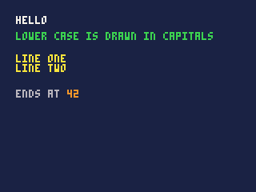
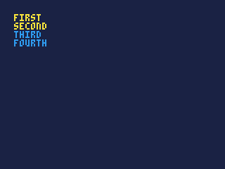
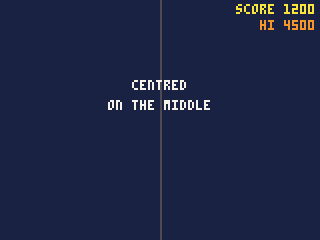
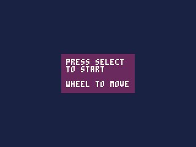
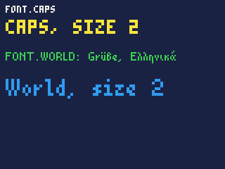
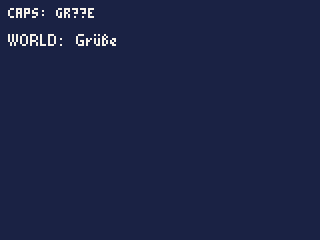

# Text and fonts

Writing text on the screen -- scores, messages, menus -- and the fonts it
is drawn in.

- [How text works](#how-text-works)
- [print](#printtext-x-y-c), [cursor](#cursorx-y-c)
- [textw](#textwtext), [textfit](#textfittext-w-more), [texth](#texthtext)
- [font](#fontf-size), and [fonts of your own](#fonts-of-your-own)

## How text works

`print` draws text into the screen like any other drawing: in a colour,
moved by the [camera](reference-drawing.md#camerax-y-turn-px-py-zoom), cut off by the
[clip](reference-drawing.md#clipx0-y0-x1-y1) and the screen's edges. It does
not wrap: a line too long for the screen runs off its edge.

**Positions are the text's top left.** A line of the standard font is 6
pixels tall, so lines 6 apart sit one under another; leave 8 or 10 for
breathing room.

**Joining text.** `+` joins text and numbers into one: `"POINTS " +
points`. Inside `print`, `textw` and `texth`, the pieces are drawn one
after another without being joined first, so

```js
print("POINTS " + points + "  LIVES " + lives, 2, 2, 7);
```

costs no more than printing the same characters as one string. Fractions
print with up to four decimal places (`1 / 3.0` prints `0.3333`), and
`null` prints as `null` -- usually the sign of a variable that was never
set.

**Line breaks.** `"\n"` in the text starts a new line, below the first,
back at the same x.

**Fonts.** Two are built in:

| Font | Looks | Line height | Holds |
|---|---|---|---|
| `FONT.CAPS` | small capitals, 3x5 in a 4x6 cell -- the default | 6 | A to Z (lower case drawn as capitals), digits, punctuation |
| `FONT.WORLD` | upper and lower case, proportional | 12 | Latin with accents, Greek, Cyrillic, Vietnamese; and Japanese, Chinese and Korean |

A cart can add fonts of its own (below). Either can be drawn at double
size.

**What it costs.**

| | Units |
|---|---|
| a character in `FONT.CAPS` | about 12 |
| a character in `FONT.WORLD` or a cart font | about 34 |
| a character in `FONT.CAPS` at size 2 | about 58 |
| `textw` or `texth` | under 10, whatever the length |

A score and a few labels cost a few hundred units a frame. A screen full
of text in `FONT.WORLD` -- several thousand -- is worth drawing once into
an image if it does not change.

---

## print(text, [x, y], [c])

Writes text.

| Argument | |
|---|---|
| `text` | what to write: text, a number, or pieces joined with `+` |
| `x`, `y` | the top left of the first character; left out, the [cursor](#cursorx-y-c) |
| `c` | the colour; the pen colour when left out |

`print(text, c)`, with just one number after the text, takes it as the
colour, at the cursor.

**Returns** the x just after the last character -- where more text would
go on the same line.

```js
cls(1);
print("HELLO", 10, 10, 7);
print("Lower case is drawn in capitals", 10, 20, 11);
print("LINE ONE\nLINE TWO", 10, 34, 10);
var end = print("ENDS AT ", 10, 56, 6);
print("" + end, end, 56, 9);     // carry on where it ended, in another colour
```



- The colour becomes the pen colour, as for the shapes.
- After `print`, the cursor is at the start of the next line, under the
  text, so a following `print` without a position goes below it.
- Text with several lines returns the x after its *last* line.
- A character the font does not have draws as `?`.

## cursor([x, y], [c])

Sets where `print` writes when it is given no position, and optionally the
pen colour.

| Argument | |
|---|---|
| `x`, `y` | where the next line of text starts; 0, 0 when left out |
| `c` | the pen colour to set |

**Returns** nothing.

```js
cls(1);
cursor(10, 10, 10);
print("FIRST");
print("SECOND");
print("THIRD", 12);      // a colour only: the cursor, in blue
print("FOURTH");         // still blue: the pen
```



- Each `print` without a position moves the cursor down a line, so a list
  of lines needs only the first position. `cls` puts the cursor back at
  0, 0.

## textfit(text, w, [more])

Text cut to fit a width, in the current font and size: a title on a row,
a name in a box.

| Argument | |
|---|---|
| `text` | the text |
| `w` | the room, in pixels |
| `more` | what marks a cut: `"..."` when left out |

**Returns** `text` itself when it fits; otherwise the longest start of it
that fits with `more` after it, cut between characters -- never inside an
accented letter or an ideograph -- and spaces at the cut dropped.

```js
font(FONT.WORLD);
print(textfit(playback.title(), 100), 4, 40, 7);
```

- A few hundred units, whatever the length: work it out when the text
  changes, not every frame.

## textw(text)

How wide `print` would make some text, in pixels, in the current font and
size.

| Argument | |
|---|---|
| `text` | the text, as for `print` |

**Returns** its width in pixels: the widest line, for text with several.

Use it to centre text, or to line it up on the right:

```js
function centre(s, y, c) {
    print(s, 80 - textw(s) / 2, y, c);
}

function right(s, x, y, c) {
    print(s, x - textw(s), y, c);
}

function draw() {
    cls(1);
    line(80, 0, 80, 119, 5);
    centre("CENTRED", 40, 7);
    centre("ON THE MIDDLE", 50, 7);
    right("SCORE 1200", 158, 2, 10);
    right("HI 4500", 158, 10, 9);
}
```



- In `FONT.CAPS` every character is 4 pixels wide, so the width is 4
  times the length. `FONT.WORLD` and cart fonts are proportional -- an
  `i` is narrower than an `m` -- so measure rather than count.
- `textw(s) / 2` is a whole number divided by a whole number, so it is
  rounded down: centred text may sit half a pixel left, which is what you
  want on a pixel screen.

## texth(text)

How tall `print` would make some text, in pixels: all its lines, in the
current font and size.

| Argument | |
|---|---|
| `text` | the text, as for `print` |

**Returns** its height in pixels.

```js
var lines = "PRESS SELECT\nTO START\n\nWHEEL TO MOVE";

function draw() {
    cls(1);
    var w = textw(lines), h = texth(lines);
    rectfill(80 - w / 2 - 4, 60 - h / 2 - 4, 80 + w / 2 + 3, 60 + h / 2 + 3, 2);
    print(lines, 80 - w / 2, 60 - h / 2, 7);
}
```



- An empty line counts: the text above is four lines, 24 pixels tall in
  `FONT.CAPS`.

## font(f, [size])

Chooses the font `print`, `textw` and `texth` use from now on.

| Argument | |
|---|---|
| `f` | `FONT.CAPS`, `FONT.WORLD`, or one of the cart's `FONT.<name>` |
| `size` | 1, or 2 to draw it at double size; 1 when left out |

**Returns** nothing.

```js
cls(1);
print("FONT.CAPS", 4, 4, 7);
font(FONT.CAPS, 2);
print("CAPS, SIZE 2", 4, 14, 10);
font(FONT.WORLD);
print("FONT.WORLD: Grüße, Ελληνικά", 4, 34, 11);
font(FONT.WORLD, 2);
print("World, size 2", 4, 50, 12);
font(FONT.CAPS);                 // back to the default
```



- The font lasts until changed, like the rest of the drawing state. Set
  it back after a title or a message, or every `print` after it -- next
  frame's too -- uses it.
- Size 2 doubles every pixel: chunky, readable from further away, good for
  titles and big numbers.
- `FONT.CAPS` has only the plain ASCII characters. Accented letters and
  other scripts need `FONT.WORLD`:

  ```js
  print("CAPS: Grüße", 4, 4, 7);
  font(FONT.WORLD);
  print("WORLD: Grüße", 4, 14, 7);
  font(FONT.CAPS);
  ```

  

- Japanese, Chinese and Korean come from a font file the iPod installs
  with PodBox, and that the IDE has when it was built with it. Without it,
  they draw as `?`.
- The `ui` dialogs draw in the current font and size, so a cart's
  dialogs match its text; any text the font cannot draw is shown in
  `FONT.WORLD` instead. The pause menu is the iPod's own, and `font`
  does not change it.

## Fonts of your own

A cart can carry up to 16 fonts of its own, as `.bdf` files in its
`fonts/` folder -- BDF is the plain-text bitmap font format that font
editors such as FontForge save. Each becomes `FONT.<name>`, after its file
name, and is used like the built-in ones:

```js
font(FONT.story);
print("Once upon a time...", 4, 4, 7);
font(FONT.CAPS);
```

To make one in the IDE, choose **File > New file**, then **A font** to
start from nothing, or **A font, a copy of CAPS** to change the standard
one. The font editor draws each character on a grid with its baseline
marked, sets how far each moves the next one along, and adds characters
by typing them.

- A font's characters can be up to 32 pixels a side, and a cart's fonts
  can hold 64 KB of characters in all.
- A character a cart font lacks draws as its `?`, or not at all if it has
  no `?` either.
- Cart fonts cost about the same as `FONT.WORLD`: about 34 units a
  character.
