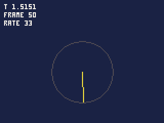

# Time and speed

How a cart's time passes: ticks, the rate, what happens when the iPod
cannot keep up, and the clock and calendar.

- [How time works](#how-time-works): [ticks](#ticks), [when the iPod falls behind](#when-the-ipod-falls-behind),
  [pausing](#pausing)
- [rate](#rate), [setrate](#setraten), [t and time](#t-time), [frame](#frame),
  [skipped](#skipped), [unitsnow](#unitsnow), [resumed](#resumed), [date](#dateout)
- [Speeds that do not depend on the rate](#speeds-that-do-not-depend-on-the-rate)
- [Stepping the rate down](#stepping-the-rate-down)

## How time works

### Ticks

A cart runs in **ticks**: each one runs `update()` once, then `draw()`.
The **rate** is how many ticks a second: 33 unless `cart.json` says 20,
25 or 50, and a cart can change it while it runs.

Movement is counted in ticks. A ball that moves 1.5 pixels each
`update()` moves 1.5 pixels a tick -- 49.5 pixels a second at 33 ticks a
second, 37.5 at 25.

**Time in a cart is the ticks it has run**, not the clock on the wall.
`t()` is the ticks so far divided by the rate. When the cart is paused,
or the iPod falls far behind (below), no ticks run and `t()` stands
still -- which is what a game wants: a level timer does not count the
time spent in the pause menu.

### When the iPod falls behind

Each tick has a time slot: 1/33 of a second at 33. When a tick's work --
your `update()` and `draw()`, and sending the screen -- takes longer than
its slot, the next tick is late. The iPod catches up like this:

- **A tick late**: it runs one `update()` **without** `draw()`, then a
  normal tick. The game's rules keep their speed; only one frame of the
  picture is missed.
- **Two ticks late or more**: the same, and then it gives up the time
  it is behind rather than racing to make it up. The game slows down.

So `update()` runs at most twice for each frame drawn. This is why a
cart's rules belong in `update()` and its drawing in `draw()`: a cart
that draws in `update()` cannot have the drawing skipped, and slows
sooner.

`skipped()` tells the cart how many frames it fell behind by, so it can
react -- by stepping its rate down (below), or by drawing less.

The IDE runs a cart as the iPod you choose under **Run > Run as**,
each tick taking as long as it would there, so falling behind happens in
the IDE as it would on the iPod. The status bar shows the frames drawn
each second.

### Pausing

Holding Menu for a second pauses the cart and shows the pause menu. A
short press asks whether to quit, unless the cart takes it as a button
(`"menu_button": "game"` in `cart.json`); the question pauses the game
too. On the iPod, a cart left untouched for five minutes pauses, so the
iPod can turn its backlight off, and so does sliding the hold switch
on. No ticks
run while paused, and a dialog (`ui.*`) holds the ticks the same way
while it is open. [`resumed()`](#resumed) tells the cart it was paused,
and music the cart plays itself (`playback.play`) pauses with it.

---

## rate()

The ticks a second the cart runs at now.

**Returns** 20, 25, 33 or 50.

```js
function init() {
    printh(rate());     // 33, or what cart.json says
}
```

## setrate(n)

Changes the rate, from the next tick.

| Argument | |
|---|---|
| `n` | 20, 25, 33 or 50; anything else stops the cart: "setrate() takes 20, 25, 33 or 50" |

**Returns** nothing.

```js
setrate(25);
printh(rate());     // 25 straight away
```

- `t()` carries on smoothly across the change: at frame 10 at 33 ticks a
  second it was 0.303; a tick after `setrate(25)`, 0.343 -- a 25th of a
  second on.
- Speeds counted per tick slow down at a lower rate unless the cart
  scales them; see [below](#speeds-that-do-not-depend-on-the-rate).
- At 50, each tick has two thirds of the time it has at 33; at 20, the
  most time a tick there is.

## t(), time()

The seconds since the cart started, counted in ticks run.

**Returns** a fraction: `frame() / rate()`, carried across changes of
rate.

```js
function draw() {
    cls(1);
    print("T " + t(), 4, 4, 7);
    print("FRAME " + frame(), 4, 12, 7);
    print("RATE " + rate(), 4, 20, 7);
    var a = t() / 2;                     // half a turn a second
    line(80, 70, 80 + cos(a) * 30, 70 + sin(a) * 30, 10);
    circ(80, 70, 30, 5);
    if (flr(t() * 2) % 2 == 0) print("BLINK", 70, 108, 8);   // on and off each half second
}
```



- `t()` is 0 in `init()`, and a tick's worth more at each `update()`:
  `0.0303` at the first at 33 ticks a second.
- It is a fraction, so it wraps after about 9 hours (32767 seconds). For
  long counts, use `frame()`.
- Animate from it: `flr(t() * 8) % 4` is a frame number going 0 to 3
  eight times a second, whatever the rate.
- `time()` is the same function.

## frame()

How many ticks the cart has run.

**Returns** an integer: 0 in `init()`, 1 in the first `update()`.

```js
if (frame() % 33 == 0) printh("a second's worth of ticks at 33");
```

- It counts every tick, drawn or not.
- An integer, so it never wraps in practice. Prefer it to `t()` for
  timers counted in ticks: `if (frame() > endsAt) ...`.

## skipped()

How many frames the iPod fell behind by since the last call.

**Returns** an integer, 0 when it kept up. Each call starts the count
again.

```js
var late = 0;

function update() {
    late += skipped();
}
```

- A late tick runs `update()` without `draw()` and reports itself here.
  A tick further behind reports how many frames it was late by, though
  only one `update()` was run to catch up.
- In `pbgvm`, `--skip 5:1,10:3` makes ticks 5 and 10 late, as a slow
  iPod would: tick 5 reports one frame skipped and tick 10 three, and
  both run `update()` without `draw()`.

## unitsnow()

**Returns** the units this tick has spent so far: a cart that measures
itself can leave out an effect before the tick runs late, rather than
learn from `skipped()` after.

```js
if (unitsnow() < 9000) particles.draw(smoke);   // smoke only with room
```

- The budget differs by iPod and by what it plays: about 12,500 a tick
  at 33 ticks a second on an iPod Video playing FLAC.

## resumed()

Whether the game was paused -- by the pause menu, the hold switch or the
question a short press of Menu asks -- since the last call.

**Returns** true once after a pause, then false until the next.

```js
function update() {
    // a round timed against the music is lost to a pause
    if (resumed() && playingRound) loseRound();
}
```

- The cart's own dialogs (`ui.*`) do not count: the cart opened them.
- In `pbgvm`, `--pause 40` pauses the game before tick 40. In the IDE,
  pausing with Menu (Esc) and the Game menu's dialogs count.

## date(out)

The date and time, from the iPod's clock.

| Argument | |
|---|---|
| `out` | an `Int32Array` of at least 7, to fill |

**Returns** nothing; `out` holds year, month (1 to 12), day, hour,
minute, second, and the day of the week (0 Sunday to 6 Saturday).

```js
var d = new Int32Array(7);
date(d);
printh(d.join(","));     // e.g. 2026,11,3,12,0,0,2
```

- An array shorter than 7 stops the cart: "date() needs an Int32Array of
  7".
- On the iPod it is the iPod's own clock. In the IDE it is the
  computer's: the time the run began, plus the iPod's time since, so a
  replay is told the same dates its run was. In `pbgvm` it is always 3
  November 2026, 12:00, a Tuesday, so a script gets the same result every
  time.
- Use it for things that change with the day -- a daily puzzle seeded
  with `srand(d[0] * 400 + d[1] * 31 + d[2])` -- not for timing: `t()` and
  `frame()` stop when the game pauses, and the date does not.

---

## Speeds that do not depend on the rate

A speed in pixels a tick depends on the rate: at 25 ticks a second, the
same speed covers a quarter less ground than at 33. A cart that only
ever runs at one rate can ignore this. One that changes its rate -- to
keep up on a slow iPod, say -- scales its speeds:

```js
var k = 1.0;                 // how much to scale per-tick speeds by

function update() {
    k = 33.0 / rate();       // 1 at 33, 1.32 at 25
    x += dx * k;
    y += dy * k;
}
```

At 25 ticks a second each tick moves 1.32 times as far, so a second
covers the same ground as at 33. Note `33.0`: `33 / rate()` would divide
two integers and give 1.

Anything counted in ticks needs the same care: a power-up lasting 330
ticks lasts 10 seconds at 33 and 13 at 25. Count such things in seconds
with `t()`, or scale the count.

## Stepping the rate down

The iPod Video playing heavy music -- high-resolution FLAC, say -- has
much less time to give a cart than the same iPod playing nothing. A
cart that is busy every frame can measure how it is doing and step down:

```js
var late = 0, k = 1.0;

// once a tick, from update()
function pace() {
    late += skipped();
    if (frame() % rate() != 0) return;       // judge once a second
    if (late > 4 && rate() > 25) setrate(25);
    else if (rate() < 33 && !playback.playing()) setrate(33);
    late = 0;
    k = 33.0 / rate();
}
```

Once a second it looks at how many frames were skipped. More than four a
second at 33 and it steps down to 25, where each tick has a third more
time. When the music stops it steps back up.

Stepping down is a last resort, after making the cart cheaper (see
**Making it fast**): a game at 33 feels smoother than at 25.
