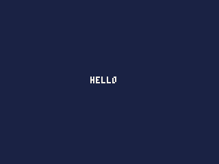
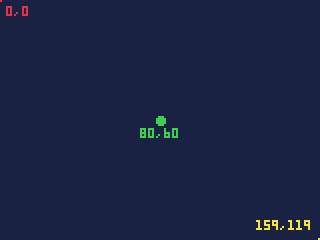
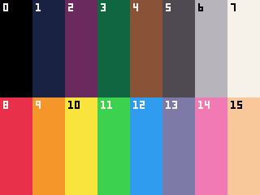
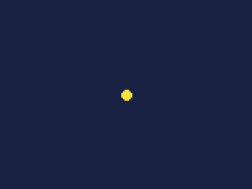

# 1. A ball and a bat

In this chapter you make a ball that bounces round the screen, and a bat
you move with the click wheel to keep it up. It is the start of a game you
finish over the next chapters, and along the way it covers the ideas every
Arcade game is built on: the screen, colours, the three functions that run
a game, and reading the wheel.

You need the [Arcade IDE](https://anthonyfletcher.github.io/podbox/ide/)
open in a browser, Chrome or Edge for the best of it. Nothing else: the IDE
runs your game on the same engine as the iPod.

## Start a cart

A game for the Arcade is called a **cart**, after the cartridges old
consoles took. Choose **Cart > New cart**. Two files appear in the Files
panel:

- `cart.json` holds the cart's settings: its name, its speed, its
  high-score tables. Open it and change `"New Game"` to `"Bat and Ball"`:
  the name the iPod lists the game by, and the name of its file when you
  save it. Leave the rest for now.
- `main.js` holds the code. It opens in the editor.

Press **Ctrl+Enter** (or the power button at the top right of the Player).
The Player shows this:



## The three functions

Here is all of `main.js`:

```js
function init() {
}

function update() {
}

function draw() {
    cls(1);
    print("hello", 66, 56, 7);
}
```

The Arcade calls these three functions for you. You never call them
yourself.

- **`init()`** runs once, when the cart starts. It sets things up.
- **`update()`** runs every **tick**, 33 times a second. It moves things,
  reads the wheel and buttons, and decides what happens: the game's rules.
- **`draw()`** runs after each `update()`, and draws the frame you see.

Keeping the rules in `update()` and the drawing in `draw()` matters on the
iPod: when the iPod is too busy to draw every frame -- playing music and
running your game at once -- the Arcade skips a `draw()` but never an
`update()`, so the game keeps its speed even when its picture stutters.

`draw()` here does two things. `cls(1)` clears the screen to colour 1,
dark blue. `print("hello", 66, 56, 7)` writes the word with its top left
at 66 across and 56 down, in colour 7, white.

## The screen and its colours

The screen is **160 pixels across and 120 down**. A position is two
numbers, x across and y down, counted from 0 at the top left. The
bottom-right pixel is 159, 119, and the middle is 80, 60:



Notice that y grows *downward*, which is the other way up from a maths
graph. Something falling has a y that grows.

Every colour is a number, 0 to 15 to start with. These are a new cart's
sixteen:



A cart can change what these look like, and have up to 256: that is for a
later chapter.

Try changing the numbers in `draw()` -- the text's position, its colour,
the background's colour -- and press Ctrl+Enter again to see the change.

## Draw a ball

Replace the `print` line with a filled circle:

```js
function draw() {
    cls(1);
    circfill(80, 60, 3, 10);
}
```

`circfill(x, y, r, c)` draws a filled circle centred at x, y, with radius
`r`, in colour `c`. This one is 3 pixels in radius, in the middle of the
screen, in yellow:



## Make it move

To move, the ball's position has to change from one frame to the next, so
it goes in **variables** instead of fixed numbers. Put two at the very top
of the file, outside any function, so every function can use them:

```js
var x = 80;
var y = 60;
```

Draw the ball where they say:

```js
function draw() {
    cls(1);
    circfill(x, y, 3, 10);
}
```

And move it a pixel to the right every tick, in `update()`:

```js
function update() {
    x = x + 1;
}
```

Run it. The ball slides right and off the edge of the screen -- here it is
after 30 ticks, nearly a second:


Each frame starts with `cls(1)` wiping the screen, so the ball is drawn
fresh where it now is, and no trail is left behind. Take `cls(1)` out and
run it again to see what happens without it.

## Bounce

A moving ball has a speed as well as a position: how far it moves across
and down each tick. Give it two more variables, and change the top of the
file to:

```js
var x = 80, y = 60;
var dx = 1.5, dy = 1.25;
```

`dx` is the speed across and `dy` the speed down, in pixels a tick. They
are **fractions** -- 1.5 pixels a tick -- because whole pixels a tick are
either too slow (1) or too fast (2). The Arcade keeps fractions exactly
enough for this, and draws a fractional position at the pixel below it.

> **The one rule to remember about numbers.** In the Arcade, a number
> written without a point is a whole number, and **two whole numbers
> divide to a whole number**: `3 / 2` is 1, not 1.5. When you want a
> fraction, write a point: `3 / 2.0`, or `1.0` instead of `1`. Most
> puzzling bugs in a first cart come from this.

Now make `update()` move the ball by its speed, and turn it round at the
edges:

```js
function update() {
    x += dx;
    y += dy;
    if (x < 3 || x > 156) dx = -dx;
    if (y < 3 || y > 116) dy = -dy;
}
```

`x += dx` is short for `x = x + dx`. When the ball's centre comes within
3 pixels of the left or right edge -- its radius -- its speed across is
reversed, and likewise at the top and bottom. It bounces round the screen
for ever:


## A bat on the wheel

The bat is a white bar near the bottom of the screen, 20 pixels wide.
Its position across goes in another variable at the top of the file:

```js
var bat = 70;
```

and `draw()` draws it after the ball:

```js
function draw() {
    cls(1);
    circfill(x, y, 3, 10);
    rectfill(bat, 112, bat + 19, 115, 7);
}
```

`rectfill(x0, y0, x1, y1, c)` fills the rectangle between two corners,
both included: from `bat` to `bat + 19` is 20 pixels.

Now the wheel. **`wheel()`** tells you how far the click wheel turned
since the last tick, in clicks: 96 clicks make a whole turn, clockwise
counts up, anticlockwise down, and when the wheel is still it is 0. Adding
it to `bat` makes the bat follow the wheel, a pixel a click. Put this
first in `update()`:

```js
    bat = mid(0, bat + wheel(), 140);
```

`mid(low, value, high)` keeps a value between two limits: the bat stops
at the left edge (0) and the right (140, so its 20 pixels end at 159).

Run it, then **click the Player's screen** to give it the keys. In the
IDE, the Up and Down arrow keys turn the wheel, four clicks a press; or
drag your mouse round the ring of the drawn wheel under the screen. On the
iPod, it is the wheel itself.


## Hit it

At the moment the ball bounces off the bottom of the screen whether the
bat is there or not. Take the bottom out of the bounce, so the line for y
only turns the ball at the top:

```js
    if (y < 3) dy = -dy;
```

Then, after it, send the ball back up when it meets the bat:

```js
    // the bat sends the ball back up
    if (dy > 0 && y >= 109 && y <= 113 && x >= bat - 2 && x <= bat + 21) dy = -dy;
```

Read it as: if the ball is going down (`dy > 0`), and it is at the bat's
height (its centre from 109 to 113, so its edge touches the bat's top at
112), and it is across the bat's width (with a couple of pixels to spare
at each end), turn it round. The test for `dy > 0` stops the ball being
turned twice, as it would be on the next tick while still inside the bat.

And when the bat misses, start the ball again from the top:

```js
    // missed: the ball starts again from the top
    if (y > 123) {
        x = 80;
        y = 10;
    }
```

Now you have to keep it up:


## The whole cart

```js
var x = 80, y = 60;
var dx = 1.5, dy = 1.25;
var bat = 70;

function init() {
}

function update() {
    bat = mid(0, bat + wheel(), 140);

    x += dx;
    y += dy;
    if (x < 3 || x > 156) dx = -dx;
    if (y < 3) dy = -dy;

    // the bat sends the ball back up
    if (dy > 0 && y >= 109 && y <= 113 && x >= bat - 2 && x <= bat + 21) dy = -dy;

    // missed: the ball starts again from the top
    if (y > 123) {
        x = 80;
        y = 10;
    }
}

function draw() {
    cls(1);
    circfill(x, y, 3, 10);
    rectfill(bat, 112, bat + 19, 115, 7);
}
```

If yours does something different, compare it with this: a missing `+`,
or a `1` where `1.5` should be, changes everything.

## Try it on your iPod

Choose **Cart > Save as .pbg**. The whole cart is saved as one file.
Copy it to your iPod -- into a folder called `Games`, say -- and it
appears in the Arcade on the iPod's main menu. Press Menu and say Yes to
leave it; hold Menu for a second to pause it.

## What you learned

- A cart's code is `init()` once, `update()` every tick, and `draw()`
  after each. Rules in `update()`, drawing in `draw()`.
- The screen is 160x120, 0,0 at the top left, y growing down. Colours are
  numbers.
- `cls` clears, `circfill` and `rectfill` draw filled shapes.
- Variables at the top of the file keep the game's state between ticks.
- Fractions are written with a point; two whole numbers divide to a whole
  number.
- `wheel()` is the clicks turned this tick; `mid` keeps a value in range.

**Next**, in chapter 2: a score, lives and a game over.

The functions used here, and every other drawing function, are in the
reference's **Drawing** chapter.
