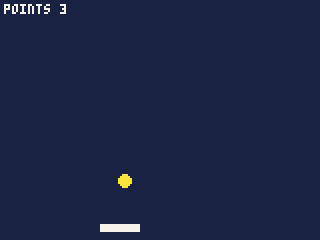
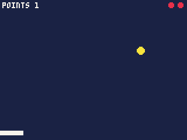
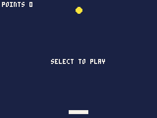
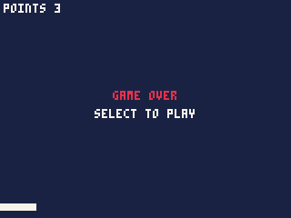
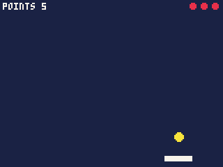

# 2. Score, lives and game over

In chapter 1 the ball bounced and the bat kept it up, but nothing was at
stake. Here it becomes a game: hits score points, misses cost lives, and
when the lives run out the game is over until you start another. You also
make the ball harder to keep up the longer you last.

Along the way: text on the screen, functions of your own, a loop, and the
way most games are organised -- a variable that says what state the game
is in.

Start from the cart you finished in chapter 1.

## Keep score

A score is one more number the game keeps between ticks, so it is another
variable at the top of the file:

```js
var points = 0;
```

A point is scored when the bat hits the ball. The test for the hit is
already in `update()`, turning the ball round; it now has two things to
do, so give it braces to hold both:

```js
    // the bat sends the ball back up, and scores a point
    if (dy > 0 && y >= 109 && y <= 113 && x >= bat - 2 && x <= bat + 21) {
        dy = -dy;
        points++;
    }
```

`points++` adds one to `points`.

Now show it. Add this line at the end of `draw()`, after everything else,
so the text is drawn on top:

```js
    print("POINTS " + points, 2, 2, 7);
```

`print(text, x, y, colour)` writes text with its top left at x, y. The
`+` joins the word to the number, so with 3 points it writes `POINTS 3`.



The text is in the Arcade's own small font, which draws every letter as a
capital -- `"Points"` and `"POINTS"` look the same. It has another font
for lower case and other languages; see the reference's **Text and
fonts**.

## Three lives

Lives are another number. Add it under `points`:

```js
var lives = 3;
```

A miss costs one. The miss is already in `update()`, starting the ball
again from the top; take a life there too:

```js
    // missed: a life lost, and the ball starts again from the top
    if (y > 123) {
        lives--;
        x = 80;
        y = 10;
    }
```

To show them, draw a small red dot for each life left, in a row at the
top right. A **`for` loop** does something a number of times:

```js
    for (var i = 0; i < lives; i++) circfill(154 - i * 8, 4, 2, 8);
```

Read it as: start `i` at 0; while `i` is less than `lives`, draw a dot and
then add one to `i`. With 3 lives it runs for `i` = 0, 1 and 2, drawing
dots at x = 154, 146 and 138. Put it at the end of `draw()`.



## Game over

When the last life goes, the game should stop and wait for the player to
start again. That means the game has two **states** -- playing, and over
-- and `update()` and `draw()` must do different things in each.

A variable says which state the game is in:

```js
var over = true;
```

It starts `true`, so the cart opens waiting for the player to start,
rather than throwing them straight in.

Starting a game and serving the ball are now done in more than one
place -- at the beginning, after a miss, after a game over -- so give them
**functions of their own**, after `init()`:

```js
// a new game
function start() {
    points = 0;
    lives = 3;
    over = false;
    serve();
}

// the ball, from the top, heading down
function serve() {
    x = 80;
    y = 10;
    dx = 1.5;
    dy = 1.25;
}
```

A function is a named piece of code; writing `serve()` anywhere runs it.
Because `serve` now sets where the ball starts, the variables at the top
no longer need their starting values -- change them to:

```js
var x, y, dx, dy;
var bat = 70;
var points = 0;
var lives = 0;
var over = true;
```

and have `init()` serve once, so the ball has somewhere to be before the
first game:

```js
function init() {
    serve();
}
```

Now `update()`. While the game is over, it should only wait for the
**Select** button -- the wheel's centre -- and start a game when it is
pressed. Put this at the very top of `update()`:

```js
    if (over) {
        if (btnp(4)) start();
        return;
    }
```

`btnp(4)` is true on the one tick the Select button is pressed (the
buttons are numbered: 0 Prev, 1 Next, 2 Menu, 3 Play, 4 Select). `return`
leaves `update()` at once, so nothing below it -- the ball, the bat --
moves while the game is over.

A miss now ends the game when it takes the last life, and serves again
otherwise:

```js
    // missed: a life lost; with none left, the game is over
    if (y > 123) {
        lives--;
        if (lives == 0) over = true;
        else serve();
    }
```

Note `==` to test whether two things are equal: a single `=` would set
`lives` to 0.

Finally, `draw()` says what to do while the game is over. Text looks best
centred, and `textw(text)` gives how wide some text would be in pixels, so
it can be placed with its middle at 80, the middle of the screen. That is
worth a function of its own, at the end of the file:

```js
// text centred across the screen
function centre(s, top, c) {
    print(s, 80 - textw(s) / 2, top, c);
}
```

and at the end of `draw()`:

```js
    if (over) {
        if (points > 0) centre("GAME OVER", 50, 8);
        centre("SELECT TO PLAY", 60, 7);
    }
```

"GAME OVER" only shows after a game has been played -- when the cart
first opens, `points` is still 0.



In the IDE, Select is the Enter key, or the middle of the drawn wheel.



## Make it harder

A game everyone can keep up for ever is not much of a game. Two changes
to the hit make it more interesting: the ball comes off the bat a little
faster each time, and where it lands on the bat decides which way it
goes -- off the middle, straight up; off an end, steeply to that side.
That gives the player some control.

Change the hit to:

```js
    // the bat sends the ball back up, a little faster, and scores a point
    if (dy > 0 && y >= 109 && y <= 113 && x >= bat - 2 && x <= bat + 21) {
        dy = -min(3.0, dy * 1.05);
        dx = (x - (bat + 10)) / 5.0;
        points++;
    }
```

- `dy * 1.05` is 5% faster than before; `min(3.0, ...)` stops it there, at
  3 pixels a tick, so the ball never gets too fast to see. The minus sends
  it up.
- `x - (bat + 10)` is how far the ball is from the bat's middle: from
  about -12 at the left end to 12 at the right. Divided by 5.0 that is a
  speed across of up to about 2.4 either way.

Note the `5.0`. Two whole numbers divide to a whole number, so when the
ball and the bat both sit on whole pixels, `/ 5` would give only -2, -1,
0, 1 or 2; `5.0` keeps the fraction whatever they hold.



## The whole cart

```js
var x, y, dx, dy;
var bat = 70;
var points = 0;
var lives = 0;
var over = true;

function init() {
    serve();
}

// a new game
function start() {
    points = 0;
    lives = 3;
    over = false;
    serve();
}

// the ball, from the top, heading down
function serve() {
    x = 80;
    y = 10;
    dx = 1.5;
    dy = 1.25;
}

function update() {
    if (over) {
        if (btnp(4)) start();
        return;
    }

    bat = mid(0, bat + wheel(), 140);

    x += dx;
    y += dy;
    if (x < 3 || x > 156) dx = -dx;
    if (y < 3) dy = -dy;

    // the bat sends the ball back up, a little faster, and scores a point
    if (dy > 0 && y >= 109 && y <= 113 && x >= bat - 2 && x <= bat + 21) {
        dy = -min(3.0, dy * 1.05);
        dx = (x - (bat + 10)) / 5.0;
        points++;
    }

    // missed: a life lost; with none left, the game is over
    if (y > 123) {
        lives--;
        if (lives == 0) over = true;
        else serve();
    }
}

function draw() {
    cls(1);
    circfill(x, y, 3, 10);
    rectfill(bat, 112, bat + 19, 115, 7);
    print("POINTS " + points, 2, 2, 7);
    for (var i = 0; i < lives; i++) circfill(154 - i * 8, 4, 2, 8);
    if (over) {
        if (points > 0) centre("GAME OVER", 50, 8);
        centre("SELECT TO PLAY", 60, 7);
    }
}

// text centred across the screen
function centre(s, top, c) {
    print(s, 80 - textw(s) / 2, top, c);
}
```

## What you learned

- `print(text, x, y, c)` writes text; `+` joins text and numbers.
  `textw(text)` measures it, for centring.
- A `for` loop repeats something a number of times.
- Functions of your own -- `start`, `serve`, `centre` -- name a piece of
  code so it can be run from several places.
- A variable such as `over` holds the game's state, and `update()` and
  `draw()` check it to behave differently in each. `return` leaves a
  function early.
- `btnp(i)` is true on the tick button `i` is pressed; `btn(i)` while it
  is held. Select is button 4.
- `==` tests whether two things are equal; `=` sets.

**Next**, in chapter 3: sprites, so the ball and bat look like something.

The text functions used here are in the reference's **Text and fonts**.
