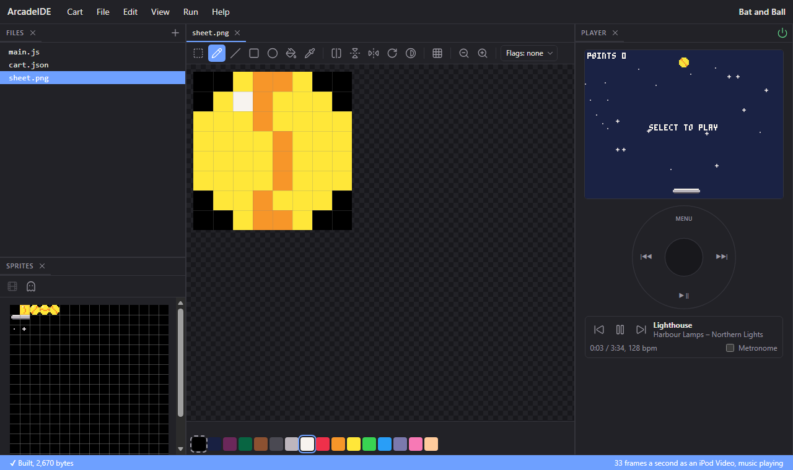
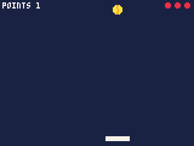
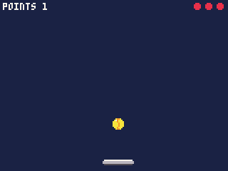
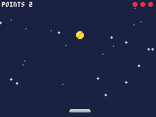

# 3. Sprites

So far everything has been drawn from shapes: a circle for the ball, a
rectangle for the bat. Games mostly draw **sprites** instead -- small
pictures you draw pixel by pixel in the IDE, and put on the screen with
one call. In this chapter the ball becomes a spinning ball, the bat gets
rounded ends, and a field of twinkling stars fills the background.

Start from the cart you finished in chapter 2.

## The sprite sheet

A cart's sprites all live on one picture, its **sprite sheet**: 128
pixels square, cut into a grid of 16 by 16 squares of 8x8 pixels. Each
square is one sprite, numbered from 0 at the top left, along each row and
down:

| | | | | |
|---|---|---|---|---|
| 0 | 1 | 2 | ... | 15 |
| 16 | 17 | 18 | ... | 31 |
| 32 | 33 | 34 | ... | 47 |

A new cart has no sheet yet. Choose **File > New file**, pick **The
sprite sheet** under What, and press **Make it**. `sheet.png` appears in
the Files panel and opens in the sprite editor:



- The **Sprites** panel (bottom left) shows the whole sheet. Click a
  square to draw that sprite; drag across several to draw them together.
- The big grid in the middle is the chosen sprite, magnified.
- The colours along the bottom are the palette. Click one to draw with it
  with the left mouse button; right-click one to make it the colour the
  right button draws.
- The tools along the top: select, pencil, line, rectangle, oval, fill,
  and the colour picker, then flips and turns.

**Colour 0 is see-through.** Wherever a sprite's pixel is colour 0 --
black, in the editor -- the sprite does not draw, and whatever is behind
it shows. That is how a round ball is drawn from a square sprite: its
corners are colour 0.

For this chapter, draw:

- **Sprites 1 to 4**: the ball, four times, each with a stripe a little
  further round, so that shown one after another it seems to spin. A
  yellow disc filling the square, its corners left at 0, with an orange
  (colour 9) seam across it, and one white pixel near the top left as a
  shine.
- **Sprite 16**: the bat's left end, 4 pixels tall at the top of the
  square -- a white top row, two light grey rows and a dark grey bottom
  row, with the left end rounded off.
- **Sprite 17**: a plain piece of the bat's middle, in the same four rows
  but square.
- **Sprites 32 and 33**: a star, twice -- a single light grey dot, and a
  small cross with a white middle.

They need not look exactly like the pictures here; they need only be in
those squares. The sheet is part of the cart as soon as you draw, and goes
with it when you save.

## The ball as a sprite

`spr(n, x, y)` draws sprite `n` with its top left at x, y. The ball's
`x` and `y` are its middle, so to centre an 8x8 sprite on it, draw it 4
pixels up and left. In `draw()`, replace the `circfill` line with:

```js
    spr(1, x - 4, y - 4);
```



The ball is now 8 pixels across, one more than the circle was, but the
bounces still work at the same places, close enough not to notice.

## A bat from three pieces

A sprite is 8 pixels wide, and the bat is wider, so it is built from
pieces: the left end (sprite 16), the middle (sprite 17), and the right
end -- which is the left end facing the other way. `spr` can flip a
sprite as it draws it, so the right end needs no sprite of its own.

In `draw()`, replace the `rectfill` line with three sprites side by side:

```js
    spr(16, bat, 112);
    spr(17, bat + 8, 112);
    spr(16, bat + 16, 112, 1, 1, true);
```

The extra arguments to the last one are its width and height in sprites
(1 and 1: a single sprite) and `true` to flip it across.

Three sprites make the bat 24 pixels wide instead of 20, so three numbers
in `update()` that were worked out from its width change with it. The bat
now stops 24 pixels from the right edge:

```js
    bat = mid(0, bat + wheel(), 136);
```

it reaches 4 pixels further right in the hit test:

```js
    if (dy > 0 && y >= 109 && y <= 113 && x >= bat - 2 && x <= bat + 25) {
```

and its middle, for the angle, is at `bat + 12`:

```js
        dx = (x - (bat + 12)) / 5.0;
```



## A spinning ball

An animation is a few pictures shown one after another, fast. The ball
has four, sprites 1 to 4, so the ball's sprite should step through 1, 2,
3, 4, 1, 2... over time.

`t()` is the time in seconds since the cart started, as a fraction:
0.5 after half a second. Multiplied by 12 it counts up 12 a second;
`flr` rounds that down to a whole number; and `% 4` -- the remainder
after dividing by 4 -- turns 0, 1, 2, 3, 4, 5... into 0, 1, 2, 3, 0, 1...
Add 1, and it steps through the ball's four sprites 12 times a second, a
spin three times a second. Change the ball's line in `draw()` to:

```js
    spr(1 + flr(t() * 12) % 4, x - 4, y - 4);
```

A faster spin is a bigger number than 12; a slower one, a smaller.

The sprite editor works these lines out for you: drag across the frames
of an animation in the Sprites panel and press **Animate** (the film
button). It plays them at a speed you set, and shows the line of code that
plays them the same way.

## Twinkling stars

A starry background takes two more ideas: a list of places, and drawing
each one.

Each star has a position, and there are 24 of them. Rather than 48
variables, keep them in two **arrays** -- lists of numbers -- one for the
x of every star and one for the y. Add them at the top of the file, under
`over`:

```js
var starx = new Int32Array(24), stary = new Int32Array(24);
```

`new Int32Array(24)` is a list of 24 whole numbers, all 0 to begin with.
`starx[0]` is the first, `starx[23]` the last.

Give each star a random place once, when the cart starts. `rnd(160)` is a
random whole number from 0 to 159. Change `init()` to:

```js
function init() {
    for (var i = 0; i < 24; i++) {
        starx[i] = rnd(160);
        stary[i] = rnd(100);
    }
    serve();
}
```

The stars stay above y = 100, out of the bat's way.

Then draw them, first thing after `cls(1)` in `draw()`, so that everything
else is drawn over them:

```js
    for (var i = 0; i < 24; i++) spr(32 + (flr(t() * 2) + i) % 2, starx[i] - 4, stary[i] - 4);
```

The sprite is the star's animation, as for the ball: `flr(t() * 2) % 2`
flips between 0 and 1 twice a second, choosing sprite 32 (the dot) or 33
(the cross). Adding `i`, the star's number, means odd and even stars take
turns, so half the sky twinkles while the other half rests.



## The whole cart

```js
var x, y, dx, dy;
var bat = 70;
var points = 0;
var lives = 0;
var over = true;
var starx = new Int32Array(24), stary = new Int32Array(24);

function init() {
    for (var i = 0; i < 24; i++) {
        starx[i] = rnd(160);
        stary[i] = rnd(100);
    }
    serve();
}

// a new game
function start() {
    points = 0;
    lives = 3;
    over = false;
    serve();
}

// the ball, from the top, heading down
function serve() {
    x = 80;
    y = 10;
    dx = 1.5;
    dy = 1.25;
}

function update() {
    if (over) {
        if (btnp(4)) start();
        return;
    }

    bat = mid(0, bat + wheel(), 136);

    x += dx;
    y += dy;
    if (x < 3 || x > 156) dx = -dx;
    if (y < 3) dy = -dy;

    // the bat sends the ball back up, a little faster, and scores a point
    if (dy > 0 && y >= 109 && y <= 113 && x >= bat - 2 && x <= bat + 25) {
        dy = -min(3.0, dy * 1.05);
        dx = (x - (bat + 12)) / 5.0;
        points++;
    }

    // missed: a life lost; with none left, the game is over
    if (y > 123) {
        lives--;
        if (lives == 0) over = true;
        else serve();
    }
}

function draw() {
    cls(1);
    for (var i = 0; i < 24; i++) spr(32 + (flr(t() * 2) + i) % 2, starx[i] - 4, stary[i] - 4);
    spr(1 + flr(t() * 12) % 4, x - 4, y - 4);
    spr(16, bat, 112);
    spr(17, bat + 8, 112);
    spr(16, bat + 16, 112, 1, 1, true);
    print("POINTS " + points, 2, 2, 7);
    for (var i = 0; i < lives; i++) circfill(154 - i * 8, 4, 2, 8);
    if (over) {
        if (points > 0) centre("GAME OVER", 50, 8);
        centre("SELECT TO PLAY", 60, 7);
    }
}

// text centred across the screen
function centre(s, top, c) {
    print(s, 80 - textw(s) / 2, top, c);
}
```

## What you learned

- A cart's sprites are 8x8 squares on its sprite sheet, numbered from 0
  at the top left. Draw them in the IDE's sprite editor; colour 0 is
  see-through.
- `spr(n, x, y)` draws sprite `n` with its top left at x, y. Centre it on
  a point by drawing it 4 pixels up and left.
- `spr(n, x, y, w, h, flip)` draws a block `w` by `h` sprites, flipped
  across when `flip` is true -- so a symmetrical thing needs only half its
  sprites.
- An animation is a sprite number that changes with time:
  `first + flr(t() * speed) % frames`.
- `new Int32Array(n)` holds a list of `n` whole numbers, read and set as
  `list[i]`; `rnd(n)` is a random whole number from 0 to n - 1.

**Next**, in chapter 4: sound.

Every sprite function, and drawing sprites from pictures of your own, is
in the reference's **Sprites**.
