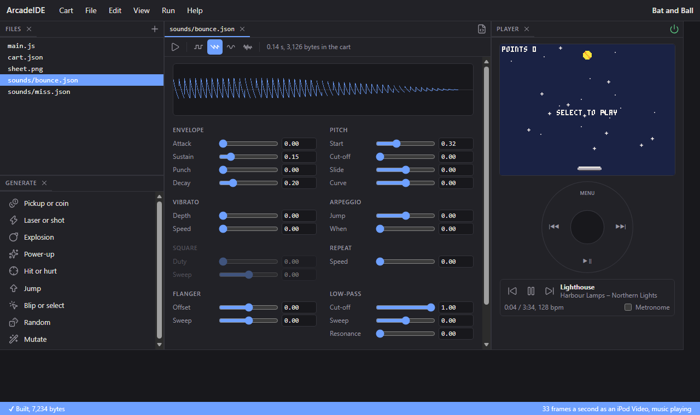

# 4. Sound

A game feels alive when it answers back: a blip when the ball meets the
bat, a thud when it is lost. In this chapter you make two sound effects in
the IDE's sound editor and play them from the game, make the blip climb in
pitch as a rally goes on, and tick the iPod's own clicker when the ball
hits a wall.

Start from the cart you finished in chapter 3.

## How sound works in the Arcade

The owner's music keeps playing while a cart runs -- that is the point of
a game on a music player -- so the Arcade has no music of its own.
Instead a cart has **sound effects**: short sounds made in the IDE, each a
file in the cart's `sounds/` folder, played over the music.

Effects are made the way sfxr made them, a sound maker many small games
use: instead of recording a sound, you set a wave, how its loudness rises
and falls, how its pitch slides, and a few effects on top. Buttons make a
starting point for common kinds -- a coin, a laser, an explosion -- which
you then adjust by ear.

## Make a bounce sound

Choose **File > New file**, pick **A sound** under What, name it
`bounce`, and press **Make it**. `sounds/bounce.json` opens in the sound
editor:



- The **Generate** panel (bottom left) makes a new sound of a kind each
  time you press one. Press **Blip or select** a few times until one
  sounds like a ball on a bat -- each press is a little different.
- The **play** button at the top left plays it, as does the Space bar.
  The line beside the waves says how long it is and how many bytes it
  adds to the cart.
- The four wave buttons choose its tone: square, saw, sine, and noise.
- The sliders shape it: **Envelope** is how its loudness rises and falls,
  **Pitch** where it starts and how it slides. Move one and let go to hear
  it; double-click a slider to put it back.

Then make a second sound the same way, named `miss`, from **Hit or
hurt**: something short and falling, for a lost ball.

In code, each sound is `SFX.` and its name: `SFX.bounce` and `SFX.miss`.

## Play it on a hit

`sfx(n)` plays sound `n`. Add it to the hit in `update()`, after
`points++`:

```js
        points++;
        sfx(SFX.bounce);
    }
```

Run it and keep the ball up: each hit plays the blip. Sounds play through
your computer's speakers in the IDE, and through the headphones or dock
on the iPod, mixed over the music.

## A sound for a miss

And the other sound when a life is lost, in the miss:

```js
        lives--;
        sfx(SFX.miss);
```

## Four sounds at once

Two sounds can overlap: the end of one blip and the start of the next, or
a blip and a miss. The Arcade plays up to **four** at once, each on its
own **channel**, numbered 0 to 3. `sfx(n)` puts a sound on a channel that
is free, or -- when all four are busy -- on the one closest to finishing,
cutting it short.

To choose the channel yourself, give it: `sfx(SFX.miss, 3)` always plays
on channel 3, stopping whatever was playing there. `sfx(-1, 3)` stops
channel 3. Giving a sound that matters a channel of its own means a burst
of other sounds can never cut it off.

## A rising rally

A blip that climbs in pitch as the points mount up makes a long rally
feel like it is going somewhere. `sfxp(n, semitones)` plays a sound
transposed: 12 semitones is an octave up, -12 an octave down. Change the
hit's sound to:

```js
        sfxp(SFX.bounce, min(points, 12));
```

Each point takes the blip a semitone higher, up a whole octave at 12
points, and there it stays. A sound played higher is also shorter --
an octave up, it lasts half as long -- as with a record played fast.

## The clicker

The iPod has a small speaker of its own inside -- the one that ticks as
you turn the wheel, and that plays even with no headphones in. `click()`
ticks it, and `click(true)` gives its short beep instead. It is a nice
touch for small things, like the ball glancing off a wall, which do not
need a sound of their own. Make the two wall bounces in `update()` tick
it:

```js
    if (x < 3 || x > 156) {
        dx = -dx;
        click();
    }
    if (y < 3) {
        dy = -dy;
        click();
    }
```

The IDE plays the click through the computer's speakers; on the iPod it
comes from the little speaker that makes the wheel's click, even with
headphones in.

## The whole cart

```js
var x, y, dx, dy;
var bat = 70;
var points = 0;
var lives = 0;
var over = true;
var starx = new Int32Array(24), stary = new Int32Array(24);

function init() {
    for (var i = 0; i < 24; i++) {
        starx[i] = rnd(160);
        stary[i] = rnd(100);
    }
    serve();
}

// a new game
function start() {
    points = 0;
    lives = 3;
    over = false;
    serve();
}

// the ball, from the top, heading down
function serve() {
    x = 80;
    y = 10;
    dx = 1.5;
    dy = 1.25;
}

function update() {
    if (over) {
        if (btnp(4)) start();
        return;
    }

    bat = mid(0, bat + wheel(), 136);

    x += dx;
    y += dy;
    if (x < 3 || x > 156) {
        dx = -dx;
        click();
    }
    if (y < 3) {
        dy = -dy;
        click();
    }

    // the bat sends the ball back up, a little faster, and scores a point
    if (dy > 0 && y >= 109 && y <= 113 && x >= bat - 2 && x <= bat + 25) {
        dy = -min(3.0, dy * 1.05);
        dx = (x - (bat + 12)) / 5.0;
        points++;
        sfxp(SFX.bounce, min(points, 12));
    }

    // missed: a life lost; with none left, the game is over
    if (y > 123) {
        lives--;
        sfx(SFX.miss);
        if (lives == 0) over = true;
        else serve();
    }
}

function draw() {
    cls(1);
    for (var i = 0; i < 24; i++) spr(32 + (flr(t() * 2) + i) % 2, starx[i] - 4, stary[i] - 4);
    spr(1 + flr(t() * 12) % 4, x - 4, y - 4);
    spr(16, bat, 112);
    spr(17, bat + 8, 112);
    spr(16, bat + 16, 112, 1, 1, true);
    print("POINTS " + points, 2, 2, 7);
    for (var i = 0; i < lives; i++) circfill(154 - i * 8, 4, 2, 8);
    if (over) {
        if (points > 0) centre("GAME OVER", 50, 8);
        centre("SELECT TO PLAY", 60, 7);
    }
}

// text centred across the screen
function centre(s, top, c) {
    print(s, 80 - textw(s) / 2, top, c);
}
```

The cart also holds `sounds/bounce.json` and `sounds/miss.json`, which
the sound editor wrote.

## What you learned

- The owner's music plays while a cart runs; a cart has sound effects, not
  music.
- A sound effect is made in the sound editor -- a Generate button for a
  starting point, then the sliders -- and saved in `sounds/`. In code it is
  `SFX.<name>`.
- `sfx(n)` plays a sound; four can play at once, on channels 0 to 3.
  `sfx(n, channel)` chooses the channel, and `sfx(-1, channel)` stops it.
- `sfxp(n, semitones)` plays a sound higher or lower: 12 semitones is an
  octave.
- `click()` ticks the iPod's own little speaker.

**Next**, in chapter 5: a high-score table the iPod keeps, and settings
in the pause menu.

Every sound function, and plain notes with `tone`, are in the reference's
**Sound**.
