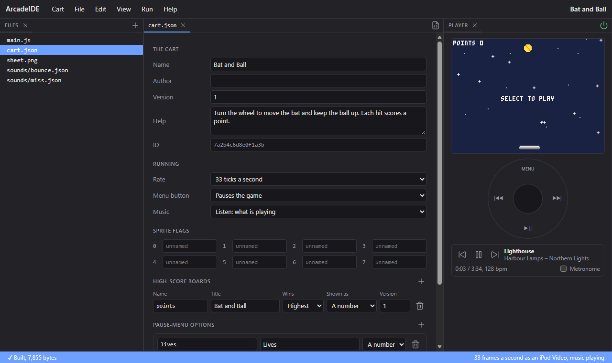
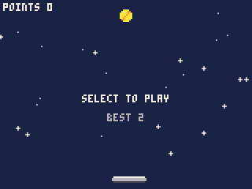
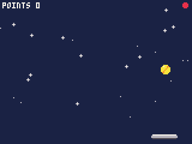

# 5. High scores and the pause menu

A game you come back to needs a score to beat. In this chapter the game
gets a high-score table that the iPod keeps between plays, a setting for
how many lives a game starts with, and an item of its own in the pause
menu.

These are things the iPod looks after for the cart: it stores the scores
and the settings, and draws the tables and the menu in the iPod's own
style. The cart only says what it has and when a score is made.

Start from the cart you finished in chapter 4.

## The pause menu

Hold **Menu** for a second on the iPod while a cart runs, and the game
stops and the pause menu comes up (a short press asks whether to quit).
It always has:

- **Resume**, back to the game;
- **Game Sound**, to mute the game's own sounds;
- **Now Playing**, to see and change the music;
- **Restart**, to start the cart again from the beginning;
- **Quit**, back to the iPod's menus.

and it adds rows of the cart's own when it has them: its items, its
settings, **High Scores** when it has a table, and **Help** when it has
help text. This chapter gives it all of those.

In the IDE, Menu (Esc) just pauses. What the pause menu holds is in the
IDE's **Game** menu instead, while the cart runs: your items, **Options...**
for the settings, **High scores...**, **Help...** and **Restart**. Scores
and settings are kept in the browser between runs, as the iPod keeps them,
and a table shown with `score.show` opens in a dialog. The end of the
chapter says how to see it all on the iPod.

## Settings for the cart: cart.json

The table, the setting and the help all go in `cart.json`, the cart's
settings file. Open it, and the IDE shows it as a form -- or choose **Cart
> Settings**:



First give the cart some **Help**: one or two sentences saying how to
play. The pause menu's Help shows them.

## A high-score table

Under **High-score boards**, press **+** to add one. Fill in:

- **Name** `points` -- what the code calls it, `BOARD.points`.
- **Title** `Bat and Ball` -- what the table is called on the iPod.
- **Wins**: Highest, since more points is better. (A racing game's lap
  times would be Lowest.)
- **Shown as**: A number.

A board keeps its ten best scores, each with the date it was made.

## Put the score on the board

The score goes on the board when the game ends. That is now a few things
to do, so give it a function, beside `serve()`:

```js
// the game is over: the score goes on the board, which shows if it placed
function finish() {
    over = true;
    if (score.submit(BOARD.points, points) > 0) score.show(BOARD.points);
}
```

- `score.submit(board, value)` puts a score on a board. It gives back the
  score's place, 1 to 10, or 0 when it was not good enough to make the
  ten.
- `score.show(board)` shows the board's table, the new score marked, over
  the game; the game carries on when the player closes it. Showing it only
  when the score placed means a poor game ends quietly.

Then, in `update()`, the last life calls `finish()` instead of setting
`over` itself:

```js
        if (lives == 0) finish();
        else serve();
```

Play a game to the end, and the table comes up with your score marked.

## The best score on the start screen

The best score so far is worth showing while the game waits to start.
`score.best(board)` gives the top score, or `null` while the board is
empty. In `draw()`, under "SELECT TO PLAY":

```js
        centre("SELECT TO PLAY", 60, 7);
        var best = score.best(BOARD.points);
        if (best != null) centre("BEST " + best, 72, 6);
```

`null` is how the Arcade says "nothing": testing `best != null` keeps "BEST
null" off the screen before the first game.



## A setting: how many lives

Some players want an easier game, some a harder one. A **setting** --
the form calls them pause-menu options -- lets the owner choose, in the
pause menu, and the iPod remembers their choice.

Under **Pause-menu options**, press **+** and fill in:

- **Name** `lives` -- in code, `OPT.lives`.
- **Title** `Lives` -- the row in the pause menu.
- **Type**: A number, from **1** to **5**, starting at **3**.
- **Help**: `How many balls each game starts with.` -- shown in the pause
  menu's Help, under the cart's own.

The other types are **A choice**, from a list of words such as Easy,
Normal, Hard, and **On or off**.

`opt.get(option)` gives the setting's value now: for this one, the
number. A new game takes its lives from it. In `start()`, change the
lives line to:

```js
    lives = opt.get(OPT.lives);
```

The owner can change it at any time from the pause menu; the next game
starts with the new number. (A cart that must react the moment a setting
changes -- redrawing something that depends on it -- can ask
`opt.changed()`, which is true for the one tick after a change.)



## An item of your own

The pause menu can also hold up to five items of the cart's own, each
running a function of the cart's when chosen. A **New game** item lets the
player give up on a bad start without going back to the start screen.

`menuitem(i, label, fn)` sets item `i` (1 to 5) to show `label` and run
`fn` when chosen. Set it up once, in `init()`:

```js
function init() {
    for (var i = 0; i < 24; i++) {
        starx[i] = rnd(160);
        stary[i] = rnd(100);
    }
    serve();
    menuitem(1, "New game", start);
}
```

`start` here has no brackets: it is the function itself, handed over to
be run later, not run now. When the player chooses New game, the menu
closes, `start()` runs, and play carries on from a fresh game.

## Seeing it on the iPod

Save the cart (**Cart > Save as .pbg**), copy it to the iPod, and start
it from the Arcade on the main menu. Play a game to the end: the table
comes up. Then hold Menu for a second:

- **Lives** is a row with the number beside it; select it to change it.
- **High Scores** shows the table any time.
- **Help** shows the cart's help, then the Lives setting's.
- **New game** is at the top, under Resume.

Scores and settings are kept by the iPod for this cart -- found by the ID
in `cart.json`, which is why that must never change -- so they are still
there the next time it is played, and when a newer version of the cart is
copied over.

## The whole cart

`main.js`:

```js
var x, y, dx, dy;
var bat = 70;
var points = 0;
var lives = 0;
var over = true;
var starx = new Int32Array(24), stary = new Int32Array(24);

function init() {
    for (var i = 0; i < 24; i++) {
        starx[i] = rnd(160);
        stary[i] = rnd(100);
    }
    serve();
    menuitem(1, "New game", start);
}

// a new game
function start() {
    points = 0;
    lives = opt.get(OPT.lives);
    over = false;
    serve();
}

// the game is over: the score goes on the board, which shows if it placed
function finish() {
    over = true;
    if (score.submit(BOARD.points, points) > 0) score.show(BOARD.points);
}

// the ball, from the top, heading down
function serve() {
    x = 80;
    y = 10;
    dx = 1.5;
    dy = 1.25;
}

function update() {
    if (over) {
        if (btnp(4)) start();
        return;
    }

    bat = mid(0, bat + wheel(), 136);

    x += dx;
    y += dy;
    if (x < 3 || x > 156) {
        dx = -dx;
        click();
    }
    if (y < 3) {
        dy = -dy;
        click();
    }

    // the bat sends the ball back up, a little faster, and scores a point
    if (dy > 0 && y >= 109 && y <= 113 && x >= bat - 2 && x <= bat + 25) {
        dy = -min(3.0, dy * 1.05);
        dx = (x - (bat + 12)) / 5.0;
        points++;
        sfxp(SFX.bounce, min(points, 12));
    }

    // missed: a life lost; with none left, the game is over
    if (y > 123) {
        lives--;
        sfx(SFX.miss);
        if (lives == 0) finish();
        else serve();
    }
}

function draw() {
    cls(1);
    for (var i = 0; i < 24; i++) spr(32 + (flr(t() * 2) + i) % 2, starx[i] - 4, stary[i] - 4);
    spr(1 + flr(t() * 12) % 4, x - 4, y - 4);
    spr(16, bat, 112);
    spr(17, bat + 8, 112);
    spr(16, bat + 16, 112, 1, 1, true);
    print("POINTS " + points, 2, 2, 7);
    for (var i = 0; i < lives; i++) circfill(154 - i * 8, 4, 2, 8);
    if (over) {
        if (points > 0) centre("GAME OVER", 50, 8);
        centre("SELECT TO PLAY", 60, 7);
        var best = score.best(BOARD.points);
        if (best != null) centre("BEST " + best, 72, 6);
    }
}

// text centred across the screen
function centre(s, top, c) {
    print(s, 80 - textw(s) / 2, top, c);
}
```

`cart.json`, as the form writes it (your `id` is your own; empty fields,
such as a blank author, are left out):

```json
{
  "id": "7a2b4c6d8e0f1a3b",
  "name": "Bat and Ball",
  "version": "1",
  "help": "Turn the wheel to move the bat and keep the ball up. Each hit scores a point.",
  "rate": 33,
  "boards": [
    {
      "name": "points",
      "title": "Bat and Ball"
    }
  ],
  "options": [
    {
      "name": "lives",
      "title": "Lives",
      "type": "number",
      "min": 1,
      "max": 5,
      "default": 3,
      "help": "How many balls each game starts with."
    }
  ]
}
```

## What you learned

- The pause menu is the iPod's own: Resume, Now Playing, Restart and Quit,
  plus the cart's items, settings, High Scores and Help.
- High-score boards, settings and help are declared in `cart.json`, most
  easily through **Cart > Settings**.
- `score.submit(board, value)` records a score and gives its place;
  `score.show(board)` shows the table; `score.best(board)` is the top
  score, or `null`.
- `opt.get(option)` reads a setting the owner chooses in the pause menu.
- `menuitem(i, label, fn)` adds an item of your own; `fn` without brackets
  is the function itself.
- `null` means "nothing"; test for it with `!= null`.

**Next**, in chapter 6: putting the game on the iPod for good, and making
sure it keeps up there.

Boards, settings and achievements are in full in the reference's
**Scores, options and the pause menu**.
