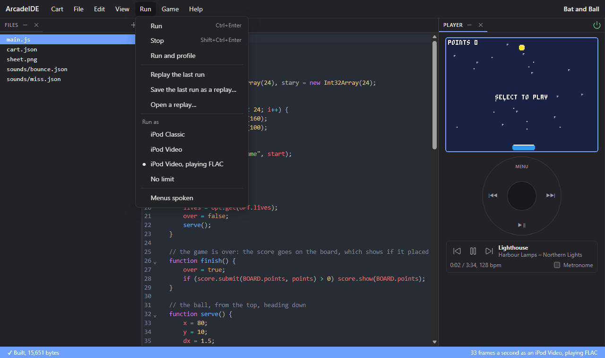
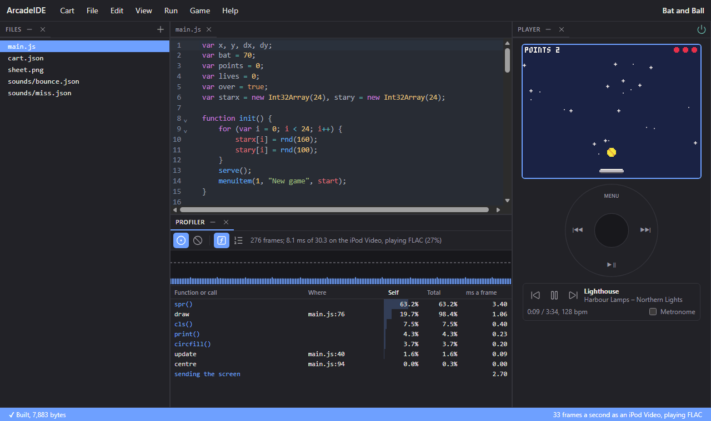

# 6. On the iPod, and keeping up there

The game is finished. This last chapter puts it on the iPod for good, and
answers the question every Arcade game has to: does it keep up there?
The iPod is a music player first, and a game runs on what the music
leaves over. The IDE can show you exactly how much your game needs, and
where it goes.

The cart itself does not change in this chapter.

## Save the cart

Choose **Cart > Save as .pbg**, and choose where to save it. The IDE
names it after the cart: `bat_and_ball.pbg`.

A `.pbg` is the whole cart in one file: the code, the sprite sheet, the
sounds, `cart.json` -- and the code's source, as you wrote it. **Cart >
Open** on any `.pbg` gives back every one of its files, so the same file
you play is the one you keep, share, and come back to edit. After the
first save, **Save** (Ctrl+S) writes back to the same file.

## Copy it to the iPod

Connect the iPod to your computer by USB; it shows up as a drive. Make a
folder on it called `Games`, copy `bat_and_ball.pbg` into it, and eject
the iPod.

On the iPod, choose **Arcade** on the main menu: the game is there, by
its name. Select it and it starts (it is also in **Files**, under
`Games`). Holding **Menu** for a second brings up the pause menu -- with
your high scores, your Lives setting and your New game item -- and
**Quit** leaves the game.

To update it, save it again from the IDE and copy it over the old one.
The high scores and settings stay: the iPod keeps them by the cart's ID,
not its file.

## Will it keep up?

The game runs at 33 ticks a second, so each tick -- an `update()` and a
`draw()` -- has about 30 milliseconds. In that time the iPod also has to
send the finished frame to its screen, and, if music is playing, decode
the music, which always comes first. A game that needs more than what is
left drops frames: `update()` still runs every tick, so the game keeps its
speed, but frames go undrawn, and the movement stutters.

How much is left depends on the iPod:

- The **iPod Classic** is fast: about three to four times the Video's
  speed.
- The **iPod Video** is slower, and **playing music** takes some of
  that: FLAC, the heaviest, about two-thirds.

So an iPod Video playing music is the slowest case, and the one every
game must keep up on. The IDE runs your game as that by default: the
**Run** menu's **Run as** says which iPod it pretends to be.

As each iPod, each tick takes as long as it would on that iPod. The line
at the bottom right of the IDE says how it is doing: "33 frames a second
as an iPod Video, playing FLAC" means it keeps up. FLAC is the heaviest
music to play alongside a game, so a game that keeps up there keeps up
everywhere. A lower number than 33 means frames are being dropped -- it
would stutter on the iPod.

## Where the time goes

Choose **Run > Run and profile**. The game runs, with the **Profiler**
panel open under the code. Press Select and play for a few seconds:

- **The line at the top** sums it up: each frame takes 8.1 ms of the 30.3
  it has on an iPod Video playing FLAC -- 27%. Plenty to spare.
- **The graph** has a bar for each frame, how long it took, against the
  dashed line of the time a frame has. A bar over the line is drawn red: a
  frame that would be dropped.
- **The table** lists what took the time: each function of yours and each
  Arcade call. **Self** is the time spent in it alone, **Total** with
  everything it called, and the last column what that comes to each frame,
  on the iPod you run as.

For this game:

- **`spr()`** takes most of the time: about 3.4 ms a frame, for 24
  stars, the ball and three pieces of bat. Clearing the whole screen with
  **`cls()`** is only 0.4 ms.
- **`draw`** itself, the code around those calls, is about 1.1 ms.
- **Sending the screen** takes 2.7 ms. The iPod compares each row drawn
  with the last frame and sends only those that changed: here, the rows
  with the ball, the bat and the twinkling stars. A whole new screen
  would take 6.6 ms.

Click a row to go to that function in the code.

The profiler finds where the time goes by looking, every so often, at
what the game is doing. Something very quick -- like `update()` here --
is caught only now and then, so its share is right over many frames but
not over a few; play for a few seconds before reading the numbers.

## Units: the measure behind it

The Arcade counts a game's work in **units**, about one for each step of
your code, with each Arcade call costing what its work is worth. A tick of
this game costs about **2,800 units**. Each iPod turns units into time
at its own speed: on an iPod Video playing FLAC a unit is about 1.9
millionths of a second, so 2,800 units are about 5.4 ms, and with the
2.7 ms of the screen, 8.1 ms.

The rule of thumb: on an iPod Video playing FLAC, a game at 33 ticks a
second that redraws the whole screen has room for about **12,500 units**
a tick. This one uses under a quarter of that, so there is room for much more --
more stars, more balls, a wall of bricks.

When a game does run out, the profiler says where to look. Common causes,
in the order to look for them:

- **Loops over many things in your own code** -- hundreds of objects
  moved or tested each tick. The Arcade has fast built-in systems for
  exactly this; see the reference's **Moving many things**.
- **Pixels drawn one at a time** with `pset`, hundreds a frame.
- **Text built each frame** that never changes.
- **A slower rate**: `setrate(25)` gives every tick 40 ms instead of 30.
  Scale speeds by `33.0 / rate()` so the game plays the same.

The reference's **Making it fast** goes through each.

## Replays

Every time you run the game in the IDE, it is recorded: every press of a
button, every turn of the wheel, and where its random numbers started
from, so the run can be played again exactly. **Run > Replay the last
run** does that, frame for frame, and then hands the game back to you
where the recording ends.

Replays are for two things:

- **Bugs.** Something odd happened while you played -- the ball went
  through the bat, say. Replay the run, and it happens again, every time,
  while you look at the code.
- **Comparing.** Change the code, then replay the same run with the
  profiler recording, and see what the change costs on exactly the same
  play. If the change alters what happens -- the screen stops matching the
  recording -- the IDE says from which frame.

**Run > Save the last run as a replay** keeps it as a file, and **Open a
replay** plays one again later, on the same cart.

## Share it on the web

**Cart > Export as web page** saves the game as one HTML file, about
300 KB, that anyone can play in a browser: put it on a website, or send
it and open it from disk. It runs the game as an iPod Classic would, and
keeps its high scores and settings in that browser.

The export asks two things. **Wheel**: whether to draw the click wheel
under the screen -- on touch screens only, always, or never, for keys
alone. **Size**: whether the screen fills the window, fills it in whole
pixels so every pixel is the same size, or stays at a fixed 1 to 4 times
the iPod's 160 by 120.

On the page, click the screen or press Enter to start. The keys are the
IDE's: Left and Right are Prev and Next, Up and Down turn the wheel,
Enter is Select, Space is Play, and Esc is Menu, which opens the pause
menu.

A game that uses your music -- `playback`, `beat` or `tracks` -- cannot
be exported: a web page has no music library to play from.

## What you learned

- **Cart > Save as .pbg** saves the whole cart, its source included, as
  one file. Copy it to the iPod and open it from **Files**.
- Each tick has about 30 ms at 33 a second, shared with sending the screen
  and the music. An iPod Video playing FLAC is the slowest case, and the
  IDE runs as it by default.
- **Run > Run and profile** shows what each frame costs and where it goes.
- A game's work is counted in units: about 12,500 a tick on an iPod Video
  playing FLAC for a game that redraws the whole screen.
- Every run is recorded; **Replay the last run** plays it again exactly.
- **Cart > Export as web page** makes a page anyone can play the game in.

That is the whole game, made and on the iPod. The reference has every
part of the Arcade in full: start with **Sprites**, **Maps and objects**
and **Input and the wheel** for a bigger game, or **Moving many things**
when it has a lot going on.
